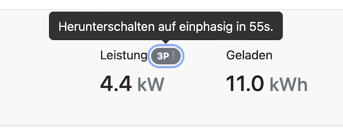
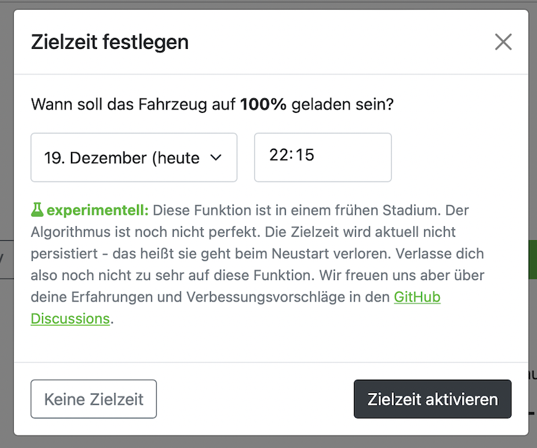

Dnes přichází malá aktualizace hlavně s několika opravami chyb a dalšími vylepšeními.

## Časovače v rozhraní

Rozhraní vám nyní zobrazuje časovače běžící na pozadí:

<!-- excerpt -->

- V režimu **Solár**:
  - Kdy se nabíjení přeruší
  - Kdy se nabíjení znovu spustí
- Přepínání fází (1P/3P):
  - Kdy se přepne z jedné na tři fáze
  - Kdy se přepne ze tří fází na jednu

Zobrazuje se také, s kolika fázemi se nabíjí.

## Cílové nabíjení

Funkce cílového nabíjení je zpět. Můžete s ní nabít elektromobil k určitému datu a času na požadovaný stav nabití.

## Stažení a instalace

- [Debian, Ubuntu, Raspberry Pi](/cs/installation/linux)
- [macOS Homebrew](/cs/installation/macos)
- [Docker](/cs/installation/docker)
- [Windows](/cs/installation/windows)

## Přehled změn

- [Podrobný seznam změn](https://github.com/evcc-io/evcc/releases/tag/0.74)
