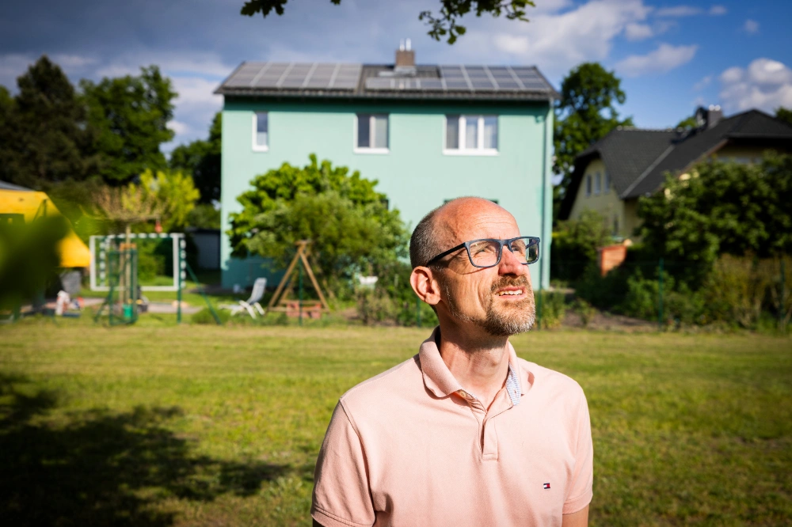
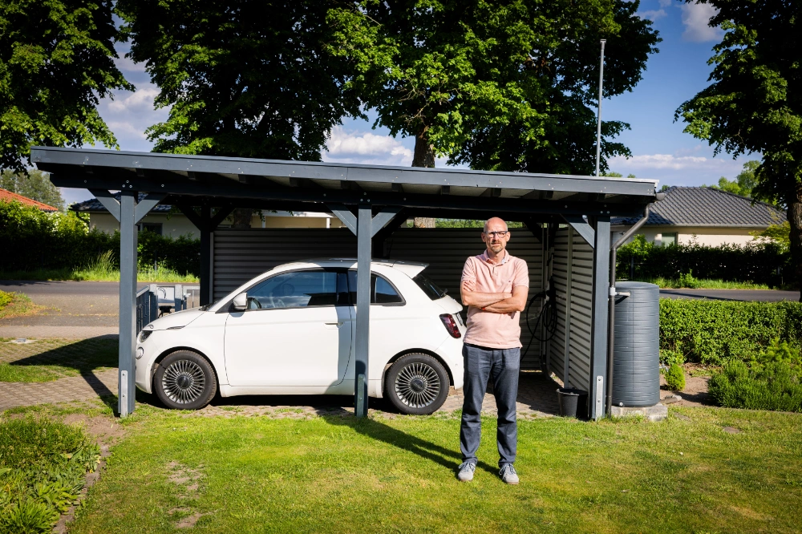
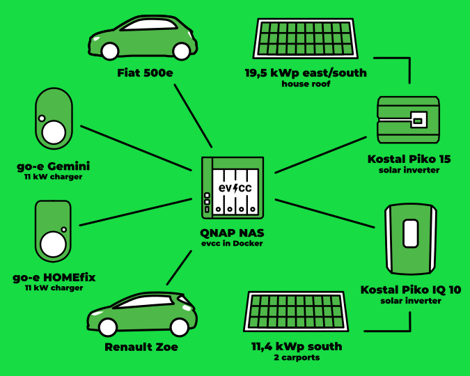
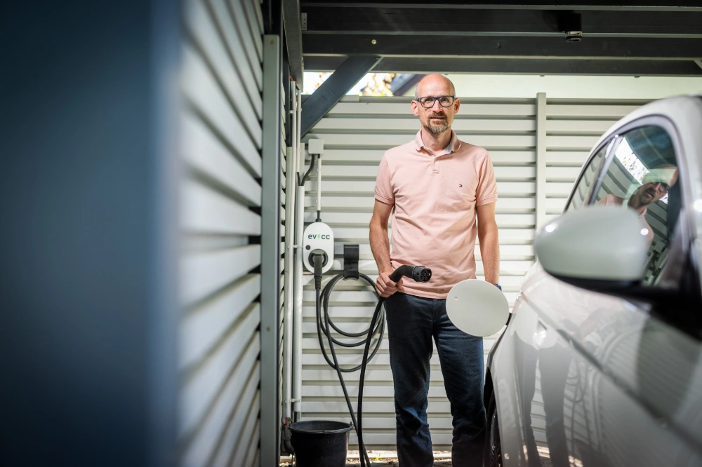
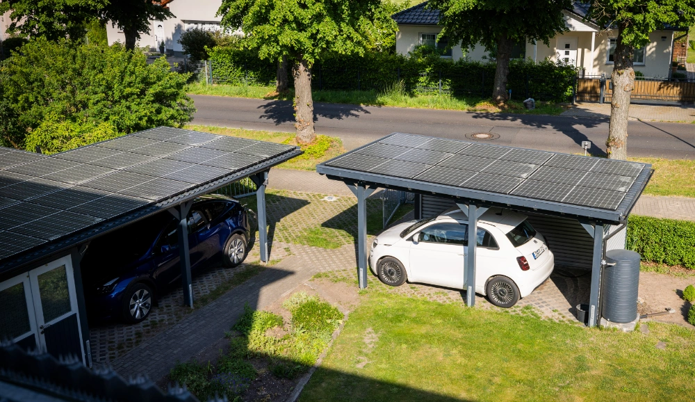

Toto je druhý příspěvek naší série komunitních portrétů.
Fotograf [Detlef](https://hee.se) tentokrát navštívil Christiana v Trebbinu a pořídil skvělé fotografie.

{/* excerpt */}

## Trebbin: jeden dům, tři generace

**Michael:** Zdravím, Christiane, děkuji, že jste si udělal čas.
Můžete nám říct něco o sobě, své rodině a o tom, jak bydlíte?

**Christian:** Zdravím, Michaele, jsem Christian.
Bydlím s manželkou, našimi dvěma dětmi a tchyní v Trebbinu v domě, který byl původně postaven v roce 1980.
V roce 2009 jsme ho rozšířili a energeticky zrekonstruovali, abychom získali více prostoru a snížili spotřebu energie.
Žijeme tu jako třígenerační rodina a v poslední době jsme hodně udělali pro elektromobilitu a vlastní výrobu energie.

**Michael:** Můžete nám povědět víc o své cestě k elektromobilitě?

**Christian:** Naše cesta k elektromobilitě začala v roce 2019, kdy jsem kvůli změně zaměstnavatele musel začít dojíždět do práce autem.
Tehdy jsme se rozhodli pro ojetý Smart ED.
Protože všichni chtěli vždycky jezdit Smartem, nahradili jsme naše auto se spalovacím motorem Renaultem Zoe, který nám dodali v listopadu 2020.
Od té doby jezdíme čistě elektricky.

**Michael:** Zajímavé, tenhle efekt už jsem slyšel: elektrické druhé auto se stane oblíbencem celé rodiny a auto se spalovacím motorem zůstane stát.
A jak to vypadá dnes?
Jezdíte ještě Smartem?

**Christian:** Ne, Smart si našel nového majitele.
Na začátku letošního roku jsme ho prodali a nahradili ho Fiatem 500e Icon.
Teď tedy jezdíme Fiatem a Renaultem Zoe.
Obě auta nabíjíme elektřinou z našich vlastních fotovoltaických elektráren.

## Na cestách s malými elektromobily

**Michael:** Jak elektromobily používáte v každodenním životě?
Jakou roli hraje vaše nabíjecí infrastruktura?

**Christian:** Naši každodenní mobilitu máme dobře zorganizovanou.
Manželka dojíždí do práce do Berlína vlakem, zatímco já na své cesty používám jedno z aut.
Kvůli koníčkům dětí najezdíme mnohem víc, takže jsme s auty na cestách dost často, ale většinou na solární energii.
Díky dvěma nabíječkám go-e instalovaným u přístřešků pro auta můžeme nabíjet kdykoli a máme jistotu, že jsou auta připravená k jízdě.
Po jízdě auta prostě připojíme, a když je potřebujeme, jsou zase nabitá.
Nabíječky jsou napájené z fotovoltaických elektráren, takže elektřinu ze střechy můžeme využívat přímo.
První fotovoltaická elektrárna na střeše domu má 19,47 kWp a druhá na přístřešcích pro auta má 11,4 kWp.
Elektrárny jsou dimenzované tak, abychom si elektřinu pro auta i domácnost dokázali z velké části vyrobit sami.

**Michael:** Jak do této sestavy zapadl evcc?

**Christian:** S první fotovoltaickou elektrárnou přišlo přání nabíjet automatizovaně jen solární elektřinou.
evcc byl jediný projekt, který nabízel možnost běžet v kontejneru Docker.
Nemusel jsem tedy kupovat nový hardware, protože v domácnosti už běžel NAS pro zálohování a ukládání dat.
Pro nás bylo obzvlášť důležité mít přehled o spotřebě energie a stavu nabití aut.
V provozu se jako výhoda ukázal velmi vysoký WAF (Woman Acceptance Factor) v rodině.
Manželka tak evcc používá velmi intenzivně a i tchyně se ráda podívá, jestli je k dispozici dost energie.
Díky evcc se nám daří pokrýt v ročním průměru asi 85 % elektřiny potřebné pro auta z vlastní fotovoltaické elektrárny.
Tím se naše energetická soběstačnost zvýšila na 73 %, a to celé bez domácí baterie.

## Vysoká soběstačnost bez domácí baterie

**Michael:** 73 % energetické soběstačnosti bez domácí baterie je opravdu působivé.
O takové hodnotě mnozí sní.
Jak se vám to podařilo?

**Christian:** Pomohla nám velkoryse dimenzovaná fotovoltaická elektrárna v kombinaci s orientací na východ a západ.
Výroba se tak rozkládá na celý den.
To je pro nás obzvlášť užitečné, protože auta můžeme nabíjet přes den.
Řízení nabíjení pak obstará evcc, takže to nemusíme řešit.
Pro nás to bylo správné rozhodnutí a s výsledkem jsme spokojení.

**Michael:** Děkuji za vhled do vaší sestavy.

---

Děkujeme také Detlefovi za skvělé fotografie.
Po [prvním příspěvku na blogu](/cs/blog/2024/08/09/portrait-arne-gifhorn) se nám ozvali už další členové komunity, kteří chtějí sdílet své příběhy.
Čeká nás tedy ještě víc zajímavých pohledů do různých instalací. 🤩
