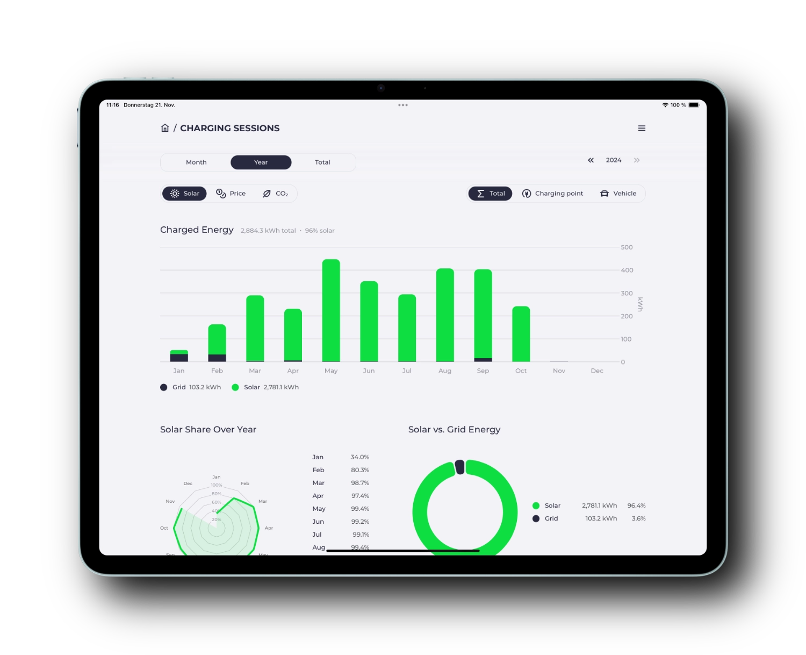
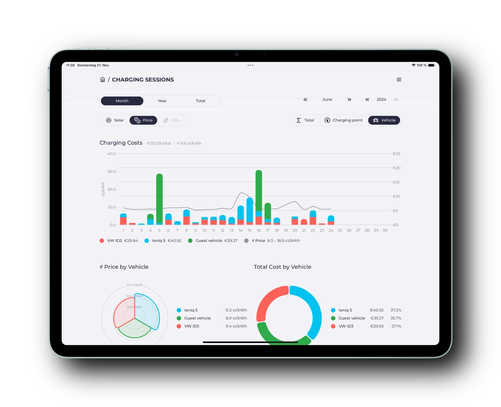
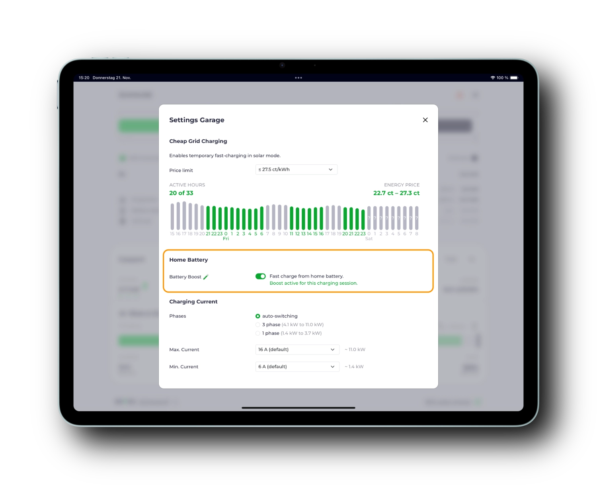

Dny se zkracují.
To je dobrý důvod krátce shrnout, co se od [posledního článku v srpnu](/cs/blog/2024/08/17/highlights-14a-enwg-ocpp-loadmanagement-elli) změnilo.

{/* excerpt */}

## Vizualizace nabíjecích relací

Přehled [nabíjecích relací](/cs/features/sessions) je k dispozici už nějakou dobu.
Kromě základních údajů, jako je spotřeba energie, doba nabíjení, vozidlo a ujeté kilometry, shromažďujeme už delší dobu i informace o podílu solární energie z vlastní výroby, skutečných cenách a emisích CO₂.

Dosud byla tato data k dispozici jen jako tabulka nebo export CSV pro vlastní analýzu.
Nově jsme přidali přehledné vizualizace vaší nabité energie, podílu solární energie, nákladů a emisí CO₂.



Pokud máte více nabíjecích bodů nebo vozidel, můžete data seskupovat a porovnávat.
V [dokumentaci](/cs/features/co2) zjistíte, jak nastavit potřebné [zdroje dat o CO₂](/cs/features/co2) a [dynamické ceny](/cs/features/dynamic-prices).



## Rychlé dobití

První verze často žádaného [rychlého dobití](/cs/features/battery#battery-boost) se dostala do vydání jako experimentální funkce 🧪.
Tato funkce doplňuje klasické nabíjení ze solárního přebytku.
Po aktivaci se k nabíjení vozidla kromě dostupné solární energie využívá i energie uložená v domácí baterii.
Systém automaticky určí maximální nabíjecí výkon, který baterie dokáže poskytnout.



Rychlé dobití lze aktivovat pro každý nabíjecí bod zvlášť a automaticky se vypne, jakmile se vozidlo odpojí.

To se hodí zejména za slunečných dnů.
Pokud chcete odpoledne vyjet autem z domu, můžete rychlé dobití aktivovat před odjezdem, aby se energie z plně nabité domácí baterie přesunula do vozidla.
Vaše vozidlo odjíždí s vyšším stavem nabití a domácí baterie má volné místo pro energii z odpoledního slunce, kterou byste jinak poslali do sítě.

Další nastavení, jako jsou limity nabíjení, a výraznější umístění v uživatelském rozhraní (jako tlačítko Boost) plánujeme pro některé z dalších vydání.

## Flexibilní tarify

Seznam [různých tarifů](/cs/tariffs) neustále roste.
Zejména v příštích letech bude téma dynamických tarifů nabývat na významu.

Digitální poskytovatelé jako Tibber, Awattar, Octopus nebo Ostrom nabízejí API pro aktuální cenu a předpověď cen na další den.
Tyto ceny často už zahrnují poplatky za distribuci a další náklady.

U dynamických tarifů, pro které poskytovatel API nenabízí, můžete cenu elektřiny určit sami na základě denní ceny (day-ahead) na burze s elektřinou.

Dobrým zdrojem dat pro spotovou cenu je rozhraní [Energy Charts](https://api.energy-charts.info) od Fraunhofer ISE.
Lze ho používat bez předchozí registrace.

Zde je příklad konfigurace pro německou cenovou zónu:

```yaml
tariffs:
  grid:
    type: template
    template: energy-charts-api
    bzn: DE-LU
    charges: 0.22 # fixed surcharge per kWh (e.g. 20ct grid fee, 2ct provider fees)
    tax: 0.19 # percentage surcharge (e.g. 19% VAT)
```

Konečná cena pro spotřebitele za kWh se počítá podle vzorce `(price + charges) * (1 + tax)`.
Tento vzorec byl dříve pevně daný v kódu.

U složitějších tarifů, např. s horním cenovým limitem, si teď můžete vzorec upravit sami.
Zde je příklad dynamického tarifu s horním cenovým limitem 50 ct/kWh:

```yaml
tariffs:
  grid:
    type: template
    template: energy-charts-api
    bzn: DE-LU
    charges: 0.22 # fester Aufschlag pro kWh (bspw. 20ct Netzentgelt, 2ct Gebühren)
    tax: 0.19 # prozentualer Aufschlag (bspw. 19% MwSt.)
    formula: math.Min(0.5, (price + charges) * (1 + tax))
```

Kromě spotové ceny (`price`) a hodnot `charges` a `tax` máte k dispozici také celou knihovnu [math](https://pkg.go.dev/math) jazyka Go.

## Hybridní střídače s omezeným AC výkonem

Některé hybridní střídače nabízejí vyšší DC výkon než AC výkon.
To znamená, že zvládnou např. 10 kW solárního výkonu, ale do domácí sítě dodají jen 8 kW AC výkonu.
Zbývající 2 kW se na straně DC ukládají do baterie.
To vždy způsobovalo problémy při regulaci přebytku, protože evcc počítá s plným solárním výkonem.
Globální konfigurační volba `maxGridSupplyWhileBatteryCharging` (ano, nešikovný název) byla pokusem čelit těmto nechtěným vedlejším účinkům.

Tuto volbu jsme nahradili stabilnějším řešením.
Všechny dotčené [šablony střídačů](/cs/meters) (např. Fronius, Growatt, SMA, Sungrow) mají nyní v rozšířeném nastavení volbu `maxAcPower`.
Díky ní můžete pro každý střídač zvlášť definovat maximální AC výkon (např. `maxAcPower: 8000` pro 8 kW).
Regulace přebytku tuto hodnotu nyní odpovídajícím způsobem zohledňuje.

## Sponzor cocharge: zpřístupněte svou soukromou nabíječku veřejnosti

S radostí vítáme brémský startup [cocharge](https://cocharge.de/evcc) jako nového sponzora.

[](https://cocharge.de/evcc)

cocharge umožňuje soukromým uživatelům zpřístupnit svou nabíječku veřejnosti.
Vaše nabíječka se pak objeví v aplikacích velkých poskytovatelů nabíjecích karet, volitelně s nastavitelnou otevírací dobou.
Pro majitele elektroauta funguje nabíjení a účtování na vaší nabíječce stejně jako na kterékoli jiné veřejné nabíjecí stanici.
cocharge se postará o technické detaily, uplatnění kvót THG, roamingové smlouvy i byrokracii.
**Váš dodatečný příjem z cizích nabíjecích relací se vyplácí měsíčně.**

Předpokladem pro používání cocharge je **certifikovaná nabíječka (eichrechtskonform)**, která **podporuje OCPP**.
Nabíjecí bod musí být také **veřejně přístupný**.
Nevznikají žádné jednorázové ani opakované náklady.
cocharge si z každé nabíjecí relace bere pouze provizi 15 %.

Pokud máte [služební auto](https://cocharge.de/dienstwagen-laden) a nabíjecí kartu od zaměstnavatele, může pro vás být toto řešení obzvlášť zajímavé.
Díky automatickému vyúčtování si nejen ušetříte byrokracii,
ale můžete si i přivydělat, pokud nabíjíte z vlastní solární energie nebo s dynamickým tarifem ve výhodných časech.

Chcete používat cocharge a evcc společně?
Většina certifikovaných nabíječek má kromě OCPP i lokální rozhraní, např. Modbus.
Svou nabíječku pak můžete zpřístupnit veřejnosti a souběžně s evcc lokálně optimalizovat nabíjecí výkon.

Pokud vás to zaujalo a chcete být mezi prvními uživateli, podívejte se na [cocharge.de/evcc](https://cocharge.de/evcc).

## Spousta drobných vylepšení

Jako obvykle přibyla i spousta drobných vylepšení, oprav chyb a podpora nových nabíječek, střídačů a dalších zařízení.
Podrobnosti najdete v [poznámkách k vydání](https://github.com/evcc-io/evcc/releases).

💚 Velké díky patří všem, kteří projekt podporují aktivní účastí a finančním sponzorstvím.

**Příjemné nabíjení!**<br/>
Tým evcc<br/>
Michael, Andi a Uli
