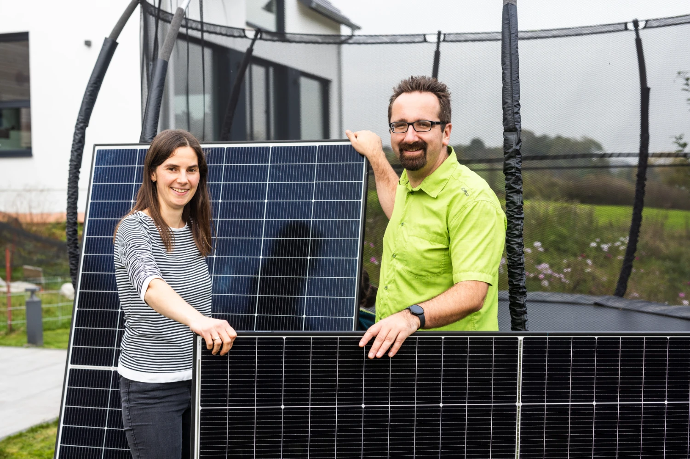
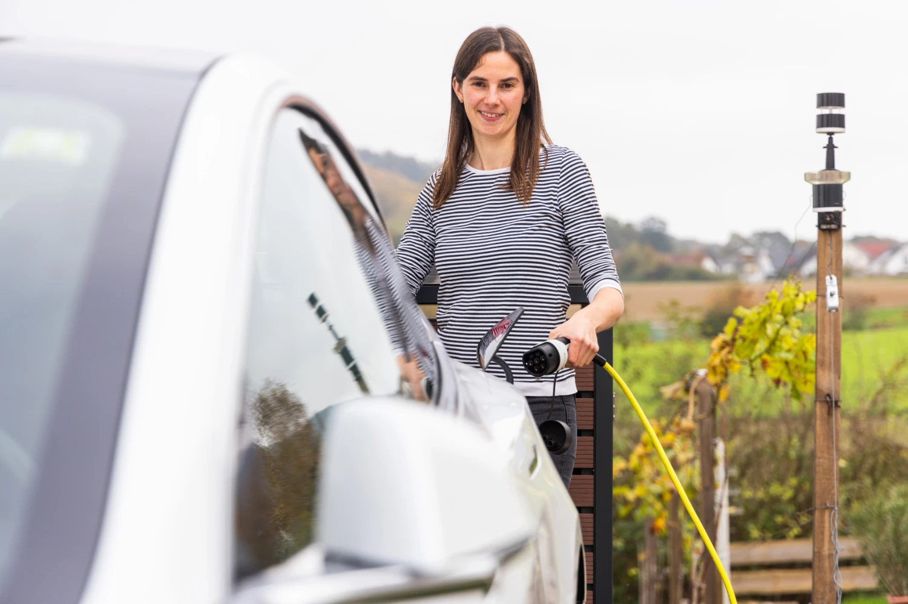
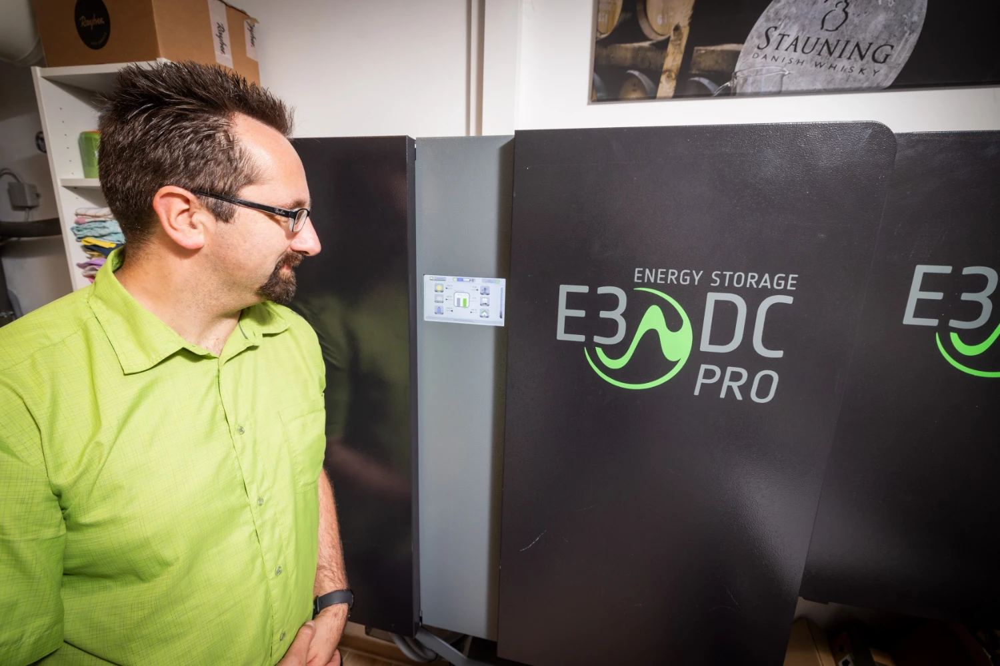
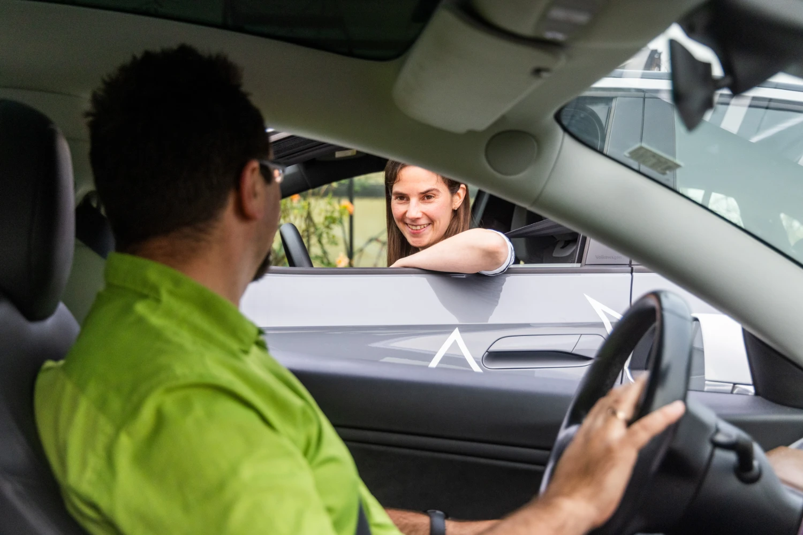
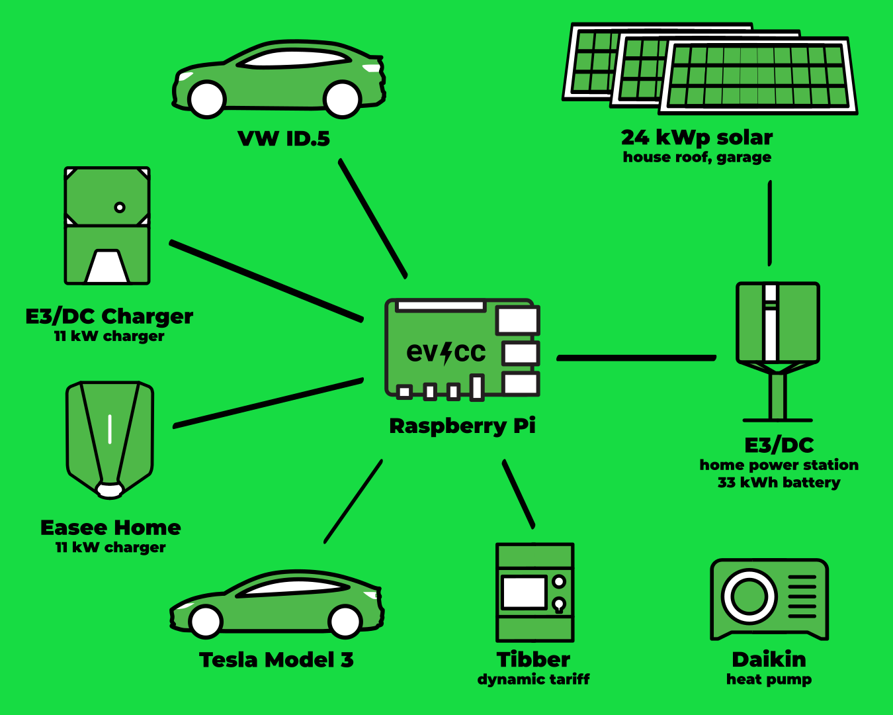
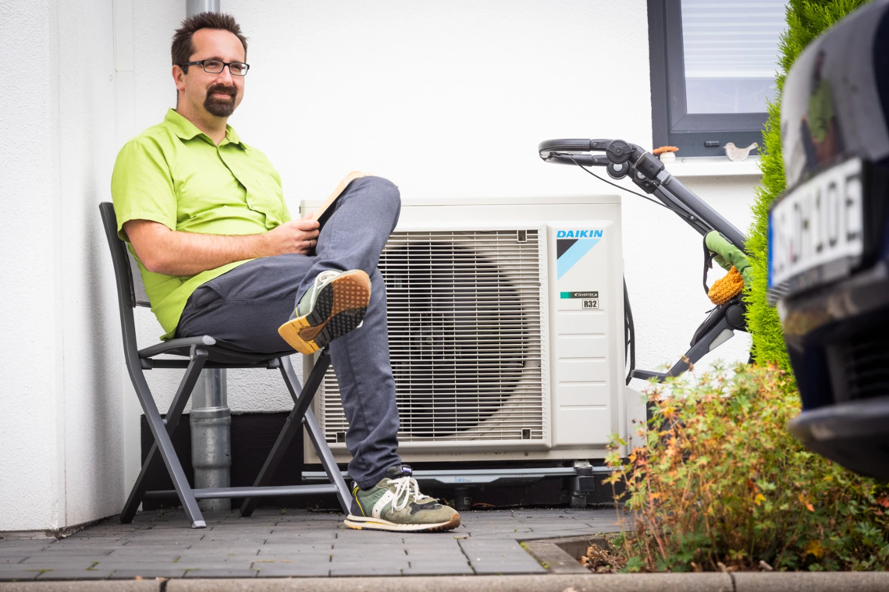
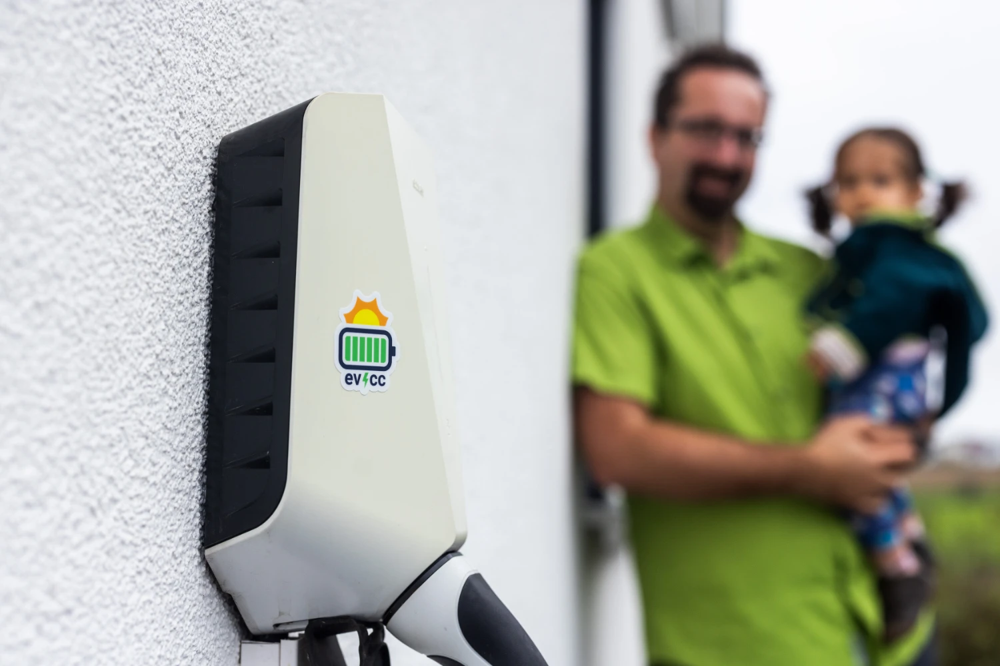

Dny jsou teplejší.
Dobrá chvíle na nový komunitní portrét.
Tentokrát navštívil fotograf [Detlef](https://hee.se) Ulriku a Gunthera v krásném městě Alzenau v německém Bavorsku.

{/* excerpt */}

## Maximální izolace, nebo maximum fotovoltaiky?

**Michael:** Zdravím vás oba, skvělé, že jste ochotni se zapojit do komunitního portrétu.
Pojďme rovnou k věci: Jak začala vaše cesta k elektromobilitě?

**Ulrike:** K elektromobilitě jsme se dostali v roce 2018 s Nissanem Leaf, po něm následoval Model 3.
Tehdy jsme ještě bydleli v nájemním bytě.
Bylo to docela dobrodružné, protože jsme neměli vlastní parkovací místo a nabíjecích bodů bylo málo.
Se solární energií jsme experimentovali na našich výletech s karavanem.
Tam samozřejmě v menším měřítku, např. na nabíjení telefonů.

Když jsme se nastěhovali do nového domu, obě témata se spojila: elektromobilita a fotovoltaika.
Dnes nám to výrazně usnadňuje život.
Je skvělý pocit začínat den s plně nabitým autem.

**Gunther:** Přesně tak, mě baví hlavně ticho a příjemná jízda.
Jak už Ulrike říkala, od začátku nám bylo jasné, že pro auto potřebujeme levnou elektřinu.
Na začátku jsme ještě zvažovali, jestli se zaměřit na maximální izolaci, nebo spíš na maximum solární energie.
Nakonec vyšlo levněji osadit na střechu orientovanou na východ a západ víc fotovoltaických panelů, než dům rozsáhle zateplovat.
Teď máme novostavbu se spoustou solární energie, díky které můžeme vytápět dům a nabíjet auta i za špatného počasí.

Je skvělý pocit být díky vlastní solární energii devět měsíců v roce nezávislý na síti.
Naše náklady na energii pro dva elektromobily, tepelné čerpadlo a dům jsou minimální a díky dodatečným panelům na garáži se dokonce dostávají do záporu.

## Plně elektrická domácnost!

**Michael:** Páni, to zní jako velmi důsledné provedení.
Jak přesně vypadá vaše technika?

**Gunther:** Na střeše domu máme 10,5 kWp orientovaných na západoseverozápad a 8,4 kWp na východojihovýchod.
Na střeše garáže na severní straně máme dalších zhruba 5,1 kWp, položených naplocho s orientací na východ a západ, takže celkem máme 24 kWp.
Protože do práce jezdíme dvěma elektromobily, máme velkou baterii s využitelnou kapacitou 33 kWh (domácí elektrárna E3DC).
Auta tak můžeme večer po práci nabíjet z baterie výkonem až 12 kW, což nám dává flexibilitu za špatného počasí.

**Ulrike:** U spotřebičů v domě i kolem něj jsme důsledně zavedli koncept „all electric“, takže nemáme žádné další spotřebiče s jinými, fosilními zdroji energie.
To znamená vysokou spotřebu elektřiny, ale díky maximálnímu využití všech střešních ploch ji dokážeme dobře pokrýt.
Pomáhá také nebát se dát solární panely i na severní stranu.
Systém doplňuje naše velká baterie.

**Gunther:** Díky mnoha panelům a baterii je systém velmi hospodárný a období špatného počasí bez problémů překleneme.
Od začátku listopadu do poloviny února odebíráme elektřinu ze sítě, jinak jsme soběstační.
V roce 2024 byla naše soběstačnost 75 %.
Letos míříme na 80 %!

Kromě fotovoltaických elektráren a běžných domácích spotřebičů máme nabíječku E3DC, kterou řídí domácí elektrárna, a nabíječku Easee Home na druhém parkovacím místě.
Ta přibyla později pro druhý elektromobil a je to jednoduchá, neřízená nabíječka.
Tady přichází na řadu evcc: dodává nabíječce Easee potřebnou inteligenci, aby druhý elektromobil optimálně nabíjela z přebytku a s ohledem na dynamický tarif Tibber.

| Komponenta                   | Podrobnosti                                                     |
| ---------------------------- | --------------------------------------------------------------- |
| **Fotovoltaická elektrárna** | 24 kWp (10,5 kWp ZSZ, 8,4 kWp VJV, 5,1 kWp V/Z na garáži)       |
| **Baterie**                  | 33 kWh (domácí elektrárna E3DC)                                 |
| **Vozidla**                  | Tesla Model 3, VW ID.5                                          |
| **Nabíječky**                | nabíječka E3DC (garáž), Easee Home (parkovací místo, přes evcc) |
| **Tepelné čerpadlo**         | Daikin                                                          |
| **Dynamický tarif**          | Tibber                                                          |

## V zimě uvědoměleji, v létě v klidu

**Michael:** Jak tato instalace ovlivnila váš každodenní život?

**Ulrike:** V zimě a v přechodném období víc sledujeme spotřebu energie a plánujeme dopředu: kdy prát prádlo, kdy nabíjet auto?
Hlavně u druhé nabíječky nám evcc sejme starosti z hlavy.
Zapojíme auto a o zbytek se postará systém.
Velmi uklidňující!

V létě máme tolik přebytečné energie, že toho nemusíme moc plánovat.
Naše spotřeba elektřiny se oproti dřívějšku dokonce zvýšila.

## Energie Stammtisch: sdílení znalostí v regionu

**Michael:** Gunthere, vy se angažujete v [Energie-Stammtisch Freigericht](https://www.energie-stammtisch-freigericht.de).
To zní zajímavě.
Jak to začalo?

**Gunther:** Jsme skupina převážně technicky zdatných lidí, kteří se v regionu podílejí na projektech obnovitelné energie.
Pomáháme s plánováním fotovoltaických elektráren, baterií, tepelných čerpadel a nabíjecích řešení doma a sdílíme své zkušenosti.
Pořádáme workshopy o balkonových elektrárnách a zasazujeme se o rozvoj větrné energie v obci.
Ta práce velmi motivuje a lidé v regionu z ní mají užitek.
Sám jsem se do spolku dostal přes téma elektromobilů a dnes jsem členem jeho předsednictva.
Hlubší pohled do naší práce nabízí naše [stránka na Facebooku](https://www.facebook.com/share/1RU91S4CHT/).

## evcc: pěkné, okamžité a praktické

**Michael:** To jsou cenné tipy a zkušenosti.
Opravdu dobrý nástroj, jak posunout energetickou transformaci ve vlastním regionu a zapojit sousedy.
Vraťme se ještě k softwaru.
Máte v evcc oblíbenou funkci?
Máte nějaké návrhy na zlepšení?

**Ulrike:** Sekundové rozlišení evcc je skvělé.
V obýváku máme na zdi přilepený starý telefon, který zobrazuje energetickou bilanci.
Energetickou bilanci tak vidíme v reálném čase, sekundu po sekundě.
A uživatelské rozhraní je opravdu pěkné.
Nabíjení z přebytku s evcc také funguje skvěle.

**Gunther:** Prostor pro zlepšení vidím v nastavení, které jsem tehdy dělal s pomocí souseda.
Nové nastavení přes webové rozhraní, na kterém pracujete, jde přesně správným směrem.
Pokud jde o stabilitu, mohlo by evcc lépe reagovat na výpadky externích rozhraní.

**Ulrike:** Nejvíc oceňuji, že se nemusím o nic starat: stačí zapojit auto a o zbytek se postará evcc.
V každodenním životě je to opravdová úleva.

**Gunther:** Jinak evcc pokrývá naše potřeby v automatizaci i vizualizaci.
Jsme rádi, že máme tak promyšlený nástroj pro správu energie.

**Michael:** To je skvělé, děkuji za zpětnou vazbu.
A také za nahlédnutí do vašeho energetického světa.
Je to prostě inspirativní!

---

**Jak vypadá vaše instalace evcc?**
Pokud byste se rádi podělili o své zkušenosti, svou cestu a svou techniku formou komunitního portrétu, klidně se přihlaste [tady ve formuláři](https://airtable.com/appDI3xIiev1DOpMY/shrW1zGH26KElfZOK).
Hledáme především pokročilé instalace nebo uživatele mimo Německo.
