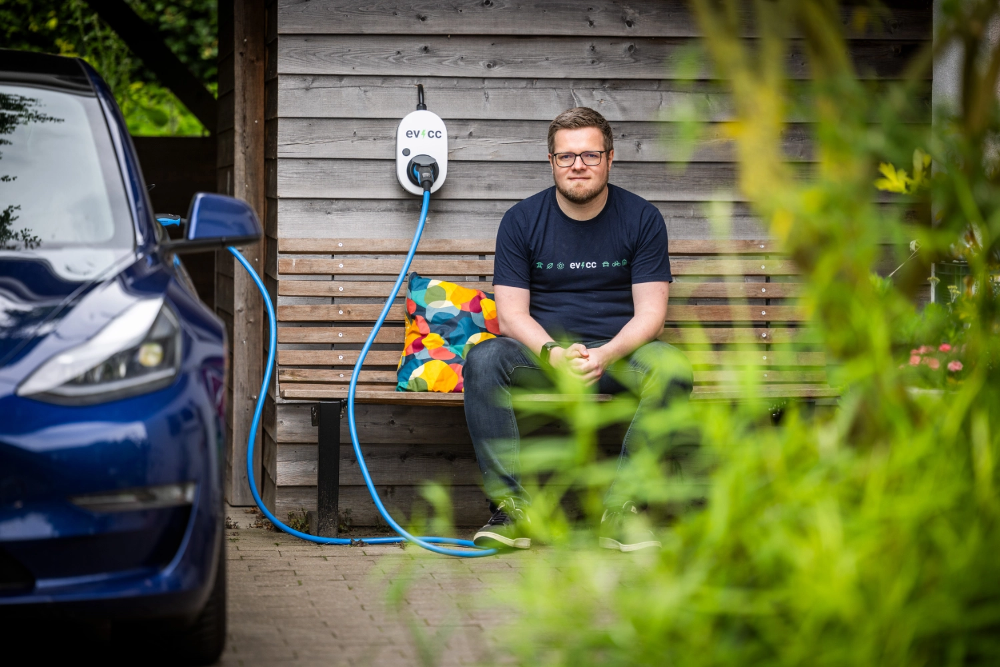
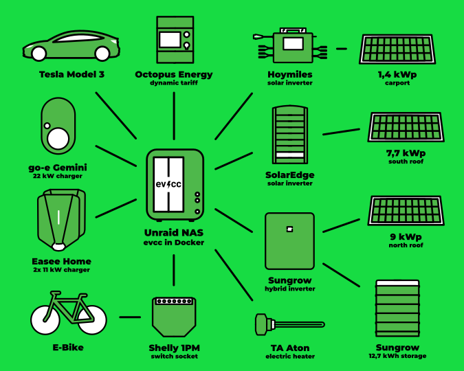
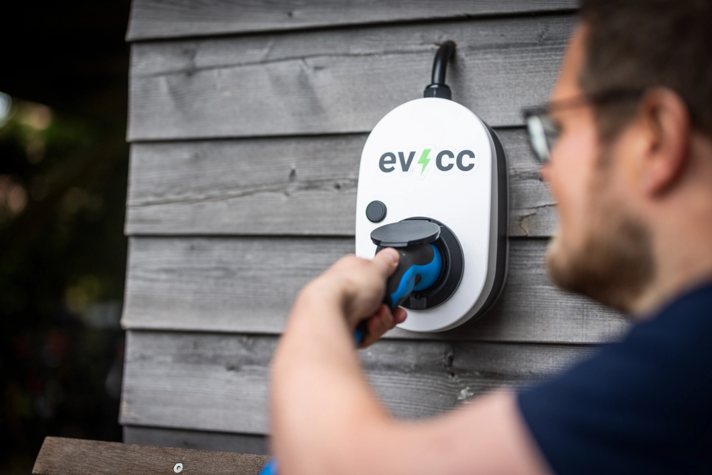
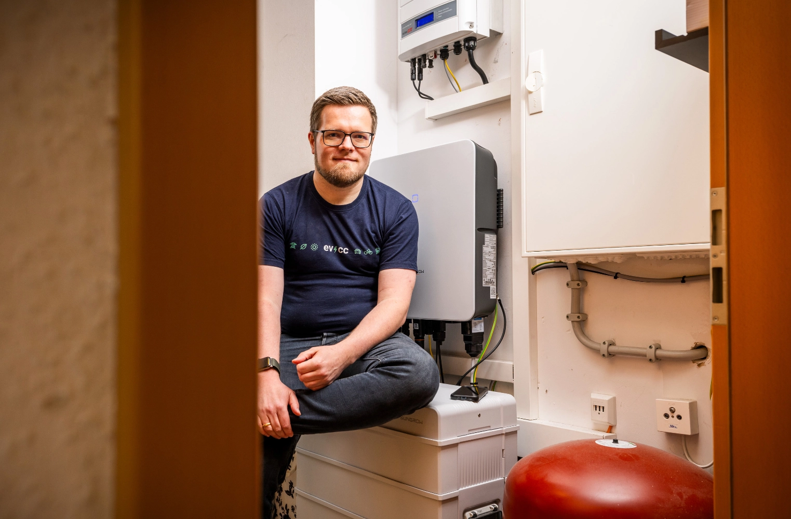

Během posledních měsíců jsme poznali mnoho uživatelů z komunity.
Dnešní portrét je trochu jiný: fotograf [Detlef](https://hee.se) se ujímá role tazatele a mluví s Michaelem z hlavního týmu evcc.

{/* excerpt */}

## „Nejlepší software je k ničemu, když o něm nikdo neví“

**Detlef:** Dnes si role prohodíme a na otázky budete odpovídat vy.
Vás i projekt jsem poznal díky jedné z vašich přednášek.
Jste něco jako „šéf evcc“?

**Michael:** Ne, tak bych se nepopsal.
Jsem součástí tříčlenného hlavního týmu spolu s [Andim](https://github.com/andig) a [Ulim](https://github.com/premultiply).
Společně na projektu pracujeme a dělíme se o různé úkoly, které s sebou open-source projekt této velikosti nese.

Kromě vývoje UI, na který se zaměřuji, se starám i o naši viditelnost na veřejnosti.
Patří k tomu věci jako web, články na blogu, [samolepky](https://github.com/evcc-io/evcc/discussions/4446), dokumentace, trochu sociálních sítí a
občasná vystoupení na konferencích nebo ve videích na YouTube.
Dělám to, protože si myslím, že nejlepší software je k ničemu, když o něm nikdo neví.

## Od naivní představy ke členovi hlavního týmu

**Detlef:** Jaký byl váš první kontakt s evcc?

**Michael:** Můj první kontakt s evcc byl nejspíš stejný jako u většiny uživatelů.
V roce 2020 jsme si objednali elektromobil a hledal jsem řešení, jak ho nabíjet přebytkem solární energie.
Docela naivně jsem si myslel, že si prostě koupím chytrou nabíječku a bude hotovo.
Realita byla vystřízlivěním: uzavřená řešení vázaná na výrobce, cloudové služby a proprietární systémy, tedy přesně to, co jsem nechtěl.

Pak jsem narazil na evcc.
Software byl minimalistický, modulární a stavěl na zajímavé kombinaci technologií Go a Vue.js.
Projekt byl tehdy starý jen pár měsíců.
Poslal jsem první příspěvky do kódu a rychle se stal součástí hlavního týmu.
Za téměř pět let urazil software neuvěřitelný kus cesty.

## Eat your own dog food

**Detlef:** Předpokládám, že máte vlastní instalaci evcc.
Jak vypadá?

**Michael:** Naše cesta začala v roce 2017 fotovoltaickou elektrárnou o výkonu 9,8 kWp orientovanou na jih.
Tehdy bylo důležité zůstat u nás v Německu pod hranicí 10 kWp.
V roce 2023 jsme solárními panely zaplnili i zbývající severní střechu a přístřešek pro auto.
Celkem je to teď 18 kWp plus domácí baterie s kapacitou 12,8 kWh.
Tato rozšíření zvýšila naši soběstačnost.

Elektromobil samozřejmě nabíjíme solární energií pomocí evcc.
Snažím se ale využívat i všechny ostatní funkce, které jsme do softwaru zatím zabudovali.
Od března do října přebírá ohřev teplé vody [topná tyč 3 kW řízená evcc](https://github.com/naltatis/aton-ctrl).
Využívá jen solární přebytek nebo velmi levnou elektřinu ze sítě.
Dokonce i naše elektrokolo je připojené k zásuvce, která dodává proud jen tehdy, když svítí slunce.

Ekonomika tu ve skutečnosti nehraje hlavní roli.
Naše peletové topení by vodu ohřálo o něco levněji a spotřeba elektrokola je ve srovnání s autem zanedbatelná.
Jde mi ale o to, abych nové funkce sám používal v každodenním životě.
Držím se hesla, které se traduje ve vývoji softwaru: [Eat your own dog food.](https://en.wikipedia.org/wiki/Eating_your_own_dog_food)

| Komponenta                   | Podrobnosti                                                                                                   |
| ---------------------------- | ------------------------------------------------------------------------------------------------------------- |
| **Fotovoltaická elektrárna** | 18,1 kWp celkem 7,7 kWp jih SolarEdge 9,0 kWp sever Sungrow 1,4 kWp přístřešek Hoymiles & AhoyDTU |
| **Domácí baterie**           | 12,8 kWh Sungrow                                                                                              |
| **Vozidla**                  | Tesla Model 3                                                                                                 |
| **Nabíječky**                | Easee Home, Go-e Gemini                                                                                       |
| **Topná tyč**                | 3 kW TA Aton přes PWM                                                                                         |
| **Elektrokolo**              | Shelly 1PM                                                                                                    |
| **Dynamický tarif**          | Octopus Energy                                                                                                |

## Síla komunity místo odborných znalostí

**Detlef:** evcc dnes podporuje stovky zařízení a služeb.
Znáte je všechny?

**Michael:** Rozsah funkcí ano, ale detaily jednotlivých integrací rozhodně ne.
Uli a Andi jsou experti na kompatibilitu zařízení.
Nové integrace zařízení téměř vždy přicházejí od členů komunity, kteří dané zařízení vlastní.
Někdy jsou tito uživatelé zároveň vývojáři a mohou poslat pull requesty.
Ve většině případů s uživateli řešení vypracujeme společně.

Na naší systémové architektuře je krásné, že pro vývoj funkcí nehrají specifika zařízení žádnou roli.
Náš jednotný datový model zajišťuje, že práce např. s domácími bateriemi funguje vždy stejně, bez ohledu na značku a model.
Pokud zařízení nabízí další funkce, jako je přepínání fází nebo možnost řízení, objeví se v uživatelském rozhraní automaticky další možnosti.

## Open source vs. komerční řešení

**Detlef:** Pojďme si promluvit o open source. Baví vás to i po všech těch letech?

**Michael:** Rozhodně.
Open source je nepřekonatelný: vytváříme jakousi databázi, která jednotně zpracovává rozhraní téměř všech nabíječek, střídačů a dalších zařízení.
Tato myšlenka _svobodného vědění_ je fascinující a představuje neuvěřitelně cenný zdroj, i pro další projekty.

**Detlef:** Mnoho výrobců nabízí proprietární systémy, některé střídače se ale otevírají.
Co to znamená pro váš projekt?

**Michael:** Máte pravdu.
Mnoho výrobců dnes integruje funkce chytrého nabíjení.
V ideálním světě by mělo být chytré řízení energie co nejjednodušší.
Tesla to s kombinací Powerwall, nabíječky a vozidla zvládá poměrně dobře.
Jakmile ale ekosystém opustíte, třeba s jiným vozidlem nebo s tepelným čerpadlem, začne to být složité.
Právě tady jsou potřeba řešení jako evcc.

**Detlef:** Věříte, že si evcc najde uživatele i mimo okruh IT nadšenců?

**Michael:** Myslím, že ano.
Dnes je ještě potřeba určité technické zázemí nebo aspoň trochu lásky ke kutilství.
Pracujeme ale na tom, aby bylo prvotní nastavení stejně snadné jako nastavení domácího routeru.
Software se tak zpřístupní i technicky méně zdatným uživatelům.

Cloudové služby se samozřejmě používají ještě snáz: zaregistrovat se, zadat přihlašovací údaje, hotovo.
Pak jste ale závislí na poskytovateli cloudu a musíte mu důvěřovat, pokud jde o ochranu soukromí a stabilitu.
Lokální řešení ve vlastních čtyřech stěnách vám dává plnou kontrolu.
Nezávislost, stabilita a kontrola nad vlastními daty jsou důležitá kritéria.

## Žádná magie, žádná záplava zaškrtávacích políček

**Detlef:** Všem požadavkům na funkce z GitHubu vyhovět nemůžete.
Kdo rozhoduje o tom, co se dostane do další verze?

**Michael:** Roli hraje řada faktorů.
Naší zásadou je nezahlcovat UI nastaveními, která potřebují vysvětlení, ale také neimplementovat „magické chování“, které by mohlo uživatele překvapit.
Tyto cíle si někdy navzájem odporují.
Když si nejsme jistí, požadavky na funkce odmítneme, ale díky otevřeným rozhraním lze mnoho funkcí nejdřív implementovat externě pomocí vlastních skriptů nebo Home Assistantu.

Roli samozřejmě hraje i poptávka.
Zdroje tepla jsme dlouho podporovali jen jako pluginy, abychom se soustředili na naši hlavní funkci, nabíjení elektromobilů.
Od začátku roku jsme ale integrovali tepelná čerpadla od více než 20 výrobců, jednoduše proto, že to chtělo tolik uživatelů a většina potřebných mechanismů už v evcc existovala.

## Žádná roadmapa, žádné ovládnutí světa

**Detlef:** evcc pro mě byl vždy projekt pro nabíjení nezávislé na výrobci, dnes je to prakticky univerzální systém řízení energie (EMS).
Jak vidíte budoucnost?

**Michael:** Zajímavá otázka.
Žádná oficiální roadmapa neexistuje.
Komunitní model financování nám dává svobodu: žádná vnější omezení, žádné milníky s pevnými termíny ani plány na ovládnutí světa.

Naší jedinou motivací je co nejlépe přizpůsobit software přáním uživatelů.
Komunita udržuje projekt naživu a určuje jeho směr.
Jestli si říkáme „univerzální EMS“ a můžeme zaškrtnout všechna políčka ve srovnání produktů, pro nás není důležité.
Důležité je, abychom dodávali řešení pro skutečné potřeby uživatelů.

Co se týče budoucnosti: často žádanou funkcí jsou vizualizace a statistiky, které jdou nad rámec nabíjecích relací.
Tedy jakýsi „dashboard“, jaký znáte z aplikací výrobců střídačů.
Nápadů na to už máme hodně.

Dalším velkým tématem jsou vylepšení chytrého řízení.
Plánujeme začlenit do našich algoritmů předpovědi výroby a spotřeby.
Důležitá je také dobrá integrace externích optimalizačních systémů a služeb založených na AI.
I tady stále hledáme zapálené přispěvatele.
Pokud máte zájem, klidně nás kontaktujte na Slacku.

**Detlef:** Za sebe i za všechny uživatele evcc: moc děkuji, že projekt takto posouváte vpřed.
Pokaždé mě znovu potěší, když nabíjím auto energií, kterou si sám vyrobím.

**Michael:** Díky za otázky a za příležitost zažít formát rozhovoru z druhé strany.

---

**Hledáme komunitní portréty!**
Už jste přispěli kódem do evcc?
Pak se klidně ozvěte [tady](https://airtable.com/appDI3xIiev1DOpMY/shrW1zGH26KElfZOK).
Momentálně hledáme portréty aktivních členů komunity.
