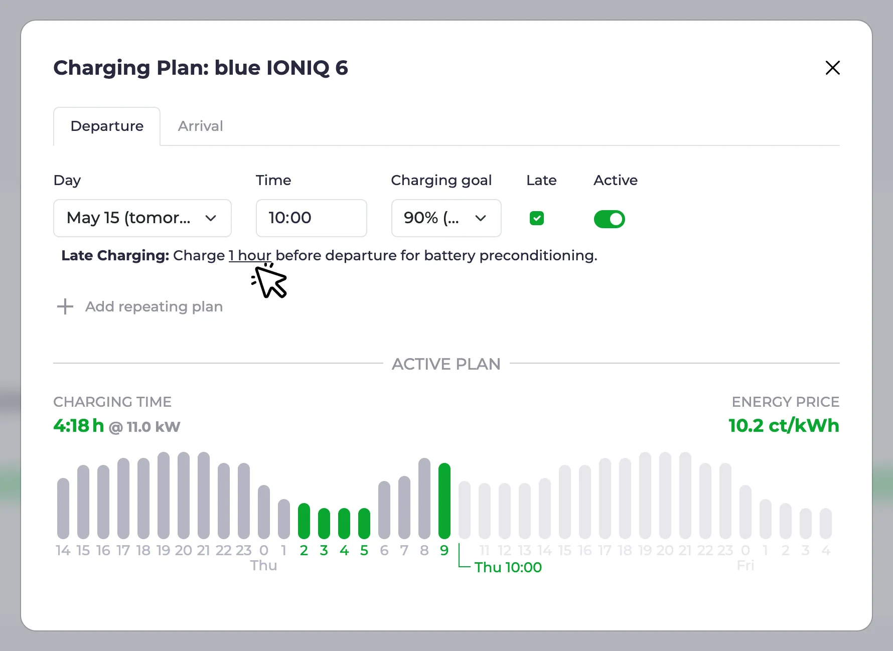
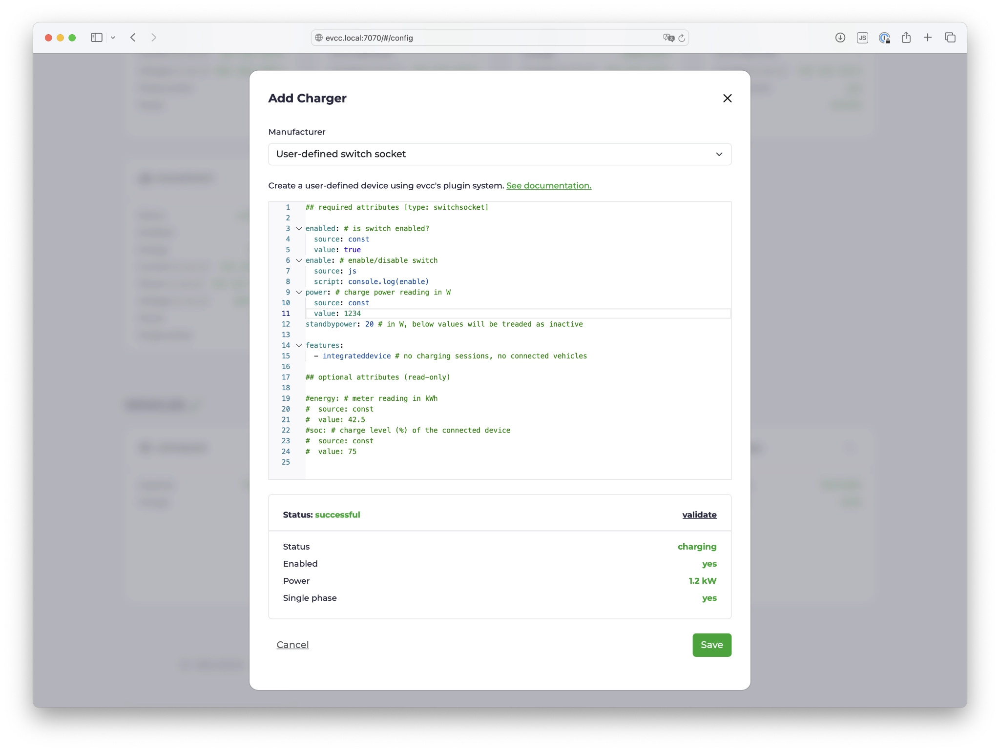
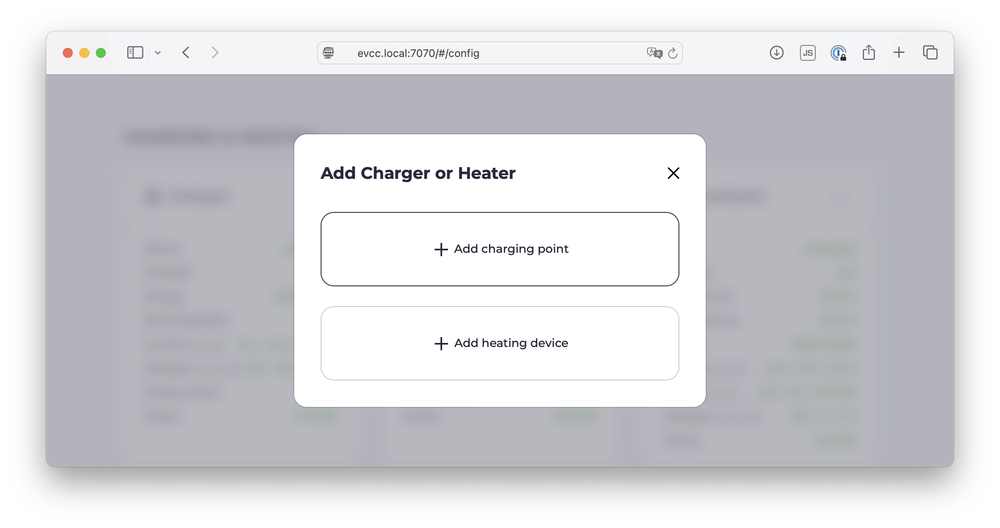
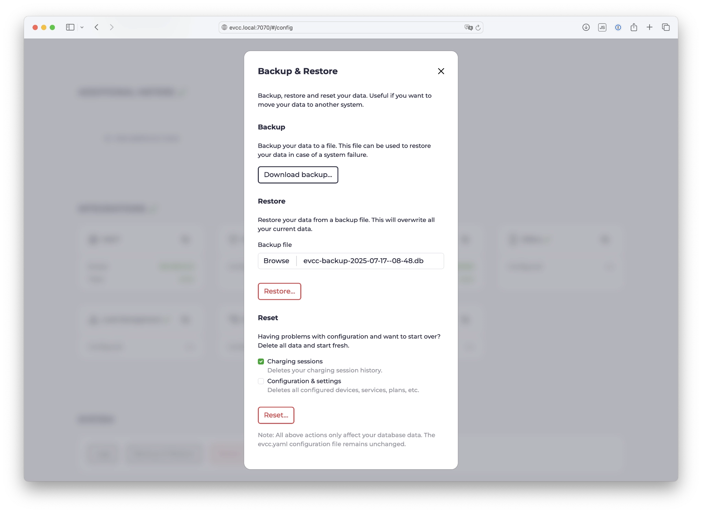
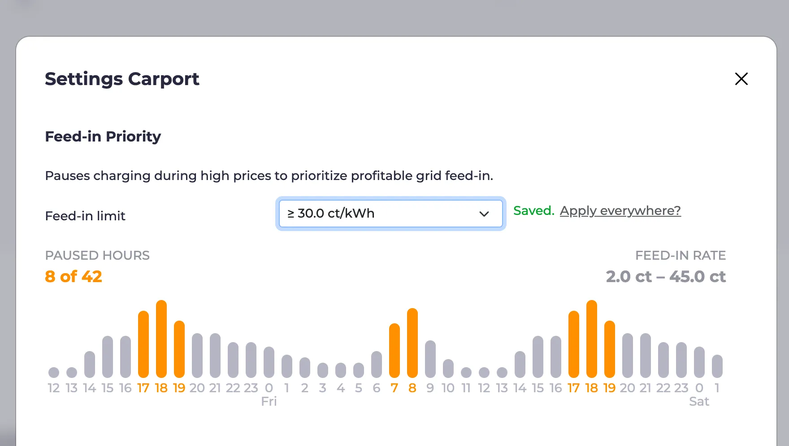

import Video from "@components/Video.astro";
import configUiVideo from "../../../../../en/blog/2025/07/30/config-ui.mp4";
import configUiPoster from "../../../../../en/blog/2025/07/30/config-ui.webp";
import mcpVideo from "../../../../../en/blog/2025/07/30/mcp-integration.mp4";
import mcpPoster from "../../../../../en/blog/2025/07/30/mcp-integration.webp";

Je čas na nový přehled funkcí! Vybral jsem několik zajímavých témat.

{/* excerpt */}

Než se dostaneme k funkcím, máme důležité oznámení pro všechny uživatele REST API.

## Nekompatibilní změna: REST API

S vydáním v0.207 se mění REST API.
Koncové body zůstávají stejné, formát odpovědi se ale zjednoduší.
Konkrétně odpadá vnější úroveň `result`.

Zde je příklad pro koncový bod `GET /api/state`:

Současná odpověď JSON:

```json
{
  "result": {
    "loadpoints": [...],
    ...
  }
}
```

Budoucí odpověď JSON:

```json
{
  "loadpoints": [...],
  ...
}
```

Správci oblíbených integrací evcc byli informováni a potřebné úpravy už provedli.

Uživatelé s vlastními skripty nebo automatizacemi, které přistupují přímo k REST API, si je musí upravit sami.
Další podrobnosti najdete v příslušném [tiketu na GitHubu.](https://github.com/evcc-io/evcc/pull/22299)

:::note[Poznámky k migraci]
Pro snazší přechod jsme vydali dvě verze: **v0.206 a v0.207 mají stejné funkce**.
Změny API přináší až **v0.207**.
Pokud vám nový formát odpovědi způsobí problémy, můžete se vrátit k v0.206.
Získáte tak všechny zde popsané novinky a své skripty a integrace můžete na nekompatibilní změnu připravit vlastním tempem.
:::

## Plány: odložené nabíjení

Plány nabíjení dostaly novou funkci: _Odložené nabíjení_.
Ve výchozím nastavení plánovací algoritmus optimalizuje nabíjení tak, aby probíhalo v nejlevnějších nebo nejčistších hodinách.
Může ale mít smysl nabíjet vozidlo až na poslední chvíli, tj. tak, aby nabíjení skončilo právě v nastaveném cílovém čase.

Příklady použití:

- **Předehřátí**: Zejména v zimě se vyplatí ohřát baterii vozidla nabíjením těsně před odjezdem. Ušetří se tím energie, protože baterii pak během jízdy není třeba tolik temperovat.
- **Klimatizace**: Pokud máte v autě na čas odjezdu zapnutou klimatizaci, toto nastavení zajistí, že se potřebná energie odebere z nabíječky, a ne z baterie auta.
- **Šetrnost k baterii**: Při nabíjení na 100 % před dlouhými cestami by baterie neměla zůstávat dlouho plně nabitá.



Kromě zaškrtávacího políčka pro aktivaci odloženého nabíjení můžete nastavit také dobu, po kterou se má nabíjet bezprostředně před cílovým časem.
Můžete tak např. většinu energie nabít v nejlevnějších hodinách a auto dobít do plna až v poslední hodině, jak ukazuje snímek obrazovky výše.

Další podrobnosti najdete v [dokumentaci](/cs/features/plans#late-charging).

<a id="config-ui"></a>

## Konfigurace v prohlížeči

V oblasti prvotní konfigurace v prohlížeči se děje hodně.
Už několik týdnů je možné nastavení bez `evcc.yaml`, dříve však vždy začínalo v [demo režimu](https://demo.evcc.io/).

Nyní nastavení začíná dialogovým oknem s výběrem:

- Klasická konfigurace přes `evcc.yaml`
- Konfigurace v prohlížeči _🧪 experimentální_

V následujícím videu uvidíte proces konfigurace s několika vozidly, měřiči, solárními/bateriovými systémy, nabíječkami a tepelnými čerpadly:

<Video src={configUiVideo} poster={configUiPoster} />

### Demo režim

Pro vyzkoušení rozhraní bez konfigurace je demo režim stále k dispozici.
Spustíte ho [přepínačem CLI](https://docs.evcc.io/docs/reference/cli/evcc) `--demo`.

V tomto režimu používají solár, baterie a nabíječky simulovaná data.
Navíc je vypnutý systém ověřování, a proto jsou všechny chráněné funkce (konfigurace, logy atd.) deaktivované.

### Zařízení definovaná uživatelem (pluginy)

Přes konfigurační rozhraní už bylo možné vytvářet vozidla, měřiče, solární/bateriové systémy, nabíječky, tarify, chytré spínače a tepelná čerpadla.
Základem je naše rozsáhlá knihovna šablon zařízení, která dnes pokrývá více než 550 produktů.

Další silnou stránkou je [flexibilní systém pluginů](/cs/reference/plugins).
Díky němu lze připojit i exotická zařízení a integrace přes HTTP, Modbus, skript, MQTT atd.
Tato zařízení definovaná uživatelem (`type: custom`) se dosud musela konfigurovat v `evcc.yaml`.
Nyní to jde i v konfiguračním rozhraní, včetně zvýraznění syntaxe, validace a testovací funkce.



### Nabíjení a vytápění

evcc vzniklo pro chytré nabíjení elektromobilů.
Dnes už podporuje i stále delší seznam tepelných čerpadel a topných tyčí.
Základní cíle optimalizace, jako je efektivní využití vlastní energie nebo cenově optimalizované nabíjení ze sítě, jsou v obou oblastech stejné.
V detailech se však liší chování regulace, požadavky na vizualizaci a možnosti nastavení.

V konfiguračním rozhraní byla proto sekce _Nabíjecí body_ přejmenována na _Nabíjení a vytápění_.
Postup nastavení byl také přepracován tak, aby zobrazoval jen volby, které se pro dané použití hodí.

Ve [videu výše](#config-ui) (od 2:10) uvidíte rozdílné postupy pro nabíjení a vytápění.
Zde je snímek obrazovky prvního dialogového okna nastavení:



V příštích vydáních přibudou další kroky, aby se _vytápění_ stalo v evcc plnohodnotnou součástí.
Další podrobnosti najdete v tomto [tiketu na GitHubu](https://github.com/evcc-io/evcc/issues/19753).

### Zálohování a obnova

Teď, když se do konfiguračního rozhraní přesouvá stále více funkcí, vyvstávají nové otázky:

- Jak mohu zálohovat svou konfiguraci?
- Jak přenesu svou instalaci na nový systém?
- Mohu konfiguraci resetovat a začít od nuly?

Abychom na tyto otázky odpověděli, implementovali jsme funkci zálohování a obnovy.
Můžete tak zálohovat databázi evcc na svůj počítač, obnovit uložený stav nebo smazat konfiguraci a přitom si např. ponechat historii nabíjení.



Velké díky patří [@maschga](https://github.com/maschga) za podporu při implementaci.

### Co dál

Počet otevřených úkolů kolem konfigurace v prohlížeči se stále zmenšuje.
Některá zařízení zatím nelze vytvořit a ladicí informace pro hlášení na GitHubu je ještě třeba vylepšit.
A samozřejmě je vždy co zlepšovat i na stávajících funkcích.

Už je ale vidět, že konfigurace v prohlížeči se brzy stane novým standardem.
Verze 1.0.0 se blíží.

Poznámka: Konfigurace přes `evcc.yaml` bude možná i nadále.

## Dynamický export do sítě

S [dynamickými tarify](/cs/features/dynamic-prices) můžete přizpůsobit nabíjení a vytápění aktuální cenové situaci.
Tato funkce je nyní k dispozici i pro export do sítě.

Pokud máte tarif s [dynamickými cenami za export do sítě](/cs/features/dynamic-feedin) (např. přímý prodej, dynamické síťové poplatky, Nizozemsko, Austrálie), objeví se v dialogovém okně nastavení nabíjecího bodu funkce [upřednostnit export do sítě](/cs/features/dynamic-feedin#feed-in-priority).



Můžete tak pozastavit nabíjení nebo vytápění v době, kdy se víc vyplatí exportovat energii do sítě.
K tomu můžete nastavit pevnou cenovou hranici.
Automatizace pomocí externích skriptů nebo systémů přes API je samozřejmě také možná.

V příštích vydáních přidáme další funkce kolem dynamického exportu do sítě.
Zkoušíme pozastavit export do sítě při záporných cenách a omezovat výrobu.
Více o tom [zde](https://github.com/evcc-io/evcc/issues/21747).

## Integrace AI přes MCP 🧪

Pomocí protokolu [Model Context Protocol](https://en.wikipedia.org/wiki/Model_Context_Protocol) (zkráceně MCP) lze jazykovým modelům (LLM) jako Claude, Gemini a ChatGPT dát strukturovaný přístup k externím systémům, jako je evcc.

Po aktivaci experimentálního [MCP](/cs/integrations/mcp) se v evcc zapne experimentální MCP server.
Nový koncový bod (např. `http://evcc.local:7070/mcp`) můžete zadat do konfigurace svého LLM.

Téma MCP i dostupné nástroje jsou stále velmi mladé a neustále se mění.
Vidíme tu ale velký potenciál a zajímavé nové možnosti, zejména v oblasti optimalizace a automatizace s lokálními modely.

Následující video ukazuje příklad, jak evcc spolupracuje s Claude Code (Sonnet 4):

<Video src={mcpVideo} poster={mcpPoster} />

Požadavek: _„Uživatel chce zítra v 8:00 jet se svou Teslou do Hamburku.“_

LLM…

- … určí správný nabíjecí bod: „white Model 3“
- … vypočítá vzdálenost: Brémy (z názvu) → Hamburk (z požadavku)
- … vypočítá potřebný stav nabití: 90 %
- … vytvoří plán nabíjení: 90 % v 8:00 pro Teslu Model 3
- … přepne režim nabíjení z **Vypnuto** na **Solár**, protože plány jsou aktivní jen v režimu (Min+)Solár

Nakonec si vyžádá plán nabíjení vypočítaný evcc a vrátí ho uživateli.

Tento poměrně jednoduchý příklad docela dobře ukazuje, kam by se to mohlo v budoucnu ubírat.
Jsme zvědaví, jak se téma MCP bude vyvíjet.
Klidně si to sami vyzkoušejte a podělte se o své zkušenosti v [diskuzích na GitHubu](https://github.com/evcc-io/evcc/discussions).

Další podrobnosti o použití MCP např. s Claude Code najdete v [dokumentaci](/cs/integrations/mcp).

## Rozbalitelná výroba, baterie a nabíjecí body

Pokud máte nakonfigurováno více solárních/bateriových systémů nebo nabíjecích bodů, můžete je nyní v zobrazení toku energie rozbalit a zobrazit další podrobnosti.
Zařízením vytvořeným přes konfigurační rozhraní můžete k tomuto účelu přidělit název.

:::note
Pojmenování solárních, bateriových a dalších měřičů není z technických důvodů v `evcc.yaml` možné.
:::

## Podpora nových zařízení

Od února jsme přidali podporu zařízení několika nových výrobců:

- **Nabíječky:** Ampure, Autoaid, Charge Amps, Elecq, eledio, EN+, enercab, EntraTek, Free2Move, Free2move eSolutions, Huawei, Kathrein, Plugchoice, Volt Time, ZJ Beny
- **Chytré spínače:** Home Assistant
- **Tepelná čerpadla a elektrické ohřívače:** alpha innotec, Bosch, Buderus, Bösch, CTA All-In-One, Daikin, Elco, IDM, Junkers, Kermi, Lambda, my-PV, Nibe, Novelan, Roth, Stiebel Eltron, Tecalor, Vaillant, Viessmann, Wolf, Zewotherm
- **Měřiče:** Axitec, Bosch, IAMMETER, IOmeter, ORNO, Saia-Burgess Controls (SBC), Sigenergy, Wago
- **Solární/bateriové systémy:** Axitec, batterX, Bosch, IAMMETER, Marstek, Sigenergy
- **Vozidla:** Toyota

Samozřejmě jsme také opravovali chyby a vylepšovali stávající implementace.

## A mnohem víc…

Toto je jen výběr.
Úplný seznam novinek najdete jako obvykle v [poznámkách k vydání na GitHubu](https://github.com/evcc-io/evcc/releases).
Velké díky všem, kdo se aktivně podílejí na vývoji evcc.
Jste skvělí 🤘.

**S pozdravem**<br />
Tým evcc<br />
Michael, Andi & Uli
