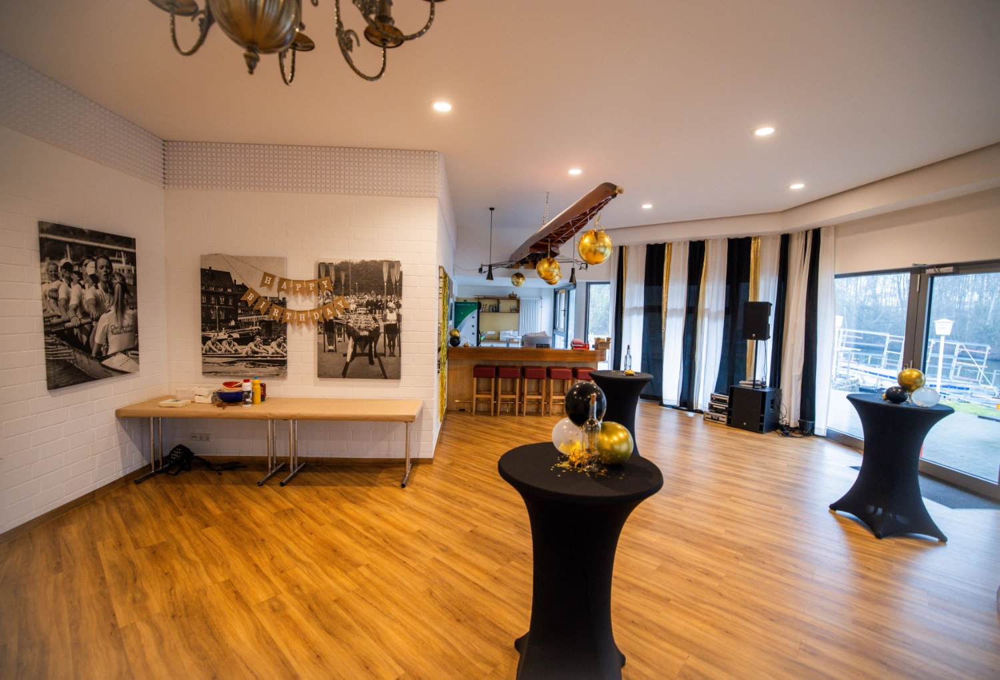
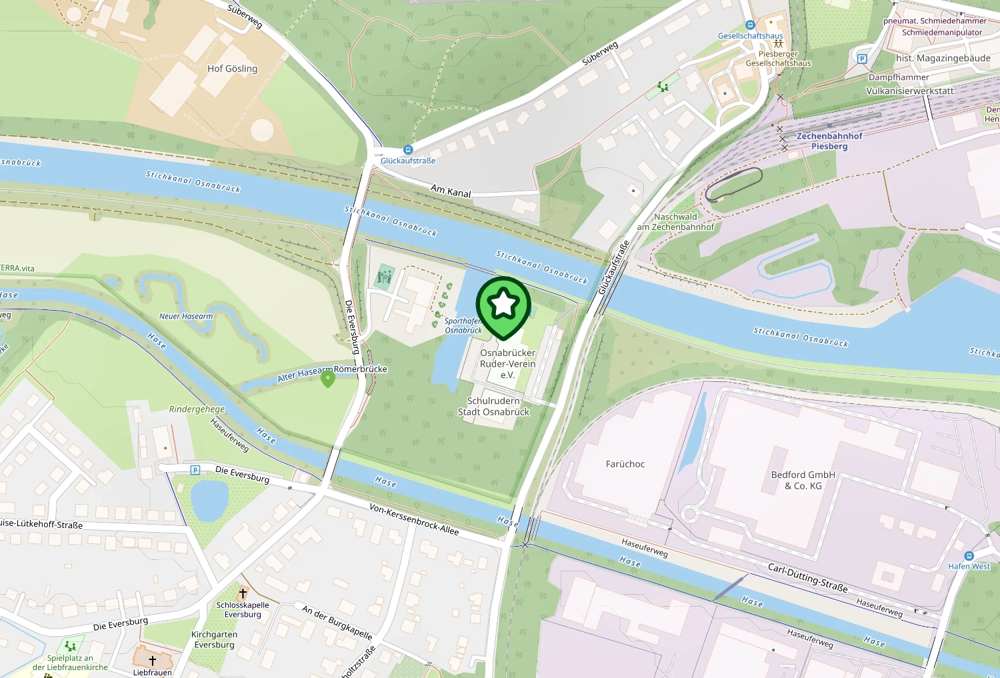

Zveme vás na první komunitní setkání evcc!
**18. dubna 2026** se sejdeme v Osnabrücku, abychom se poznali, vyměnili si nápady a společně si dali něco z grilu.
[Veslařský klub Osnabrück](https://www.orv.de) nám laskavě poskytne své prostory.

{/* excerpt */}

## Co vás čeká

Setkání se koná **odpoledne** a je na něm místo pro **100 účastníků**.
Připravili jsme uvolněný program:

- **Seznámení**: přiřaďte tváře k uživatelským jménům z GitHubu
- **Výměna zkušeností**: diskuse o vašich instalacích evcc a zkušenostech
- **Networking**: navažte kontakty s dalšími uživateli a vývojáři evcc
- **Grilování**: zakončení dne s jídlem a pitím

## Registrace

Registrace probíhá přes rezervační systém veslařského klubu.
Platí se **příspěvek 10 €**, který pokrývá i jídlo z grilu.

**[Zaregistrovat se →](https://widgets.yolawo.de/w/0/bookables/692e18b1db6c17d85beacfd2?t=1764767521803)**

Při registraci můžete volitelně uvést své město.
Pomůže nám to získat představu, odkud lidé přijíždějí.

## Místo konání

**[Zobrazit v Google Maps →](https://maps.app.goo.gl/75RsYsPpeBuNLsWC6)**

**Osnabrücker Ruderverein e.V.** 
Glückaufstraße 16 
49090 Osnabrück

Veslařský klub leží přímo u průplavu Stichkanal a nabízí pro naše setkání skvělou atmosféru.
Jak si můžete přečíst v [komunitním portrétu](/cs/blog/2025/11/29/osnabruecker-ruderverein), klub používá evcc k řízení vlastní energie.

Moc se těšíme, že konečně uvidíme tváře za uživatelskými jmény z GitHubu!
Ať už jste uživatel, nebo vývojář, ať jste s námi delší dobu, nebo s evcc teprve začínáte: přijďte!

Pokud máte jakékoli dotazy, klidně se ozvěte ve [vlákně GitHub Discussions](https://github.com/evcc-io/evcc/discussions/25787).

**Uvidíme se v dubnu v Osnabrücku!** 
Tým evcc 
Michael, Andi a Uli
