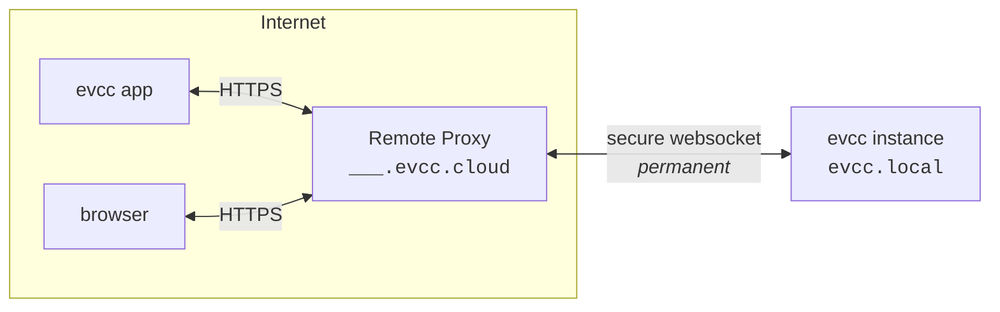

import { Steps } from "@astrojs/starlight/components";
import SponsorInfoBox from "@components/SponsorInfoBox.astro";
import statusImg from "@assets/features/remote-access/status.png";
import clientsImg from "@assets/features/remote-access/clients.png";
import clientCreatedImg from "@assets/features/remote-access/client-created.png";

Vzdálený přístup vám umožní dostat se k vaší instanci evcc i mimo domácí síť, a to přes [aplikaci evcc](/cs/features/app) nebo prohlížeč.
Vaše instance dostane vlastní doménu na `evcc.cloud`.
Přesměrování portů, dynamické DNS ani VPN nejsou potřeba, protože instance navazuje spojení sama směrem ven.

<SponsorInfoBox lang="en" type="feature" />

## Nastavení

<Steps>

1. Funkci zapněte v **Konfigurace → Vzdálený přístup**.

   

2. Vaše instance evcc se připojí k `evcc.cloud` a získá vlastní doménu, např. `swift-dark-crow.evcc.cloud`.

   

3. Pro každé zařízení, které má mít přístup, vytvořte samostatného klienta.
   Dostanete uživatelské jméno, heslo a QR kód, který obsahuje obojí.
   - **Aplikace:** Naskenujte QR kód fotoaparátem telefonu.
     Otevře se [aplikace evcc](/cs/features/app) a je ihned připojená.
   - **Prohlížeč:** Otevřete svou osobní doménu a přihlaste se uživatelským jménem a heslem (basic auth přes HTTPS).
   - **Klienti API:** Přistupujte k API programově pomocí uživatelského jména a hesla.

     ```bash title="curl example"
     curl --user Macbook:7IIGKZGP-MV0PJKSE "https://swift-dark-crow.evcc.cloud/api/state?jq=.pvPower"
     ```

   

4. Ve stejném zobrazení vidíte, kdy byli jednotliví klienti naposledy aktivní, a můžete jednotlivým zařízením kdykoli odebrat přístup.
   Přístup lze volitelně omezit na pevně stanovenou dobu.

</Steps>

## Zabezpečení

**Přenos.**
Požadavky na vaši doménu procházejí přes HTTPS s wildcard certifikátem pro `*.evcc.cloud`.
Spojení mezi Remote Proxy a vaší lokální instancí vede přes tunel WebSocket.

**Co vidí Remote Proxy.**
Remote Proxy požadavky pouze přeposílá.
Obsah požadavků se neukládá ani nekontroluje.
U každé registrace se ukládá jen doména, hash tokenu připojení, přiřazený sponzor a časová razítka, aby bylo možné tunel při opětovném připojení znovu přiřadit.

**Lokální ověřování.**
Pro každé zařízení vytváříte samostatné přihlašovací údaje.
Ukládají se a ověřují výhradně na vaší instanci evcc.
Na Remote Proxy se žádné přihlašovací údaje neukládají.
Heslo se zobrazí jen jednou, při vytvoření klienta.
Odebrání zařízení zruší přístup jen tomuto zařízení.
Všechna ostatní zůstanou připojena.
Opakované neúspěšné pokusy o přihlášení se automaticky omezují.

**Rozsah přístupu.**
Přihlašovací údaje pro vzdálený přístup fungují vedle vlastních bezpečnostních mechanismů evcc.
Poskytují pouze síťový přístup k vaší instanci, srovnatelný s přístupem z vaší lokální sítě.
Změny konfigurace, zálohy, logy nebo restart dál vyžadují heslo administrátora.

**Vazba na sponzorský token.**
Registraci ověřuje server `sponsor.evcc.io`.
Každý sponzor dostane právě jednu doménu, která je k němu trvale vázána a nikdy se nepřiděluje znovu.

## Technické podrobnosti

Vaše aplikace nebo prohlížeč se připojuje k vaší osobní doméně na `evcc.cloud`.
Remote Proxy přeposílá požadavky přes tunel WebSocket do vaší lokální instance evcc.
Tento tunel otevírá vaše lokální instance sama směrem ven, takže ve vaší síti není potřeba žádný otevřený port.



Při první aktivaci se lokální instance evcc zaregistruje u Remote Proxy.
Výměnou za sponzorský token dostane token připojení a náhodně přidělenou doménu.
Obojí se uloží lokálně a při dalším startu se znovu použije k obnovení tunelu, aniž by bylo nutné znovu procházet registrací.

Při dalších startech otevře lokální instance evcc trvalé spojení WebSocket (WSS) šifrované pomocí TLS k Remote Proxy.
Toto spojení slouží jako tunel pro veškerý další provoz a navazuje se směrem ven, takže není potřeba přesměrování portů.

Nad tímto spojením funguje jako multiplexer [hashicorp/yamux](https://github.com/hashicorp/yamux).
Každý příchozí HTTP požadavek na Remote Proxy se stane samostatným streamem yamux nad existujícím spojením WebSocket.
Více souběžných požadavků sdílí jedno spojení bez nového TCP nebo TLS handshaku pro každý požadavek.

Přes tunel fungují i upgrady na WebSocket.
To je důležité, protože samotné uživatelské rozhraní evcc přijímá živá data přes WebSocket.

Pokud se tunel přeruší, lokální instance se automaticky znovu připojí.
Dokud spojení trvá, je vaše doména dostupná, jinak Remote Proxy vrátí chybu.

Hostitel Remote Proxy je ve výchozím nastavení `api.evcc.cloud`.
Pro vývoj nebo vlastní proxy ho lze přepsat proměnnou prostředí `EVCC_REMOTE_ACCESS`.

Zdrojový kód Remote Proxy bude zveřejněn později.
Podrobnosti o ochraně osobních údajů najdete v našich [zásadách ochrany osobních údajů](https://evcc.io/en/datenschutz/).
