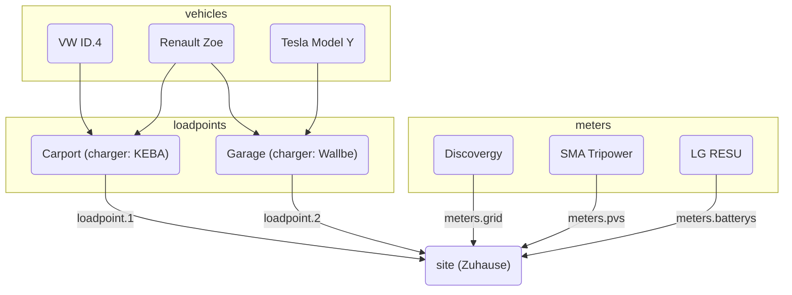

evcc lze konfigurovat dvěma způsoby:

**1. Konfigurace v uživatelském rozhraní (doporučeno)**

Konfigurace probíhá ve webovém rozhraní v části **Konfigurace**.
Nastavení se automaticky ukládají do databáze.
Další informace najdete v části [Konfigurace](/cs/installation/configuration).

**2. Konfigurace pomocí souboru**

Konfigurace pomocí souboru `evcc.yaml` je nadále podporována.
Tato sekce dokumentuje konfiguraci pomocí YAML.

:::note[Souběžné použití]
Oba způsoby konfigurace lze používat souběžně.
Zařízení (nabíjecí body, měřiče, fotovoltaické elektrárny, domácí baterie, vozidla) se slučují z obou zdrojů.
U ostatních nastavení má přednost konfigurace v uživatelském rozhraní.
Podrobnosti najdete v [FAQ](/cs/faq#ui-migration).
:::

## Konfigurace pomocí souboru (evcc.yaml)

Konfigurační soubor je ve formátu YAML a ve výchozím nastavení se jmenuje `evcc.yaml`.
Nachází se buď ve stejném adresáři jako samotné evcc, nebo na systémech POSIX (např. Linux) v `/etc/evcc.yaml`.

Při spuštění lze zadat nestandardní cestu: `evcc -c /path/to/evcc.yaml`

### Struktura

Konfigurační soubor obsahuje několik sekcí.
Aby se sekce mohly na sebe odkazovat, mají zařízení k identifikaci parametr `name`.

Vzorový soubor s mnoha parametry najdete zde:
https://github.com/evcc-io/evcc/blob/master/evcc.dist.yaml

Zde je přehled vztahů mezi nejdůležitějšími částmi
konfigurace:

### Jak evcc funguje? (Pohled pod kapotu)

Aby systém fungoval, je důležitý měřič sítě (měřič `grid`).
Ten určuje aktuální přebytečný výkon.
Měření vyráběného výkonu přitom na funkci nemá vliv.
Provoz evcc bez měřiče sítě je také možný, viz [FAQ](/cs/faq#configuration).

Přebytečný výkon se porovnává s minimálním výkonem potřebným k nabíjení. Pokud
stačí, nabíjení se spustí.

Minimální výkon potřebný k nabíjení se vypočítá z hodnot `minCurrent`
a `phases`, které se definují pro každý `loadpoint` (skupinu nabíječek na jednom místě)
Další informace najdete v části [`loadpoints`](/cs/reference/configuration/loadpoints).

Například: `phases: 1` a `minCurrent: 8`

1 (fáze) × 8 A (minCurrent) × 230 V (napětí sítě) = 1 840 W (minimální výkon potřebný k nabíjení)

#### Možnosti úprav

Za normálních okolností odpovídá přebytečný výkon dostupnému nabíjecímu výkonu.
Dostupný nabíjecí výkon však lze individuálně upravit pomocí
několika parametrů. Jsou to:

- Lokalita: `residualpower`
- Lokalita: `prioritySoc`
- Lokalita: `bufferSoc`
- Lokalita: `aux`
- Nabíjecí bod: `enable: threshold`
- Nabíjecí bod: `disable: threshold`

Dostupná nastavení najdete v popisu
jednotlivých parametrů.

- [Konfigurační parametry lokality](/cs/reference/configuration/site)
- [Konfigurační parametry nabíjecího bodu](/cs/reference/configuration/loadpoints)

### Lokalita

[Lokalita](/cs/reference/configuration/site) popisuje místo se stávajícími a potřebnými zařízeními
domácí instalace a řídí dostupný výkon.

### Nabíjecí bod

[Nabíjecí bod](/cs/reference/configuration/loadpoints) popisuje nabíjecí infrastrukturu a spojuje
existující _nabíječky_, _vozidla_ a vše ostatní, co nabíjecí bod potřebuje.

### Nabíječky

[Nabíječky](/cs/reference/configuration/chargers) obsahují seznam nabíječek a jejich vlastností, např.
způsob, jakým se k nim přistupuje.

### Měřiče

[Měřiče](/cs/reference/configuration/meters) jsou seznam zařízení, která měří různé toky výkonu. Patří
mezi ně:

- Výkon odebíraný ze sítě a exportovaný do sítě
- Výkon fotovoltaické elektrárny
- Nabíjecí proud elektromobilu (pokud ho nabíječka neměří sama)
- Tok výkonu domácí baterie (baterií)

### Zařízení omezující výkon

[Zařízení omezující výkon](/cs/reference/configuration/curtailers) jsou zařízení, která na pokyn provozovatele distribuční soustavy (§ 9 EEG) pouze omezují
export do sítě z fotovoltaické elektrárny, např. SMA Sunny Home Manager 2.0 nebo řídicí
střídač systému s několika střídači.

### Vozidla

Chcete-li omezit stav nabití elektromobilů na určitou úroveň, můžete zde zadat
existující [vozidla](/cs/reference/configuration/vehicles) a přístupové údaje k jejich online službám.

### HEMS

evcc může předávat informace o nabíjecích bodech a jejich nabíjecích proudech jinému
[systému řízení energie v domácnosti (HEMS)](/cs/reference/configuration/hems), aby mohl tyto
informace využít např. k řízení domácí baterie.

### Oznámení

V této sekci můžete definovat události, o kterých chcete být informováni.
Pro doručování zpráv je podporována řada různých systémů.

[Další informace](/cs/reference/configuration/messaging)
