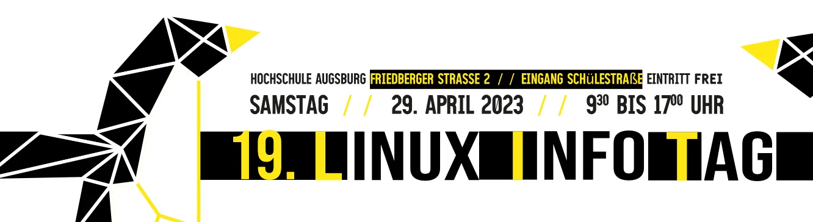
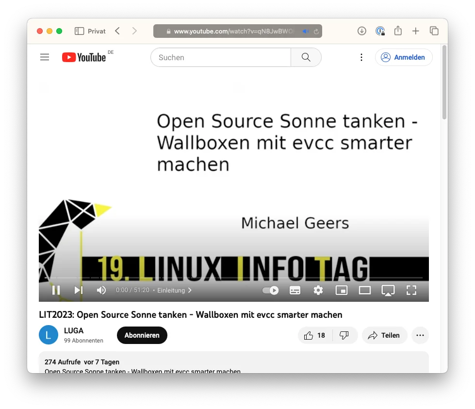
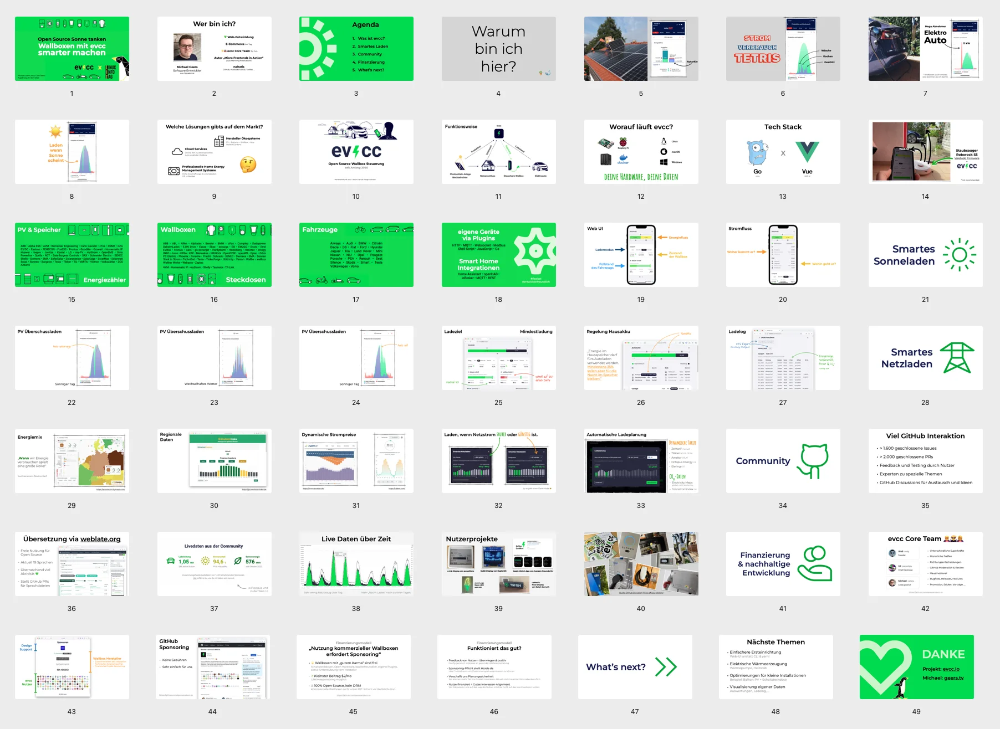

I slutningen af april blev den [19. Linux Infotag](https://www.luga.de/static/LIT-2023/) afholdt efter en lang coronapause. Linux Infotag er et open source-arrangement for fællesskabet, der organiseres af [Linux User Group Augsburg e.V. (LUGA)](https://www.luga.de/).

<!-- excerpt -->

## Videooptagelsen er nu tilgængelig

Blandt mange andre spændende emner fik vi i år mulighed for at præsentere vores projekt. Nu er videooptagelsen også tilgængelig.

[YouTube: Open Source Sonne tanken - Wallboxen mit evcc smarter machen (de)](https://www.youtube.com/watch?v=qN8JwBWOlzw)

Ud over den generelle introduktion til emnet opladning af elbiler med egen solstrøm handlede det også om smart opladning fra elnettet, og jeg gav et indblik i udviklingsprocessen og vores finansieringsmodel. Så tag gerne et kig.

Du finder slides fra foredraget på [Speaker Deck](https://speakerdeck.com/naltatis/open-source-sonne-tanken-wallboxen-mit-evcc-smarter-machen). 👇

