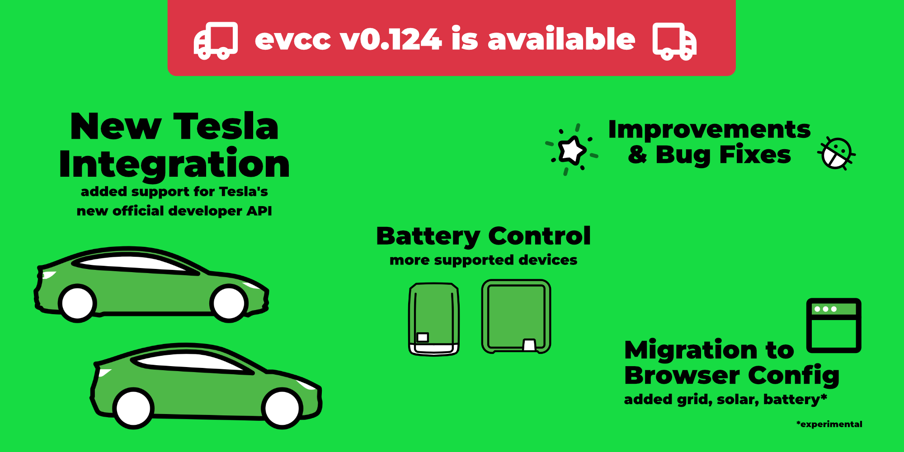
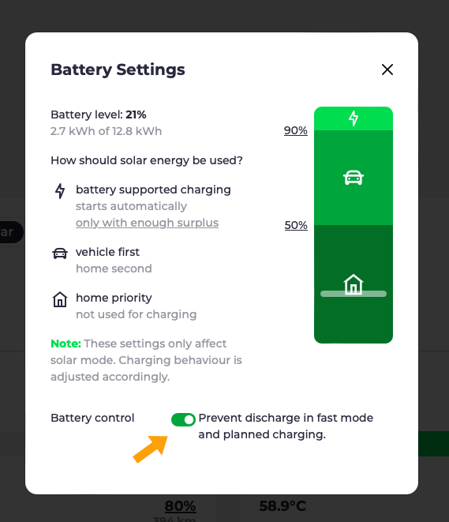
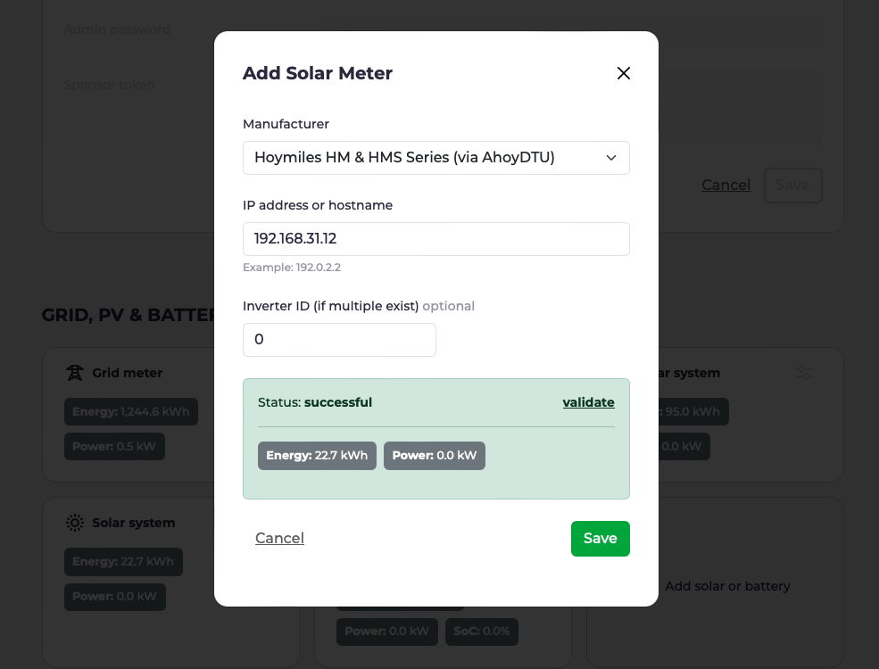

Dagene bliver længere, og solopladning begynder at blive sjovt igen.
Et godt tidspunkt til en kort opdatering om den seneste udvikling i evcc.

{/* excerpt */}

## Ny Tesla-integration

I [oktober](https://www.notateslaapp.com/news/1653/tesla-creates-official-apis-for-third-party-services-to-start-charging-for-usage) lancerede Tesla et nyt [officielt API](https://developer.tesla.com/docs/fleet-api).
Samtidig meddelte de, at det gamle, [uofficielle API](https://www.teslaapi.io) bliver lukket i begyndelsen af 2024.

### Hvad betyder det for mig?

For at bruge det nye API skal du lave to ændringer i `evcc.yaml`:

1. **Nyt template-navn:** Da det gamle API stadig virker for nogle brugere i dag, har vi besluttet at tilbyde begge implementeringer side om side indtil videre. Skift template-navnet fra `tesla` til `tesla-command` for at bruge det nye API.

2. **Generér nye tokens:** Med det nye API er det nu muligt at generere de nødvendige `accessToken` og `refreshToken` direkte i browseren.
   Til det har vi lavet en lille hjemmeside på [tesla.evcc.io](https://tesla.evcc.io).

Konfigurationen skal derefter se sådan ud:

```yaml
vehicles:
 - name: mytesla
   type: template
   template: tesla-command # change `tesla` to `tesla-command`
   accessToken: ... # generetad by tesla.evcc.io
   refreshToken:  ... # generetad by tesla.evcc.io
   ...
```

De tokens, der genereres via [tesla.evcc.io](https://tesla.evcc.io), kan **kun bruges med de officielle evcc-builds** (stable & nightly).
Grunden er, at tokens fra Teslas nye Developer API altid er bundet til en tredjepartsapp.

Du kan naturligvis stadig selv bygge evcc.
Så skal du dog have din egen Tesla Developer Account og selv generere dine tokens.
Flere detaljer finder du i den tilhørende [pull request](https://github.com/evcc-io/evcc/pull/10802).

### Privatliv og sikkerhed

Ligesom med det gamle API foregår kommunikationen ved dataudtræk (opladningsniveau, status osv.) og styring (f.eks. at vække bilen) direkte mellem din lokale evcc-installation og Teslas infrastruktur.
Kun genereringen af tokens sker én gang via vores hjemmeside.
Tokens bliver ikke gemt, men kun vist for dig i browseren.

Til udvidet styring af køretøjet (start og stop af opladning direkte i køretøjet) kræves der desuden en signeret forespørgsel til Tesla.
I dag gælder det brugere af en Tesla Wall Connector.
Da vi hverken kan eller må lægge vores private nøgle til tredjepartsappen ind i evcc-binærfilen, vil vi sandsynligvis stille en [egen tjeneste](https://github.com/evcc-io/evcc/pull/11893) til rådighed, der signerer disse forespørgsler og sender dem videre til Tesla.
Men mere om det i en senere udgivelse.

### Omkostninger

Tesla tilbyder i øjeblikket det nye API [gratis](https://developer.tesla.com/docs/fleet-api#membership-tiers).
De har dog allerede meddelt, at de vil opkræve gebyrer for brug af API'et i fremtiden.
Desværre ved vi endnu ikke, hvor open source-venlig denne model bliver.

Det er meget muligt, at vi ikke kan tilbyde generering af tokens gratis i fremtiden.
Vi kobler det måske til den eksisterende sponsormodel for evcc.
Men mere om det, når der er nyt fra Tesla.

## Aktiv batteristyring

En stor ny funktion, der kommer med juleudgivelsen, er den aktive batteristyring.
Funktionen er ikke længere markeret som eksperimentel.
Derudover er nogle nye batteriinvertere blevet understøttet i de seneste uger.
I dokumentationen kan du nu se, [om din inverter er understøttet](/da/meters#features).

### Passiv styring

Passiv batteristyring har været tilgængelig i evcc i et stykke tid.
Her regulerer evcc solopladningen, så hjemmebatteriet ikke bliver afladet utilsigtet.
Sidste år introducerede vi en [konfigurationsdialogboks](/da/blog/2023/10/05/feature-highlights-10-2023#battery-settings), hvor du kan indstille prioriteten mellem opladning af køretøjet og hjemmebatteriet.
Denne model fungerer rigtig godt til solopladning.
evcc kender hjemmebatteriets aktuelle opladningsniveau og regulerer kun køretøjets ladeeffekt.
Til hurtig opladning virker denne mekanisme dog ikke.
Det kræver en aktiv batteristyring.

### Undgå afladning under hurtig opladning

Som standard forsøger hjemmebatteriet at dække husets samlede energiforbrug (inklusive ladepunkter).
Afhængigt af den aktuelle elpris eller den forventede solproduktion kan det dog være ønskeligt at hente energien til **hurtig opladning af køretøjet** direkte fra elnettet og ikke fra hjemmebatteriet.
På den måde bliver den opsamlede solenergi i hjemmebatteriet og kan f.eks. bruges til husets forbrug om natten.

Det er vores første anvendelsesscenarie for aktiv batteristyring.
Hvis din inverter understøtter funktionen, vises en tilsvarende indstilling i dialogboksen med batteriindstillinger.



Når indstillingen er aktiv, sættes hjemmebatteriet i en spærretilstand under hurtig opladning.
I den tid bliver det hverken afladet eller opladet.
Spærringen er også aktiv under [planlagt opladning](/da/blog/2023/10/05/feature-highlights-10-2023#charging-planner-visualization) og [smart opladning fra elnettet](/da/blog/2023/10/05/feature-highlights-10-2023#smart-grid-charging).

### Næste skridt: opladning af batteriet med billig strøm fra elnettet

Det næste udviklingstrin for aktiv batteristyring er muligheden for at oplade hjemmebatteriet med billig strøm fra elnettet.
Det er især interessant for brugere af dynamiske tariffer på mørkere dage.
Målet er at fylde hjemmebatteriet med energi fra elnettet i perioder med lave priser og derefter bruge energien i huset i perioder med høje priser.
De nødvendige hardwareintegrationer har vi allerede implementeret.
Derfor forventer vi, at funktionen bliver tilgængelig i en af de næste udgivelser.

## Opdatering: overgang til konfiguration i browseren

evcc er et meget fleksibelt og kraftfuldt system til din egen energioptimering.
Vores største udfordring er stadig at forene denne fleksibilitet med en enkel opsætning.
I de seneste måneder har vi gjort store fremskridt med konfigurationen.
Vores mål er at gøre det muligt at tage systemet i brug udelukkende via browseren, uden `evcc.yaml`.

Hvis du har aktiveret indstillingen **Show experimental UI features** i indstillingsdialogboksen, kan du se vores aktuelle udviklingsstatus under **🧪 Device Configuration**.
I øjeblikket kan du tilføje og redigere køretøjer, elnetsmålere, solcelleanlæg og batterisystemer der.
Ladepunkter og tariffer følger i næste iteration.
Selvom det stadig er under udvikling, ser vi frem til din feedback.



## Små forbedringer og fejlrettelser

Som altid indeholder denne udgivelse også en række mindre forbedringer og fejlrettelser.
Flere detaljer finder du i [udgivelsesnoterne](https://github.com/evcc-io/evcc/releases/tag/0.124.0).

Venlig hilsen<br/>
evcc-kerneteamet
