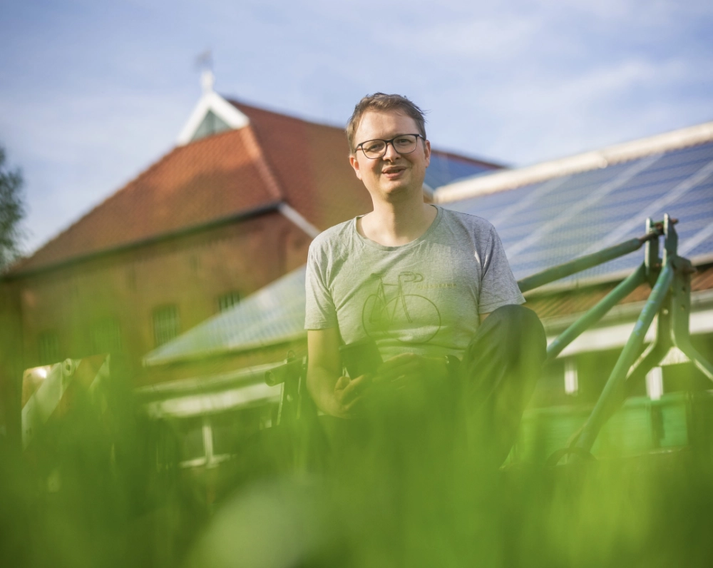
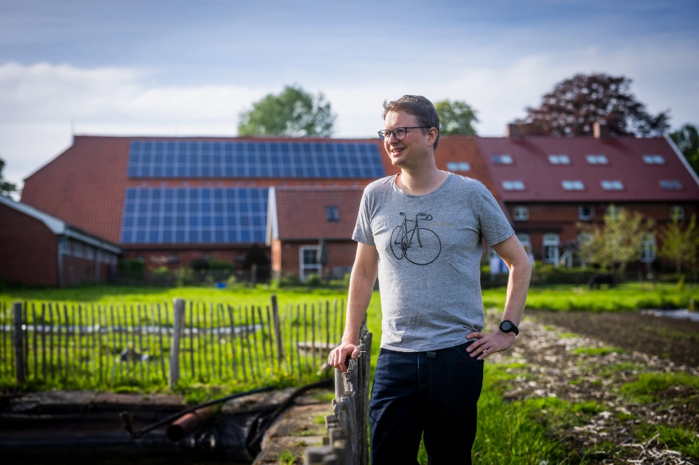
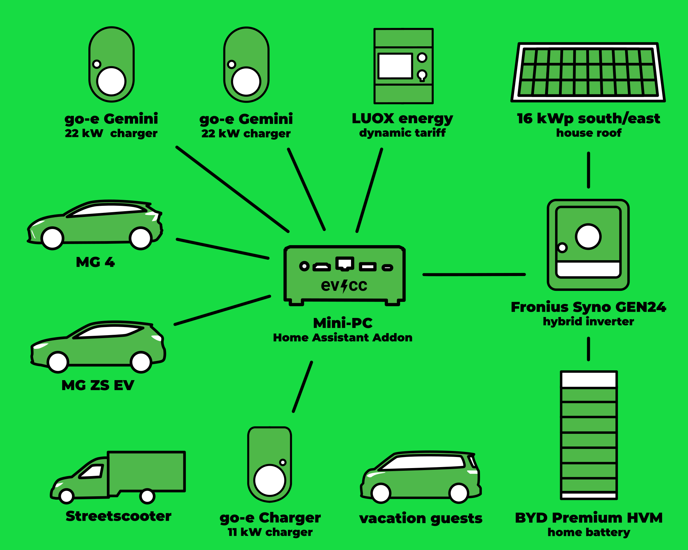
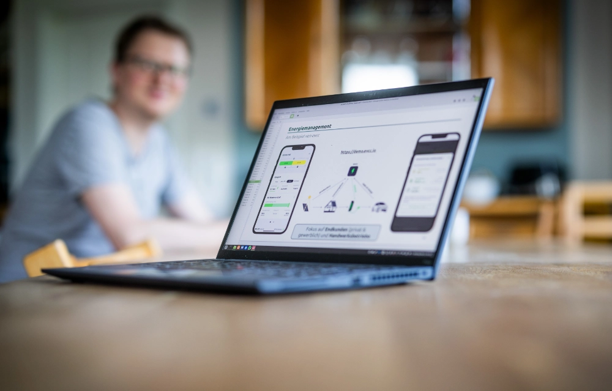
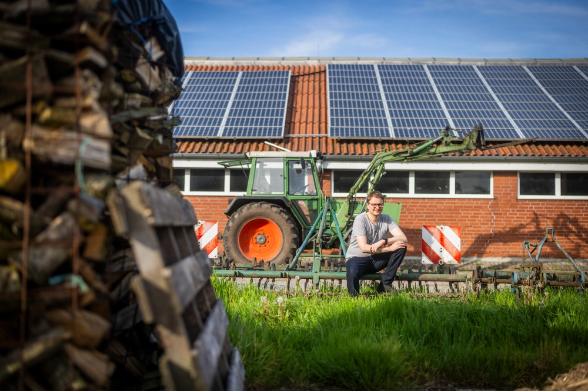

Dette er det tredje indlæg i vores serie af community-portrætter.
Fotografen [Detlef](https://hee.se) har besøgt Tjarko fra Großefehn på [Gröönlandhof](https://www.groeoenlandhof.de).
Ud over flotte billeder giver besøget også interessante indblik.

{/* excerpt */}

## Flergenerationsprojekt på en plusenergigård

**Michael:** Hej Tjarko, dejligt, at du tager dig tid til et community-portræt.
Jeres gård, Gröönlandhof, var med i [PV Magazine](https://www.pv-magazine.de/2021/01/15/selbst-ist-der-groeoenlandhof-wallbox-ladesteuerung-selbst-gebaut/) for nogle år siden, og nogle brugere har måske hørt navnet før.
Måske kan du starte med at fortælle lidt om dig selv?

**Tjarko:** Ja, gerne.
For seks år siden omdannede vi mine forældres fredede gård til et flergenerationsprojekt som plusenergigård, Gröönlandhof.
Siden da har vi boet her sammen med andre mennesker, og vi driver bl.a. også et andelslandbrugsprojekt.
På gården har vi en elektrisk varevogn, Streetscooteren, og to elektriske personbiler.
Vi startede med en Renault Zoe, som siden er blevet erstattet af en MG ZS og en MG 4.
Hele opsætningen forsynes af flere solcelleanlæg.

## 4 solcelleanlæg, 3 ladepunkter, 3 elbiler og feriegæster

**Michael:** Solcelleanlæg er et godt stikord.
Måske kan vi gå i dybden med de tekniske detaljer her.
Hvordan ser din opsætning ud?

**Tjarko:** Tja, som jeg nævnte, har vi to anlæg med fuld eksport til elnettet, som snart bliver lagt om til egetforbrug, og et solcelleanlæg på 16 kWp, der vender mod sydøst, som vi allerede bruger til eget behov.
Vi planlægger også endnu et solcelleanlæg på 16 kWp, der vender mod sydvest.
Det hele fordeles via en Fronius Symo-inverter og et stort hjemmebatteri fra BYD på 22 kWh.
Vi har tre ladepunkter forskellige steder på gården: to go-e Charger på 22 kW og én go-e Charger på 11 kW.
Med den indbyggede belastningsstyring har vi begrænset ladepunkterne til samlet maks. 22 kW.
Vi har oprettet RFID-chips til alle køretøjer, så man nemt kan følge opladningerne med evcc.
Da flere og flere gæster (gårdbesøgende, feriegæster osv.) kommer i elbil, findes der også en RFID-chip til gæstekøretøjer.
I de seneste to år er det lykkedes os at dække 45 % af vores opladning med solenergi!

Hardwaremæssigt kørte jeg først evcc til test på en Synology NAS med Docker, men nu kører det på en mini-pc som add-on i Home Assistant.
Det synes jeg er enklere og mere behageligt, og det giver endnu flere muligheder for automatisering via Home Assistant.
Desuden kan alle beboere på gården let betjene det via Home Assistant-appen.

| Komponent            | Detaljer                                                                                                                           |
| -------------------- | ---------------------------------------------------------------------------------------------------------------------------------- |
| **Biler**            | MG 4, MG ZS, Streetscooter, feriegæsternes biler                                                                                   |
| **Opladere**         | go-e Charger (11 kW, 2 × 22 kW)                                                                                                    |
| **Hybridinverter**   | Fronius Symo GEN24 10.0 Plus                                                                                                       |
| **Solcelleanlæg**    | 16 kWp mod sydøst                                                                                                                  |
| **Hjemmebatteri**    | BYD Premium HVM (22,1 kWh)                                                                                                         |
| **Styring**          | evcc på mini-pc som Home Assistant-add-on                                                                                          |
| **Dynamisk eltarif** | LUOX energy (tidligere Lumenaza)                                                                                                   |
| **Planlagt**         | 16 kWp sydvest (nyt anlæg) 27 kWp-anlæg (fra fuld eksport til egetforbrug) 25 kWp-anlæg (fra fuld eksport til egetforbrug) |

Vi har en dynamisk eltarif fra LUOX energy (tidligere Lumenaza), da de også aftager strøm fra små solcelleanlæg til direkte afsætning.

Det eneste, der nu står tilbage på to-do-listen, er integrationen af de trådløse Homematic-termostater, så rumtemperaturen kan hæves med evcc i fyringssæsonen, når der er soloverskud.
Når yderligere to solcelleanlæg (27 kWp og 25 kWp) i de kommende år er lagt om fra fuld eksport til egetforbrug, bliver det en helstøbt opsætning.

**Michael:** Det er virkelig imponerende. Det lyder, som om mange dele af jeres hverdag er integreret i en bæredygtig energiforsyning, ikke kun opladning af en bil.
Kan du fortælle lidt om din baggrund? Hvorfor begyndte du at beskæftige dig med emnet? Hvordan stødte du på evcc?

**Tjarko:** Jeg er selv ingeniør inden for vedvarende energisystemer og har længe beskæftiget mig med energiproduktion, energilagring og energistyring, både privat og professionelt.
Som forsker har jeg også udgivet open data- og open source-projekter, så jeg er generelt meget begejstret for emnet.
Jeg stødte på evcc direkte på GitHub og så hurtigt potentialet.
Især det, at evcc kunne tage højde for køretøjernes opladningsniveau længe før mange andre løsninger, var et stort plus for mig.

## Cloudbaserede løsninger vil aldrig kunne gøre det i samme omfang

**Michael:** Tjarko, du har brugt evcc helt fra starten. Hvad fascinerer dig ved projektet? Og hvad ville du måske ønske dig fremover?

**Tjarko:** evcc har altid været god til at understøtte så meget hardware som muligt og samtidig gøre alle funktioner nemme at forstå og bruge.
Den største fordel for mig fremover er, at det kører lokalt på netværket og derfor kan styre mange batterisystemer.
Ud over den allerede implementerede funktion _spærring af batteriafladning ved lave elpriser_ er det for nylig blevet muligt at _oplade batteriet fra elnettet_.
Cloudbaserede løsninger vil aldrig kunne gøre det på tværs af producenter i det omfang, evcc kan.

Mit største ønske er, at hele **opsætningen** kan klares via webgrænsefladen, og at der også kommer en eller flere virksomheder, der sælger evcc sammen med hardware, så mange flere brugere kan få glæde af evcc.

**Michael:** Nå, lad os se, hvor hurtigt det ønske går i opfyldelse.
Mange tak for din tid, og alt det bedste!
