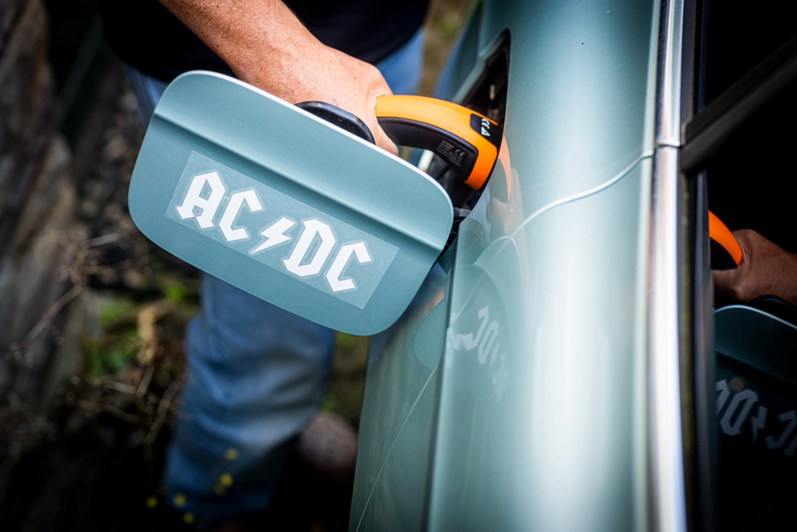
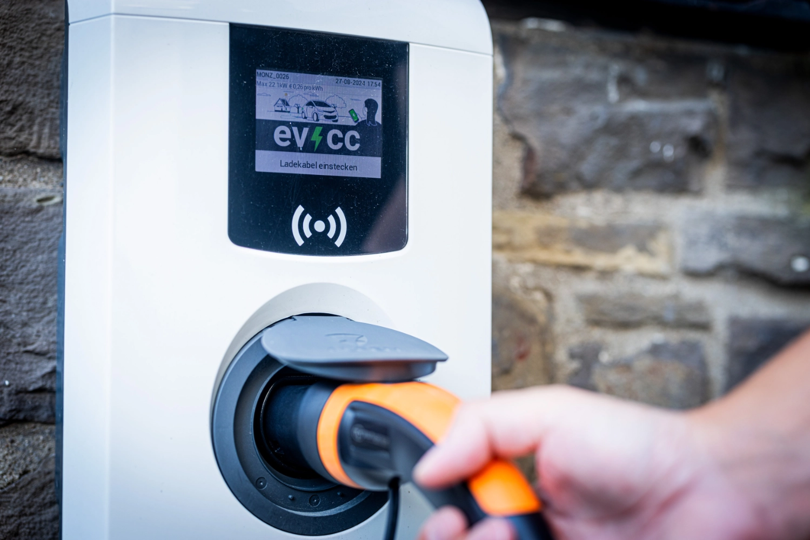
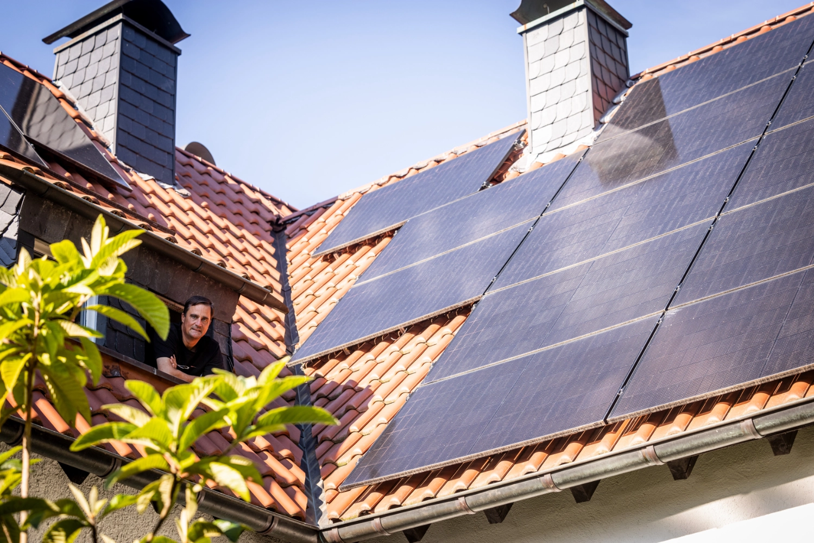
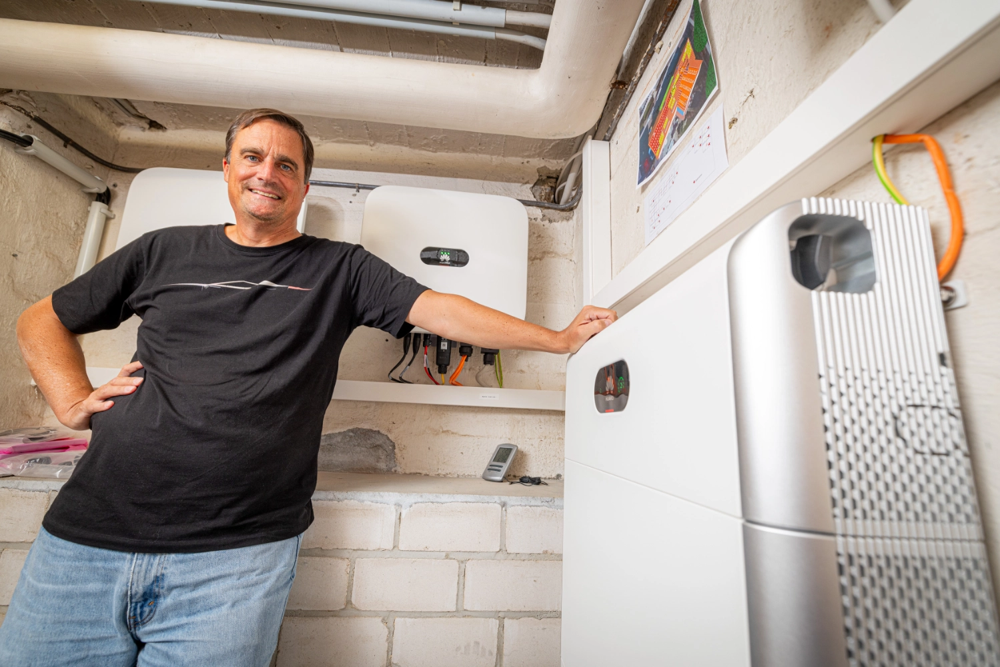
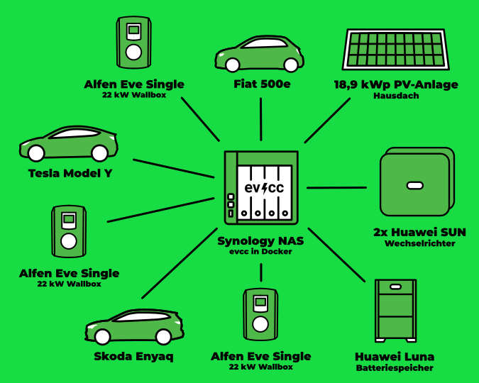

I vores serie af community-portrætter har fotografen [Detlef](https://hee.se) besøgt Olaf i Nordrhein-Westfalen.

{/* excerpt */}

## Vi vidste, at der ikke var nogen vej tilbage

**Michael:** Hej Olaf, tak fordi du tager dig tid til at være med i dette format.
Fortæl os lidt om dig selv, og hvordan du kom i gang med elbiler og opladning med soloverskud.

**Olaf:** Hej Michael, det er mig en fornøjelse.
Jeg er 52, gift og har to døtre.
I 1998 var jeg med til at stifte mit første firma inden for e-handel, hvor jeg ledede sysadmin-teamet.
Jeg er stadig aktiv som medstifter og rådgiver i forskellige virksomheder.

Jeg kom ind på elbiler for omkring fire eller fem år siden.
Før det havde jeg ikke for alvor overvejet dem og var påvirket af den mærkelige mediedækning.
Jeg troede, at elbiler let gik i brand og havde begrænset rækkevidde.
Jeg kan ikke huske præcis, hvad der fik mig til at kigge på dem igen, måske et blogindlæg eller en vens forslag om at gøre noget ved klimaforandringerne.
I starten af 2020 så jeg YouTube-kanaler om kommende elbiler i Tyskland.

Det stod hurtigt klart, at en Enyaq eller en Model Y ville passe bedst til vores behov.
Desværre gik der et stykke tid, før disse biler blev tilgængelige, så jeg fik installeret opladerne før vores første elbil.
Efter en afslappet sommerferie på 5.500 km i Spanien med Enyaq'en stod det klart for min familie og mig, at der ikke var nogen vej tilbage.
Vi solgte straks den anden fossilbil.
Når man først er kommet ind i elmobilitet, er det næste logiske skridt at installere et solcelleanlæg til opladning med overskud.

**Michael:** Imponerende. Klimaet var altså startskuddet, og så gik du mere i dybden.
Jeg er nysgerrig: Hvordan ser dit udstyr derhjemme ud?

**Olaf:** Solcelleanlægget er på 18,92 kWp, med 6 paneler på en lidt fladere kvist mod nord-nordvest.
Vi har to Huawei-invertere og et Huawei LUNA2000-hjemmebatteri med en kapacitet på 15 kWh.
Vi bruger tre Alfen Eve Single Pro-line 22 kW-opladere, og evcc kører i Docker på min Synology.
Vores tre biler lader jævnligt med solstrøm.
Ud over Enyaq'en har vi en Model Y og en Fiat 500e.

## Så var jeg fanget

**Michael:** Hvordan opdagede du evcc, og hvorfor bruger du det?

**Olaf:** I starten prøvede solcelleinstallatøren og jeg at få Alfen-opladerne til at lade med overskud ved hjælp af en Elgris-smartmåler.
Vi fik vist de aktuelle værdier, men kunne ikke justere ladeeffekten.
Da Alfens support sagde, at funktionen stadig var i beta, kiggede jeg efter andre muligheder for opladning med soloverskud og fandt evcc.
Jeg kunne lide den modulære tilgang, hvor enheder fra forskellige producenter kan arbejde sammen.
Det er open source og bliver løbende udviklet, og det vakte så meget interesse hos mig, at jeg prøvede at installere det.
Da jeg havde overvundet yaml-filens finurligheder og så evcc tilpasse ladeeffekten til soloverskuddet, var jeg solgt.

**Michael:** Det kan jeg godt forstå.
Det er fascinerende at se softwaren regulere, især når det gælder om at udnytte den selvproducerede strøm bedst muligt.
Hvad er din yndlingsfunktion?

**Olaf:** Min favorit er Sol-tilstanden, som tilpasser mine opladere til det aktuelle overskud fra taget.
Jeg sætter også pris på andre fordele, som at Fiat 500e'en kun lades op til 80 %, hvilket den ikke selv kan.
Jeg får mere aktuelle visninger af solproduktionen end i Huaweis app, som opdaterer hvert 5. minut.
Jeg justerer indstillingen **Tilbageværende effekt** i brugerfladen for at sætte en buffer, så der ikke trækkes strøm fra elnettet, når en sky passerer, eller et stort apparat tændes.
Inverteren regulerer dette med hjemmebatteriet i løbet af sekunder.
Desværre bliver evcc bremset af Huaweis dongle, som kræver et interval på 45 sekunder.
Men evcc's indstillinger har løsninger på næsten alle problemer.

**Michael:** Det er dejligt at se evcc kompensere for producentens svagheder.
Bruger du integrationer med andre systemer som Home Assistant eller Grafana?

**Olaf:** Ikke endnu.
Det er helt nyt for mig, og jeg mangler i øjeblikket tid til at udforske det.
Jeg er ret tilfreds med evcc's indbyggede funktioner.

| Komponent         | Beskrivelse                                    |
| ----------------- | ---------------------------------------------- |
| **Solcelleanlæg** | 18,9 kWp, delvist orienteret mod nord-nordvest |
| **Inverter**      | 2x Huawei SUN2000                              |
| **Hjemmebatteri** | Huawei LUNA2000 med 15 kWh                     |
| **Opladere**      | 3x Alfen Eve Single Pro-line 22 kW             |
| **Køretøjer**     | Škoda Enyaq, Tesla Model Y, Fiat 500e          |
| **Styring**       | evcc på Synology i Docker                      |

**Michael:** Julen er næsten over os.
Hvis du kunne ønske dig noget til evcc's videre udvikling, hvad skulle det så være?

**Olaf:** At flytte konfigurationen fra en yaml-fil til brugerfladen ville være et kæmpe skridt fremad.
Det ville gøre mange ting enklere.
Intelligent styring af varmepumper ville også være fantastisk, da vi er ved at udskifte vores gamle varmeanlæg med en Lambda-varmepumpe.
Det ville være rart at bruge evcc til at opvarme den store buffertank med overskudsstrøm og undgå dyr strøm fra elnettet om natten.

**Michael:** Det passer godt.
Vores seneste udgivelse tilføjede de første varmepumpeintegrationer og en SG Ready-skabelon.
Der vil ske meget mere næste år.
Tak igen, Olaf, fordi du delte din opsætning og din personlige rejse ind i ”elmobilitet og effektiv opladning”.
Jeg ønsker dig og din familie en glædelig jul og fortsat god fornøjelse med din opsætning.
