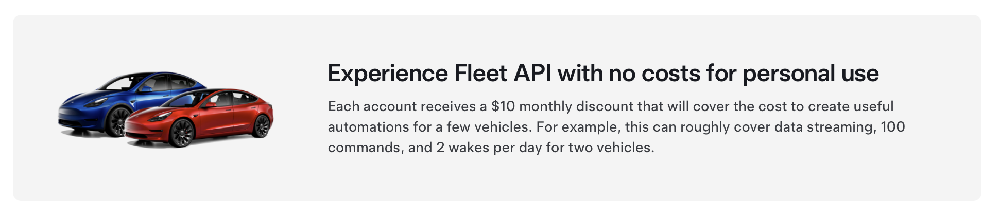

Fra og med evcc v0.133 kræves en [Tesla Developer Account](https://developer.tesla.com/).
Brugen er stadig gratis, men kræver et ekstra trin i opsætningen.

{/* excerpt */}

:::note[Opdatering]
Dette indlæg er blevet revideret.

**[8.2.2025](https://github.com/evcc-io/docs/pull/723/files):** Mere detaljeret vejledning til konfiguration af Tesla Fleet API og myteslamate.com.<br/>
**[27.3.2025](https://github.com/evcc-io/docs/pull/775/files):** Opdatering til den nye opsætningsproces hos myteslamate.com.

:::

## Tesla Fleet API koster penge fra februar

Sidste år integrerede vi [Tesla Fleet API](/da/blog/2024/02/01/v0124-new-tesla-api) i evcc.
Tesla var den første producent, der stillede et officielt og frem for alt åbent API til rådighed for kommunikation med sine køretøjer.

Tesla havde allerede meddelt, at dette API ikke ville forblive gratis.
Priserne er nu kendt og træder i kraft 1. februar 2025.
Afregningen sker efter forbrug, og omkostningerne varierer afhængigt af typen af forespørgsel.

Med [tesla.evcc.io](https://tesla.evcc.io) har vi stillet en tjeneste til rådighed, som lader evcc-brugere generere adgangstokens til brug af API'et.
Fra februar 2025 ville vi blive faktureret for API-kommunikationen med disse tokens.
Omkostningerne pr. bruger afhænger af antallet af køretøjer, opladningsadfærden og den konkrete konfiguration af opdateringsintervallet.
For de fleste brugere overstiger disse omkostninger vores sponsormodel på ”2 dollar om måneden”, og det kunne vi ikke bære økonomisk, heller ikke hvis vi krævede sponsorat for Tesla-integrationen.

## Gratis API-kredit til private brugere

Tesla giver private brugere en månedlig API-kredit på 10 dollar, som burde være tilstrækkelig for de fleste evcc-brugere.

[](https://developer.tesla.com/)

Med version 0.133 har vi tilpasset API-kommunikationen med Tesla, så du kan bruge din egen Tesla Developer Account.
Gamle tokens, der er genereret med [tesla.evcc.io](https://tesla.evcc.io), virker ikke længere.
Vi har overvejet at udvide vores eksisterende proces til generering af tokens, så du kan bruge din egen Tesla Developer Account.
Heldigvis har [myteslamate.com](https://app.myteslamate.com) allerede implementeret denne funktion.
Der kan du generere **access- og refresh-tokens** med din Developer Account.
Derfor valgte vi at lade være med at opfinde den dybe tallerken igen.

## Hvad skal du gøre?

<a id="vehicle"></a>

### For Tesla-ejere

Til opsætningen i evcc skal du bruge tre oplysninger:

- **Client ID:** fra [Tesla Developer Portal](https://developer.tesla.com/)
- **Access Token:** via scriptet fra [myteslamate.com](https://www.myteslamate.com/tesla-api-application-registration/)
- **Refresh Token:** via scriptet fra [myteslamate.com](https://www.myteslamate.com/tesla-api-application-registration/)

Følg vejledningen på [myteslamate.com](https://www.myteslamate.com/tesla-api-application-registration/) for at generere disse oplysninger.

Da du arbejder på myteslamate.com og developer.tesla.com parallelt, anbefaler vi, at du udfører trinnene i to browservinduer samtidig.
Til sidst i processen skal et script downloades og køres i terminalen/konsollen på din computer.

Under login vises en dialogboks med tilladelser.
Til drift med en almindelig oplader (ikke Tesla Wall Connector) kræver evcc følgende **Tesla API-tilladelser**:

- Profiloplysninger _(region, liste over køretøjer)_
- Køretøjsoplysninger _(opladningsniveau, køretøjsstatus osv.)_
- Køretøjets placering _(til genkendelse af køretøjet, endnu ikke implementeret)_
- Køretøjskommandoer _(til at vække køretøjet)_

Når du har gennemført processen, skal du indtaste oplysningerne i evcc-konfigurationen:

Eksempel:

```yaml {6-8}
vehicles:
  - name: my_car
    type: template
    template: tesla
    title: Tesla Model 3
    clientId: aaaaaa-11111-... # fra developer.tesla.com
    accessToken: ey1234567890... # fra myteslamate.com
    refreshToken: EU_1234567890... # fra myteslamate.com
```

Du kan følge dit forbrug af API-kredit i [oversigten i Tesla Developer Portal](https://developer.tesla.com/dashboard/).

:::note
evcc-projektet har ingen forbindelse til myteslamate.com.

Vi er i kontakt med [jlestel](https://github.com/jlestel), udvikleren af myteslamate.com.
Han tillader udtrykkeligt, at evcc-brugere bruger tjenesten gratis.
Læs [Terms of Service](https://www.myteslamate.com/terms-of-service) og [Privacy Policy](https://www.myteslamate.com/privacy-policy), før du bruger tjenesten.
:::

### For brugere af Tesla Wall Connector

Hvis du bruger en Tesla Wall Connector, er der yderligere trin, da opladningskommandoerne skal signeres og håndteres via en offentligt tilgængelig server.
myteslamate.com stiller sådan en proxy til rådighed.
Afregningen sker efter forbrug direkte via myteslamate.com.
Disse kommandoer tærer ikke på din Tesla API-kredit.

Vi går ud fra, at du allerede har gennemført de [trin, der er beskrevet ovenfor](#vehicle).
Log ind på myteslamate.com igen, og følg vejledningen for at opsætte den betalte kommandoproxy.
Kopiér **Proxy-Token** fra afsnittet **Use MyTeslamate API**.
Indsæt dette token i din evcc-konfiguration:

```yaml {9}
vehicles:
  - name: my_car
    type: template
    template: tesla
    title: Tesla Model 3
    clientId: aaaaaa-11111-... # fra developer.tesla.com
    accessToken: ey1234567890... # fra myteslamate.com
    refreshToken: EU_1234567890... # fra myteslamate.com
    proxyToken: aaaaa-bbbbb-... # fra myteslamate.com
```

Med denne opsætning sender evcc opladningskommandoer til myteslamate.com-proxyen, som signerer dem med din Tesla-applikation og videresender dem til det oprindelige Tesla API.

:::caution[Proxy-tokenet giver meget vidtgående adgang]
Det anbefales at begrænse tilladelserne hos myteslamate.com til de nødvendige funktioner.
For evcc er kun funktionerne **Charge Start**, **Charge Stop** og **Set Charging Amps** nødvendige.
:::

## tesla.evcc.io lukkes

tesla.evcc.io lukkes i februar.
Alle tokens, der er genereret med tjenesten, mister deres gyldighed.
For fortsat at bruge Tesla API'et kræves en opdatering til evcc version 0.133.

## Andre muligheder

Tesla API-kommunikationen i evcc er ikke bundet til myteslamate.com.
Du kan selv generere tokens med den tilsvarende infrastruktur (offentlig callback-URL påkrævet) og indtaste dem i den ovennævnte evcc-konfiguration.

Alternative integrationer via tjenester som [TeslaLogger](https://docs.evcc.io/docs/vehicles#teslalogger), [TeslaMate](https://docs.evcc.io/docs/vehicles#teslamate), [TeslaBleHttpProxy](https://docs.evcc.io/docs/vehicles#tesla-ble), [Tessie](https://docs.evcc.io/docs/vehicles#tessie) eller [Tronity](https://docs.evcc.io/docs/vehicles#tronity) er også mulige.

Ejere af en Tesla Wall Connector kan også fortsat bruge [TeslaBleHttpProxy](https://github.com/wimaha/TeslaBleHttpProxy) som lokal ”Command Proxy”.

## Konklusion

Vi har diskuteret flere alternativer til Tesla-integrationen.
Særlige tjenester og prisniveauer for Tesla-brugere var også på bordet.
Vi mener, at vores nuværende løsning er den bedste set fra brugerens perspektiv.
For det første medfører den ingen ekstra omkostninger for de fleste private brugere.
Integrationen kræver fortsat ikke sponsorat.
API-kommunikationen kræver ingen tredjepartstjenester.
Brugere med større flåder kan også bruge evcc. I så fald opkræver Tesla API-gebyrerne direkte, når den månedlige gratis kvote overskrides.

**Venlig hilsen**<br/>
evcc-teamet<br/>
Michael, Andi & Uli
