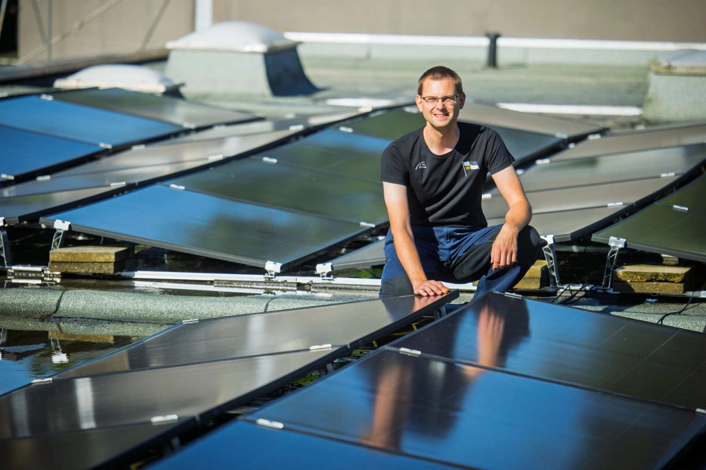
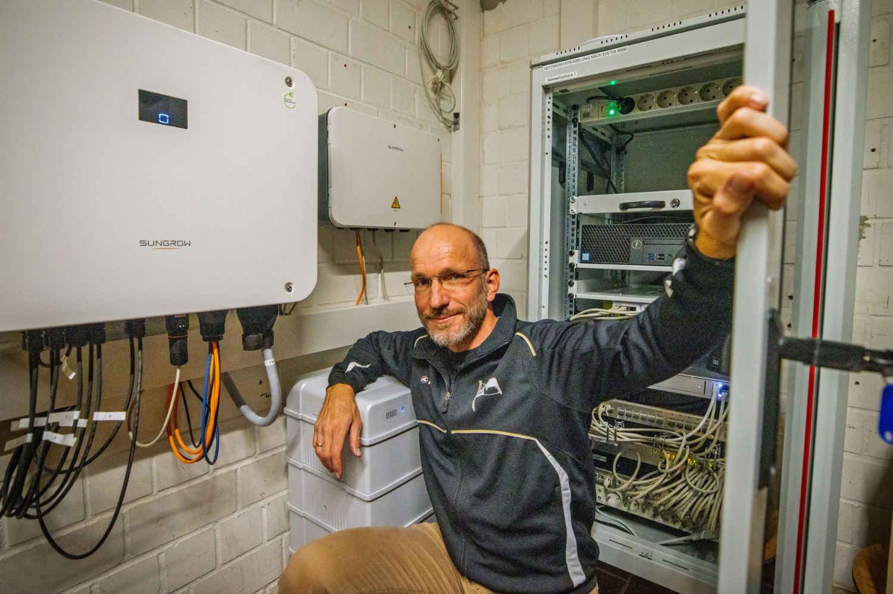
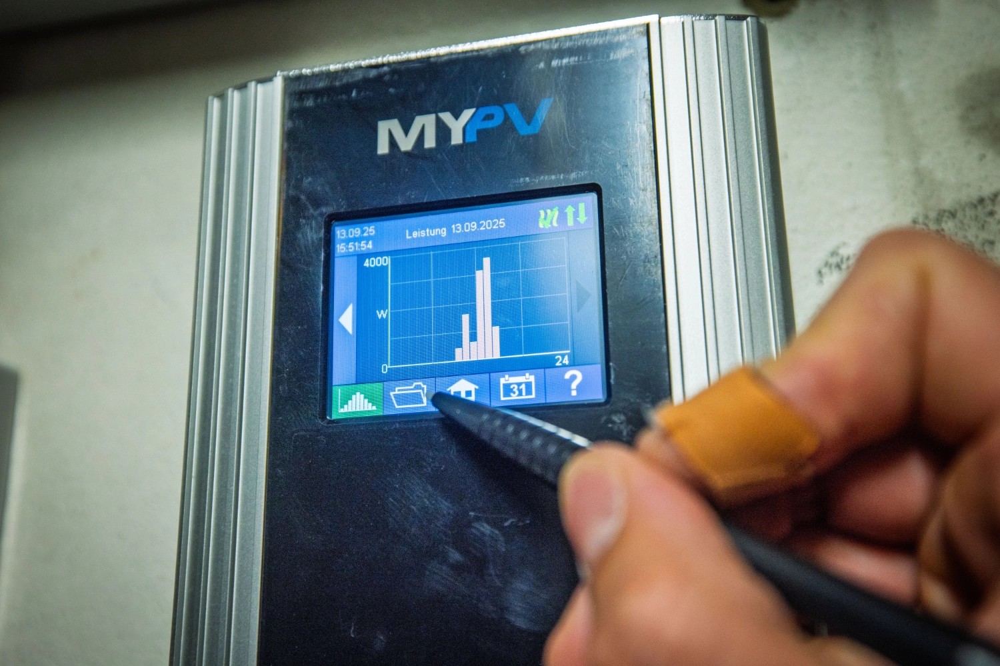
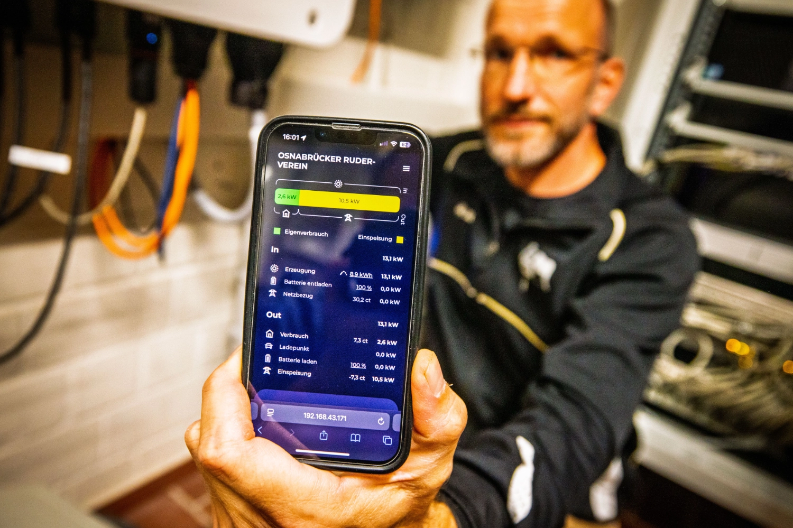
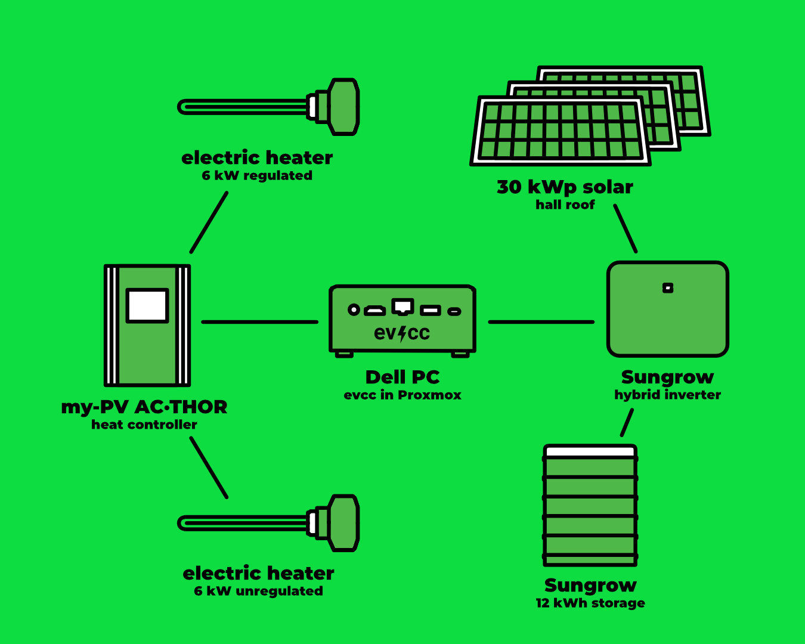
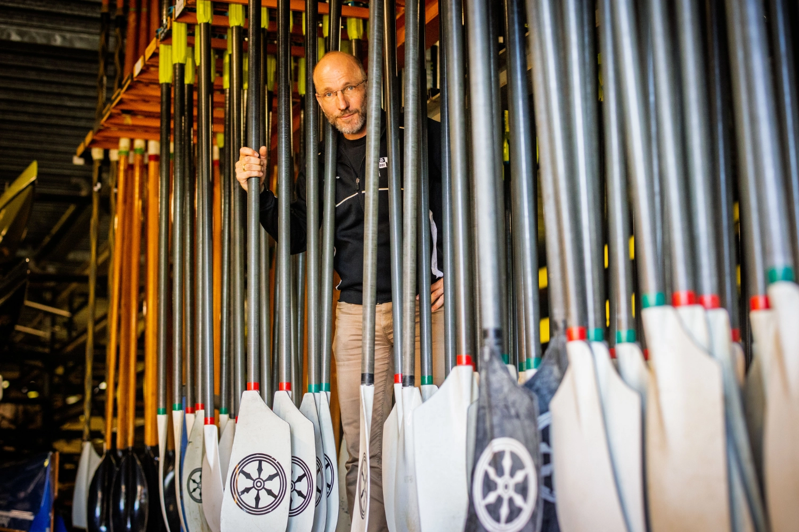
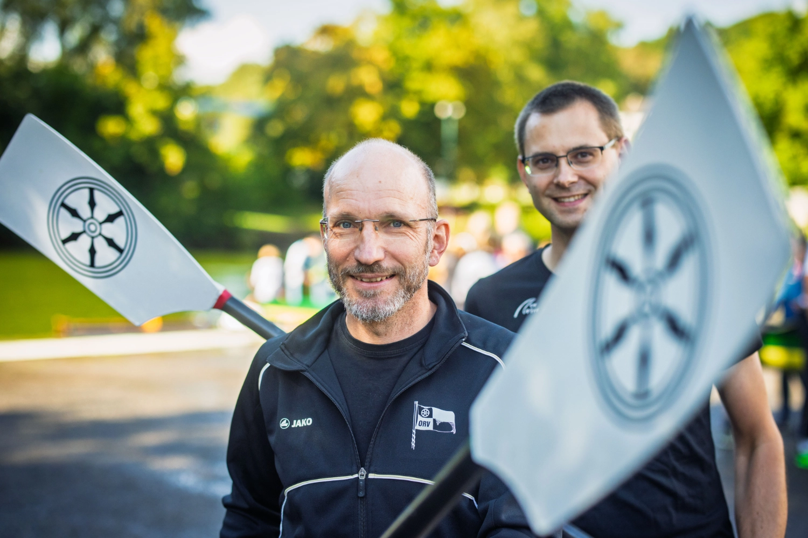
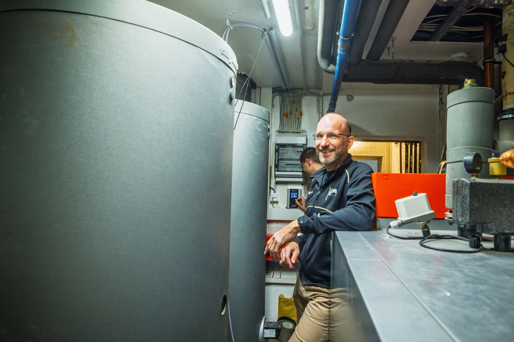

Et stort bådhus, brusere til snesevis af roere og masser af tagflade: [Osnabrücker Ruderverein](https://www.orv.de) (ORV) har fundet en måde at sænke energiforbruget på og samtidig blive mere uafhængig af fossile brændsler med solenergi og evcc.
Fotografen [Detlef](https://hee.se) har besøgt dem.

{/* excerpt */}

## Fra solvarme til solceller

**Michael (evcc):** Hej Michael, hej Markus, dejligt at I tager jer tid.
Et stort tag på et bådhus: det er perfekt til solceller.
Hvordan overbeviste I klubben om at investere?

**Michael (ORV):** Vi havde et solvarmeanlæg på taget indtil for nogle år siden, men det var økonomisk set en total fiasko.
Som led i en energirenovering var et solcelleanlæg naturligvis på dagsordenen.
Den oprindelige anledning var stigende elpriser, men også ønsket om at blive uafhængig af gas.
Da vi kunne klare mange opgaver med frivilligt arbejde fra klubbens medlemmer, blev investeringen betydeligt lavere end først anslået.
Det overbeviste medlemmerne.

**Michael (evcc):** Hvor meget af tagfladen har I kunnet dække?

**Markus (ORV):** I øjeblikket er kun omkring en fjerdedel af tagfladen dækket med et anlæg på 30 kWp.
Men vi må ikke installere mere på grund af reglerne, og vi udnytter allerede nettilslutningen fuldt ud.
Hvis det ændrer sig, vil vi gerne selv udvide anlægget med frivilligt arbejde.

## Varmt vand til snesevis af roere

**Michael (evcc):** Hvordan kom evcc ind i billedet?
Overvejede I alternativer?

**Michael (ORV):** Vores formand brugte allerede evcc derhjemme til sit solcelleanlæg, og erfaringerne var positive.
Så var det oplagt også at bruge det i klubben.

**Michael (evcc):** Og hvordan ser jeres tekniske opsætning ud?

**Markus (ORV):** Vi har et Sungrow-anlæg på 29,92 kWp, et batteri på 12 kWh og en My-PV AC-Thor 9s med et reguleret varmelegeme på 6 kW og et ureguleret varmelegeme på 6 kW, der styres via relæudgangen.
De sidder hver i sin varmtvandsbeholder.
Softwaren kører på en genbrugt Dell-pc, der bruger beskedne 15 W.
Der er installeret Proxmox på den, Home Assistant kører i en VM og evcc i en container.
Vi opgraderede også vores tekniske infrastruktur sidste år for at få et stabilt og fremtidssikret system.

**Michael (evcc):** Hvor mange går i bad på en almindelig dag med vand fra jeres soldrevne varmelegeme, og har vandet nogensinde været for koldt?

**Michael (ORV):** Det er svært at sige, hvor mange der går i bad om dagen.
Siden vi har installeret vandbesparende brusehoveder og timere, går folk helt sikkert kortere tid i bad.
Det er med til at spare gas.
Vandet kan ikke blive for koldt, fordi vi har en gaskedel, der varmer vandet op, så snart det falder under 36 °C.

## 5.742 kWh gas sparet

**Michael (evcc):** Kan I allerede sige, hvor meget gas I har sparet med jeres varmelegemer?

**Markus (ORV):** Vi kan analysere forbruget pr. varmelegeme med Home Assistant.
Frem til midten af september havde vi varmet vand op med mindst 5.742 kWh solstrøm.
Det burde svare til nogenlunde den samme mængde gas.
Da vi stadig er i testfasen, har vi endnu ingen langsigtede erfaringer.

**Michael (evcc):** Ville I stadig have strøm til overs til en oplader til medlemmernes elbiler eller andre forbrugsenheder?

**Michael (ORV):** I øjeblikket eksporterer vi overskuddet til elnettet.
Siden varmelegemerne kom i drift, er overskuddet blevet meget mindre.
Men vi planlægger allerede at installere opladere til elbiler i fremtiden.

| Komponent               | Detaljer                                                               |
| ----------------------- | ---------------------------------------------------------------------- |
| **Solcelleanlæg**       | 29,92 kWp (ca. 1/4 af den tilgængelige tagflade)                       |
| **Inverter**            | Sungrow                                                                |
| **Batteri**             | 12 kWh                                                                 |
| **Varmtvandsanlæg**     | My-PV AC-Thor 9s med 2 varmelegemer (6 kW reguleret + 6 kW ureguleret) |
| **Varmtvandsbeholdere** | 2 stk.                                                                 |
| **Styring**             | evcc i container på Proxmox, Home Assistant i VM                       |
| **Hardware**            | Dell-pc (15 W forbrug)                                                 |

## Varmepumpe vs. varmelegeme

**Michael (evcc):** En varmepumpe er betydeligt mere effektiv end et varmelegeme.
I bruger i øjeblikket varmelegemer til at varme vandet op.
Hvorfor har I valgt det, og har I allerede planer om en varmepumpe?

**Michael (ORV):** Vi har allerede talt om en varmepumpe.
Men vores varmebehov som klub adskiller sig markant fra typiske installationer.
Klassiske tommelfingerregler gælder ikke nødvendigvis, og vi vil dimensionere anlægget efter vores behov.
Vi vil også kunne vurdere, om en kombineret varmepumpe til opvarmning og varmt vand eller separate anlæg er bedst for os.

Vores gaskedel fungerer i øjeblikket fint.
Lige nu indsamler vi omfattende data om forbrug, spidsbelastning osv. med Home Assistant.
Vores mål er at kunne varme helt uden gas næste sommer.
Det er vi meget fortrøstningsfulde omkring.

**Markus (ORV):** Da vi skal klare projekterne i vores fritid, holder vi antallet af parallelle projekter nede, så vi rent faktisk får tingene gjort færdige (griner).
Desuden er fyrrummet fyldt op, så når der kommer en varmepumpe ind, skal gaskedlen ud.

## Fra kassererjobbet ud på vandet

**Michael (evcc):** Michael og Markus, I er de to tekniske ildsjæle i Osnabrücker Ruderverein: hvor ofte ser klubbens medlemmer jer i en båd, og hvor ofte kun i teknikrummet?

**Markus (ORV):** Siden jeg overdrog posten som kasserer i foråret, har jeg sat mig for at komme mere ud på vandet.

**Michael (ORV):** Jeg overtog bestyrelsesposten for bygninger og anlæg for tre år siden, og ja, jeg bruger meget mere tid på arbejde i og for klubben.
Alligevel når jeg som regel stadig at ro en tur i weekenden.

## Ønsker til fremtiden

**Michael (evcc):** Har I ønsker til fremtiden og den videre udvikling af evcc?

**Markus (ORV):** Helt sikkert: en funktion, der sørger for, at vandet primært varmes op om morgenen og i løbet af dagen, men at batteriet er 100 % opladet, når natten falder på, ville være vores næste ønske.
For at skåne batteriet og for at eksportere til elnettet på en netvenlig måde ville det også være rart at kunne neddrosle ladeeffekten.

**Michael (evcc):** Tak for de gode forslag.
Fordi evcc har sine rødder i opladning af elbiler, har vi stadig meget at forbedre, når det gælder opvarmning.
Men der er ting på vej.

Tak for indblikket i jeres energiverden i roklubben.
Det viser fint, hvordan evcc også kan fungere i større foreninger!

---

**Hvordan ser din evcc-opsætning ud?**
Hvis du har lyst til at dele dine erfaringer, din historie og din teknik i form af et community-portræt, så tilmeld dig [her via formularen](https://airtable.com/appDI3xIiev1DOpMY/shrW1zGH26KElfZOK).
Vi leder især efter portrætter af usædvanlige installationer eller brugere uden for Tyskland.

---

_Opdatering 19. december 2025: Vi har tilføjet afsnittet ”Varmepumpe vs. varmelegeme”._
