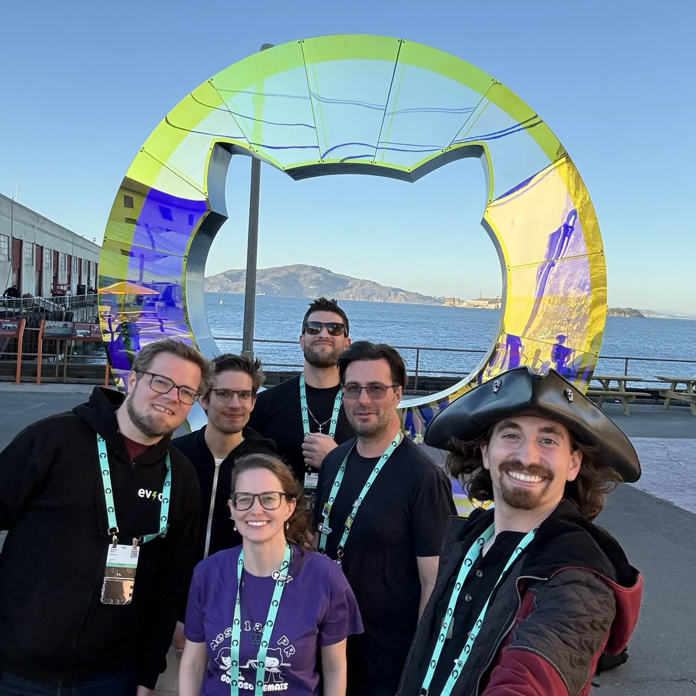

Sidste sensommer spurgte GitHub, om vi ville deltage i [Secure Open Source Fund](https://github.com/open-source/github-secure-open-source-fund).
Vi søgte, blev udvalgt af komitéen og kom med i et intensivt sikkerhedsprogram sammen med 98 maintainers fra 67 open source-projekter.

{/* excerpt */}

## Programmet

Den intensive fase løb i september 2025 med omkring 20 sessioner, alle live over Zoom og om aftenen, hvilket passede fint for europæiske deltagere, selv om der deltog folk fra alle tidszoner.
Sessionerne blev ledet af eksperter fra [GitHub Security Lab](https://securitylab.github.com/) og dækkede en bred vifte af emner.
Mellem sessionerne havde vi konkrete opgaver, der skulle løses. Lektier, men af den effektive slags.
Den egentlige værdi var dog at høre emnerne forklaret af folk, der arbejder med dem hver dag, og at diskutere dem i gruppen.

## Sikkerhed er træning, ikke et afkrydsningsfelt

Et begreb, der satte sig fast hos mig, var _Improving Our Security Posture_.
Sikkerhed er ikke et felt, man krydser af én gang. Det minder mere om fitness.
Der er ingen målstreg.
Man opbygger vaner, man bliver ved med at træne, og man bliver langsomt stærkere.
Programmet gav os en struktureret træningsplan.

Emnerne var meget forskellige.
Vi arbejdede med klare licenser og licenskompatibilitet, tilføjede licenstjek for vores Go- og NPM-afhængigheder og offentliggjorde SBOM'er.
Vi skrev en [SECURITY.md](https://github.com/evcc-io/.github/blob/main/SECURITY.md) og en plan for håndtering af sikkerhedshændelser.
Vi lærte om CVE-processen. Ikke noget, jeg har haft brug for indtil nu, men godt at være forberedt.
Vi gennemgik trusselsmodellering, secure-by-design-principper og UX-overvejelser ved udvikling af sikker software.
På værktøjssiden var der sessioner om statisk analyse med CodeQL og om fuzzing.

Jeg havde ikke regnet med, at sikkerhed i GitHub Actions var så omfattende et emne.
Der er mange subtile måder, workflows kan udnyttes på, og vi endte med at hærde vores egne actions grundigt med værktøjer som [actions-permissions](https://github.com/GitHubSecurityLab/actions-permissions).

En session, der overraskede mig, handlede om AI-sikkerhed.
GitHub introducerede os til [Secure Code Game](https://github.com/skills/secure-code-game), en praktisk udfordring, hvor man finder sårbarheder i en kodebase.
De første niveauer dækker klassiske OWASP-problemer som SQL-injection og XSS. Kendt terræn.
Men den nyeste sæson handler om at narre software med indbygget LLM-funktionalitet til at gøre ting, den ikke burde.
Det var en øjenåbner at se, at dette er den nye front, som folk aktivt træner til.

## Forskellige projekter, forskellige perspektiver

Det, der gjorde programmet særligt, var blandingen af projekter i gruppen.
Der var applikationer som evcc, [Thunderbird for Android](https://github.com/thunderbird/thunderbird-android), [Mattermost](https://github.com/mattermost/mattermost) og [Mastodon](https://github.com/mastodon/mastodon).
Biblioteker som [GoReleaser](https://github.com/goreleaser/goreleaser) (som vi bruger til vores releases), [Mermaid](https://github.com/mermaid-js/mermaid) (som vi bruger i vores dokumentation) og [Node.js](https://github.com/nodejs/node).
Og grundlæggende værktøjer som [curl](https://github.com/curl/curl) og [ImageMagick](https://github.com/ImageMagick/ImageMagick).

Sikkerhed betyder noget helt andet afhængigt af, hvad man bygger.
En applikation, der kører i folks hjem, står over for andre trusler end et bibliotek, der er indlejret i tusindvis af projekter.
Det var virkelig værdifuldt at høre, hvordan curl tænker sikkerhed sammenlignet med Mastodon.
Ud over indholdet er netværket, man opbygger med andre maintainers, noget, der varer ved.

## GitHub Universe

I oktober 2025 blev jeg inviteret til konferencen GitHub Universe i San Francisco ([læs mere](https://www.linkedin.com/posts/michael-geers_homeassistant-githubuniverse-opensource-activity-7391032971517992960-a9V8)).
Jeg deltog i et panel om Secure Open Source Fund på Community Day.
Det var dejligt at møde andre maintainers personligt efter flere ugers Zoom-sessioner.

Sammen med [Gregg Cochran](https://www.linkedin.com/in/greggcochran/) (GitHub), [Christian Grobmeier](https://www.linkedin.com/in/grobmeier/) (Log4j), [Camila Maia](https://www.linkedin.com/in/cmaiacd/) (ScanAPI) og [Carlos Alexandro Becker](https://www.linkedin.com/in/caarlos0/) (GoReleaser) optog jeg et podcastafsnit om open source-sikkerhed.
Du kan [se det på YouTube](https://www.youtube.com/watch?v=XmCSHr12CO0) eller [lytte til lydversionen](https://the-github-podcast.simplecast.com/episodes/live-from-github-universe-inside-the-github-secure-open-source-fund-EV0GufSU).

## Vær med

**Hvis du vedligeholder et open source-projekt:** overvej at søge om at komme med i programmet.
Overblikket over sikkerhedsemner er bredt, og netværket af maintainers, du opbygger, er lige så værdifuldt.

**Hvis din virksomhed er afhængig af open source** (og det er den næsten helt sikkert): overvej at sponsorere dine kritiske afhængigheder direkte.
Eller støt [Secure Open Source Fund](https://github.com/open-source/github-secure-open-source-fund) for at hjælpe det bredere økosystem.
Sikrere open source betyder sikrere software for alle.
