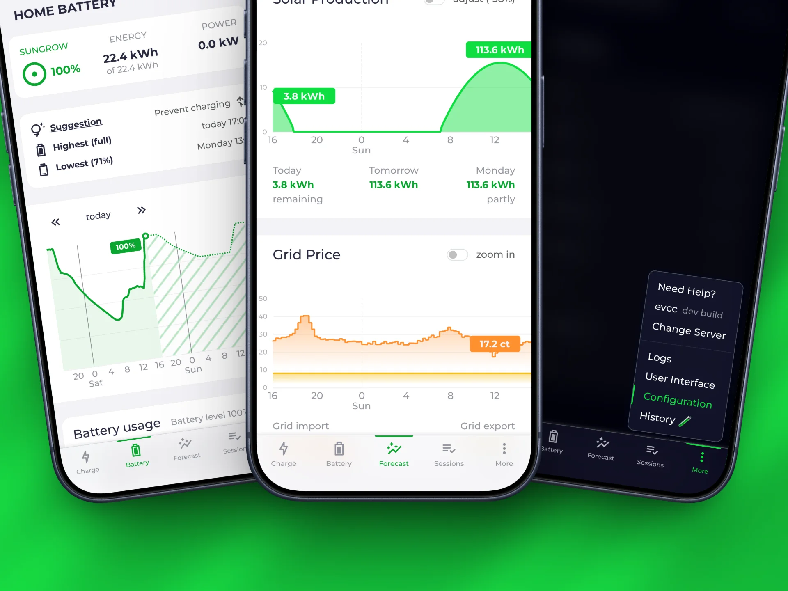
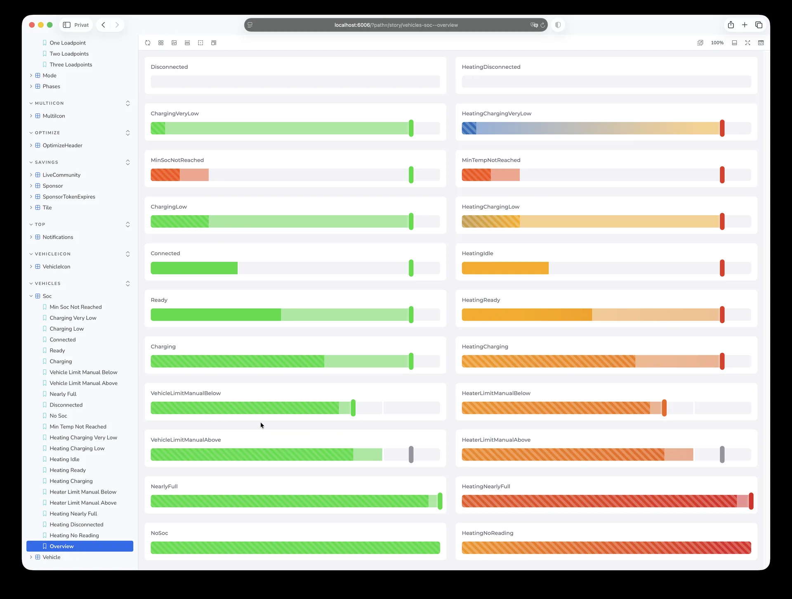
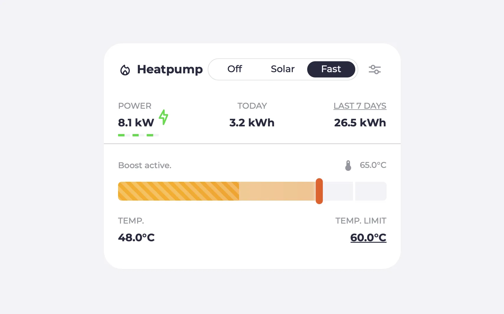
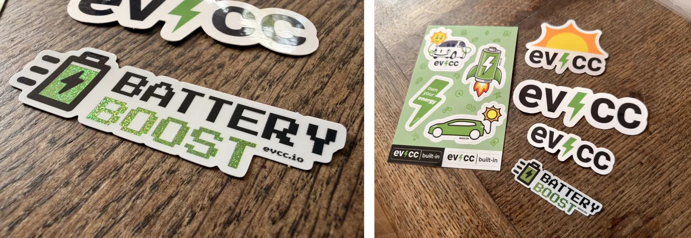
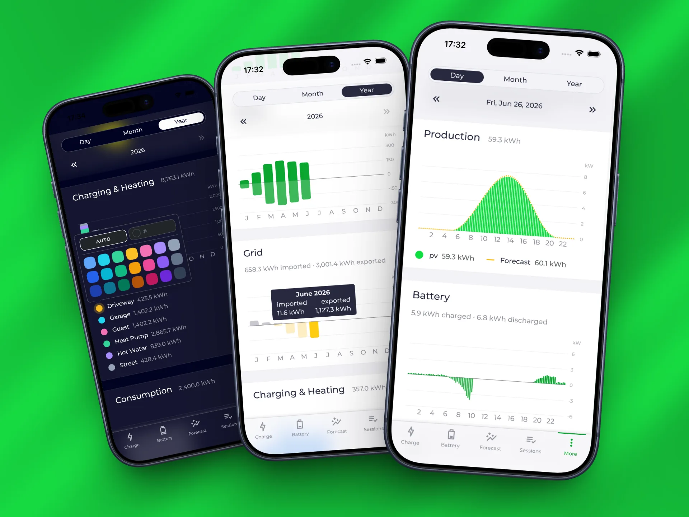
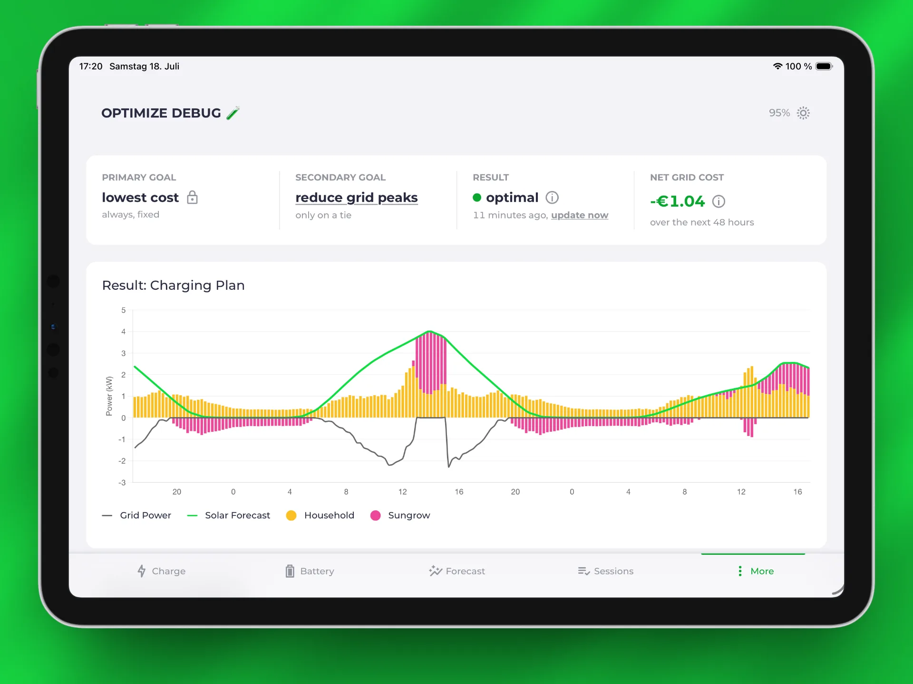

import Video from "@components/Video.astro";
import changeServerVideo from "../../../../../en/blog/2026/07/18/change-server.mp4";
import changeServerPoster from "../../../../../en/blog/2026/07/18/change-server.webp";
import widgetsVideo from "../../../../../en/blog/2026/07/18/widgets.mp4";
import widgetsPoster from "../../../../../en/blog/2026/07/18/widgets.webp";
import remoteAccessVideo from "../../../../../en/blog/2026/07/18/remote-access.mp4";
import remoteAccessPoster from "../../../../../en/blog/2026/07/18/remote-access.webp";
import batteryBoostVideo from "../../../../../en/blog/2026/07/18/battery-boost.mp4";
import batteryBoostPoster from "../../../../../en/blog/2026/07/18/battery-boost.webp";

Der er gået et halvt år siden [det seneste highlights-indlæg](/da/blog/2026/01/01/highlights-browser-config-ready).
Siden da er der sket meget med udgivelserne [0.301 til 0.311](https://github.com/evcc-io/evcc/releases): en ny navigation, widgets i iOS-appen, fjernadgang, tidsbaseret statistik og meget mere.
I dette blogindlæg fremhæver vi nogle af vores højdepunkter og giver et kort kig på vores videre planer.

{/* excerpt */}

## Ny brugerflade

Brugerfladen har fået en ny navigation nederst på skærmen.
Sektionerne **Oplader**, **Hjemmebatteri**, **Prognose**, **Sessioner** og **Mere** fører dig nu hurtigere frem til alle funktioner.
Batteri og prognose har fået deres egne sider i stedet for at gemme sig i dialogbokse i hamburgermenuen som før.
Batterisiden viser de aktuelle værdier sammen med den forventede udvikling i opladningsniveauet (eksperimentelt, mere om optimizeren senere).
Navigationen giver dig også et diskret hint, når der er en ny evcc-version.
Den ofte efterspurgte opdateringsknap lige ved siden af ændringsloggen findes endnu ikke.
Men den står på vores liste.

Undervejs er flere huller i den browserbaserede konfiguration blevet lukket: [tariffer](/da/tariffs), [notifikationer](/da/notifications), EEBUS og [eksterne grænser](/da/external-limit) kan nu sættes op via formularer i stedet for at redigere YAML.
Kun belastningsstyring skal i øjeblikket stadig konfigureres via en stor YAML-blok.

## App: widgets og flere servere

[evcc-appen](/da/features/app) har fået nogle nye funktioner i de seneste måneder.

**iOS-widgets:** Status for ladepunktet, solprognose, importpris, eksportpris og CO₂-prognose er nu tilgængelige som widgets direkte på din hjemmeskærm.
Et tryk fører dig direkte til det rigtige sted i appen.

<Video
  src={widgetsVideo}
  poster={widgetsPoster}
  autoplay
  aspect="1 / 1"
  title="iOS-widgets"
/>

**Flere servere:** Du kan nu administrere flere evcc-installationer i appen, f.eks. til dit hjem, dine forældre eller dit sommerhus.
Du skifter via **Mere → Skift server**.

<Video
  src={changeServerVideo}
  poster={changeServerPoster}
  autoplay
  aspect="1 / 1"
  title="Skift mellem servere i appen"
/>

**Opsætning med QR-kode:** Du sætter en ny installation op ved at scanne en QR-kode direkte fra webgrænsefladen.
Du behøver ikke længere at indtaste serveradresse og loginoplysninger manuelt.
Det er især praktisk, når du forbereder en installation til en anden.
Du kan læse mere om mulighederne i [referencen for appen](/da/reference/app).

En særlig tak til [Maschga](https://github.com/Maschga) for løbende at forbedre appen.

## Fjernadgang

Mange af jer vil gerne holde øje med jeres anlæg, mens I er hjemmefra.
Vores anbefaling har hidtil været at sætte en VPN op til det.
Undervejs har vi ofte hørt ønsket om en enklere løsning.

Emnet har optaget os i lang tid.
I de seneste år har vi bygget mange prototyper og kasseret dem igen.
Vores krav: høj sikkerhed, ingen datalagring på vores servere, gennemsigtighed, nem brug og en høj grad af lokal kontrol.

Med den nye, eksperimentelle [fjernadgang](/da/features/remote-access) har vi nu en løsning, der passer.
Din evcc-installation får sit eget domæne på `evcc.cloud`.
Forbindelsen går gennem en tunnel, som din evcc-installation selv åbner udadtil.
Der kræves ingen port forwarding i din router.
Det fine ved løsningen er, at den teknisk set er meget enkel.
Kernen er biblioteket [hashicorp/yamux](https://github.com/hashicorp/yamux), som lader os sende indgående internettrafik sikkert videre til den rigtige lokale evcc-installation, transportkrypteret via TLS.
Selve autentificeringen sker på din lokale evcc-installation: Loginoplysninger gemmes og kontrolleres udelukkende der, og der findes ingen brugerkonti i skyen.
Tjenesten er tilgængelig for sponsorer og kan aktiveres med to klik under **Opsætning → Fjernadgang**.

<Video
  src={remoteAccessVideo}
  poster={remoteAccessPoster}
  autoplay
  aspect="4 / 3"
  title="Aktivér fjernadgang og forbind appen"
/>

## Dæmpning og effektbegrænsning

Vi har omarbejdet [den eksterne styring](/da/external-limit) fra netselskabet fra bunden, et emne der primært er relevant for Tyskland.
Signalerne fra en FNN-styreboks kan læses via EEBUS eller via kontaktindgange.

**Dæmpning:** Begrænsning af styrbare forbrugsanlæg efter § 14a EnWG har været understøttet i et stykke tid.
Nu er det blevet bedre: Aktive grænser fordeles forholdsmæssigt på alle styrbare enheder og vises i brugerfladen.

**Effektbegrænsning:** Det nye er, at produktionseffekten kan reduceres efter § 9 EEG.
Invertere fra Huawei, Enphase, Sungrow og generiske SunSpec-enheder kan allerede begrænses.
Du finder en oversigt over de enheder, der kan begrænses, i [enhedslisten](/da/meters?f=curtail).
Her arbejder vi på at understøtte flere enheder.
Hvis du kender en anden enhed godt, vil vi blive glade for dit bidrag.

{/* TODO: image dimming/curtailment */}

## Varmepumper og opvarmning

Flere og flere af jer bruger jeres soloverskud ikke kun til bilen, men også til en varmepumpe eller et elektrisk varmelegeme.
Her er der også sket meget.

Temperaturer vises nu som et interval med deres egen farveovergang fra blå til rød, så de tydeligt kan skelnes fra ladepunkter.
Du kan selv konfigurere temperaturintervallet.

Med **kontinuerlig** får varmepumper en ny konceptuel tilstand: I stedet for hård tænd/sluk-styring kører enheden videre af sig selv, hvilket passer bedre til denne type enheder.
Via EEBUS understøtter vi kompressorfleksibilitet (OHPCF), som gør det muligt at køre varmepumper målrettet på overskud.

Derudover kommer mange [nye enheder](/da/heating#supported), fra Vaillant-mærkefamilien til Glen Dimplex og Xtherma.
Vi har stadig nogle åbne punkter som bedre navne på tilstandene, en tilpasset plantilstand og tidsbaseret dataregistrering (se nedenfor), plus flere idéer som prognoser for varmebehovet i optimizeren.

**Sponsorat påkrævet:** Da vi introducerede opvarmningskategorien, annoncerede vi, at disse enheder, ligesom mange opladere, ville kræve et sponsorat.
Bemærkningen har siden stået øverst i [enhedslisten](/da/heating).
Med en af de kommende udgivelser vil vi håndhæve det i softwaren.

## Batteriboost

Nogle gange skal bilen hurtigt fyldes op, selv når solen ikke leverer.
Med **Batteri boost** kan du efter behov lade køretøjet op fra hjemmebatteriet.
Et klik på ladepunktet er nok, og opladningen fortsætter, indtil en justerbar batterigrænse er nået.
Boost fungerer i tilstanden **Sol**.

<Video
  src={batteryBoostVideo}
  poster={batteryBoostPoster}
  autoplay
  aspect="1 / 1"
  title="Batteriboost i appen"
/>

Batteriboost er i øvrigt den første funktion, der har fået sit eget klistermærke.
På [fællesskabstræffet](/da/blog/2026/04/20/community-treffen-rueckblick) i april delte vi nogle udkast til klistermærker ud og samlede idéer ind.
Klistermærket med glimmertryk i pixydust-grøn er nu en del af standardsættet i brevene til nye sponsorer.

## OCPP-videresendelse

Et typisk tilfælde: Du kører i firmabil, og din arbejdsgiver refunderer opladningsomkostningerne via en afregningsplatform.
Din oplader taler OCPP med platformen, men kan kun forbinde til ét system.
Indtil nu måtte du vælge: soloptimering med evcc eller afregning via platformen.

Den nye [OCPP-videresendelse](/da/integrations/ocpp-forwarding) løser det.
Din evcc-installation styrer opladeren og videresender samtidig OCPP-beskederne til den eksterne backend.
Hvis det ønskes, blokerer den kommandoer udefra og beholder alene kontrollen over opladningen.
Tak til [webalexeu](https://github.com/webalexeu) for at drive emnet frem og bygge implementeringen.

{/* TODO: diagram OCPP forwarding */}

## Understøttelse af nye enheder

**Over 50 nye producenter** er kommet til siden starten af året.
Enhedsbiblioteket omfatter nu mere end **320 producenter** og over **800 produkter**.

**Opladere:** ChargeLine, ChargeX, Enovates, ETEK, EVSE Master (Besen, Telestar, Morec), Hager, Lektrico, Nexblue, RAEDIAN, Shell Recharge, Stegen, Voltie

**Varmepumper og varmelegemer:** Askoma, E.G.O., Glen Dimplex, M-Tec, OVUM, Xtherma, plus Vaillant-mærkefamilien (Saunier Duval, Bulex, Glow-worm, DemirDöküm)

**Målere, sol- og batterisystemer:** ADA, Afore, Atmoce, Azimut Energy, Danfoss, Eltako, Everhome, Finder, Homey, IBC Solar, IndeVolt, INTILION, IoTaWatt, Sessy, Smartstuff, Solinteg, stromleser.one, Tepto

**Tariffer:** BKW, CKW, Energy-Charts, EPEX Predictor, EWS Schönau, Fingrid, OMIE, Pstryk, pvnode

**Køretøjer:** Alpine, Genesis, Lexus

Der har selvfølgelig også været mange fejlrettelser og forbedringer af eksisterende implementeringer.
Detaljerne finder du i [udgivelsesnoterne](https://github.com/evcc-io/evcc/releases).

## VW-koncernen: væk og delvist tilbage

Af og til forsvinder integrationer også igen.
Situationen med VW-koncernen er lidt af en rutsjebanetur.
Flere af koncernens mærker faldt fra, fordi koncernen [lukkede](https://www.heise.de/news/Frust-bei-E-Auto-Fahrern-Schnittstelle-fuer-Drittanbieter-weg-VW-arbeitet-dran-11320034.html) API'et i sin app, som tredjeparter som evcc, Home Assistant og andre brugte uofficielt.
Via en omvej over den nye EU Data Act-grænseflade har vi gjort dem tilgængelige igen, delvist og med begrænsninger.
I stedet for et live-API leverer transparensportalen hvert 15. minut et ZIP-arkiv med køretøjsdataene, som din evcc-installation henter og afkoder.
Koncernen har annonceret en holdbar løsning for smart home-projekter og open source.
Vi er i kontakt, men har nu ventet i flere uger på producentens næste skridt.

## Historik: tidsbaseret statistik

Vi er gået i gang med en længe efterspurgt funktion: Energidata registreres nu struktureret i en opløsning på 15 minutter, uafhængigt af opladningssessioner.
Den nye, eksperimentelle side **Historik** viser elnet, produktion, batteri, opladning og opvarmning, husstandens forbrug og ekstra målere over tid.
Ud over den visuelle visning kan dataene eksporteres som CSV eller XLSX.

Vi har også indført begrebet _forbrugsenheder_: Det lader dig opdele det registrerede husstandsforbrug yderligere, f.eks. efter vaskemaskine, opvaskemaskine eller brødrister.
I modsætning til ladepunkter og varmelegemer bliver forbrugsenheder kun registreret og ikke styret.

For at forbedre datakvaliteten har vi tilføjet understøttelse af energimåling med tovejsmålere.
Det registrerer begge retninger: importeret og eksporteret for elnettet, opladet og afladet for batteriet.

Emnet er endnu ikke færdigt.
Vores fokus lige nu er at sikre, at dataene er korrekte for alle understøttede enhedsklasser.
Visualiseringerne er derfor stadig bevidst enkle tidsserier.
Men der er allerede masser af idéer: I denne [idétråd](https://github.com/evcc-io/evcc/discussions/31060) kan du poste skærmbilleder af statistikker og visualiseringer, som du synes er godt lavede og nyttige, og som du gerne vil se i evcc i fremtiden.

Dermed lægger vi fundamentet for statistik ud over opladning af elbiler.
Spørgsmål som ”Hvor meget solstrøm brugte varmepumpen sidste år?” vil vi fremover kunne besvare direkte.

## Optimizer

Indtil nu har evcc styret ud fra den aktuelle energisituation i dit hjem.
Ladeplaner kigger ganske vist fremad på priser og prognoser, men altid med fokus på et enkelt ladepunkt.
[Optimizeren](/da/features/optimizer) ser på det store billede: Den beregner den optimale adfærd for hele systemet for de næste to dage på baggrund af prognoser for forbrug og produktion samt elprisens forløb.
Vejrprognoser er netop blevet flettet ind, så varmebehovet fremover kan anslås og tages med i beregningen.
Dem har [daniel309](https://github.com/daniel309) bidraget med, mange tak!

Derudover kan du nu vælge en strategi: Du bestemmer, hvad planen ud over omkostningseffektivitet skal optimere efter, f.eks. at fylde batteriet først eller at reducere spidsbelastninger på elnettet.
Optimizerens anbefalinger vises der, hvor de betyder noget: ved ladepunktet og på batterisiden, inklusive den forventede kurve for opladningsniveauet.
Optimizeren styrer endnu ingen enheder.
Næste skridt er at omsætte de beregnede planer til handlinger: konkret at styre batteriets og ladepunktets adfærd.

## Sponsorat via Creem

Det er nu muligt at blive sponsor uden en GitHub-konto.
På [sponsor.evcc.io](https://sponsor.evcc.io) kan du gennemføre dit sponsorat direkte, behandlet via betalingsudbyderen [Creem](https://www.creem.io), et ungt europæisk firma fra Estland.
Du kan i øjeblikket betale med Apple Pay, Google Pay og kreditkort, og flere betalingsmetoder er planlagt.
Der er også nye [tokenpakker med mængderabat](https://sponsor.evcc.io/business) til elektrikere og installatører, der bruger evcc i deres kundeprojekter.
Du finder alle detaljer i [dokumentationen om sponsorat](/da/sponsorship).

## Ny dokumentation

[docs.evcc.io](https://docs.evcc.io) er også blevet bygget om.
Vi er flyttet fra Docusaurus til [Astro Starlight](https://starlight.astro.build).
Det nye fundament er lettere, mere moderne og giver mere frihed til udvidelser.
Siderne indlæses hurtigere og fungerer uden JavaScript på klientsiden.
Søgningen kører nu lokalt i din browser i stedet for via den eksterne tjeneste Algolia.
Engelsk er det nye standardsprog.
Hver enhed har sin egen detaljeside, som der kan linkes direkte til, med en parametertabel genereret ud fra skabelonerne og en omskifter mellem release- og nightly-tilstand.
Redigeringsfunktionen fører dig direkte til kildeskabelonen.
REST API-referencen bygges ud fra OpenAPI-specifikationen, og der findes en [llms.txt](https://docs.evcc.io/llms.txt) til LLM'er.

## Agentisk udvikling

Værktøjer til agentisk udvikling er blevet markant bedre i de seneste måneder og har ændret, hvordan vi arbejder i projektet, ikke uden gnidninger, men for det meste positivt.
På GitHub forhåndssorterer en agent nye issues, pull requests får en automatisk første gennemgang, og maintainere kan udløse analyser, rettelser og testbuilds via en kommentar.
Som forsøg lader vi også AI svare på selve indholdet i issues: forstå problemet, søge efter løsninger og i egnede tilfælde endda foreslå en pull request direkte.
Resultatet: bedre issues, bedre pull requests og et stort løft for bidragene.
Vi har dokumenteret retningslinjer for AI-genererede bidrag i [CONTRIBUTING.md](https://github.com/evcc-io/evcc/blob/master/CONTRIBUTING.md).

Én ting er dog klar: Fokus og kvalitet er fortsat vores højeste prioritet.
Det er blevet nemt at generere nye funktioner.
Desto vigtigere er god kommunikation i issues og diskussioner.
At forstå anvendelsestilfælde og de konkrete behov bag dem er fortsat afgørende, selv om genvejen med den ”hurtigt genererede ekstra indstilling” ofte er meget fristende.

## Et kig fremad

Hvad arbejder vi på som det næste?
Nogle planer er allerede nævnt ovenfor: flere [forbedringer for varmepumper](#heating), mere [statistik](#history) baseret på den nye dataregistrering og [optimizeren](#optimizer) på vej fra anbefaling til aktiv styring.
Dertil kommer to større emner.

**Miniladepunkter:** Almindelige forbrugsenheder og varmelegemer skal have deres egne kort med passende funktioner.
Med de tidsbaserede data og den omarbejdede enhedsstyring er forudsætningerne nu på plads.
Detaljer i [GitHub-diskussionen](https://github.com/evcc-io/evcc/discussions/7235).

**Tovejsopladning:** De første køretøjer og opladere, der kan levere strøm tilbage, findes i fællesskabet (inklusive kerneteamet).
Vi arbejder på at gøre dem brugbare i evcc.
Vi er i øjeblikket i dialog med producenter om implementeringsdetaljer i standarden, certifikater og andre tekniske udfordringer.
Hvis du har en kompatibel kombination af oplader og køretøj derhjemme (eller arbejder hos en producent), er du velkommen til at kontakte os: via [GitHub-issue](https://github.com/evcc-io/evcc/issues), på [Slack](https://evcc.io/slack) eller på [info@evcc.io](mailto:info@evcc.io).

---

💚 Vi har nævnt nogle bidragydere ovenfor, men de er kun nogle få af mange flere.
En stor tak til alle, der bringer projektet fremad: med kode, idéer, test, diskussioner og økonomisk støtte, uden hvilken projektet ikke ville være muligt i denne form.

Vi ønsker dig en solrig sommer med masser af fulde batterier.

**Venlig hilsen** 
evcc-teamet 
Michael, Andi & Uli
