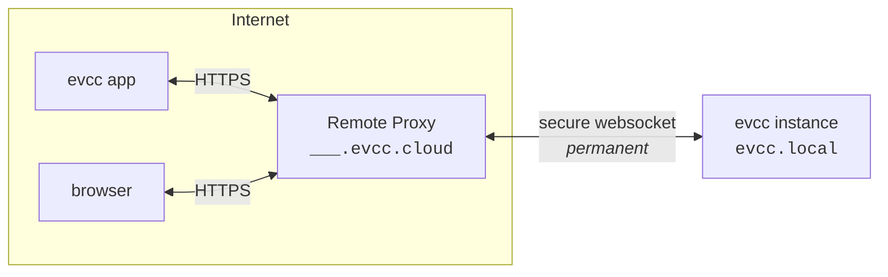

import { Steps } from "@astrojs/starlight/components";
import SponsorInfoBox from "@components/SponsorInfoBox.astro";
import statusImg from "@assets/features/remote-access/status.png";
import clientsImg from "@assets/features/remote-access/clients.png";
import clientCreatedImg from "@assets/features/remote-access/client-created.png";

Med fjernadgang kan du nå din evcc-installation uden for dit hjemmenetværk via [evcc-appen](/da/features/app) eller en browser.
Din installation får sit eget domæne på `evcc.cloud`.
Der kræves hverken portvideresendelse, dynamisk DNS eller VPN, fordi installationen selv opretter en udgående forbindelse.

<SponsorInfoBox lang="en" type="feature" />

## Opsætning

<Steps>

1. Aktivér funktionen under **Opsætning → Fjernadgang**.

   

2. Din evcc-installation opretter forbindelse til `evcc.cloud` og får sit eget domæne, f.eks. `swift-dark-crow.evcc.cloud`.

   

3. Opret en separat klient for hver enhed, der skal have adgang.
   Du får et brugernavn, en adgangskode og en QR-kode, der indeholder begge dele.
   - **App:** Scan QR-koden med telefonens kamera.
     [evcc-appen](/da/features/app) åbnes og er forbundet med det samme.
   - **Browser:** Åbn dit personlige domæne, og log ind med brugernavn og adgangskode (basic auth over HTTPS).
   - **API-klienter:** Tilgå API'et programmatisk med brugernavn og adgangskode.

     ```bash title="curl example"
     curl --user Macbook:7IIGKZGP-MV0PJKSE "https://swift-dark-crow.evcc.cloud/api/state?jq=.pvPower"
     ```

   

4. I samme visning kan du se, hvilke klienter der senest har været aktive, og til enhver tid tilbagekalde adgangen for enkelte enheder.
   Adgangen kan eventuelt begrænses til en fast periode.

</Steps>

## Sikkerhed

**Transport.**
Forespørgsler til dit domæne går over HTTPS med wildcard-certifikatet for `*.evcc.cloud`.
Forbindelsen mellem Remote Proxy og din lokale installation går gennem en WebSocket-tunnel.

**Hvad Remote Proxy ser.**
Remote Proxy videresender kun forespørgsler.
Indholdet af forespørgslerne bliver hverken gemt eller undersøgt.
For hver registrering gemmes kun domænet, en hash af forbindelsestokenet, den tilknyttede sponsor og tidsstempler, så tunnelen kan tildeles igen ved genforbindelse.

**Lokal godkendelse.**
Du opretter separate adgangsoplysninger for hver enhed.
De gemmes og kontrolleres udelukkende på din evcc-installation.
Der gemmes ingen adgangsoplysninger på Remote Proxy.
Adgangskoden vises kun én gang, når klienten oprettes.
Fjerner du en enhed, tilbagekaldes kun den enheds adgang.
Alle andre forbliver forbundet.
Gentagne mislykkede loginforsøg bliver automatisk bremset.

**Adgangens omfang.**
Adgangsoplysningerne til fjernadgang kommer oven i evcc's egne sikkerhedsmekanismer.
De giver kun netværksadgang til din installation, svarende til at nå den fra dit lokale netværk.
Ændringer i opsætningen, sikkerhedskopier, logfiler eller en genstart kræver stadig administratoradgangskoden.

**Binding til sponsortoken.**
Registreringen verificeres mod `sponsor.evcc.io`.
Hver sponsor får præcis ét domæne, som er permanent bundet til den pågældende sponsor og aldrig tildeles igen.

## Tekniske detaljer

Din app eller browser opretter forbindelse til dit personlige domæne på `evcc.cloud`.
Remote Proxy videresender forespørgslerne gennem en WebSocket-tunnel til din lokale evcc-installation.
Din lokale installation åbner selv tunnelen udgående, så der ikke kræves en åben port i dit netværk.



Ved første aktivering registrerer den lokale evcc-installation sig hos Remote Proxy.
Mod sit sponsortoken modtager den et forbindelsestoken og et tilfældigt tildelt domæne.
Begge gemmes lokalt og genbruges ved næste start for at genoprette tunnelen uden at gå gennem registreringen igen.

Ved senere opstart åbner den lokale evcc-installation en vedvarende, TLS-krypteret WebSocket-forbindelse (WSS) til Remote Proxy.
Denne forbindelse fungerer som tunnel for al efterfølgende trafik og oprettes udgående, så der ikke kræves portvideresendelse.

Oven på denne forbindelse fungerer [hashicorp/yamux](https://github.com/hashicorp/yamux) som multiplexer.
Hver indgående HTTP-forespørgsel hos Remote Proxy bliver sin egen yamux-stream oven på den eksisterende WebSocket-forbindelse.
Flere parallelle forespørgsler deler én forbindelse uden et nyt TCP- eller TLS-handshake pr. forespørgsel.

WebSocket-upgrades gennem tunnelen fungerer også.
Det er vigtigt, fordi evcc-brugerfladen selv modtager livedata over WebSocket.

Hvis tunnelen bliver afbrudt, genopretter den lokale installation automatisk forbindelsen.
Så længe forbindelsen er oppe, kan dit domæne nås; ellers returnerer Remote Proxy en fejl.

Remote Proxy-værten er som standard `api.evcc.cloud`.
Til udvikling eller en selvhostet proxy kan den ændres med miljøvariablen `EVCC_REMOTE_ACCESS`.

Kildekoden til Remote Proxy bliver offentliggjort på et senere tidspunkt.
Du kan læse mere om databeskyttelse i vores [privatlivspolitik](https://evcc.io/en/datenschutz/).
