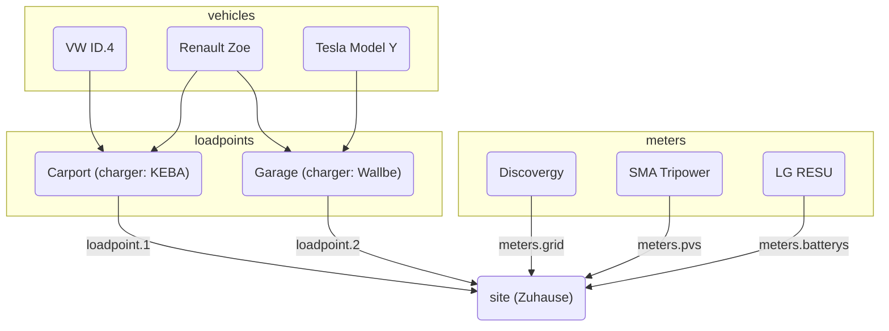

evcc kan konfigureres på to måder:

**1. Konfiguration i brugerfladen (anbefalet)**

Konfigurationen foregår i brugerfladen under **Opsætning**.
Indstillingerne gemmes automatisk i databasen.
Du finder flere oplysninger under [Konfiguration](/da/installation/configuration).

**2. Filbaseret konfiguration**

Konfiguration via filen `evcc.yaml` understøttes fortsat.
Denne sektion dokumenterer den YAML-baserede konfiguration.

:::note[Brug side om side]
Begge konfigurationsmetoder kan bruges side om side.
Enheder (ladepunkter, målere, solcelleanlæg, hjemmebatterier, køretøjer) flettes sammen fra begge kilder.
For andre indstillinger har konfigurationen i brugerfladen forrang.
Detaljer finder du i [FAQ](/da/faq#ui-migration).
:::

## Filbaseret konfiguration (evcc.yaml)

Konfigurationsfilen er skrevet i YAML-format og hedder som standard `evcc.yaml`.
Den ligger enten i samme mappe som evcc selv eller på POSIX-systemer (f.eks. Linux) i `/etc/evcc.yaml`.

Du kan angive en anden sti ved opstart: `evcc -c /path/to/evcc.yaml`

### Opbygning

Konfigurationsfilen indeholder flere sektioner.
For at kunne henvise mellem sektionerne har enheder en `name`-parameter til identifikation.

En eksempelfil med mange parametre finder du her:
https://github.com/evcc-io/evcc/blob/master/evcc.dist.yaml

Her er et overblik over sammenhængen mellem de vigtigste dele af
konfigurationen:

### Hvordan fungerer evcc? (et kig under motorhjelmen)

For at systemet kan fungere, er en elnetsmåler vigtig. Den
gør det muligt til ethvert tidspunkt at beregne overskudseffekten. Det er interessant at måle den
producerede effekt, men det har ingen betydning for funktionen, med
[denne undtagelse](/da/faq#configuration).

Overskudseffekten sammenlignes med den minimale effekt, der kræves til opladning. Hvis
den rækker, startes opladningen.

Den minimale effekt, der kræves til opladning, beregnes ud fra værdierne `minCurrent`
og `phases`, som defineres pr. `loadpoint` (en gruppe opladere på samme sted).
Se [`loadpoints`](/da/reference/configuration/loadpoints) for flere
oplysninger.

F.eks.: `phases: 1` og `minCurrent: 8`

1 (faser) x 8 A (minCurrent) x 230 V (netspænding) = 1.840 W (minimal effekt, der kræves til opladning)

#### Muligheder for justering

Normalt svarer overskudseffekten til den tilgængelige ladeeffekt.
Den tilgængelige ladeeffekt kan dog justeres individuelt med
flere parametre. Det er:

- Anlæg: `residualpower`
- Anlæg: `prioritySoc`
- Anlæg: `bufferSoc`
- Anlæg: `aux`
- Ladepunkt: `enable: threshold`
- Ladepunkt: `disable: threshold`

De mulige indstillinger fremgår af beskrivelsen af den enkelte
parameter.

- [Konfigurationsparametre for anlægget](/da/reference/configuration/site)
- [Konfigurationsparametre for ladepunkter](/da/reference/configuration/loadpoints)

### Anlæg

Et [anlæg](/da/reference/configuration/site) beskriver din hjemmeinstallation med de relevante enheder og
står for at regulere den tilgængelige effekt.

### Ladepunkt

Et [ladepunkt](/da/reference/configuration/loadpoints) beskriver ladeinfrastrukturen og samler
eksisterende _opladere_, _køretøjer_ og alt andet, et ladepunkt har brug for.

### Opladere

Sektionen [Opladere](/da/reference/configuration/chargers) indeholder en liste over dine opladere og deres egenskaber, f.eks.
hvordan de adresseres.

### Målere

[Målere](/da/reference/configuration/meters) er en liste over enheder, der måler forskellige effektflow. Det
omfatter:

- Effekt importeret fra og eksporteret til elnettet
- Effekt produceret af solcelleanlægget
- Køretøjets ladestrøm (hvis opladeren ikke selv understøtter det)
- Effektflow for hjemmebatteri(er)

### Enheder til effektbegrænsning

[Enheder til effektbegrænsning](/da/reference/configuration/curtailers) er enheder, der kun begrænser solcelleanlæggets eksport til elnettet
efter anmodning fra netselskabet (§ 9 EEG), f.eks. SMA Sunny Home Manager 2.0 eller den styrende
inverter i et anlæg med flere invertere.

### Køretøjer

Her kan du angive dine [køretøjer](/da/reference/configuration/vehicles) og adgangsdata til producentens onlinetjeneste
for at begrænse opladningen til et bestemt opladningsniveau.

### HEMS

evcc kan videresende ladepunkterne og deres ladestrømme til et andet
[Home Energy Management System (HEMS)](/da/reference/configuration/hems), så det kan bruge disse
oplysninger, f.eks. til at styre hjemmebatteriet.

### Beskeder

I denne sektion kan du definere hændelser, du vil have besked om. En
række forskellige systemer understøttes til levering af beskeder.

[Flere oplysninger](/da/reference/configuration/messaging)
