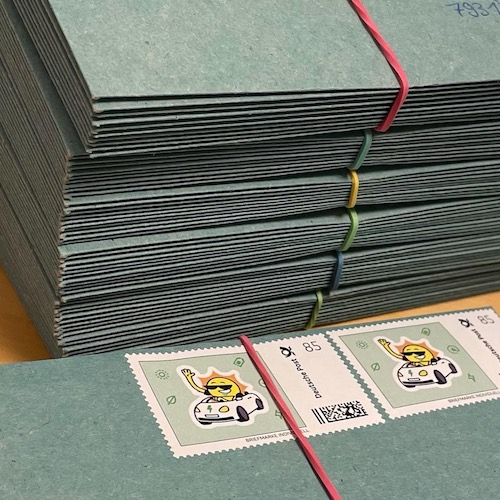
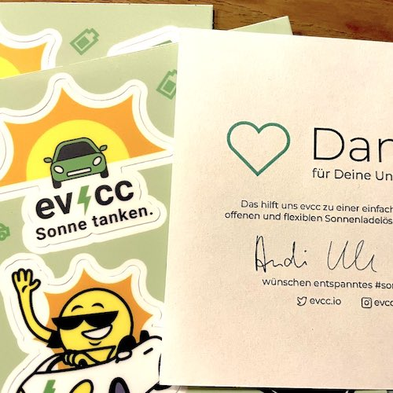
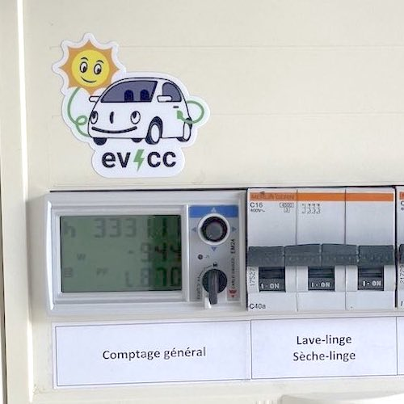
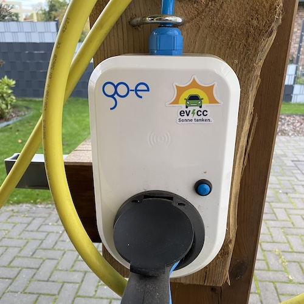
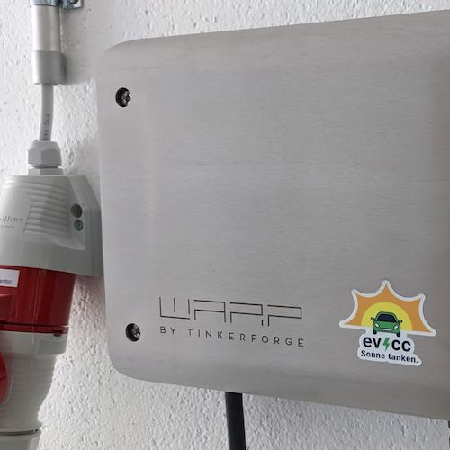
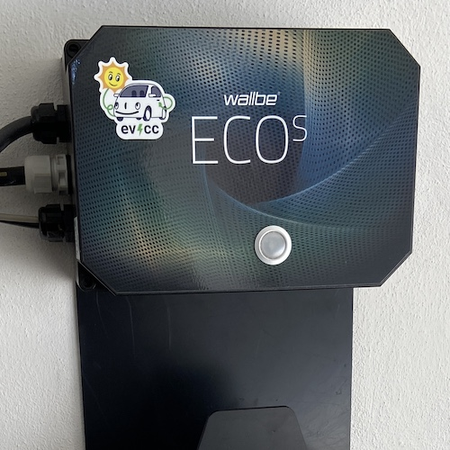
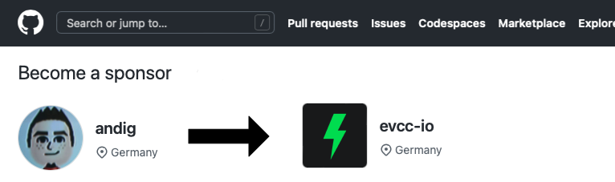
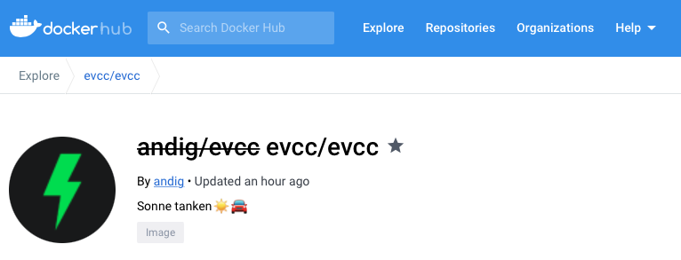

Es sind schon wieder siebzehn Releases seit unserem letzten Update hier im Blog vergangen.
Wie immer ist eine Menge passiert.
Es gab einige Fehlerkorrekturen, aber auch viele neue Integrationen und Funktionen.
Mehr zu unseren Highlights der letzten Monate in einem späteren Blogartikel.

<!-- excerpt -->

## 🌱 Nachhaltige Open-Source-Entwicklung

evcc hat als kleines Hobbyprojekt angefangen, weil wir mit den bestehenden Lösungen für PV-Überschussladen unzufrieden waren und etwas Besseres bauen wollten.
Inzwischen macht evcc aber nicht mehr nur unser eigenes Laden mit Sonnenstrom leichter.
Es gibt vermutlich mehrere tausend Installationen, die morgens das Auto wecken, sobald die Sonne auf die heimische PV-Anlage scheint.
Der Gedanke macht uns sehr froh.

Genaue Zahlen über unsere Nutzerbasis haben wir nicht.
Uns ist Datensparsamkeit wichtig, daher haben wir auch keine Ambition, ein allgemeines Tracking in unsere Webseite oder die Anwendung einzubauen.
Dennoch können wir anhand von Zahlen aus Docker (bisher über 1 Mio. Pulls) und Cloudsmith (aktuell rund 4.500 Paketdownloads pro Tag) ziemlich gut erkennen, dass sich viele im Alltag auf evcc verlassen.

Damit wir das Projekt mit ausreichendem Fokus pflegen und weiterentwickeln können, ist eine nachhaltige Finanzierung ein wichtiges Thema.
Hinter evcc steckt kein großes Unternehmen und kein Wallbox-Hersteller, und wir haben auch keine Lust auf das Startup-Spiel mit Investoren.
Aktuell ist evcc ein Projekt, das wir in unserer Freizeit vorantreiben.
Wir sind überzeugt, dass es eine gute Idee ist, direkt für dich als Nutzer zu arbeiten und unabhängig von anderen Verpflichtungen und Zwängen zu bleiben.

Mit **GitHub Sponsoring** haben wir eine sehr leichtgewichtige und einfache Lösung gefunden, um finanzielle Unterstützung direkt von Nutzern entgegenzunehmen.
Zudem haben wir dadurch die Möglichkeit, **einige Funktionen exklusiv für Sponsoren** bereitzustellen.
Momentan sind das bestimmte Wallbox-Typen und die Telemetrie-Funktion, wir können uns aber durchaus vorstellen, dieses Modell in Zukunft noch anzupassen.

## 💚 Danke an alle Sponsoren

Aktuell haben wir **über 1.500 Sponsoren** 🥳, die einen monatlichen Beitrag von mindestens 2 $ zahlen.
Das ist ziemlich cool, ein großer Vertrauensbeweis und bestärkt uns darin, weiter viel Zeit in das Projekt zu investieren.

Zusätzlich zum Sponsortoken, das Funktionen freischaltet, schicken wir allen Unterstützern auch gerne Sticker.
Damit kannst du deinen Laptop, Raspberry Pi, deine Wallbox oder dein Ladeequipment verschönern.
Den Link zum Stickerformular findest du in der evcc-Oberfläche unten rechts, wenn du auf das Sonnensymbol klickst.

| [@evcc_io](https://twitter.com/evcc_io/status/1489667714411114502)                                                                                      | [@Ein_Klimawender](https://twitter.com/Ein_Klimawender/status/1589844295992819712)                                                                          | [@frd9900](https://twitter.com/frd9900/status/1591416016848162816)                                                                                        |
| ------------------------------------------------------------------------------------------------------------------------------------------------------- | ----------------------------------------------------------------------------------------------------------------------------------------------------------- | --------------------------------------------------------------------------------------------------------------------------------------------------------- |
|                         |  |                        |
| [@ABBolle](https://github.com/evcc-io/evcc/discussions/4446#discussioncomment-4069333)                                                                  | [@rediculum](https://github.com/evcc-io/evcc/discussions/4446#discussion-4393578)                                                                           | [@123aerox](https://github.com/evcc-io/evcc/discussions/4446#discussioncomment-4013806)                                                                   |
|  |         |  |

## 📮 Einmal-Sponsoring

Wir haben schon mehrfach gehört, dass manche Nutzer Bauchschmerzen mit monatlichen Zahlungen haben und sich eine Einmalzahlung wünschen, um ein Sponsortoken zu erhalten.
Das ist nun möglich.
Auf der [GitHub-Sponsoring-Seite](https://github.com/sponsors/evcc-io?frequency=one-time) gibt es jetzt neben den monatlichen auch einmalige Stufen.
Folgende Stufen haben wir uns überlegt:

- **🌱 $100 - Nachhaltige Entwicklung** Du trägst dazu bei, dass wir weiterhin viel Energie in die Weiterentwicklung von evcc investieren können. Außerdem bekommst du **ein unbefristetes Sponsortoken**, mit dem du alle evcc-Funktionen nutzen kannst.
- ~~**☀️ $150 - Friends & Family** Du bekommst **drei unbefristete Sponsortoken**. Eins für dich und zwei weitere, die du an Freunde oder Familie weitergeben kannst. Du wirst als Sponsor auf [evcc.io](https://evcc.io) erwähnt.~~
- **🚛 $1.000 - Multiplikator** Für Elektriker und Solarteure. Du möchtest evcc bei mehreren Kunden einsetzen? Schreib uns an [info@evcc.io](mailto:info@evcc.io) und wir finden eine gute Lösung.

Unbefristete Sponsortoken werden genauso wie bisher über [sponsor.evcc.io](https://sponsor.evcc.io) ausgestellt.
Einziger Unterschied ist, dass das Token nicht abläuft.

:::note[Update]
Wir haben die Sponsorstufen 2026 angepasst.
Mehr dazu in unserem [aktuellen Blogartikel](/de/blog/2026/01/01/highlights-browser-config-ready#sponsoring).
:::

## 🎟️ Contributor-Token

Community-Mitglieder, die über GitHub-PRs substanziell zu evcc beigetragen haben, können auch ein kostenloses Token erhalten.
Wir freuen uns immer über Bugfixes, brauchen aber auch dringend Unterstützung bei Dokumentation und [Übersetzung](https://github.com/evcc-io/evcc/discussions/5218).

Was genau ein substanzieller Beitrag ist, haben wir nicht klar geregelt.
Ein falsch gesetztes Komma zu korrigieren reicht noch nicht, das Beheben eines fiesen Bugs aber definitiv.
Schreib uns einfach eine Mail an [info@evcc.io](mailto:info@evcc.io) und nenne deinen GitHub-Nutzernamen.

## 🚚 GitHub Sponsoring zieht um

Aktuell läuft das GitHub Sponsoring über den Account von [@andig](https://github.com/andig), dem Gründer von evcc.
Der Betrag, der nach Ausgaben (Infrastruktur, Sticker usw.) im Monat übrig bleibt, wird über einen Verteilungsschlüssel an alle drei Mitglieder des Core-Teams verteilt.
Um diesen Prozess transparenter zu machen, ziehen wir unser GitHub Sponsoring jetzt auf die [evcc-io-Organisation](https://github.com/sponsors/evcc-io) um.
Wenn du bereits Sponsor bist, musst du nichts ändern.
Dein Token funktioniert wie gewohnt weiter, und dein Beitrag erreicht weiterhin alle Teammitglieder.
Wir haben aber alle Links zum Sponsoring auf die Organisation umgestellt.
Einmalzahlungen gibt es nur dort.

## 🐳 Docker-Image zieht um

Im gleichen Zug ziehen wir auch unsere Docker-Images um.
Bislang wurden die Pakete unter `andig/evcc` veröffentlicht.
Die offiziellen Versionen findest du jetzt unter `evcc/evcc`.

An dieser Stelle noch einmal Danke an das Docker-Team, das evcc als [Docker-Sponsored-Open-Source-Projekt](https://www.docker.com/community/open-source/application/) qualifiziert hat.
Dadurch bekommen wir kostenfreien Zugang zu den Team-Funktionen von Docker Hub.

---

**Danke für deine Unterstützung!**
evcc Core Team 
[@andig](https://github.com/andig), [@premultiply](https://github.com/premultiply) und [@naltatis](https://github.com/naltatis)
