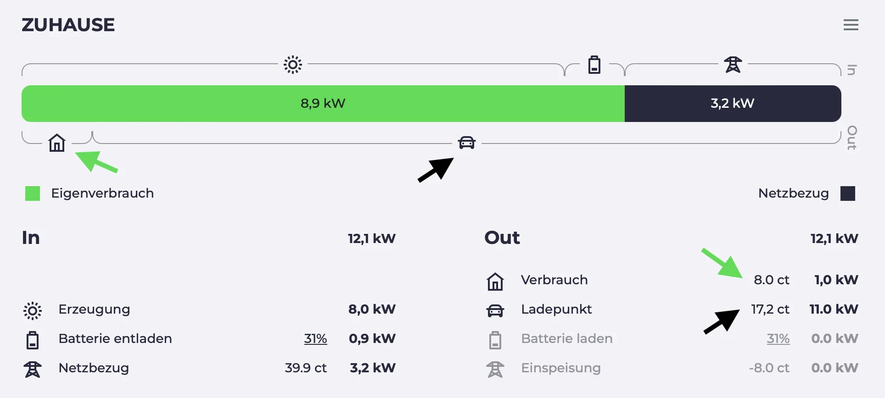

import Video from "@components/Video.astro";
import batterysettingsVideo from "./batterysettings.mp4";
import batterysettingsPoster from "./batterysettings.webp";
import chargingplanVideo from "./chargingplan.mp4";
import chargingplanPoster from "./chargingplan.webp";
import chargingsessionsVideo from "./chargingsessions.mp4";
import chargingsessionsPoster from "./chargingsessions.webp";
import dynamicpricesVideo from "./dynamicprices.mp4";
import dynamicpricesPoster from "./dynamicprices.webp";
import minsocVideo from "./minsoc.mp4";
import minsocPoster from "./minsoc.webp";
import sessionvaluesVideo from "./sessionvalues.mp4";
import sessionvaluesPoster from "./sessionvalues.webp";

Seit dem letzten Blog-Artikel hat sich einiges getan. Wir haben viele neue Funktionen hinzugefügt und einige Fehler behoben. In diesem Artikel stellen wir dir ein paar davon vor.

## Visualisierung der Ladeplanung \{#charging-planner-visualization\}

Die Ladeplanung gibt es bei evcc schon etwas länger.
Du gibst an, wann dein Fahrzeug einen gewünschten Ladestand haben soll, und evcc sucht die besten Zeiträume zum Laden.
Seit einigen Releases ist der Algorithmus keine Blackbox mehr, da wir das Planungsergebnis grafisch darstellen.

<Video src={chargingplanVideo} poster={chargingplanPoster} />

{/* excerpt */}

Wie funktioniert der Algorithmus?

1. PV-Überschuss hat Vorrang
2. Zeiten mit günstigem Netzstrom (wenn ein [dynamischer Stromtarif](/de/features/dynamic-prices) konfiguriert ist)
3. Zeiten mit sauberem Netzstrom (wenn eine [CO₂-Schnittstelle](/de/features/co2) konfiguriert ist)
4. Zeitfenster kurz vor Abfahrt

**Ausblick:** Aktuell experimentieren wir mit PV-Vorhersagedaten von [Solcast](https://solcast.com/).
Dadurch kann der Algorithmus noch bessere Entscheidungen treffen.
Liegt das Ladeziel z. B. am Tag, kann es sinnvoll sein, das Fahrzeug nicht komplett mit günstigem Nachtstrom zu laden, sondern Platz für Überschussenergie am Tag zu lassen.

## Mindestladung über die UI einstellbar

Die Mindestladefunktion gibt es bei evcc schon seit Ewigkeiten.
Sie ist hilfreich, wenn du mal mit wenigen Prozent nach Hause kommst und sichergehen willst, dass du immer genug Reichweite für ein unerwartetes Ereignis hast.

Bislang konnte sie aber nur über die Konfigurationsdatei oder per API eingestellt werden.
Inzwischen geht das auch über die UI unter **Plan** → **Ankunft** → **Min. Ladung %**.

Die Einstellung wird pro Fahrzeug gespeichert und bleibt auch nach einem Neustart oder Update erhalten.

<Video src={minsocVideo} poster={minsocPoster} />

## Smartes Netzladen \{#smart-grid-charging\}

Reicht der eigene PV-Überschuss mal nicht aus, kannst du auch Netzstrom nutzen, wenn er besonders günstig oder sauber ist.
Klickst du im Energieflussdiagramm auf den Netzstrompreis bzw. die CO₂-Emissionen, öffnet sich der Dialog **Smartes Netzladen**.

Dort kannst du einen Schwellwert für den Preis bzw. die CO₂-Emissionen einstellen.
Wird dieser Wert unterschritten, wechselt evcc bei allen Ladepunkten im PV-Modus zeitweise auf schnelles Laden.

<Video src={dynamicpricesVideo} poster={dynamicpricesPoster} />

Voraussetzung für diese Funktion ist, dass du entweder einen dynamischen Stromtarif oder eine CO₂-Schnittstelle konfiguriert hast.

Eine weitere kleine Neuerung ist, dass du bei den meisten dynamischen Stromtarifen nun die Möglichkeit hast, die von der API gelieferten Preise um **prozentuale bzw. feste Aufschläge** zu ergänzen (`charges` / `tax`).
Tibber und Octopus Energy (UK) liefern bereits Werte inkl. Aufschlägen.
Bei awattar, Nordpool Estonia und Energinet kannst du diese nun ergänzen.

Übrigens: Falls du einen dynamischen Stromtarif hast, der noch nicht unterstützt ist, aber eine Schnittstelle bietet, dann mach gerne ein GitHub-Issue dazu auf.

## Batterieeinstellungen \{#battery-settings\}

Ein großer Vorteil, den evcc gegenüber anderen Überschussladeregelungen hat, ist die Integration der Hausbatterie.
Über den Konfigurationswert [`prioritySoc`](/de/features/battery) kann geregelt werden, ob der PV-Überschuss **zuerst in die Hausbatterie oder das Fahrzeug** geladen werden soll.

Generell versucht evcc im PV-Modus zu verhindern, dass die Hausbatterie in die Fahrzeugbatterie entladen wird, um unnötige Wandlungsverluste zu vermeiden.
Mit dem Wert [`bufferSoc`](/de/features/battery) kannst du jedoch bewusst **einen Anteil der Hausbatterie zur Ladeunterstützung** freigeben.

Zudem kannst du festlegen, dass der Ladevorgang automatisch startet, sobald die Batterie einen bestimmten Ladestand erreicht hat ([`bufferStartSoc`](/de/features/battery)).
Die automatische Ladung startet auch dann, wenn die Sonne nicht scheint.

<Video src={batterysettingsVideo} poster={batterysettingsPoster} />

## PV-Anteil, Preis, CO₂ pro Ladevorgang

Auch für die Freunde der Datenanalyse haben wir etwas.
Wir erfassen nun den Anteil an eigener PV-Energie (in %), den Preis (gesamt und pro kWh), die Ladedauer und die durchschnittlichen CO₂-Emissionen pro Ladevorgang.
Zwischen diesen Werten kannst du direkt in der Anzeige des Ladevorgangs wechseln.

<Video src={sessionvaluesVideo} poster={sessionvaluesPoster} />

## Neue Berechnung des PV-Anteils

Falls du festgestellt hast, dass der PV-Anteil seit einer der letzten Versionen leicht gesunken ist, dann liegt das an unserer neuen Berechnung.
Bislang hat evcc das Verhältnis von Netz- und Eigenenergie immer gleichmäßig auf Hausverbrauch und Ladevorgänge aufgeteilt.

Wir haben jetzt auf ein neues Modell umgestellt, bei dem der Hausverbrauch zuerst den grünen Strom bekommt und der verbleibende Mix an die Ladevorgänge geht.
Danke an [@MarkusGH](https://github.com/MarkusGH) für die Umsetzung.
Mehr Details zu dem Modell findest du [in der Dokumentation](/de/faq#savings-calculation).

## Übersicht der Ladevorgänge

Die neuen Werte haben natürlich auch Einzug in die Übersicht der Ladevorgänge gehalten.
Je nach Konfiguration sind hier jetzt auch Preise und CO₂-Emissionen zu sehen.
Zudem haben wir die Ansicht komplett überarbeitet und uns für eine **kompakte Tabelle auf Monatsbasis** entschieden.
Sie kann **nach Ladepunkt und Fahrzeug gefiltert** werden.

Wenn du hier noch mehr Flexibilität brauchst, kannst du natürlich auch auf den CSV-Export zurückgreifen oder dir die Rohdaten gleich per InfluxDB oder MQTT abholen.

<Video src={chargingsessionsVideo} poster={chargingsessionsPoster} />

## Priorisierung von Ladepunkten und Fahrzeugen

Hast du mehrere Ladepunkte, kannst du mit der Einstellung [`priority`](/de/reference/configuration/loadpoints#priority) festlegen, welcher bevorzugt werden soll.
Die Priorisierung kannst du auch vom erkannten Fahrzeug abhängig machen oder per API steuern.
Eine Konfiguration über die UI gibt es aktuell noch nicht.

Die Priorisierungsfunktion ist auch hilfreich, wenn du evcc zum Steuern weiterer Verbraucher nutzt, z. B. [einen über die Plugin-Schnittstelle angebundenen Heizstab oder eine Wärmepumpe](https://github.com/evcc-io/evcc/pull/9393).
Damit kannst du sie so steuern, dass sie nur laufen, wenn das Auto gerade nicht (genug) lädt.

## Wie geht es weiter?

Unser [Backlog](https://github.com/evcc-io/evcc/issues?q=is%3Aopen+is%3Aissue+label%3Abacklog) ist gut gefüllt.
Dies sind die nächsten großen Themen, die wir angehen wollen:

**Konfigurations-UI:** Hier sind inzwischen alle Voraussetzungen erfüllt.
Aktuell können im 🧪 experimentellen Modus schon Fahrzeuge angelegt werden und der Sprung zur Netz-, PV- oder Batteriekonfiguration ist nicht mehr weit.
Hier ist immer noch viel zu tun, aber das Licht am Ende des Tunnels ist sichtbar.

**Bessere Planung:** Wie oben schon erwähnt, arbeiten wir daran, gute **PV-Vorhersagen** in den Planungsalgorithmus und die UI zu integrieren.
Außerdem haben wir ein Konzept für die Unterstützung **mehrerer Ladepläne**.

**Modus-Überarbeitung:** evcc ist als Anwendung für PV-Überschussladen gestartet.
Inzwischen spielt auch die Hausbatterie eine große Rolle.
Auch das Thema **netzdienliches Laden** auf Basis von dynamischen Stromtarifen oder CO₂-Emissionen nimmt immer mehr Fahrt auf.
Daher werden wir unsere Lademodi (aktuell PV und Min+PV) überarbeiten und hier mehr Flexibilität schaffen.

## Weitere neue Funktionen

Das war ein grober Überblick aus Sicht der Nutzer.
Unter der Haube wird natürlich auch fleißig gewerkelt.

- 🔌 Unterstützung weiterer Wallboxen von 22 neuen Herstellern
- 🌞🔋📟 Unterstützung von Zähler-, PV- und Batteriesystemen von 36 neuen Herstellern
- 🇬🇧 Website und Dokumentation in englischer Sprache. Danke [duckfullstop](https://github.com/duckfullstop) & [carygravel](https://github.com/carygravel) 💚

Für noch mehr Details kannst du gerne die [Release Notes](https://github.com/evcc-io/evcc/releases) der letzten 49(!) Releases seit Jahresbeginn durchgehen.

**Danke für deine Unterstützung von evcc!** 
evcc-Core-Team 
[@andig](https://github.com/andig), [@premultiply](https://github.com/premultiply) und [@naltatis](https://github.com/naltatis)
