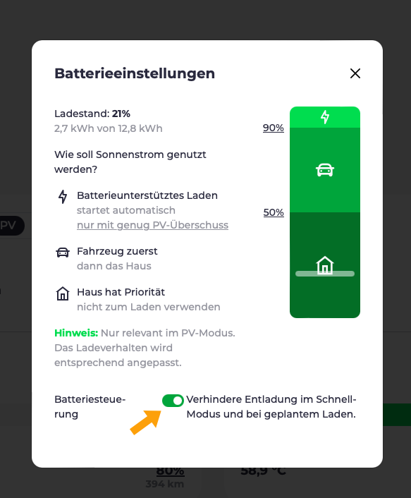

Die Tage werden länger und PV-Überschussladen beginnt wieder Spaß zu machen.
Ein guter Zeitpunkt für ein kurzes Update über die neuesten Entwicklungen bei evcc.

{/* excerpt */}

## Neue Tesla-Integration

Im [Oktober](https://www.notateslaapp.com/news/1653/tesla-creates-official-apis-for-third-party-services-to-start-charging-for-usage) hat Tesla eine neue [offizielle API](https://developer.tesla.com/docs/fleet-api) vorgestellt.
Zudem wurde angekündigt, dass die alte, [inoffizielle API](https://www.teslaapi.io) Anfang 2024 abgeschaltet wird.
In der vergangenen Woche hat Tesla mit dieser Abschaltung Stück für Stück begonnen.

### Was bedeutet das für mich?

Um die neue API nutzen zu können, musst du zwei Anpassungen in der `evcc.yaml` vornehmen:

1. **Neuer Template-Name:** Da die alte API für einige Nutzer heute noch funktioniert, haben wir uns entschieden, vorerst beide Implementierungen parallel anzubieten. Ändere den Template-Namen von `tesla` in `tesla-command`, um die neue API zu nutzen.

2. **Neue Tokens erzeugen:** Mit der neuen API ist es nun möglich, die erforderlichen `accessToken` und `refreshToken` direkt im Browser zu erzeugen.
   Dafür haben wir unter [tesla.evcc.io](https://tesla.evcc.io) eine kleine Webseite bereitgestellt.
   Ersetze die alten Tokens in deiner `evcc.yaml` durch die neu erzeugten.

Die Konfiguration sollte dann wie folgt aussehen:

```yaml
vehicles:
 - name: mytesla
   type: template
   template: tesla-command # `tesla` zu `tesla-command` ändern
   accessToken: ... # erzeugt über tesla.evcc.io
   refreshToken:  ... # erzeugt über tesla.evcc.io
   ...
```

Die über [tesla.evcc.io](https://tesla.evcc.io) erzeugten Tokens können **nur mit den offiziellen evcc-Builds** (stable & nightly) verwendet werden.
Grund dafür ist, dass die Tokens aus Teslas neuer Developer-API immer an eine Drittanbieter-App gebunden sind.

Du kannst dir evcc natürlich auch weiterhin selbst bauen.
Dafür benötigst du aber einen eigenen Tesla-Developer-Account und musst die Tokens selbst erzeugen.
Mehr Details dazu findest du im entsprechenden [Pull Request](https://github.com/evcc-io/evcc/pull/10802).

### Privatsphäre & Sicherheit

Wie auch bei der alten API läuft die Kommunikation für Datenabfrage (Ladestand, Zustand usw.) und Steuerung (Aufwecken) direkt zwischen deiner lokalen evcc-Instanz und der Tesla-Infrastruktur ab.
Lediglich die Token-Erzeugung läuft einmalig über unsere Webseite.
Tokens werden dabei nicht gespeichert, sondern dir nur im Browser angezeigt.

Für eine erweiterte Steuerung des Fahrzeugs (Ladevorgang direkt am Fahrzeug starten und stoppen) ist zusätzlich eine signierte Anfrage an Tesla erforderlich.
Dies betrifft heute konkret die Nutzer eines Tesla Wall Connectors.
Da wir unseren privaten Schlüssel als Drittanbieter-App nicht ins evcc-Binary packen können bzw. dürfen, werden wir für diesen Anwendungsfall vermutlich einen [eigenen Service](https://github.com/evcc-io/evcc/pull/11893) bereitstellen, der diese Anfragen signiert und an Tesla weiterleitet.
Dazu aber mehr in einem späteren Release.

### Kosten

Tesla bietet die neue API aktuell [kostenlos](https://developer.tesla.com/docs/fleet-api#membership-tiers) an.
Allerdings hat Tesla bereits angekündigt, künftig Gebühren für die Nutzung der API zu erheben.
Wie Open-Source-freundlich dieses Modell ausfällt, wissen wir leider noch nicht.

Es ist durchaus möglich, dass wir die Token-Erzeugung in Zukunft nicht mehr kostenlos anbieten können.
Möglicherweise verknüpfen wir sie mit dem bestehenden evcc-Sponsoring-Modell.
Aber mehr dazu, wenn es neue Informationen von Tesla gibt.

## Aktive Batteriesteuerung

Eine große neue Funktion, die mit dem Weihnachts-Release Einzug gehalten hat, ist die aktive Batteriesteuerung.
Diese Funktion ist inzwischen nicht mehr als experimentell markiert.
Zudem sind in den vergangenen Wochen einige neue unterstützte Batteriewechselrichter hinzugekommen.
In der Dokumentation siehst du inzwischen auch, [ob dein Wechselrichter unterstützt wird](/de/meters#features).

### Passive Steuerung

Eine passive Batteriesteuerung bringt evcc schon seit einiger Zeit mit.
Hierbei regelt evcc das PV-Überschussladen so, dass die Hausbatterie nicht ungewollt mit entladen wird.
Im letzten Jahr haben wir einen [Konfigurationsdialog](/de/blog/2023/10/05/feature-highlights-10-2023#battery-settings) eingeführt, mit dem du die Priorität zwischen Fahrzeug- und Hausbatterieladung einstellen kannst.
Dieses Modell funktioniert beim PV-Überschussladen sehr gut.
evcc kennt dabei den aktuellen Ladestand der Hausbatterie und regelt nur die Ladeleistung des Fahrzeugs.
Dieser Mechanismus funktioniert allerdings nicht beim Schnellladen.
Hierfür ist eine aktive Batteriesteuerung erforderlich.

### Entladesperre beim Schnellladen

Standardmäßig versucht die Hausbatterie, den gesamten Energieverbrauch des Hauses (inkl. Wallboxen) zu decken.
Abhängig vom aktuellen Strompreis oder der erwarteten PV-Erzeugung kann es aber wünschenswert sein, die Energie beim **schnellen Fahrzeugladen** direkt aus dem Netz und nicht aus der Hausbatterie zu beziehen.
Damit bleibt die gesammelte Sonnenenergie in der Hausbatterie und kann z. B. nachts für den Hausverbrauch genutzt werden.

Dies ist unser erster Anwendungsfall für die aktive Batteriesteuerung.
Unterstützt dein Wechselrichter diese Funktion, erscheint im Dialog der Batterieeinstellungen eine entsprechende Option.



Ist diese Option aktiv, wird die Hausbatterie beim Schnellladen in einen Sperrmodus versetzt.
In dieser Zeit wird sie weder entladen noch geladen.
Diese Sperre ist auch bei [geplantem Laden](/de/blog/2023/10/05/feature-highlights-10-2023#charging-planner-visualization) und beim [smarten Netzladen](/de/blog/2023/10/05/feature-highlights-10-2023#smart-grid-charging) aktiv.

### Nächster Schritt: Batterie mit günstigem Netzstrom laden

Die nächste Ausbaustufe für die aktive Batteriesteuerung ist die Möglichkeit, die Hausbatterie mit günstigem Netzstrom zu laden.
Das ist vor allem für Nutzer von dynamischen Stromtarifen an dunkleren Tagen interessant.
Ziel ist es dabei, die Hausbatterie in Niedrigpreisphasen mit Energie aus dem Netz zu füllen und diese Energie dann in Hochpreisphasen im Haus zu nutzen.
Die erforderlichen Hardwareintegrationen haben wir bereits umgesetzt.
Daher rechnen wir damit, dass diese Funktion in einem der nächsten Releases verfügbar sein wird.

## Update: Migration zur Browser-Konfiguration

evcc ist ein sehr flexibles und mächtiges System für die eigene Energieoptimierung.
Unsere größte Herausforderung ist es weiterhin, diese Flexibilität mit einer einfachen Einrichtung zu vereinen.
In den letzten Monaten haben wir große Fortschritte im Bereich der Konfiguration gemacht.
Unser Ziel ist es, eine rein browserbasierte Inbetriebnahme ohne `evcc.yaml` zu ermöglichen.

Hast du im Einstellungsdialog die Option „Experimentelle UI-Funktionen zeigen“ aktiviert, kannst du unter „🧪 Gerätekonfiguration“ unseren aktuellen Entwicklungsfortschritt sehen.
Aktuell kannst du dort Fahrzeuge, Netzzähler, PV-Anlagen und Batteriesysteme hinzufügen und bearbeiten.
Wallboxen und Tarife folgen in der nächsten Iteration.
Auch wenn das Ganze noch „Work in Progress“ ist, freuen wir uns über dein Feedback.


## Kleine Verbesserungen und Fehlerbehebungen

Wie immer enthält dieses Release auch eine Reihe kleinerer Verbesserungen und Fehlerbehebungen.
Für mehr Details schau dir die [Release Notes](https://github.com/evcc-io/evcc/releases/tag/0.124.0) an.

Viele Grüße<br/>
dein evcc-Core-Team
