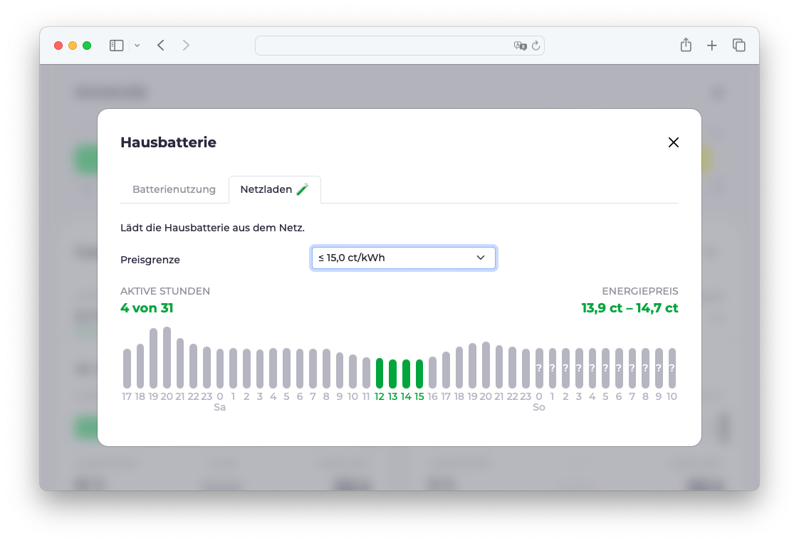
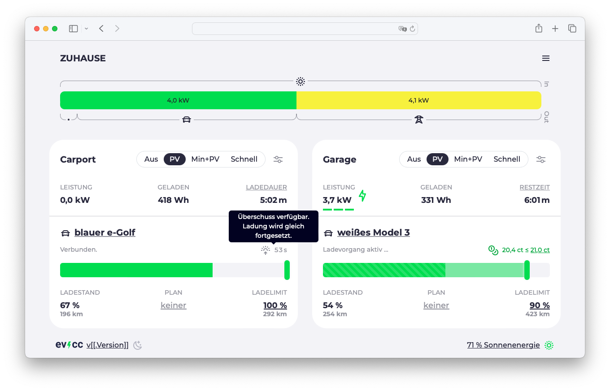

Heute ist [Version 0.130](https://github.com/evcc-io/evcc/releases) von evcc erschienen.
Da der letzte Release-Blogartikel schon etwas her ist, gibt es hier einen Überblick über die Highlights der letzten Releases.

{/* excerpt */}

## Lastmanagement & § 14a EnWG

Vor ein paar Releases haben wir Lastmanagement als experimentelle Funktion eingeführt.
Damit kannst du eine Leistungs- und/oder Stromgrenze für das gesamte Haus festlegen.
evcc regelt die Wallboxen so, dass diese Grenzen nicht überschritten werden.
Für komplexere Installationen gibt es auch die Möglichkeit, Unterstromkreise mit eigenen Grenzen und Zählern zu konfigurieren.
Mehr dazu findest du in der [Dokumentation](/de/features/loadmanagement).

### Steuerbare Verbraucher

In Deutschland ist § 14a des Energiewirtschaftsgesetzes (EnWG) derzeit ein prominentes Thema.
Hier geht es darum, dass der Netzbetreiber bei hoher Netzauslastung große Verbraucher wie Wallboxen herunterregeln kann.
Entscheidet sich der Kunde für diese Regelung, profitiert er im Gegenzug von reduzierten Netzentgelten.

Spannend ist hier die technische Umsetzung.
Der Netzbetreiber greift nicht direkt auf die Wallbox zu, sondern kommuniziert das Signal zum Herunterregeln über das Smart-Meter-Gateway (SMGW).
Das Energiemanagementsystem im Haus muss dann die relevanten Verbraucher herunterregeln.

Mit evcc kannst du diese Anforderung (Dimmen) heute schon für alle Wallboxen erfüllen, ohne sie z. B. über einen potentialfreien Kontakt abschalten zu müssen.
Die Ladepunkte können in dem Zeitraum weiter mit ihrer Mindestleistung (z. B. 4,2 kW) betrieben werden.
Damit kann jede von evcc unterstützte Wallbox in diesem Szenario eingesetzt werden.
Du musst keine neue Wallbox mit spezieller Unterstützung für die Kommunikation mit SMGW oder Steuerbox kaufen.

### Funktionsweise

Kommt es zu einer Überlastung im Netz, sendet der Netzbetreiber ein Signal an das SMGW.
Das SMGW selbst bietet allerdings keine sinnvolle Möglichkeit, mit dem Heimnetzwerk zu kommunizieren.
Dies findet über eine sogenannte Steuerbox statt, die hinter dem SMGW angeschlossen ist.
Diese zertifizierte Box leitet das Signal über EEBUS an die jeweiligen Geräte weiter.
evcc hat die EEBUS-Schnittstelle zur Steuerbox implementiert.
Kommt ein Reduzierungssignal rein, wird evcc aktiv und regelt die Wallboxen entsprechend herunter.

Ein alternativer Weg zu EEBUS ist die Kommunikation über einen einfachen Schaltkontakt der Steuerbox.
Dieser kann dann z. B. über einen GPIO-Pin an evcc angeschlossen werden.
Empfängt die Steuerbox ein Reduzierungssignal, wird der Kontakt geschlossen, evcc erkennt dies und regelt die maximale Leistung der Wallboxen herunter.

Diese simplere Kontaktlösung lässt sich auch mit bereits vorhandenen (Funk-)Rundsteuerempfängern (FRSE) einsetzen.
Im Rahmen des § 14a EnWG sind diese nicht vorgesehen, werden aber als Übergangslösung geduldet.

In der Praxis fehlt es für die Nutzung dieser Funktion noch an im Feld verbauten Steuerboxen.
Diese werden in den kommenden Monaten ausgerollt.
Falls du schon ein solches Gerät hast, dann melde dich gerne bei uns.

## Hausbatterie mit Netzstrom laden

Im [letzten Release-Blogartikel](/de/blog/2024/02/01/v0124-new-tesla-api) haben wir mit „Entladesperre beim Schnellladen“ die erste Funktion vorgestellt, bei der evcc die Hausbatterie aktiv steuert.
In Version 0.130 haben wir die Batteriesteuerung weiter ausgebaut.
Jetzt gibt es auch die Möglichkeit, die Hausbatterie gezielt mit Netzstrom zu laden.

Diese experimentelle Funktion ist verfügbar, wenn dein Wechselrichter aktive Batteriesteuerung unterstützt ([siehe Dokumentation](/de/meters)) und du einen dynamischen Stromtarif hast.
In diesem Fall kannst du ein Preislimit festlegen.
Wird dieses unterschritten, lädt evcc die Hausbatterie mit Netzstrom.

Diese Funktion kann vor allem in den Wintermonaten praktisch sein.
Ist tagsüber wenig PV-Strom zu erwarten, kann die Hausbatterie nachts mit günstigem Netzstrom geladen werden.
Somit kannst du Zeiträume mit hohen Strompreisen überbrücken.

Die aktuelle Umsetzung über ein fixes Preislimit ist bewusst simpel und nur ein erster Schritt.
Möchtest du das Limit nicht regelmäßig über die Web-UI prüfen und anpassen, kannst du über die neue API schon heute eigene, smartere Lösungen bauen (z. B. zeit- oder prognosebasiert).

## Elli Charger: Status-Update

Eine relativ verbreitete Wallbox ist der Elli Charger aus dem VW-Konzern.
Dieser wird auch unter den Namen „VW ID. Charger“, „Skoda iV Charger“, „Cupra Charger“ oder „Audi Wallbox“ verkauft und ist je nach Marke in unterschiedlichen Varianten erhältlich, die auf „Connect“, „plus“, „Pro“, „Connect+“ oder „pro“ enden ([siehe Übersicht](https://github.com/evcc-io/evcc/pull/7757#issuecomment-1529477695)).

Die Unterstützung dieser Wallbox war über die letzten Jahre leider kein Quell der Freude.
[DerAndereAndi](https://github.com/DerAndereAndi) hat hier jede Menge Leidenschaft und Zeit investiert.
Vielen Dank dafür 🙌!
Die Qualität der Firmware ist relativ schlecht und es gibt viele Bugs.
Das ist bei Software und neuen Produkten erst einmal nicht völlig ungewöhnlich.
Problematisch ist allerdings, dass dieses Produkt schon mehrere Jahre am Markt ist und der Hersteller keinerlei ernsthafte Anstrengungen zeigt, diese Bugs mit Updates zu beheben.

[Dieser Beitrag](https://github.com/evcc-io/evcc/discussions/15367) fasst die technischen Probleme zusammen, die beim Steuern und Auslesen der Wallbox auftreten.
Eine permanente Fehlerquelle waren und sind die unzuverlässigen Zählerdaten.
Im aktuellen Release haben wir daher die Unterstützung für den eingebauten Zähler entfernt und empfehlen allen Besitzern dieser Wallbox, einen separaten Zähler vorzuschalten.

Wenn du planst, eine Wallbox zu kaufen, die mit evcc steuerbar sein soll, können wir von diesen Geräten nur abraten.
Elli hat ein Produkt der nächsten Generation angekündigt, den [ElliCharger 2](https://www.elli.eco/de/privatkunden/produkte/wallbox).
Nach allem, was wir bislang wissen, handelt es sich dabei um ein deutlich ausgereifteres Gerät.
Das ändert allerdings nichts daran, dass die Wallboxen der ersten Generation, die auch heute noch aktiv verkauft werden, in puncto Qualität der Schnittstellensoftware absolut indiskutabel sind.

Solltest du so eine Wallbox besitzen und von den oben beschriebenen Problemen betroffen sein, empfehlen wir dir, dich an den Elli-Kundensupport zu wenden.
Wir haben wenig Hoffnung, dass es noch Softwareupdates geben wird.
Allerdings finden wir das Vorgehen, technisch gute Hardware durch neuere zu ersetzen, nur weil die Software nicht mehr gepflegt wird, nicht wirklich nachhaltig.

Wir würden uns auch über einen direkten technischen Kontakt zu Elli freuen.
Bislang sind unsere Versuche allerdings alle ins Leere gelaufen.

## Statusanzeigen am Ladepunkt

Eine visuelle Änderung, die kürzlich Einzug in evcc gehalten hat, ist die Überarbeitung der Statustexte.
Bislang wurden oberhalb der Ladestandsanzeige Texte wie „Überschuss verfügbar. Starte in 1:22 min...“ oder „Ladeplan aktiv. Starte um 23:12 Uhr.“ angezeigt.

Mit der wachsenden Anzahl von Funktionen ist diese Anzeige etwas unflexibel geworden und parallele Zustände, wie PV-Timer, Ladeplan und Preislimit, konnten nicht gleichzeitig angezeigt werden.
Daher haben wir den Bereich überarbeitet.
Der Zustand der Wallbox wird weiterhin als kurzer Text („Verbunden“, „Lädt“ …) angezeigt.
Weitere Informationen wie PV-Timer, Ladeplan, Preislimit, Klimatisierung oder das Fahrzeuglimit werden jetzt, sofern relevant, als Icon mit erklärendem Tooltip angezeigt.
Dadurch wird die Anzeige übersichtlicher und flexibler.

Hier eine Übersicht der neuen Icons und Tooltips:

## OCPP: Stabilität, Funktionen & Sponsoring

Die Möglichkeit, evcc als OCPP-Server zu betreiben, gibt es schon relativ lange.
In den letzten Monaten haben wir das Thema wieder in den Fokus genommen und [viel Arbeit](https://github.com/evcc-io/evcc/pulls?q=is%3Apr+is%3Amerged+sort%3Aupdated-desc+ocpp) in die Stabilität und den Funktionsumfang unserer Implementierung gesteckt.
Bisher waren für einige Wallboxen spezielle Konfigurationsparameter in der Einrichtung erforderlich.
Diese sind nun, bis auf ganz wenige Ausnahmen, alle obsolet.
Funktionen wie Zählerdaten, Abfrageintervalle, Ping- und Heartbeat-Signale werden jetzt automatisch konfiguriert.
Da es weiterhin Wallboxen gibt, die sich nicht vollständig an den Standard halten, mussten wir einige gerätespezifische Sonderbehandlungen implementieren.
Davon bekommt der Nutzer jetzt nichts mehr mit.

### RFID und Autorisierung

Die größte Änderung bzw. Neuerung aus Nutzersicht ist die standardkonforme Unterstützung der Autorisierung.
Damit ist jetzt auch die [Fahrzeugerkennung via RFID](/de/features/vehicle#detection-via-rfid) möglich.
Sofortiges Laden ohne Autorisierung geht weiterhin.
Dafür muss die jeweilige Funktion in der Wallbox („Autostart“, „Freies Laden“, „Free Vending“ oder ähnlich) aktiviert sein.
Sollte deine Wallbox diese Einstellung nicht haben (was eher selten ist), kannst du über den Parameter `remotestart: true` auch das bisherige Verhalten von evcc wiederherstellen.
Dann startet evcc die Ladung auch ohne Freigabe vom Gerät.

### Viele Wallboxen getestet

Wir haben die Implementierung mit vielen unterschiedlichen Geräten erfolgreich getestet und diese zur [Dokumentation](/de/chargers) hinzugefügt.
Die Liste ist aber sicher nicht vollständig.
Sollte deine OCPP-Wallbox nicht dabei sein, aber sauber mit evcc funktionieren, dann freuen wir uns [über eine Rückmeldung](https://github.com/evcc-io/evcc/issues/new/choose), damit wir die Dokumentation für andere Nutzer ergänzen können.
Sollte deine Wallbox nicht wie erwartet funktionieren, interessiert uns das auch 😉.

### Sponsoring erforderlich

Mit Version 0.130 wird die OCPP-Unterstützung zu einer Funktion, für die ein 💚 Sponsoring erforderlich ist.
Uns ist bewusst, dass diese Änderung für Nutzer, die evcc bisher kostenlos genutzt haben, vielleicht unerfreulich ist.
Wir haben uns dennoch dazu entschieden, diese Änderung vorzunehmen.
Dafür gibt es vor allem zwei Gründe:

1. Bei vielen neuen, kommerziellen Wallboxen ist OCPP zum Kommunikationsprotokoll der Wahl geworden und oft auch die einzige Steuerschnittstelle. Dementsprechend halten wir es, vor allem den Nutzern anderer Wallboxen gegenüber, für fair, dass die OCPP-Unterstützung ein Sponsoring erfordert und damit das gesamte Projekt unterstützt.

2. Wie oben beschrieben, haben wir sehr viel Energie und Zeit in die Verbesserung der Implementierung gesteckt und würden das auch gerne weiterhin tun, um Stabilität und Funktionalität zu gewährleisten. Deine finanzielle Unterstützung hilft uns, die nötigen Ressourcen dafür aufzubringen.

Wir hoffen auf dein Verständnis für diese Änderung.

## Weitere Verbesserungen

- **Log-UI:** Logs können jetzt direkt in der Web-UI eingesehen, gefiltert und exportiert werden.
- **Sprachen:** Inzwischen unterstützt evcc 27 Sprachen. Ein großes Dankeschön an alle Übersetzer.
- **Konfigurations-UI:** In den letzten Releases sind viele Funktionen hinzugekommen, die für die Ablösung der `evcc.yaml` notwendig sind. Mehr dazu in einem späteren Blogartikel.
- **Bugfixes:** Wie immer haben wir viele Fehler behoben und die Stabilität verbessert.
- **Neue Geräte:** Wir bauen die Liste der unterstützten Wallboxen, Wechselrichter, Zähler und Tarife stetig aus.

Für mehr Details kannst du immer in die [Changelogs der Releases](https://github.com/evcc-io/evcc/releases) und die darin verlinkten Pull Requests und Diskussionen schauen.

## Neue Sponsoren

An dieser Stelle möchten wir uns auch noch mal bei euch allen bedanken, die das Projekt durch Sponsoring unterstützen.
An einem Open-Source-Projekt arbeiten zu können, das fast vollständig von der Community und den Nutzern finanziert wird, ist eine ziemlich coole Nummer.

Auch in der Unternehmenswelt stellen wir fest, dass evcc inzwischen ernst genommen wird.
Das zeigt sich daran, dass Hersteller teilweise direkt Kontakt zu uns aufnehmen, um eine gute Integration ihrer Geräte sicherzustellen.

Als finanzielle Firmensponsoren neu dabei sind [CUBOS](https://www.cubos.com), ein Unternehmen aus dem Bereich Photovoltaik und gewerbliche Ladeinfrastruktur, [lekker Energie](https://www.lekker.de), ein Energieversorger aus Berlin, und [Victron Energy](https://www.victronenergy.com), ein Hersteller offener und modularer Wechselrichter-, Batterie- und Ladesysteme.

**Viele Grüße** 
das evcc-Team 
Michael, Andi & Uli
