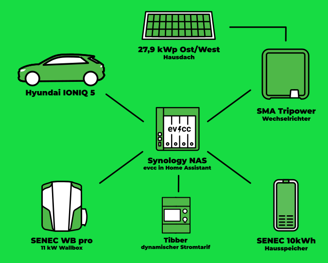

In unserer Serie von Community-Portraits war der Fotograf [Detlef](https://hee.se) vor Kurzem bei Bastian aus Ahlhorn, Großenkneten.

{/* excerpt */}

## „Wenn, dann jetzt!“

**Michael:** Hallo Bastian, wie schön, dass du da bist.
Erzähl uns ein wenig über dich und wie du zum Thema Elektroauto und PV-Überschussladen gekommen bist.

**Bastian:** Ja, gerne.
Also, ich heiße Bastian und wohne mit meiner Frau und meinen beiden Kindern in der Gemeinde Großenkneten im Landkreis Oldenburger Land.
Vom Standort her war das für uns perfekt, da wir nah an größeren Städten sind (Vechta, Oldenburg, Bremen), aber das Haus dennoch preislich erschwinglich war.
Im Ort ist außerdem alles fußläufig erreichbar, was wir so brauchen, unter anderem zwei Einkaufsmärkte, alle Schulformen und einen Kindergarten.
Nachdem wir unser Haus aus dem Jahr 1978 bezogen haben, habe ich mich recht bald mit dem Thema PV-Anlage auseinandergesetzt.
Die Dachflächen in einem Bungalow mit Spitzdach sind einfach perfekt dafür.
Und Strom war, für mein Empfinden, zu dem Zeitpunkt schon zu teuer.
„Wenn, dann jetzt“ war die Devise, damit man selbst noch möglichst viel davon hat.
Somit kam sehr zeitnah die große PV-Anlage auf das Ost- und Westdach.

## 28 kWp PV + dynamischer Stromtarif = 💚

**Michael:** Die Dachflächen zur Stromerzeugung zu nutzen, ist immer eine super Idee.
Danach kam dann das E-Auto?

**Bastian:** Ja genau, vorletztes Jahr hat mein Arbeitgeber dann angekündigt, ein E-Auto-Leasing ins Leben zu rufen, was dann für uns der ausschlaggebende Punkt war, um in die Elektromobilität einzusteigen.
Da wir viel Strom über die großen Dachflächen machen können, ergab es für uns Sinn, das Auto genau damit aufzuladen.
Bei der Suche nach Lösungen bin ich im Internet sehr schnell auf evcc gestoßen.
Das und die Integration von Frigate waren für mich dann auch der Grund, letztlich von ioBroker zu Home Assistant zu wechseln.
Anfang Januar sind wir dann auch noch zu Tibber gewechselt, sodass wir auch im Winter günstig laden können.
Vor zwei Jahren ist noch eine Wärmepumpe hier eingezogen, die vor allem im Winter fast meinen ganzen PV-Strom verbraucht.
Da bleibt nicht viel übrig, aber mit Tibber kann ich nachts günstig laden.

## Synology, Home Assistant und evcc

**Michael:** Das kann ich gut nachvollziehen.
Gerade im Winter kann man mit einem dynamischen Stromtarif erheblich sparen.
Wie sieht denn dein aktuelles technisches Setup zu Hause aus?

**Bastian:** Hier die Übersicht der Komponenten, die bei mir mit evcc zusammenspielen:

| **Komponente**     | **Details**                                            |
| ------------------ | ------------------------------------------------------ |
| **Hardware**       | Synology DS923+                                        |
| **Software**       | Home Assistant mit evcc-Add-on                         |
| **Auto**           | Hyundai IONIQ 5                                        |
| **Hausbatterie**   | SENEC.Home 2.1 10 kWh                                  |
| **Wallbox**        | SENEC.Wallbox pro                                      |
| **Wechselrichter** | SMA Tripower STP 25000TL-30                            |
| **PV**             | 27,88 kWp, 82 Module AXITEC X HC 340 (40 Ost, 42 West) |
| **Strom**          | Tibber                                                 |

**Michael:** Da kommen ja einige unterschiedliche Komponenten zum Einsatz.
Du hattest schon angesprochen, dass du Home Assistant nutzt.
Gibt es noch mehr Integrationen in andere Systeme?

**Bastian:** Ich nutze momentan nur Home Assistant.
Mit evcc möchte ich vor allem meine täglichen Stromkosten im Blick behalten.

**Michael:** Du hast eben erwähnt, dass du evcc bei einer Internetrecherche gefunden hast.
Was war der Grund, warum du dich für das System entschieden hast?

**Bastian:** Ich bin ziemlich schnell auf evcc gestoßen.
Zuerst habe ich es mit den SENEC-Komponenten probiert, aber deren System konnte kein PV-Überschussladen.
Daher bin ich dann auf evcc gekommen.
Seit Januar nutze ich das preisabhängige Laden mit Tibber, wodurch ich im Winter günstig laden konnte.

**Michael:** Welche evcc-Funktion gefällt dir am besten?

**Bastian:** Schwierige Frage, aber ich glaube, das automatische Laden zu günstigen Zeiten mag ich am meisten.
Mir gefällt auch, dass evcc sehr benutzerfreundlich ist und eine sehr übersichtliche Oberfläche mitbringt.

## Nächstes Ziel: Wärmepumpe

**Michael:** Hast du Wünsche für die zukünftige Entwicklung?

**Bastian:** Ich verfolge das Projekt auf GitHub und bin schon gespannt, wann das Laden in Kombination mit der PV-Vorhersage kommt.
Auch das Laden mit einem Planer, der weiter vorausschaut, wäre toll.
Besonders Letzteres wird mich noch besser durch den Winter bringen.

Mein nächstes Ziel ist es dann, meine Wärmepumpe zu integrieren.
Ich bin mir noch unschlüssig, ob ich das direkt in evcc mache oder in einem EMS und wenn ja, in welchem.
Erst einmal muss ich meine Wärmepumpe erreichen können.
Das ist mit Buderus/Bosch nicht so einfach…

**Michael:** Das klingt doch perfekt.
Bessere Integration für Wärmepumpen steht auch auf unserer Agenda.
Dann erst mal danke, dass du das mit uns geteilt hast, und alles Gute für die Zukunft!
