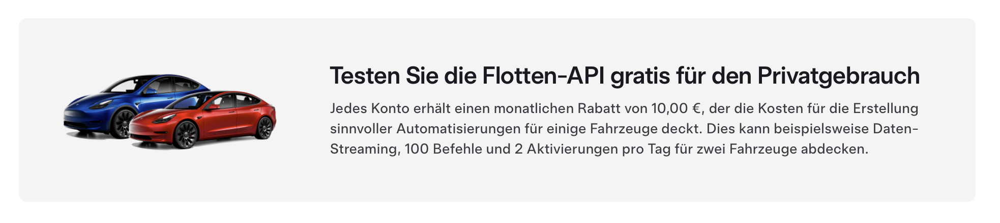

Ab evcc v0.133 wird ein [Tesla Developer Account](https://developer.tesla.com/) benötigt.
Die Nutzung bleibt kostenfrei, erfordert jedoch einen zusätzlichen Einrichtungsschritt.

{/* excerpt */}

:::note[Update]
Dieser Beitrag wurde überarbeitet.

**[8.2.2025](https://github.com/evcc-io/docs/pull/723/files):** Detailliertere Anleitungen für die Konfiguration der Tesla Fleet API und von myteslamate.com.<br/>
**[27.3.2025](https://github.com/evcc-io/docs/pull/775/files):** Aktualisierung auf den neuen Einrichtungsprozess von myteslamate.com.

:::

## Tesla Fleet API wird ab Februar kostenpflichtig

Letztes Jahr haben wir die [Tesla Fleet API](/de/blog/2024/02/01/v0124-new-tesla-api) in evcc integriert.
Tesla war der erste Hersteller, der eine offizielle und vor allem offene API für die Kommunikation mit seinen Fahrzeugen bereitgestellt hat.

Tesla hatte bereits angekündigt, dass diese Schnittstelle nicht dauerhaft kostenlos bleiben würde.
Die Preise sind nun bekannt und treten ab dem 1. Februar 2025 in Kraft.
Die Abrechnung erfolgt nutzungsbasiert, wobei die Kosten je nach Art der Anfrage variieren.

Mit [tesla.evcc.io](https://tesla.evcc.io) haben wir bislang einen Dienst bereitgestellt, über den evcc-Nutzer Zugangstoken für die API-Nutzung generieren können.
Die API-Anfragen über diese Token würden uns ab Februar 2025 in Rechnung gestellt.
Die Kosten pro Nutzer hängen von der Anzahl der Fahrzeuge, dem Ladeverhalten und der konkreten Konfiguration des Aktualisierungsintervalls ab.
Bei den meisten Nutzern überschreiten diese Kosten unser Sponsoring-Modell mit 2 $ pro Monat und wären für uns auch dann nicht tragbar, wenn wir die Tesla-Integration sponsorpflichtig machen würden.

## Kostenloses API-Guthaben für Privatnutzer

Tesla bietet Privatnutzern ein monatliches API-Guthaben von 10 €, was für die meisten evcc-Nutzer ausreichen sollte.

[](https://developer.tesla.com/)

Mit der Version 0.133 haben wir die API-Kommunikation zu Tesla so angepasst, dass du deinen eigenen Tesla Developer Account nutzen kannst.
Token, die zuvor mit [tesla.evcc.io](https://tesla.evcc.io) generiert wurden, funktionieren nicht mehr.
Wir haben überlegt, unseren bisherigen Prozess zur Token-Generierung so zu erweitern, dass du ihn mit deinem eigenen Tesla Developer Account nutzen kannst.
Glücklicherweise hat [myteslamate.com](https://app.myteslamate.com) genau diese Funktion bereits implementiert.
Dort kannst du dir mit deinem Developer Account **Access- und Refresh-Token** generieren.
Daher haben wir uns entschieden, das Rad nicht neu zu erfinden.

## Was ist zu tun?

<a id="vehicle"></a>

### Für Tesla-Fahrer

Für die Einrichtung in evcc benötigst du drei Informationen:

- **Client-ID:** aus dem [Tesla Developer Portal](https://developer.tesla.com/)
- **Access-Token:** über das Skript von [myteslamate.com](https://www.myteslamate.com/tesla-api-application-registration/)
- **Refresh-Token:** über das Skript von [myteslamate.com](https://www.myteslamate.com/tesla-api-application-registration/)

Folge der Anleitung auf [myteslamate.com](https://www.myteslamate.com/tesla-api-application-registration/), um diese Informationen zu generieren.

Da du parallel auf myteslamate.com und developer.tesla.com unterwegs bist, empfehlen wir dir, diese Schritte gleichzeitig in zwei Browserfenstern auszuführen.
Am Ende des Prozesses muss ein Skript heruntergeladen und auf deinem Rechner im Terminal bzw. in der Konsole ausgeführt werden.

Im Anmeldeprozess erscheint ein Berechtigungsdialog.
Für den Betrieb an einer normalen Wallbox (nicht Tesla Wall Connector) benötigt evcc folgende **Tesla-API-Berechtigungen**:

- Profilinformationen _(Region, Liste der Fahrzeuge)_
- Fahrzeugdaten _(Ladestand, Fahrzeugstatus usw.)_
- Fahrzeugstandort _(für die Fahrzeugerkennung, noch nicht implementiert)_
- Fahrzeugbefehle _(zum Aufwecken)_

Hast du den Prozess erfolgreich abgeschlossen, trag die Informationen in die evcc-Konfiguration ein:

Beispiel:

```yaml {6-8}
vehicles:
  - name: my_car
    type: template
    template: tesla
    title: Tesla Model 3
    clientId: aaaaaa-11111-... # von developer.tesla.com
    accessToken: ey1234567890... # von myteslamate.com
    refreshToken: EU_1234567890... # von myteslamate.com
```

Dein verbrauchtes API-Guthaben kannst du in der [Übersicht im Tesla Developer Portal](https://developer.tesla.com/de_DE/dashboard/) nachverfolgen.

:::note
Das evcc-Projekt steht in keiner Verbindung zu myteslamate.com.

Wir sind mit [jlestel](https://github.com/jlestel), dem Entwickler von myteslamate.com, in Kontakt.
Die kostenlose Nutzung des Dienstes durch evcc-Nutzer ist von ihm ausdrücklich erlaubt.
Lies vor der Nutzung des Dienstes die [Terms of Service](https://www.myteslamate.com/terms-of-service) und die [Privacy Policy](https://www.myteslamate.com/privacy-policy).
:::

### Für Nutzer des Tesla Wall Connectors

Wenn du einen Tesla Wall Connector verwendest, sind zusätzliche Schritte erforderlich, da die Ladebefehle eine signierte Kommunikation benötigen und über einen öffentlich zugänglichen Server abgewickelt werden müssen.
myteslamate.com stellt einen solchen Proxy bereit.
Die Abrechnung erfolgt nutzungsbasiert direkt über myteslamate.com.
Für diese Befehle wird nicht dein Tesla-API-Guthaben verwendet.

Wir gehen davon aus, dass du die [oben beschriebenen Schritte](#vehicle) bereits abgeschlossen hast.
Logge dich erneut auf myteslamate.com ein und folge der Anleitung zur Einrichtung des kostenpflichtigen Command-Proxys.
Kopiere das **Proxy-Token** aus dem Abschnitt **Use MyTeslamate API**.
Trage dieses Token in deine evcc-Konfiguration ein:

```yaml {9}
vehicles:
  - name: my_car
    type: template
    template: tesla
    title: Tesla Model 3
    clientId: aaaaaa-11111-... # von developer.tesla.com
    accessToken: ey1234567890... # von myteslamate.com
    refreshToken: EU_1234567890... # von myteslamate.com
    proxyToken: aaaaa-bbbbb-... # von myteslamate.com
```

Mit dieser Konfiguration sendet evcc Ladebefehle an den Proxy von myteslamate.com, der sie mit deiner Tesla-Anwendung signiert und an die eigentliche Tesla API weiterleitet.

:::caution[Das Proxy-Token hat weitreichende Rechte]
Es ist empfehlenswert, die Berechtigungen bei myteslamate.com auf die nötigen Funktionen zu beschränken.
Für evcc sind nur die Funktionen **Charge Start**, **Charge Stop** und **Set Charging Amps** notwendig.
:::

## tesla.evcc.io wird eingestellt

tesla.evcc.io wird im Februar eingestellt.
Alle damit generierten Token verlieren ihre Gültigkeit.
Für die weitere Nutzung der Tesla API ist ein Update auf evcc 0.133 erforderlich.

## Weitere Alternativen

Die Tesla-API-Kommunikation in evcc ist nicht an myteslamate.com gebunden.
Du kannst die Token mit der entsprechenden Infrastruktur (öffentliche Callback-URL notwendig) auch selbst generieren und in die oben genannte evcc-Konfiguration eintragen.

Alternative Anbindungen über Dienste wie [TeslaLogger](https://docs.evcc.io/docs/vehicles#teslalogger), [TeslaMate](https://docs.evcc.io/docs/vehicles#teslamate), [TeslaBleHttpProxy](https://docs.evcc.io/docs/vehicles#tesla-ble), [Tessie](https://docs.evcc.io/docs/vehicles#tessie) oder [Tronity](https://docs.evcc.io/docs/vehicles#tronity) sind ebenfalls möglich.

Besitzer eines Tesla Wall Connectors können auch weiterhin [TeslaBleHttpProxy](https://github.com/wimaha/TeslaBleHttpProxy) als lokalen „Command-Proxy“ verwenden.

## Fazit

Wir haben mehrere Alternativen für die Tesla-Anbindung diskutiert.
Auch spezielle Dienste und Preisstufen für Tesla-Nutzer lagen auf dem Tisch.
Wir glauben, dass unsere aktuelle Lösung aus Nutzersicht die beste ist.
Sie verursacht für die meisten Privatnutzer keine zusätzlichen Kosten.
Die Implementierung bleibt sponsorfrei.
Die API-Kommunikation erfordert keine Drittanbieterdienste.
Auch Nutzer größerer Fahrzeugflotten können evcc nutzen, wobei die API-Nutzungsgebühren direkt bei Tesla anfallen, wenn das monatliche API-Guthaben überschritten wird.

**Viele Grüße**<br/>
Das evcc-Team<br/>
Michael, Andi & Uli
