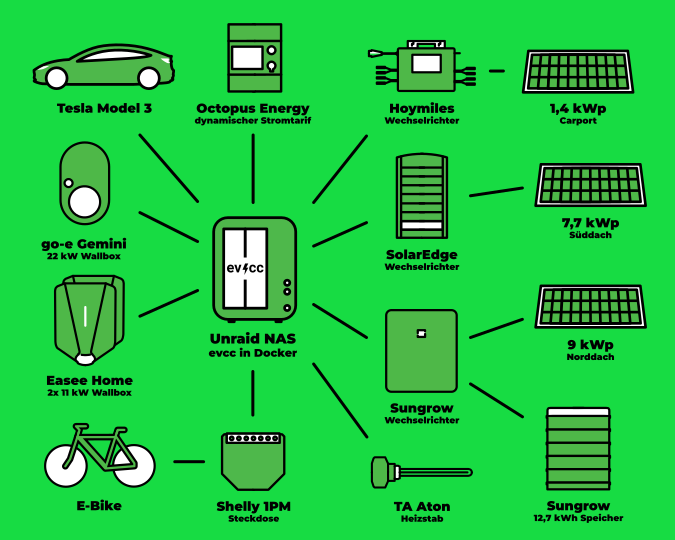

Wir haben in den letzten Monaten viele Nutzer aus der Community kennengelernt.
Das heutige Porträt ist etwas anders: Fotograf [Detlef](https://hee.se) übernimmt die Interviewerrolle und spricht mit Michael aus dem evcc-Core-Team.

{/* excerpt */}

## „Die beste Software bringt nichts, wenn niemand sie kennt“

**Detlef:** Heute drehen wir den Spieß mal um und du bist an der Reihe, Fragen zu beantworten.
Ich habe dich und das Projekt durch einen Vortrag von dir kennengelernt.
Bist du so etwas wie der „Head of evcc“?

**Michael:** Nein, so würde ich mich nicht beschreiben.
Ich bin zusammen mit [Andi](https://github.com/andig) und [Uli](https://github.com/premultiply) Teil des dreiköpfigen Core-Teams.
Wir treiben das Projekt gemeinsam voran und teilen uns die verschiedenen Aufgaben, die bei einem Open-Source-Projekt dieser Größe anfallen.

Neben meinem Schwerpunkt auf der UI-Entwicklung kümmere ich mich auch um unsere Außendarstellung.
Also Themen wie die Webseite, Blogartikel, [Sticker](https://github.com/evcc-io/evcc/discussions/4446), Dokumentation, etwas Social Media und
den ein oder anderen öffentlichen Auftritt auf Konferenzen oder in YouTube-Videos.
Das mache ich, weil ich finde, dass die beste Software nichts bringt, wenn niemand sie kennt.

## Von der naiven Idee zum Core-Team-Mitglied

**Detlef:** Wie war dein erster Kontakt mit evcc?

**Michael:** Mein erster Kontakt mit evcc war vermutlich wie bei den meisten Nutzern.
Wir hatten 2020 ein Elektroauto bestellt und ich suchte nach einer Lösung, es mit Überschussenergie aus unserer PV-Anlage zu laden.
Relativ naiv dachte ich, ich kaufe mir eine smarte Wallbox, dann passt das schon.
Die Realität war ernüchternd: herstellergebundene Insellösungen, Cloud-Dienste, proprietäre Angebote: Das alles war nicht, was ich wollte.

Dann stieß ich auf evcc.
Die Software war minimalistisch, modular und hatte mit Go und Vue.js einen spannenden Tech-Stack.
Das Projekt war damals erst wenige Monate alt.
Ich steuerte erste Beiträge bei und wurde schnell Teil des Core-Teams.
Fast fünf Jahre später ist die Software unglaublich weit gekommen.

## Das Ding mit dem Hundefutter

**Detlef:** Ich nehme an, bei dir läuft selbst eine evcc-Installation.
Wie sieht die aus?

**Michael:** Unsere Reise begann 2017 mit einer PV-Anlage mit 9,8 kWp in Südausrichtung.
Damals war es hier in Deutschland wichtig, unter der Grenze von 10 kWp zu bleiben.
2023 haben wir dann auch das restliche Norddach und das Carport mit Modulen belegt.
Insgesamt sind es jetzt 18 kWp plus eine Hausbatterie mit 12,8 kWh.
Diese Erweiterungen haben unseren Autarkiegrad erhöht.

Natürlich laden wir unser Elektroauto mit evcc und PV-Strom.
Ich versuche aber auch, alle anderen Funktionen zu nutzen, die wir bisher in die Software eingebaut haben.
Von März bis Oktober übernimmt ein [evcc-gesteuerter Elektroheizstab mit 3 kW](https://github.com/naltatis/aton-ctrl) die Warmwasserbereitung.
Er nutzt nur PV-Überschuss oder sehr günstigen Netzstrom.
Selbst unser E-Bike hängt an einer Steckdose, die nur bei Sonnenschein Energie liefert.

Wirtschaftliche Gründe stehen dabei nicht wirklich im Vordergrund.
Unsere Pelletsheizung würde das Wasser etwas günstiger erwärmen, und der E-Bike-Verbrauch ist im Vergleich zum Auto verschwindend gering.
Aber mir geht es darum, die neuen Funktionen auch selbst im Alltag zu verwenden.
Ganz nach dem Motto aus der Softwareentwicklung: [Eat your own dog food.](https://en.wikipedia.org/wiki/Eating_your_own_dog_food)

| Komponente                 | Details                                                                                                   |
| -------------------------- | --------------------------------------------------------------------------------------------------------- |
| **PV-Anlage**              | 18,1 kWp gesamt 7,7 kWp Süd SolarEdge 9,0 kWp Nord Sungrow 1,4 kWp Carport Hoymiles & AhoyDTU |
| **Hausbatterie**           | 12,8 kWh Sungrow                                                                                          |
| **Fahrzeuge**              | Tesla Model 3                                                                                             |
| **Wallboxen**              | Easee Home, Go-e Gemini                                                                                   |
| **Heizstab**               | 3 kW TA Aton via PWM                                                                                      |
| **E-Bike**                 | Shelly 1PM                                                                                                |
| **Dynamischer Stromtarif** | Octopus Energy                                                                                            |

## Community-Power statt Expertenwissen

**Detlef:** evcc unterstützt inzwischen hunderte von Geräten und Diensten.
Hast du die alle im Kopf?

**Michael:** Den Funktionsumfang schon, aber die Details zu einzelnen Integrationen ganz sicher nicht.
Uli und Andi sind die Experten für Geräteanbindungen.
Neue Geräteintegrationen entstehen fast immer durch Community-Mitglieder, die das entsprechende Gerät besitzen.
Manchmal sind das auch Entwickler, die Pull Requests beisteuern können.
Meistens erarbeiten wir gemeinsam mit den Nutzern eine Lösung.

Das Schöne an unserer Systemarchitektur ist, dass gerätespezifische Eigenheiten für die Featureentwicklung keine Rolle spielen.
Unser einheitliches Datenmodell sorgt dafür, dass der Umgang mit z. B. Hausbatterien immer gleich funktioniert, unabhängig von Marke und Modell.
Bietet ein Gerät Zusatzfunktionen wie Phasenumschaltung oder Steuerbarkeit, erscheinen automatisch weitere Optionen in der Oberfläche.

## Open Source vs. kommerzielle Lösungen

**Detlef:** Lass uns über Open Source sprechen. Begeistert dich das nach all den Jahren immer noch?

**Michael:** Absolut.
Open Source ist unschlagbar: Wir schaffen eine Art Datenbank, die Schnittstellen zu fast allen Wallboxen, Wechselrichtern und anderen Geräten einheitlich aufbereitet.
Dieser Gedanke von _freiem Wissen_ ist faszinierend und eine unglaublich wertvolle Ressource, auch für andere Projekte.

**Detlef:** Viele Hersteller bieten proprietäre Systeme an, einige Wechselrichter öffnen sich.
Was bedeutet das für euer Projekt?

**Michael:** Du hast recht.
Viele Hersteller integrieren inzwischen intelligente Ladefunktionen.
In einer idealen Welt sollte intelligentes Energiemanagement so einfach wie möglich sein.
Tesla macht das mit seiner Kombination aus Powerwall, Wallbox und Fahrzeug relativ gut.
Aber sobald man das Ökosystem verlässt (anderes Fahrzeug, Wärmepumpe integrieren), wird es kompliziert.
Hier braucht es Lösungen wie evcc.

**Detlef:** Glaubst du, dass evcc auch über IT-Begeisterte hinaus Nutzer finden wird?

**Michael:** Ich glaube schon.
Heute braucht man noch etwas technisches Hintergrundwissen oder zumindest etwas Freude am Basteln.
Aber wir arbeiten daran, die Ersteinrichtung so komfortabel wie die Einrichtung eines Heimrouters zu machen.
Dadurch wird die Software auch für weniger technisch versierte Nutzer zugänglich.

Cloud-Dienste sind natürlich noch einfacher zu benutzen: anmelden, Zugangsdaten eingeben, fertig.
Aber dann ist man vom Cloud-Anbieter abhängig und muss auf Datenschutz und Stabilität vertrauen.
Eine lokale Lösung in den eigenen vier Wänden gibt einem die volle Kontrolle.
Unabhängigkeit, Stabilität und Datenhoheit sind wichtige Kriterien.

## Keine Magie, keine Checkbox-Flut

**Detlef:** Bei den Featurewünschen auf GitHub könnt ihr nicht allen gerecht werden.
Wer entscheidet, was in die nächste Version kommt?

**Michael:** Verschiedene Faktoren spielen eine Rolle.
Unsere Leitlinie: Die UI nicht mit erklärungsbedürftigen Einstellungen überladen, aber auch kein „magisches Verhalten“ implementieren, das Nutzer überraschen könnte.
Diese Ziele widersprechen sich manchmal.
Im Zweifelsfall lehnen wir Featurewünsche ab, aber dank offener Schnittstellen lassen sich viele Funktionen auch erst einmal extern mit eigenen Skripten oder Home Assistant umsetzen.

Die Nachfrage spielt natürlich auch eine Rolle.
Heizgeräte haben wir lange nur als Plugin unterstützt, um uns auf unsere Kernfunktion, das Laden von E-Autos, zu konzentrieren.
Seit Anfang des Jahres haben wir nun aber Wärmepumpen von über 20 Herstellern integriert, einfach weil es so viele Nutzer wünschten und die meisten dafür notwendigen Mechanismen bereits in evcc existierten.

## Keine Roadmap, keine Weltherrschaft

**Detlef:** evcc war für mich immer ein Projekt für herstellerunabhängiges Laden, heute ist es quasi ein universelles EMS.
Wie siehst du die Zukunft?

**Michael:** Spannende Frage.
Eine offizielle Roadmap gibt es nicht.
Das Community-Finanzierungsmodell gibt uns Freiheit: keine externen Zwänge, keine Meilensteine oder Weltherrschaftsziele mit festen Terminen.

Unsere einzige Motivation ist, die Software optimal an Nutzerwünsche anzupassen.
Die Community hält das Projekt am Leben und gibt die Richtung vor.
Ob wir uns „Universelles EMS“ nennen und alle Produktvergleichs-Checkboxen abhaken können, ist für uns nicht wichtig.
Wichtig ist, dass wir Lösungen für die realen Bedürfnisse der Nutzer liefern.

Zur Zukunft: Ein häufig gewünschtes Feature sind Visualisierungen und Statistiken, die über Ladevorgänge hinausgehen.
Also eine Art „Dashboard“, wie man es aus den Apps der Wechselrichterhersteller kennt.
Dafür haben wir schon viele Ideen.

Ein weiteres großes Thema sind Verbesserungen der intelligenten Steuerung.
Wir planen, Erzeugungs- und Verbrauchsvorhersagen in unsere Algorithmen einzubeziehen.
Eine gute Anbindung externer Optimierungssysteme und KI-basierter Dienste ist uns ebenfalls wichtig.
Hier sind wir auch immer auf der Suche nach engagierten Mitstreitern.
Bei Interesse melde dich gerne bei uns im Slack.

**Detlef:** Von mir und im Namen aller evcc-Nutzer: Vielen Dank, dass du das Projekt so vorantreibst.
Es freut mich immer wieder, mein Auto mit selbst erzeugter Energie zu laden.

**Michael:** Danke für die Fragen und die Gelegenheit, das Interviewformat mal von der anderen Seite zu erleben.

---

**Community-Porträts gesucht!**
Du hast schon Code zu evcc beigetragen?
Dann melde dich gerne [hier](https://airtable.com/appDI3xIiev1DOpMY/shrW1zGH26KElfZOK).
Wir suchen gerade Porträts von aktiven Community-Mitgliedern.
