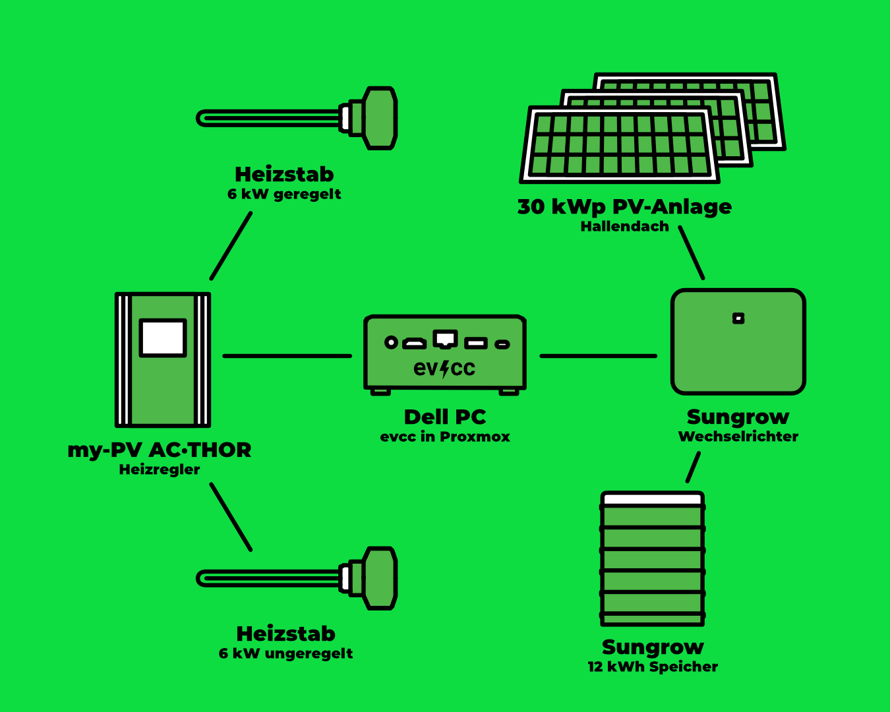

Eine große Bootshalle, Duschen für Dutzende Ruderer und viel Dachfläche: Der [Osnabrücker Ruderverein](https://www.orv.de) (ORV) hat mit PV-Strom und evcc einen Weg gefunden, den Energieverbrauch zu senken und gleichzeitig unabhängiger von fossilen Brennstoffen zu werden.
Fotograf [Detlef](https://hee.se) war zu Besuch.

{/* excerpt */}

## Von Solarthermie zur PV-Anlage

**Michael (evcc):** Hallo Michael, hallo Markus, toll, dass ihr euch die Zeit nehmt.
Ein großes Bootshallendach: Das ist perfekt für PV-Module.
Wie konntet ihr den Verein von der Investition überzeugen?

**Michael (ORV):** Wir hatten bis vor ein paar Jahren eine Solarthermieanlage auf dem Dach, die allerdings einen wirtschaftlichen Totalschaden erlitt.
Im Rahmen einer energetischen Sanierung stand eine PV-Anlage selbstverständlich mit auf der Agenda.
Ausschlaggebend waren zunächst die steigenden Strompreise, aber auch die Unabhängigkeit vom Gas.
Da wir viele Arbeiten durch Eigenleistung der Vereinsmitglieder erledigen konnten, war die Investition deutlich geringer als zunächst veranschlagt.
Das hat die Mitglieder dann auch überzeugt.

**Michael (evcc):** Wie viel von der Dachfläche habt ihr denn belegen können?

**Markus (ORV):** Derzeit ist nur ca. 1/4 der Dachfläche mit einer 30-kWp-Anlage belegt.
Aber wir dürfen aus regulatorischen Gründen nicht mehr installieren, und wir lasten den Netzanschluss bereits aus.
Falls sich das ändert, würden wir die Anlage gerne in Eigenleistung weiter ausbauen.

## Warmwasser für Dutzende Ruderer

**Michael (evcc):** Wie kam evcc ins Spiel?
Gab's alternative Überlegungen?

**Michael (ORV):** Unser erster Vorsitzender hat seine PV-Anlage zu Hause bereits mit evcc gesteuert, die Erfahrungen waren positiv.
Da lag es nahe, das auch im Verein einzusetzen.

**Michael (evcc):** Und wie sieht euer technisches Setup aus?

**Markus (ORV):** Wir haben eine Sungrow-Anlage mit 29,92 kWp, eine 12-kWh-Hausbatterie, einen My-PV AC-Thor 9s mit einem geregelten 6-kW-Heizstab und einem ungeregelten 6-kW-Heizstab am Relais.
Die beiden Heizstäbe sitzen jeweils in einem eigenen Warmwasserspeicher.
Die Software läuft auf einem umfunktionierten Dell-PC, der sparsame 15 W verbraucht.
Darauf ist Proxmox installiert, Home Assistant läuft in einer VM und evcc in einem Container.
Außerdem haben wir im letzten Jahr unsere technische Infrastruktur ausgebaut, um ein stabiles und zukunftssicheres System zu haben.

**Michael (evcc):** Wie viele Menschen duschen denn an einem normalen Tag mit eurem PV-Heizstab und war das Wasser jemals zu kalt?

**Michael (ORV):** Schwer zu sagen, wie viele Menschen am Tag duschen.
Seit wir Wassersparköpfe und Drücker mit Zeitablauf installiert haben, duschen sie auf jeden Fall kürzer.
Das kommt der Gasersparnis zugute.
Zu kalt kann das Wasser nicht werden, weil wir eine Gasheizung haben, die das Wasser erwärmt, sobald 36 °C unterschritten werden.

## 5.742 kWh Gas eingespart

**Michael (evcc):** Könnt ihr schon sagen, wie viel Gas durch die Heizstäbe eingespart wurde?

**Markus (ORV):** Wir können mit Home Assistant den Verbrauch je Heizstab auswerten.
Bis Mitte September haben wir mit mindestens 5.742 kWh PV-Strom Wasser erwärmt.
Das dürfte ungefähr der gleichen Menge Gas entsprechen.
Da wir noch in der Erprobung sind, haben wir noch keine Langzeiterfahrung.

**Michael (evcc):** Hättet ihr denn noch Strom für eine Mitglieder-Wallbox oder andere Verbraucher übrig?

**Michael (ORV):** Wir speisen den Überschuss derzeit ins Stromnetz ein.
Seit Inbetriebnahme der Heizstäbe ist er jedoch deutlich kleiner geworden.
Wallboxen planen wir aber schon für die Zukunft ein.

| Komponente             | Details                                                             |
| ---------------------- | ------------------------------------------------------------------- |
| **PV-Anlage**          | 29,92 kWp (ca. 1/4 der verfügbaren Dachfläche)                      |
| **Wechselrichter**     | Sungrow                                                             |
| **Hausbatterie**       | 12 kWh                                                              |
| **Warmwassersystem**   | My-PV AC-Thor 9s mit 2 Heizstäben (6 kW geregelt + 6 kW ungeregelt) |
| **Warmwasserspeicher** | 2 Stück                                                             |
| **Steuerung**          | evcc im Container auf Proxmox, Home Assistant in VM                 |
| **Hardware**           | Dell-PC (15 W Verbrauch)                                            |

## Wärmepumpe vs. Heizstab

**Michael (evcc):** Eine Wärmepumpe ist deutlich effizienter als ein Heizstab.
Ihr nutzt aktuell Heizstäbe für euer Warmwasser.
Warum habt ihr euch dafür entschieden und habt ihr schon Planungen für eine Wärmepumpe?

**Michael (ORV):** Das Thema Wärmepumpe haben wir bereits diskutiert.
Allerdings unterscheidet sich unser Wärmebedarf als Verein deutlich von typischen Anlagen.
Klassische Daumenregeln greifen daher nicht zwingend und wir möchten die Anlage bedarfsgerecht auslegen.
Auch die Frage, ob eine kombinierte Heiz-/Warmwasser-Wärmepumpe oder getrennte Anlagen besser für uns sind, möchten wir einschätzen können.

Unsere Gasheizung ist aktuell voll funktionsfähig.
Derzeit sammeln wir mit Home Assistant umfangreiche Daten zum Verbrauch, zu Bedarfsspitzen usw.
Unser Ziel ist es, im nächsten Sommer komplett ohne Gas zu heizen.
Da sind wir sehr zuversichtlich.

**Markus (ORV):** Da wir die Projekte in unserer Freizeit stemmen müssen, halten wir die Anzahl paralleler Projekte gering, um auch mal fertig zu werden.
(lacht) Außerdem ist der Heizungsraum voll: Wenn eine Wärmepumpe reinkommt, muss der Gaskessel raus.

## Vom Vorstandsposten aufs Wasser

**Michael (evcc):** Michael und Markus, ihr seid die beiden Technikseelen des Osnabrücker Rudervereins: Wie oft sehen Vereinsmitglieder euch noch im Boot, oder nur im Technikraum?

**Markus (ORV):** Seit ich im Frühjahr den Posten des Finanzvorstands abgegeben habe, habe ich mir vorgenommen, häufiger aufs Wasser zu gehen.

**Michael (ORV):** Ich habe vor drei Jahren den Vorstandsposten für die Liegenschaften übernommen und ja, der Anteil an Arbeit am und für den Verein ist viel höher geworden.
Trotzdem schaffe ich es meistens noch, einmal am Wochenende rudern zu gehen.

## Wünsche für die Zukunft

**Michael (evcc):** Habt ihr Wünsche für die Zukunft und Weiterentwicklung von evcc?

**Markus (ORV):** Auf jeden Fall: Eine Funktion, die dafür sorgt, dass morgens und tagsüber primär das Wasser erwärmt wird, aber abends bei Einbruch der Dunkelheit die Hausbatterie zu 100% geladen ist, wäre unser nächster Wunsch.
Zum Schonen der Hausbatterie und zum netzdienlichen Einspeisen wäre eine Drosselung der Ladeleistung ebenfalls schön.

**Michael (evcc):** Danke für die guten Anregungen.
Da evcc mit dem Laden von E-Autos gestartet ist, haben wir beim Heizen noch einiges zu verbessern.
Da kommt in Zukunft aber noch mehr.

Vielen Dank für die Einblicke in eure Energiewelt beim Ruderverein.
Das zeigt schön, wie evcc auch in größeren Gemeinschaftseinrichtungen funktionieren kann!

---

**Wie sieht dein evcc-Setup aus?**
Wenn du Interesse hast, deine Erfahrungen, deinen Weg und deine Technik in Form eines Community-Portraits zu teilen, dann trag dich gerne [hier im Formular](https://airtable.com/appDI3xIiev1DOpMY/shrW1zGH26KElfZOK) ein.
Wir suchen vor allem Portraits von außergewöhnlichen Installationen oder von Nutzern außerhalb Deutschlands.

---

_Update 19. Dezember 2025: Wir haben den Abschnitt „Wärmepumpe vs. Heizstab“ ergänzt._
