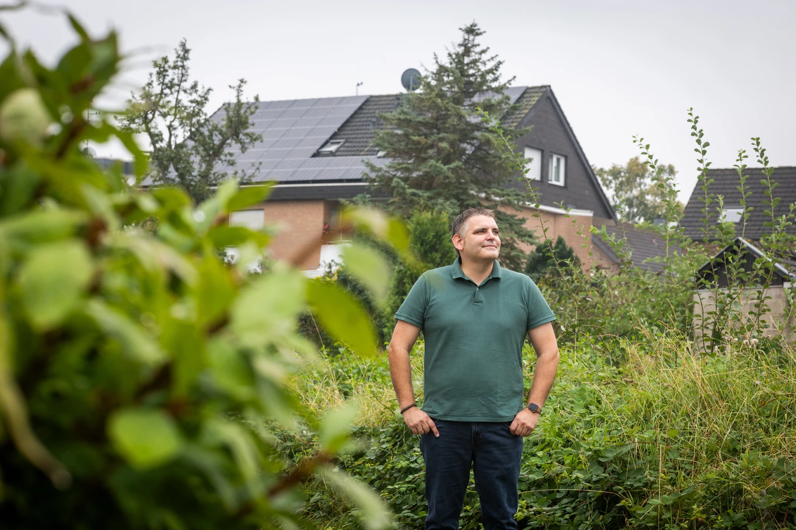
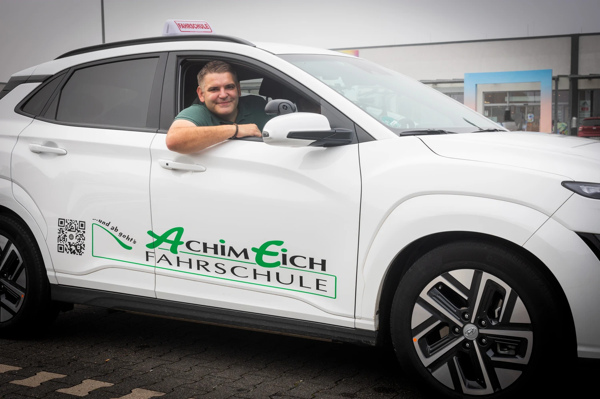
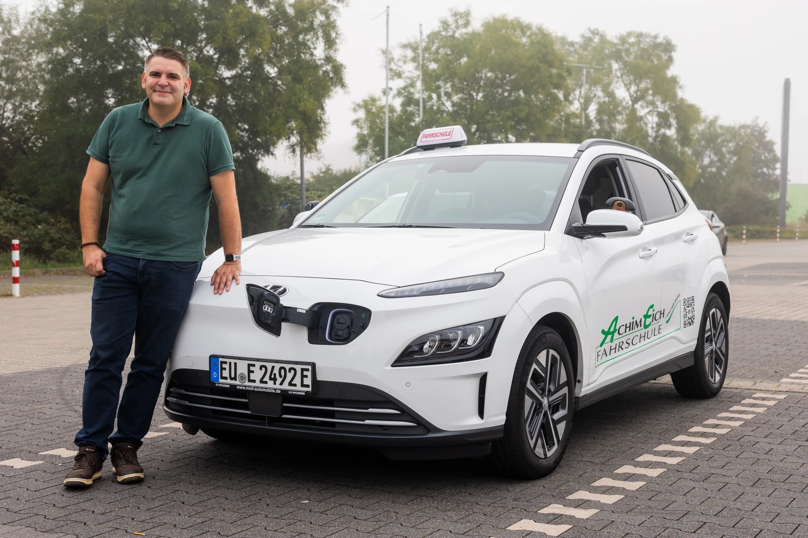
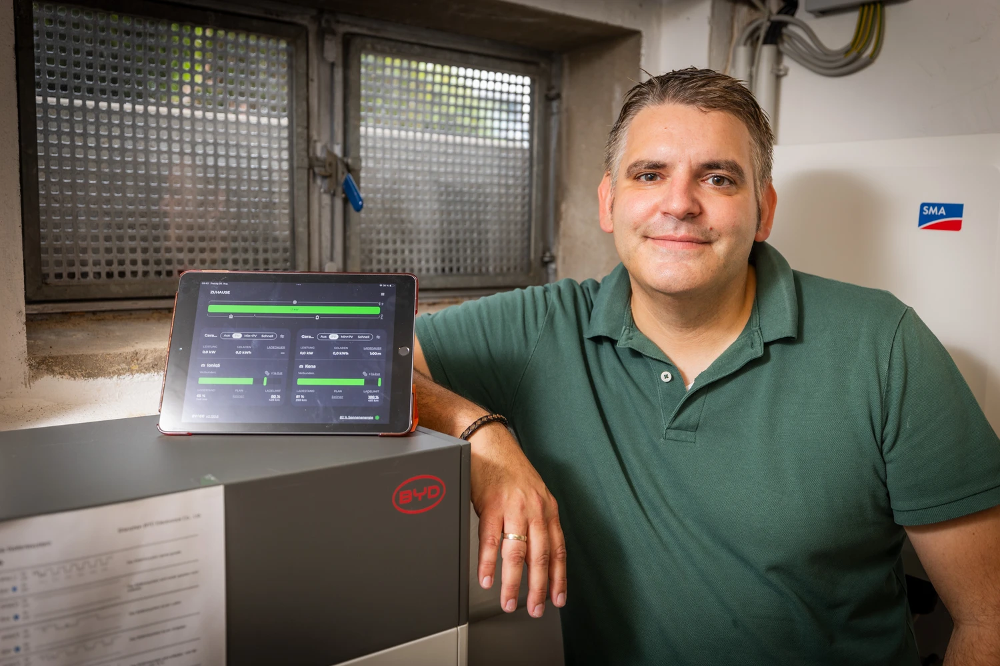
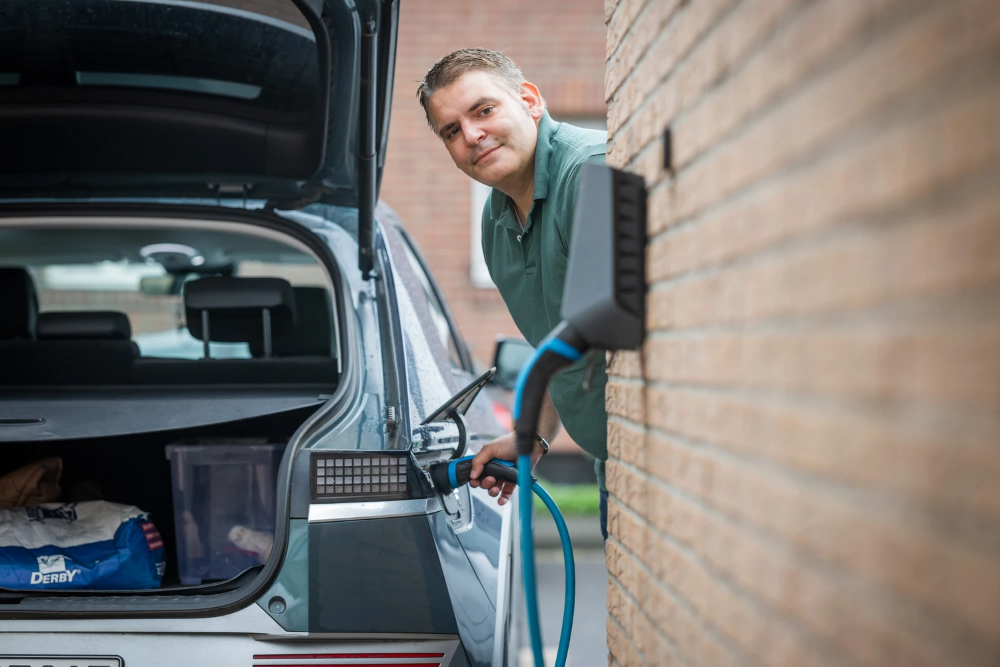
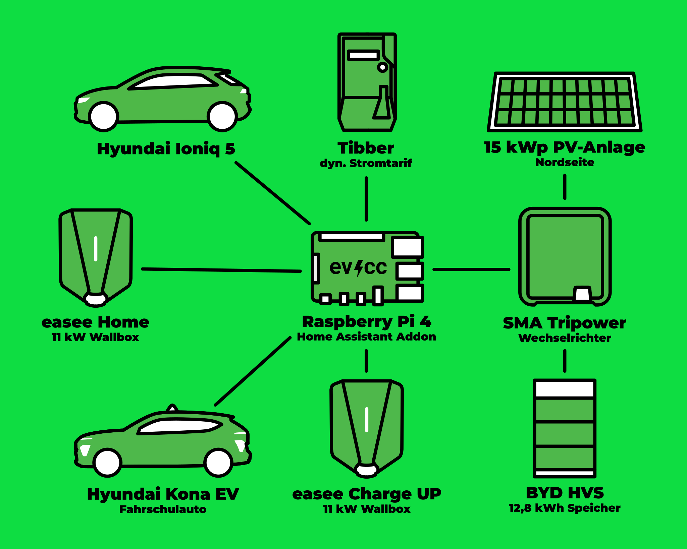
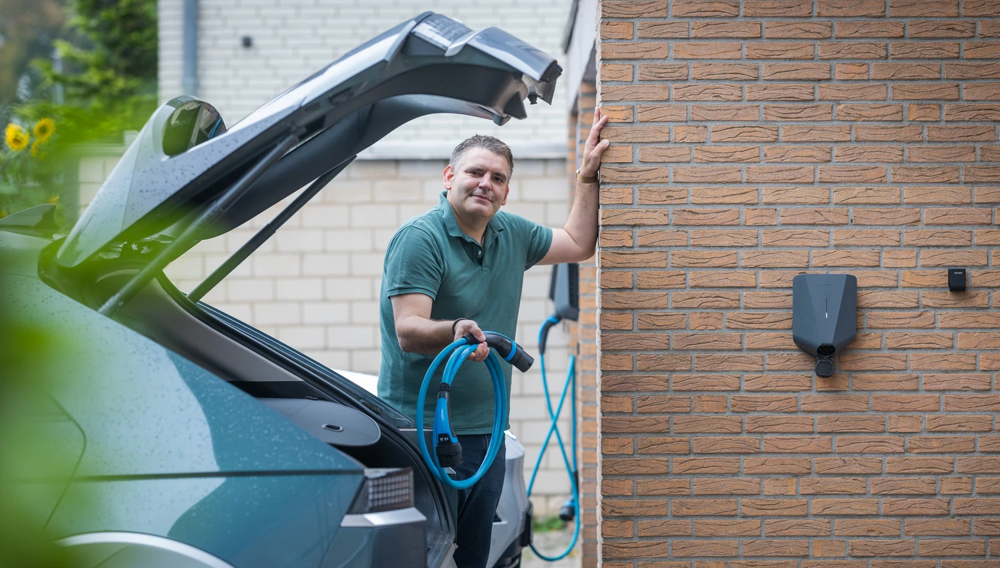
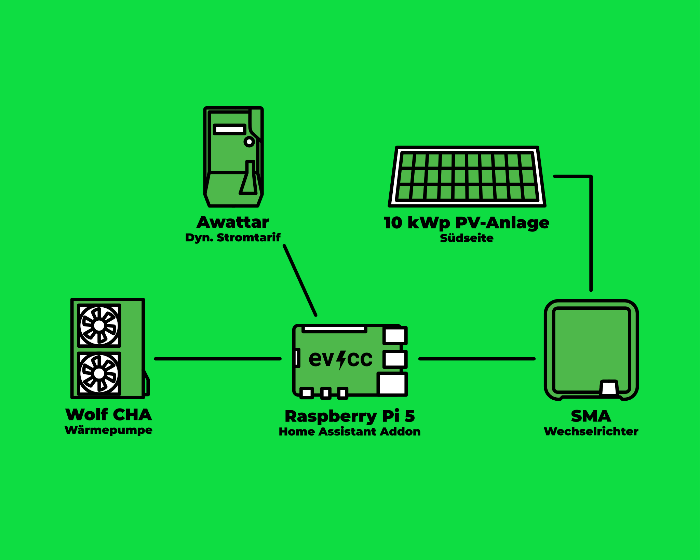
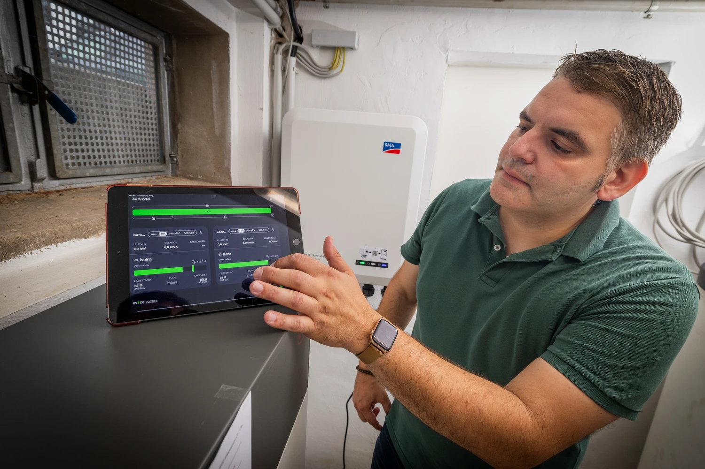

Alex ist Fahrlehrer und nutzt seit Jahren E-Fahrzeuge für die Fahrausbildung.
Mit evcc steuert er zwei Wallboxen für Privat- und Dienstwagen und plant die Integration einer Wolf-Wärmepumpe für sein 5-Parteien-Haus.
Fotograf [Detlef](https://hee.se) war zu Besuch.

{/* excerpt */}

## Vom i3-Carsharing zum IONIQ 5

**Michael:** Hallo Alex, toll, dass du dir die Zeit nimmst.
Du bist Fahrlehrer und nutzt E-Autos beruflich.
Wie war dein erster Kontakt mit Elektromobilität?

**Alex:** Hi Michael, gerne.
Mein erster Kontakt mit E-Mobilität war 2015 bei Kurztrips nach Hamburg.
Dort habe ich den BMW i3 beim DriveNow-Carsharing kennengelernt.
Technisch spannend, außergewöhnlich mit CFK-Karosserie und sehr spritzig im Stadtverkehr.
Das hat mich begeistert.

Mitte 2021 kam dann der erste eigene Stromer, ein VW ID.3 im Leasing.
Zu der Zeit habe ich auch beruflich angefangen, E-Fahrzeuge für die Fahrausbildung einzusetzen: ID.3, ID.4, Hyundai Kona.
Seit etwa zwei Jahren fahren meine Frau und ich einen Hyundai IONIQ 5.

**Michael:** Was war deine Motivation für den Umstieg?

**Alex:** Mehrere Gründe.
Umweltschutz: weniger Emissionen, weniger Lärm.
Dann das Sparpotenzial: PV-Strom vom eigenen Dach in die Hausbatterie und dann ins Auto.
Und dann der Fahrspaß.
Die elastische Beschleunigung und das leise Fahren sind angenehm.

## E-Autos in der Fahrschule

**Michael:** Du bist seit 17 Jahren Fahrlehrer im Großraum Köln/Bonn.
Wie ist das mit E-Mobilität in deinem Berufsalltag?
Hat sich da in den letzten Jahren was verändert?

**Alex:** Auf jeden Fall.
Die E-Mobilität hat sich in der Fahrschulbranche noch nicht vollständig etabliert, aber die Vorteile werden immer häufiger erkannt.
Ich schätze, 15–20% der Fahrschulautos sind mittlerweile elektrisch, ähnlich wie bei privaten Pkw.

Es gibt auch Kollegen, die der neuen Mobilität gegenüber skeptisch sind.
Einige lassen sich von den üblichen Mythen leiten: Rohstoffabbau, Akkuhaltbarkeit, Ladezeiten, Reichweite.
Aber die Skepsis bei den Eltern hat in den letzten Jahren spürbar nachgelassen.

**Michael:** Wie reagieren die Fahrschüler?

**Alex:** Viele Eltern fahren mittlerweile selbst elektrisch und sind der neuen Art der Ausbildung gegenüber aufgeschlossen.
Das Stichwort ist B197: 10 Fahrstunden à 45 Minuten auf dem Schaltwagen für die Schaltkompetenz, der Rest der Ausbildung und die Prüfung auf Automatik.
Die Schüler finden das gut, weil die Prüfung entspannter abläuft.
Typische Fehlerquellen entfallen: kein Abwürgen, kein Verschalten, kein Zurückrollen beim Berganfahren.
Das spricht sich unter den Schülern herum.

Nur noch ganz selten gibt es Eltern, die auf einer reinen Schaltausbildung bestehen.

## Wo ist denn hier der Ölmessstab?

**Michael:** Gibt es lustige Geschichten aus dem Fahrschulalltag mit E-Autos?

**Alex:** (lacht) Oh ja.
Ein Fahrschüler war in der Prüfung etwas aufgeregt und ist mit dem Prüfer zusammen im Motorraum auf die Suche nach dem Ölmessstab gegangen.
So etwas vergisst man nicht.

**Michael:** Wie sieht es mit der Reichweite aus?
Reicht die für einen normalen Fahrschultag?

**Alex:** Absolut.
Wir setzen auf die großen Akku-Varianten mit 64–77 kWh.
Selbst im Winter passt es.
Wenn wir für die B197-Ausbildung zwischendurch auf das Schaltfahrzeug wechseln, kann ich in der Zeit an der Fahrschule 90 Minuten mit 11 kW nachladen.
Einen DC-Lader musste ich praktisch nie bemühen.

Zu Hause habe ich eine separate Wallbox für den Dienstwagen.
So starte ich immer mit vollem Akku in den Tag.

## Von Tibber Smart Charging zu evcc

**Michael:** Wie bist du auf evcc gestoßen?

**Alex:** Ich habe mich im Frühjahr 2023 mit Energiemanagementsystemen (HEMS) beschäftigt.
Mein Ziel war zunächst, den dynamischen Stromtarif mit zeitoptimiertem Laden zu verbinden.
Tibber hat mit Smart Charging dafür den Grundstein gelegt.

Nach der Installation der PV-Anlage und der Hausbatterie reichte diese Steuerung aber nicht mehr aus.
Die Flexibilität von evcc hat mich begeistert: Benachrichtigungen, Tarifanbindung, vielfältige Unterstützung von Wallboxen und Fahrzeugen.
Die kontinuierliche Weiterentwicklung unterstütze ich gerne.

**Michael:** Welche Funktionen nutzt du konkret?

**Alex:** Ich nutze automatisierte Ladepläne, die Privat- und Dienstwagen bis zum frühen Morgen auf einen bestimmten Ladestand bringen.
Mein Ziel ist, dass das System ohne große Eingriffe von selbst läuft.
Man bastelt natürlich gerne am letzten Feinschliff, aber im Alltag soll es einfach laufen.

## Zwei Systeme, zwei Raspberry Pis

**Michael:** Lass uns über dein technisches Setup sprechen.
Du hast ja eine etwas ungewöhnliche Konstellation.

**Alex:** Stimmt, ich betreibe tatsächlich zwei getrennte evcc-Instanzen.
Das erste System ist für meine Wohnung.
Da habe ich eine PV-Anlage mit 14,85 kWp auf der Nordseite des Dachs, kombiniert mit einer BYD-Hausbatterie mit 12,8 kWh.
Zwei Easee-Wallboxen sind angeschlossen, eine privat und eine für den Dienstwagen.
Der dynamische Stromtarif läuft über Tibber.

Das System läuft auf einem Raspberry Pi 4 mit Home Assistant und der evcc-App.

| Komponente                 | Details                                    |
| -------------------------- | ------------------------------------------ |
| **PV-Anlage**              | 14,85 kWp (Nordausrichtung)                |
| **Wechselrichter**         | SMA Sunny Tripower SE STP10.0-3SE-40       |
| **Hausbatterie**           | BYD HVS 12,8 kWh LFP                       |
| **Wallboxen**              | Easee Home (11 kW), Easee ChargeUp (11 kW) |
| **Fahrzeuge**              | Hyundai IONIQ 5                            |
| **Dynamischer Stromtarif** | Tibber                                     |
| **Steuerung**              | Raspberry Pi 4, Home Assistant, evcc-App   |

**Michael:** Und das zweite System?

**Alex:** Das zweite System ist für das komplette 5-Parteien-Haus.
Dort habe ich eine PV-Anlage mit 10 kWp auf der Südseite des Dachs und eine Luft-Wasser-Wärmepumpe Wolf CHA 20/24 Monoblock mit SG-Ready-Schnittstelle.
Der Stromtarif läuft über Tado/awattar.

Das läuft auf einem Raspberry Pi 5, ebenfalls mit Home Assistant und der evcc-App.
Die Wärmepumpe ist noch nicht vollständig in evcc integriert, das ist mein nächstes Projekt.

| Komponente                 | Details                                  |
| -------------------------- | ---------------------------------------- |
| **PV-Anlage**              | 10 kWp (Südausrichtung)                  |
| **Wechselrichter**         | SMA Sunny Tripower STP 10000TL-20        |
| **Wärmepumpe**             | Wolf CHA 20/24 Monoblock, SG-Ready       |
| **Dynamischer Stromtarif** | Tado/awattar                             |
| **Steuerung**              | Raspberry Pi 5, Home Assistant, evcc-App |

## Ladepläne und Batterie Boost

**Michael:** Was sind deine Lieblingsfeatures in evcc?

**Alex:** Ganz klar die Ladepläne für bestimmte Wochentage.
Ich kann für jedes Fahrzeug unterschiedliche Ladezeiten einstellen.
Das läuft komplett automatisch.

Und dann der Batterie Boost.
Genial ist es, wenn die Hausbatterie voll ist und ich tagsüber, vor allem im Sommer, in einer Pause den PV-Strom aus der Hausbatterie direkt ins Auto schieße.

**Michael:** Was wünschst du dir von evcc?

**Alex:** Meine Wunschliste wird durch die kontinuierliche Weiterentwicklung immer kleiner.
Schön wäre eine native Anbindung meiner Wärmepumpe.
Es werden zwei Wolf-Systeme unterstützt, aber noch nicht die CHA.
Wenn Probleme auftreten, hilft die Community auf GitHub immer gut weiter.

Die Einbindung von Hausgeräten wie Miele@home oder BSH Home Connect wäre ebenfalls ein logischer nächster Schritt, auch wenn es hier nur um wenige kWh geht.
Ich finde es aber auch richtig, den Fokus nicht zu sehr zu verlieren und sich auf die Kernfunktionen zu konzentrieren.

**Michael:** Danke für die guten Anregungen.
Und vielen Dank für die Einblicke in deinen Fahrschulalltag und dein evcc-Setup.
Das zeigt schön, wie vielfältig E-Mobilität und evcc eingesetzt werden können!

**Alex:** Gerne!
Und wir sehen uns im April beim [Community-Treffen](/de/blog/2025/12/16/community-treffen-2026) in Osnabrück.

---

**Wie sieht dein evcc-Setup aus?**
Wenn du Interesse hast, deine Erfahrungen, deinen Weg und deine Technik in Form eines Community-Portraits zu teilen, dann trag dich gerne [hier im Formular](https://airtable.com/appDI3xIiev1DOpMY/shrW1zGH26KElfZOK) ein.
Wir suchen vor allem Portraits von außergewöhnlichen Installationen oder von Nutzern außerhalb Deutschlands.
