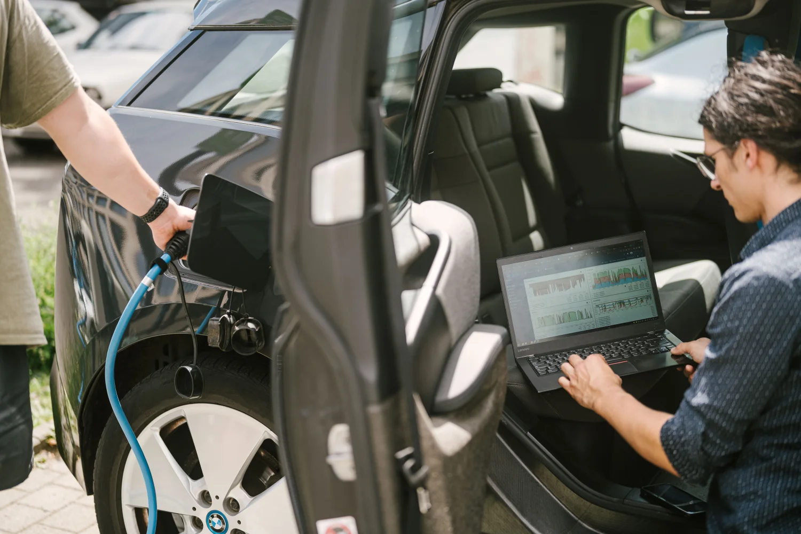

Die Forschungsgruppe Solarspeichersysteme der [HTW Berlin](https://solar.htw-berlin.de/evcc-crowdscience/) hat mit [evcc-Crowdscience](https://evcc-crowdscience.de) eine Plattform gestartet, über die evcc-Nutzer ihre Ladedaten anonym für die Forschung bereitstellen können.

{/* excerpt */}

## Warum echte Ladedaten?

Reale Ladeprofile von Elektrofahrzeugen sind für Forschung und Energiewirtschaft wichtig.
Bisherige Modelle basieren oft auf Annahmen.
Die tatsächlichen Lademuster von Haushalten mit PV-Anlage und Wallbox können aber deutlich davon abweichen.
evcc-Crowdscience will genau diese Lücke schließen.

## Wie funktioniert's?

Die Datenübertragung läuft über MQTT.
Auf [evcc-crowdscience.de](https://evcc-crowdscience.de) generierst du ein Token und trägst es in den Einstellungen deiner evcc-Instanz ein.
Ab dann werden deine Ladedaten automatisch und anonym an die Forscher übertragen.
Das funktioniert auch, wenn du MQTT bereits für andere Integrationen nutzt.
Es werden keine personenbezogenen Daten erhoben.
Wenn du nicht mehr teilnehmen möchtest, entfernst du einfach das Token.
Alle Details zur Einrichtung findest du auf der [Projektseite](https://evcc-crowdscience.de).

## Was wird erforscht?

Das Team der HTW Berlin untersucht auf Basis der gesammelten Daten:

- Wann und wie lange Fahrzeuge geladen werden
- Wie die Ladeleistung im Alltag schwankt
- Wie effektiv PV-Überschussladen in der Praxis ist
- Wie sich das Ladeverhalten zwischen Haushalten unterscheidet

Der Datensatz und die Ergebnisse sollen später als Open Data veröffentlicht werden und stehen dann allen zur Verfügung.

_Foto: HTW Berlin/Alexander Rentsch_

## Deine Daten beitragen

Wir finden das Projekt spannend und unterstützenswert.
Je mehr Haushalte teilnehmen, desto aussagekräftiger werden die Ergebnisse.
Falls du evcc mit einer Wallbox betreibst: Mach mit!

**[Auf evcc-crowdscience.de anmelden →](https://evcc-crowdscience.de)**

Mehr Hintergrundinformationen findest du auf der [Projektseite der HTW Berlin](https://solar.htw-berlin.de/evcc-crowdscience/).
