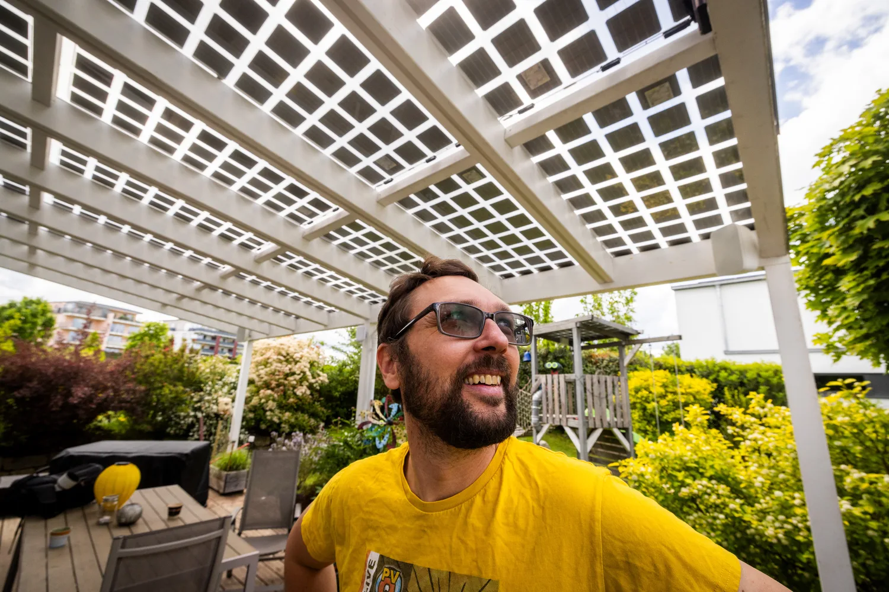
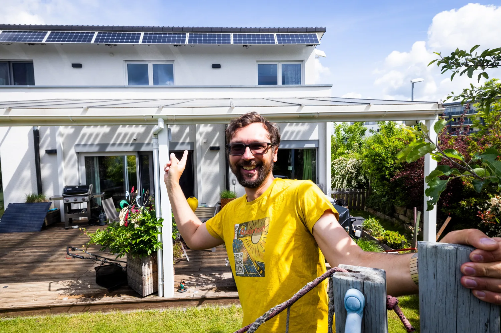
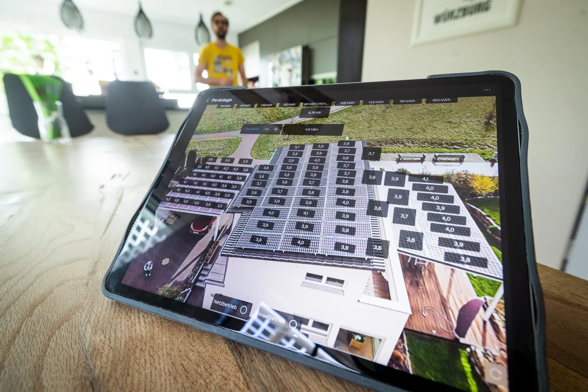
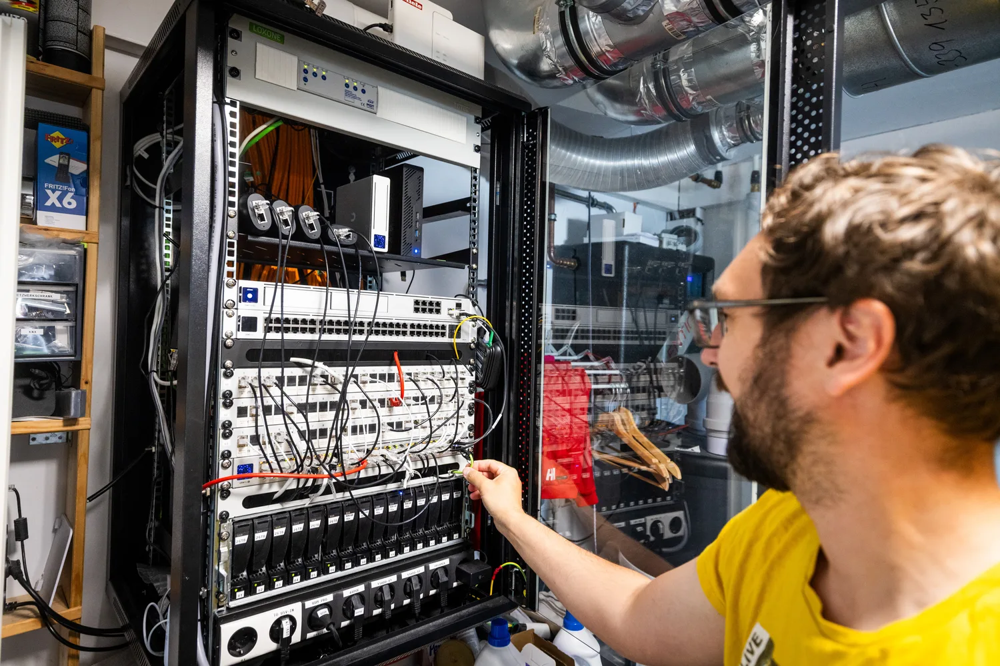
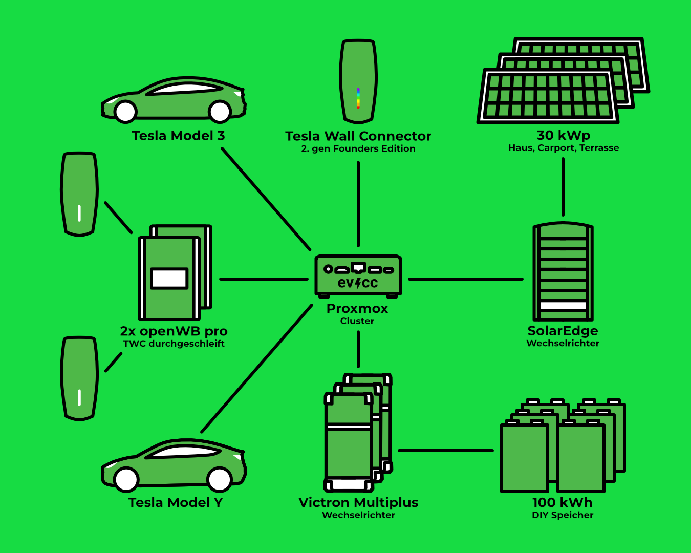
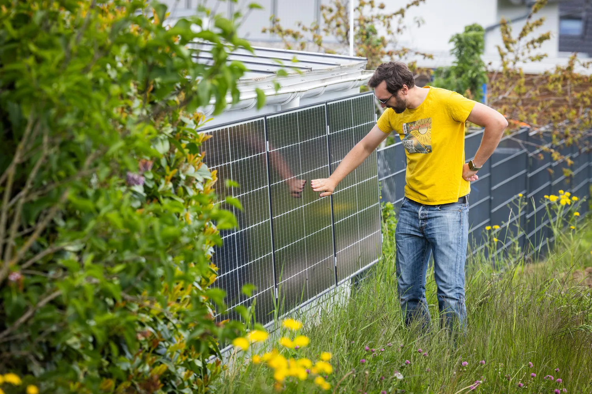

Jörg bloggt seit 2011 auf [meintechblog.de](https://meintechblog.de) über Smart Home, PV und E-Mobilität und streamt regelmäßig mit dem [PV-Quartett](https://www.youtube.com/@MeintechblogDe/streams) auf YouTube, einer von ihm gegründeten Runde mit anderen Enthusiasten aus der Energieszene.
Bei ihm zu Hause in Schwäbisch Hall laufen ein 100 kWh großer DIY-Speicher, die Direktvermarktung seines PV-Stroms und drei Wallboxen nebeneinander, verbunden über MQTT, [Loxone](https://www.loxone.com) und evcc.
Fotograf [Detlef](https://hee.se) war zu Besuch.

{/* excerpt */}

## Hobby mit 16.000 Abonnenten

**Michael:** Hallo Jörg, schön, dass du dir die Zeit nimmst.
Du bloggst seit 2011 und hast inzwischen einen [YouTube-Kanal](https://www.youtube.com/@MeintechblogDe) mit über 16.000 Abonnenten.
Ist das noch Hobby oder schon Beruf?

**Jörg:** Ich habe schon ein paar Mal überlegt, ob ich das professionalisiere.
Aber es ist und bleibt Hobby.
So kann ich darüber schreiben, worauf ich Bock habe, und muss keine Kooperationen eingehen, um über die Runden zu kommen.
Ich habe schon Demogeräte zurückgeschickt, weil sie mir nicht getaugt haben.
Bevor ich schreibe, dass etwas blöd ist, schreibe ich lieber gar nicht darüber.
Die Affiliate-Einnahmen gehen wieder in Technik, und über die blogge ich dann.
Ein Kreislauf.

**Michael:** Was gibt dir das Bloggen zurück?

**Jörg:** Den Austausch mit den Lesern.
Manche Artikel haben über 200 Kommentare, da bekomme ich ständig neue Impulse.
Der Blog ist ein Connector geworden.
Leute kommen auf mich zu, wir landen in WhatsApp-Gruppen oder im PV-Quartett, und da sind Obernerds dabei, die sich zehnmal tiefer reingebohrt haben als ich.
Diese Kontakte wären sonst nie entstanden.

**Michael:** Auf YouTube setzt du inzwischen auf Live-Sessions statt geschnittener Videos.
Warum?

**Jörg:** Eigentlich wollte ich nie auf YouTube setzen.
Aber viele haben geschrieben, das sei leichter zugänglich, also habe ich es ausprobiert.
Schneiden kostet mich viel Zeit, deshalb mache ich inzwischen oft Live-Sessions.
Da bist du gezwungen, dich zu konzentrieren, und kannst direkt auf Fragen eingehen.
Der Kanal ist groß genug, dass nicht nur zwei Leute zuschauen, sondern 20 oder 100, und einige davon bohren sich richtig rein.
YouTube darf man nicht unterschätzen, viele schauen gar kein Fernsehen mehr.

## Sonnenschutz, der Strom liefert

**Michael:** Deine PV-Anlage ist über die Jahre gewachsen: Hausdach, Carport und zuletzt das Terrassendach mit teiltransparenten Modulen.
Würdest du das Terrassendach wieder so bauen?

**Jörg:** Auf jeden Fall, jederzeit.
Es ist vor allem ein Sonnenschutz, gerade im Sommer.
Die Module sind zu 40% transparent, es kommt also genug Licht durch, und auch im Winter ist es im Haus nicht zu dunkel.
Und ich freue mich jedes Mal, wenn ich in der App sehe, wie die Dinger performen.
Sie sind 10% nach Süden geneigt und liefern einfach mega.
Alle wichtigen Infos dazu, auch zum Aufbau, gibt es [bei mir im Blog](https://meintechblog.de/2021/05/10/operation-solar-terrassenueberdachung-anlagenerweiterung-um-48-kwp/).

**Michael:** Wer ohnehin eine Terrasse überdacht, sollte PV also gleich mitdenken?

**Jörg:** Wenn es passt, ja.
Ich hatte meinen SolarEdge-Wechselrichter damals bereits nach dem Carport-Projekt vorsichtshalber auf 30 kW aufgerüstet, da konnte ich das Terrassendach einfach in einen vorhandenen String mit einhängen.
Keine neue Hardware, das rechnet sich schnell.
Man muss nur prüfen, dass der String zum Wechselrichter passt.

**Michael:** Auf den Fotos putzt du gerade die Module über dem Balkon.
Wie genau schaust du dir an, was die einzelnen Module bringen?

**Jörg:** Jeder Leistungsoptimierer liefert seine Daten.
Ein kleines Programm holt sich alle Viertelstunde die Modulwerte aus dem SolarEdge-Portal, die landen in der InfluxDB, und damit kann ich Auswertungen auf Modulebene fahren.
Ab und zu schaue ich aus Interesse, ob alle Module noch gleich stark sind und welches das schwächste ist.
So hole ich noch etwas mehr aus der Anlage raus.

**Michael:** Hast du mit der Anlage noch etwas vor?

**Jörg:** Die Module über dem Balkon sind motorisiert und lassen sich im Winkel verstellen.
Nächstes Jahr will ich die Logik dahinter noch einmal optimieren, damit sie perfekt der Sonne folgen.
Das bringt zwar nicht so viel mehr Ertrag, aber ich bin eben für jede Spielerei zu haben, die irgendwie cool ist.

## 108 Zellen im Technikraum

**Michael:** Kommen wir zu deinem Setup.
Das auffälligste Teil ist der Speicher: [100 kWh, selbst gebaut](https://meintechblog.de/2023/01/21/operation-hausspeicher-100kwh-mit-neuem-18s-batteriepackdesign/).
Wie kam es dazu?

**Jörg:** Das war bis jetzt das krasseste und intensivste Projekt, das ich gemacht habe.
Ich habe gefühlt ein Jahr recherchiert, und was man heute sieht, ist schon die dritte Variante.
Es sind 108 Zellen in sechs Packs, die passen auf den Zentimeter genau in den Technikraum.
Mittlerweile gibt es solche Gehäuse fertig aus Metall zu kaufen.
Wenn ich den Platz hätte, würde ich die heute nehmen, das spart viel Arbeit und sieht professioneller aus.

**Michael:** Warum nicht gleich einen fertigen Speicher kaufen?

**Jörg:** Das Geile am Eigenbau ist, dass ich alle Parameter so einstellen kann, wie ich will.
Ich bekomme jede Sekunde von allen 108 Zellen die Statusinformation vom BMS und kann das nicht nur auswerten, sondern live sehen und relevante Parameter on-the-fly anpassen.
Ich fahre regelmäßig Lade- und Entladetests, um Kapazität, Wirkungsgrad und Degradation zu messen.
Das ist keine Testinstallation, sondern produktiver Betrieb rund um die Uhr.
In der Form findest du diese Daten nirgendwo.

Bei einem fertigen Speicher siehst du von außen meist nur eine LED: lädt oder entlädt, mehr nicht.
Ein Kumpel von mir hat so ein Gerät, und das muss ständig mit der Cloud des Herstellers verbunden sein.
Fällt das Internet aus, dauert es ein paar Minuten, dann geht der Speicher vom Netz und ist einfach aus.
Zwischendurch wurde er vom Anbieter aus der Ferne gedrosselt, und inzwischen ist er ganz kaputt.
Einen Austauschtermin gibt es immer noch nicht, dafür bekommt er jeden Monat eine Entschädigung, weil das Ding nicht läuft.

So etwas will ich nicht im Haus haben, ohne zu wissen, was darin vorgeht.
Blöd gesagt kann sich da jemand von außen einhacken und dem Speicher sagen: Lade die Zellen nicht bis 4,2 V, sondern bis 4,5 V.
Diese Ladeschlussspannung ist die Grenze, bei der eine Zelle voll ist, und wer sie überschreitet, riskiert, dass das Ding abraucht.
Je nach Zellchemie ist das ein wirkliches Risiko.
Darauf habe ich keinen Bock.
Deshalb will ich auf Zellebene sehen, was passiert, wie die Zellen altern und wie die Degradation verläuft.

Über diese Erkenntnisse will ich demnächst auch wieder mehr bloggen, die Inhalte sind ja da.
Den Speicher genauso nachzubauen und alles mitzumessen, machen die allerwenigsten.
Aber von den Erfahrungen können viele profitieren.
Ich habe auch so viele Fehler gemacht, und die kommuniziere ich immer offen, damit andere sie nicht selbst machen müssen.

## Zwei Wall Connectors sind nur Fassade

**Michael:** Wie lädst du deine beiden Teslas?

**Jörg:** Über zwei [openWB Pro](https://openwb.de).
Zwischen openWB und Auto hängt jeweils ein durchgeschleifter Tesla Wall Connector, der selbst nicht lädt.
Der ist für die Optik da und bringt den Knopf am Ladekabel mit, der die Ladeklappe öffnet.
Damit das über die openWB funktioniert, [musste ich basteln](https://meintechblog.de/2023/11/03/so-habe-ich-meine-openwb-pro-per-charge-port-opener-gepimpt/): Ein Step-down-Wandler am openWB-Netzteil versorgt den Chargeport-Opener am Stecker.
Da habe ich viel rumgefummelt, bis es lief.

**Michael:** Im Diagramm taucht noch eine dritte Wallbox auf.

**Jörg:** Noch ein Wall Connector Gen 2 für Gäste, Founders Edition mit Elon-Unterschrift. (lacht)
Der hängt über [TWCManager](https://github.com/dracoventions/TWCManager) im Netzwerk.
Meine eigene Web-App „Wallbox-Master“ gibt ihn dort als openWB Pro aus, damit evcc ihn problemlos einbindet.
In den werde ich auch noch eine eigene [WLED](https://kno.wled.ge/)-Leiste einbauen, wie bei den anderen beiden „Fake-Wall-Connectors“, wo sie [den Ladevorgang visualisiert](https://meintechblog.de/2024/02/20/pimp-my-wallbox-kurzer-nerd-einblick-in-meine-wled-ladevisualisierung/).

## Alles über Kabel, nichts in die Cloud

**Michael:** Loxone, [Node-RED](https://nodered.org), [Home Assistant](https://www.home-assistant.io), eigene Web-Apps und evcc laufen bei dir parallel.
Wer übernimmt welche Rolle?

**Jörg:** Loxone ist seit neun Jahren das Gehirn, da laufen alle Informationen zusammen.
Es bekommt laufend Updates, ich hatte nie Stress damit, und meine Frau navigiert in der App wie beim Online-Shopping.
Die Extensions für KNX, DMX und RS485 sind aber schweineteuer, und MQTT kann der Miniserver nur halbherzig.
Deshalb setze ich jetzt komplett auf MQTT.
Ein KNX-Gateway übersetzt direkt auf MQTT, und für alles ohne passende Schnittstelle schreibe ich eigene Software, bei der am Ende MQTT rausfällt.
Dann habe ich einen Broker für alles und kann bei jedem Projekt sagen: Ich will diese Werte kombiniert haben.

**Michael:** Und Home Assistant?

**Jörg:** Da bin ich zwiegespalten.
Für jedes Gerät gibt es ein Plugin, aber jede Installation hat bei mir RAM ohne Ende gefressen.
Inzwischen lasse ich mein LLM die Integration selbst schreiben.
Es schaut sich an, wie Home Assistant das macht, und baut es so, wie ich es haben will.
Das wollte ich immer schon selbst machen, mir hat die Zeit gefehlt.
Jetzt sagst du „mach mal“, und zehn Minuten später läuft es.
Du musst ihm aber genau sagen, wie du es willst, und das Framework selbst verstehen.

**Michael:** Gibt es eine Devise hinter all dem?

**Jörg:** Alles über Kabel und nicht per Funk, und möglichst gar keine Cloud.
Das gilt auch für KI: Auf meinem Mac mini läuft ein lokales Modell.
Sensible Daten gehen nicht direkt in die Cloud, sondern das lokale Modell schaut erst drauf, anonymisiert und reicht dann weiter.
Fürs Entwickeln ist es zu schwach, da arbeiten beide zusammen.

## Ein Experten-Zoo aus KI-Agenten

**Michael:** Du bist voll im KI-Game, lässt dir Integrationen schreiben und Daten auswerten.
Wie behältst du da den Überblick?

**Jörg:** Ich habe pro Domäne einen Agenten, der dort der Experte ist, und teile das auf getrennte Sessions auf.
So ein kleiner Experten-Zoo zu Hause, der meine Konzepte und Ideen kennt.
OpenClaw hatte ich auch ausprobiert, aber das hat Token verballert ohne Ende, da bin ich komplett weg.
Jetzt baue ich das strukturiert und langsam auf, damit nicht zu viele Änderungen gleichzeitig passieren und ich alles nachvollziehen und zurückrollen kann.
Und kein Agent darf etwas Unumkehrbares tun, ohne mich zu fragen.
Da musste ich schon Lehrgeld bezahlen, deshalb bin ich mittlerweile besonders vorsichtig und vertraue der KI nie mehr blind.
Dazu gibt es bald mehr auf meintechblog.de, auch zu meinen Fails.

**Michael:** Wofür setzt du die Agenten im Alltag ein?

**Jörg:** Zum Beispiel für meine Daten.
Seit gefühlt 30 Jahren scanne ich alle Rechnungen und alles, was mit der Post kommt, und meine E-Mail-Historie reicht ähnlich weit zurück.
Das lokale Modell erkennt den Inhalt, und alles landet zusätzlich in einer Vektordatenbank.
Jetzt gebe ich ein paar Begriffe ein und finde die Tesla-Rechnung von vor drei Jahren, statt ewig in der Amazon-Historie zu suchen.
Das ist ein Gamechanger.
Genauso bei den Energiedaten in der InfluxDB: Als Mensch zeichnest du dir ein paar Graphen, die KI wertet das einfach so viel besser aus.

## Das Setup im Überblick

| Komponente         | Details                                                                                                                                                                             |
| ------------------ | ----------------------------------------------------------------------------------------------------------------------------------------------------------------------------------- |
| **PV-Anlage**      | 30 kWp, 108 Module auf Hausdach, Terrassendach sowie Carportdach und Carportwand                                                                                                    |
| **Wechselrichter** | SolarEdge 30 kW, 3 Strings, Leistungsoptimierer pro Modul                                                                                                                           |
| **Hausbatterie**   | 100 kWh DIY-LFP (108 Zellen in 6 Packs) 3x Victron MultiPlus 10 kVA                                                                                                             |
| **Wallboxen**      | 2x openWB Pro 22 kW mit durchgeschleiftem Tesla Wall Connector Gen 2 als Ladeanschluss, mit WLED-Leiste 1x Tesla Wall Connector Gen 2 Founders Edition für Gäste via TWCManager |
| **Fahrzeuge**      | Tesla Model 3 Long Range, Tesla Model Y Standard Range                                                                                                                              |
| **Stromtarif**     | Direktvermarktung über LuoxEnergy Bezug noch fester Tarif                                                                                                                       |
| **Steuerung**      | evcc in Debian-LXC auf [Proxmox](https://www.proxmox.com)-Cluster (3 Knoten) Loxone als zentrale Visualisierung Node-RED, Home Assistant, eigene Web-Apps                   |

## Netzdienlich statt Mittagsspitze

**Michael:** Deine 30 kWp verteilen sich auf das Hausdach, das Terrassendach sowie Dach und Wand des Carports.
Den Strom verkaufst du seit 2023 per [Direktvermarktung](https://meintechblog.de/2022/09/06/operation-direktvermarktung-die-eigene-pv-anlage-als-goldesel/) an der Börse.
Was war die Motivation?

**Jörg:** Ich wollte schon immer eine netzdienliche Anlage, die nicht blöd mittags einspeist, wenn keiner den Strom braucht und die Preise im Keller sind.
Es ging mir auf den Keks: Jeder baut eine PV-Anlage, der Speicher ist vormittags voll, und in der Mittagsspitze werden die Anlagen reihenweise abgeregelt.
Und mich hat interessiert, wie groß die Hürden sind, bis Netzbetreiber, RLM-Zähler und alles andere laufen.
Das war teilweise steinig.

**Michael:** Woran hakt es bei den Netzbetreibern?

**Jörg:** Viele Netzbetreiber haben Probleme, die Daten überhaupt zu verwalten.
Bisher gab es einen Zählerstand pro Jahr, jetzt müssen sie Viertelstundenwerte speichern.
Die zeitvariablen Netzentgelte müssen sie anbieten, machen sie aber so unattraktiv, dass sie keiner nutzt.
[Andreas Schmitz](https://www.youtube.com/@Akkudoktor) wollte auch unbedingt in die Direktvermarktung, und das hat sich ewig hingezogen, weil Messstellen- und Netzbetreiber nicht geantwortet haben.
Das muss sich bessern, wenn wir vorankommen wollen.

**Michael:** Im März hattest du einen Livestream mit dem Titel [Direktvermarktung, quo vadis](https://www.youtube.com/watch?v=JOFYWo6T8qE).
Was ist der nächste Schritt?

**Jörg:** Auf der Bezugsseite will ich nächstes Jahr auf einen dynamischen Tarif wechseln.
Dafür muss wahrscheinlich der RLM-Zähler raus und ein Smart-Meter-Gateway rein.
Dann kann ich zu günstigen Netzpreisen einkaufen, den Speicher laden und über § 14a EnWG von zeitvariablen Netzentgelten profitieren.

## Welche Rolle spielt evcc?

**Michael:** Bei so viel eigener Software: Welche Aufgabe hat evcc bei dir?

**Jörg:** Die Steuerung der Fahrzeugladung, vor allem auch für meine Frau.
Sie sieht, was mit den Autos passiert, und kann sagen: Jetzt schnell laden, ich muss gleich weg, nicht auf die Sonne warten.
Ich finde das ganze Projekt geil: Man kann jede Wallbox integrieren, und seit man alles über die Oberfläche konfigurieren kann, ist der Krampf mit der YAML-Datei vorbei.
Der Einrichtungsassistent führt auch Leute durch, die noch gar nicht wissen, was sie eigentlich wollen.
Es ist ressourcenschonend, sieht gut aus und läuft bei mir seit Tag 1.

**Michael:** Die Entscheidung, wann geladen wird, triffst du aber nicht in evcc?

**Jörg:** Ich hatte überlegt, die Ladezeitpunkte mehr von evcc regeln zu lassen.
Aber dafür brauche ich eine Lösung, die mein ganzes Haus im Blick hat.
Ich bin in der Direktvermarktung, und Christin, eine Freundin von mir, hat mit [DVhub](https://dvhub.de) eine Software entwickelt, die u. a. im Zusammenspiel mit dem [EOS](https://github.com/Akkudoktor-EOS/EOS) von Andreas Schmitz arbeitet und die ich bei mir einsetzen werde.
Sie wertet lokal meine Vergangenheitswerte aus, leitet daraus Vorhersagen ab und sagt dann: In den und den Stunden macht es am meisten Sinn, das Auto zu laden.
Diese Information gebe ich an evcc weiter, und evcc kümmert sich um die Ladung.
Ich will nicht alles in evcc reinquetschen, das soll es auch gar nicht.

**Michael:** Seit dem letzten Release haben wir den [Optimizer](/de/features/optimizer) mit Automatikmodus.
Der schaut drei Tage nach vorne, rechnet mit Strompreisen, Einspeisung und deiner Verbrauchshistorie und plant daraus die Steuerung der Hausbatterie und die Ladung der Fahrzeuge.
Vielleicht einen Blick wert?

**Jörg:** Den kannte ich noch gar nicht, schaue ich mir an.
Ihr liefert ja alle Daten über MQTT, die logge ich dann mal mit.
Dann vergleiche ich die evcc-Vorhersage mit dem, was meine anderen Programme sagen.
Vielleicht komme ich zum Schluss, dass die evcc-Geschichte genauso gut funktioniert, mit weniger Ressourcen.
Für 99% der Leute reicht das sicher.
Ich habe halt Sonderwünsche: Die Logik soll zum Beispiel wissen, dass ein Tesla gerade 100 km entfernt ist und nicht eingeplant werden muss.
Die Position bekomme ich live über [TeslaMate](https://github.com/teslamate-org/teslamate).

## Schnittstellenoffen und lokal

**Michael:** Zum Schluss: Was ist für dich das Wichtigste an einem System wie evcc?

**Jörg:** Die Philosophie dahinter: ein System, das schnittstellenoffen ist.
Das ist die Zukunft für alles, weil du gewerke- und geräteübergreifend Daten zusammenführen musst, um vernünftig steuern zu können.
Eine Insel, die Daten sammelt und nicht nach außen gibt, kann sich heute kein Hersteller mehr erlauben.
evcc ist das Beispiel, wie man es richtig macht, und nichts wird versteckt.
Dazu der lokale Aspekt: Die Daten in die Cloud zu schieben, ist einfach nicht notwendig.
Wenn die Haustür nicht mehr aufgeht, weil das Internet weg ist, ist im Konzept etwas falsch gelaufen.

**Michael:** Lokal heißt bei dir mehr als „ohne Cloud“.
Steckt da auch Sicherheitsdenken dahinter?

**Jörg:** Auf jeden Fall.
Die Angriffsfläche wird größer, vor allem durch KI, die Lücken in Sekunden findet.
Da sollte keine Anlage an einer zentralen Steuerung im Internet hängen, über die sich tausende Systeme auf einmal abschalten lassen.

**Michael:** Vielen Dank für den Einblick in ein Setup, das weit über das typische Einfamilienhaus hinausgeht.

**Jörg:** Sehr gerne.
Bei allem Basteln bin ich vor allem froh, dass es verlässlich läuft und die Autos jeden Tag so geladen sind, wie sie sollen.
Und demnächst sitzt du wieder bei mir im Livestream, dann frage ich dich zu evcc aus.

**Michael:** Ja, das machen wir so.

---

**Wie sieht dein evcc-Setup aus?**
Wenn du Interesse hast, deine Erfahrungen, deinen Weg und deine Technik in Form eines Community-Portraits zu teilen, dann trag dich gerne [hier im Formular](https://airtable.com/appDI3xIiev1DOpMY/shrW1zGH26KElfZOK) ein.
Wir suchen vor allem Portraits von außergewöhnlichen Installationen oder von Nutzern außerhalb Deutschlands.
