import { Steps } from "@astrojs/starlight/components";

Hier findest du die Anleitung für die manuelle Installation von evcc unter Windows.

:::caution
Diese manuelle Installation erfordert fortgeschrittene PC-Kenntnisse, vor allem im Umgang mit der Eingabeaufforderung oder PowerShell.

evcc lässt sich auch unter Windows betreiben.
Üblicherweise wird evcc aber in einer Linux-Umgebung (z. B. Raspberry Pi) eingesetzt.
:::

## Installation

<Steps>

1. ### Installieren

   Lade die passende Datei für dein System herunter und entpacke sie (z. B. per Doppelklick):
   - 64-Bit-Intel-CPU: [evcc_X.XX_windows_amd64.zip](https://github.com/evcc-io/evcc/releases/latest)

   Öffne die Eingabeaufforderung und wechsle in den entpackten Ordner. Prüfe die Installation:

   ```sh
   evcc -v
   ```

   Du solltest die aktuelle Version von evcc sehen (z. B. `evcc version 0.xxx.y`).

2. ### Starten

   ```sh
   ./evcc
   ```

3. ### Einrichten

   Öffne die evcc-Oberfläche in deinem Browser: [http://localhost:7070](http://localhost:7070).
   Vergib ein Administrator-Passwort und richte deine Geräte direkt über die Weboberfläche ein.

</Steps>

## Konfigurationsdatei (alternativ)

Alternativ zur Weboberfläche kannst du eine Konfigurationsdatei `evcc.yaml` verwenden.
Details findest du unter [Einrichtung](/de/installation/configuration).

Starte evcc mit:

```sh
./evcc -c evcc.yaml
```

## Aktualisierung/Downgrade

Führe die obigen Schritte aus und ersetze die evcc-Programmdatei durch die neue bzw. vorherige Version.
Du musst evcc nicht erneut einrichten.

## Hintergrunddienst

### Aufgabenplanung

:::note
Diese Anleitung geht davon aus, dass evcc in `c:\evcc` liegt.

Diese Anleitung wurde mit Windows 10 erstellt.
:::

- Öffne das Startmenü und suche nach „Aufgabenplanung“, klicke sie dann mit der rechten Maustaste an und wähle „Als Administrator ausführen“:

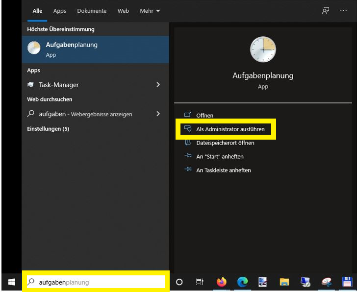

- Nach dem Start der Aufgabenplanung entscheidest du, ob du die neue Aufgabe in einem eigenen Ordner oder in der allgemeinen Aufgabenplanungsbibliothek anlegst.
  In diesem Beispiel legst du einen eigenen Ordner `evcc` an.
  Wähle „Aufgabenplanungsbibliothek“ aus, öffne dann mit der rechten Maustaste das Kontextmenü und wähle „Neuer Ordner...“:

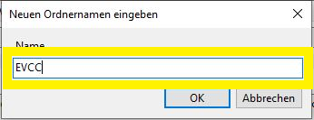

- Wähle nun den neuen Ordner `evcc` aus und öffne erneut das Kontextmenü.
  Wähle „Aufgabe erstellen...“:

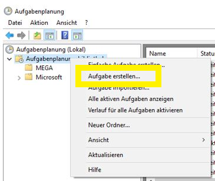

- Gib der Aufgabe einen Namen (z. B. „evcc“) und eine kurze Beschreibung.
  Da die Aufgabe als Systemdienst laufen soll, öffne die Benutzerverwaltung über „Benutzer oder Gruppe ändern...“ und gib `SYSTEM` in das Namensfeld ein.
  Klicke auf „Namen überprüfen“, dann sollte „SYSTEM“ unterstrichen sein.
  Schließe den Dialog mit OK:

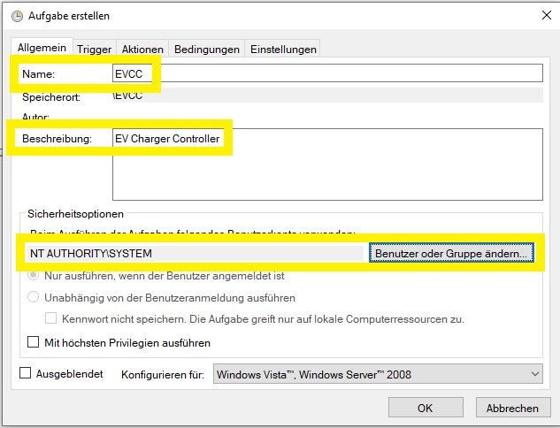 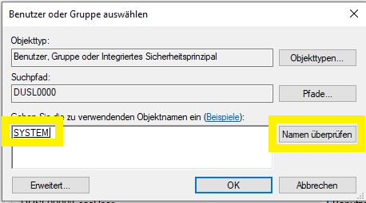

- Klicke im Reiter „Trigger“ auf „Neu...“.
  Stelle den Trigger auf „Beim Start“ und prüfe, dass das Kontrollkästchen „Aktiviert“ gesetzt ist:

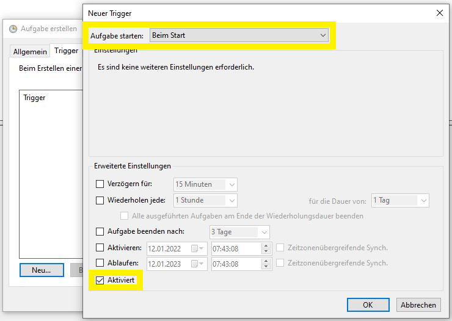

- Klicke im Reiter „Aktionen“ auf „Neu...“.
  Achte darauf, dass „Programm starten“ ausgewählt ist, und wähle dann über „Durchsuchen...“ die Programmdatei `evcc.exe` aus.
  Es empfiehlt sich, den Pfad zusätzlich im Feld „Starten in“ anzugeben, damit die Konfigurationsdatei automatisch gefunden wird:

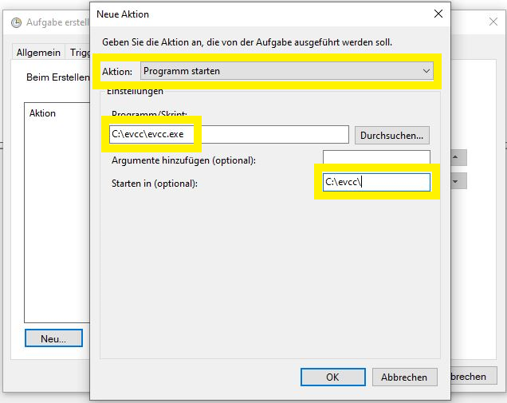

- Im Reiter „Bedingungen“ können die Standardeinstellungen bleiben.

  :::note
  Der SMA Home Manager kann über WLAN manchmal Probleme bereiten. Versuche dann, die Bedingung „Netzwerk“ zu aktivieren und in der Auswahlliste die passende Verbindung auszuwählen.
  :::

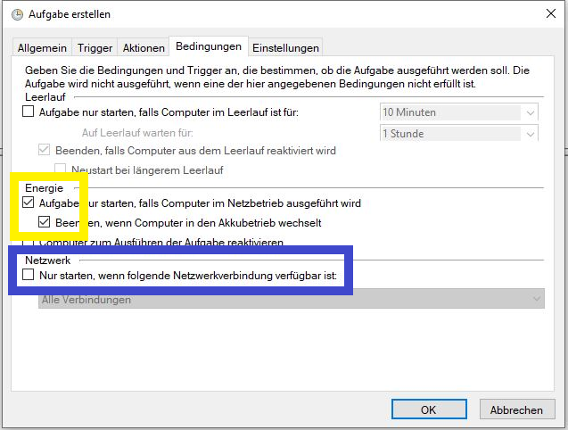

- Setze im Reiter „Einstellungen“ unbedingt den Haken bei „Aufgabe so schnell wie möglich nach einem verpassten planmäßigen Start ausführen“.
  Achte außerdem darauf, dass „Aufgabe beenden, falls Ausführung länger als:“ **nicht** ausgewählt ist, sonst hört evcc irgendwann unvermittelt auf zu laufen.

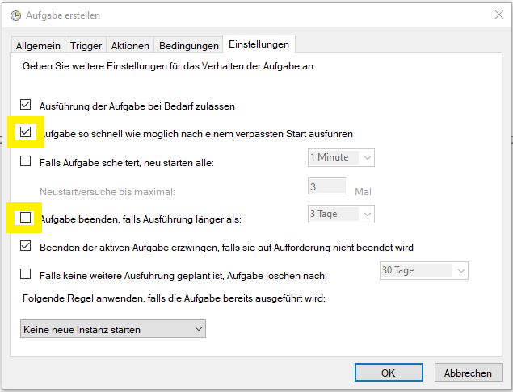

Die Aufgabe kann nun manuell gestartet oder mit einem Neustart getestet werden.
Rufe zur Kontrolle im Browser `http://localhost:7070` auf.

### NSSM \{#nssm\}

:::note
Diese Anleitung geht davon aus, dass evcc in `c:\Tools\evcc` liegt.

Diese Anleitung wurde mit Windows 11 erstellt.
:::

Als Alternative zur Aufgabenplanung kannst du evcc als Windows-Dienst betreiben.
Ein Dienst läuft ohne Benutzeranmeldung und bietet mehr Kontrolle über Neustartverhalten und Fehlerbehandlung.

Da evcc die Windows-Dienstschnittstelle nicht direkt unterstützt, kann [_nssm_](https://nssm.cc/download) (_Non-Sucking Service Manager_) als Service-Wrapper verwendet werden.

- Lade _nssm_ von [nssm.cc](https://nssm.cc/download) herunter und entpacke die ZIP-Datei nach `C:\Tools\nssm\`.
- Öffne eine Eingabeaufforderung (`cmd.exe`) und wechsle in den Ordner `win64`:

  ```sh
  cd /D C:\Tools\nssm\nssm-2.24\win64
  ```

- Installiere den Dienst:

  ```sh
  nssm install evcc
  ```

- Gehe die Reiter des Dialogs durch.
  Die folgenden Einstellungen sind Empfehlungen.
  - **Application**:

    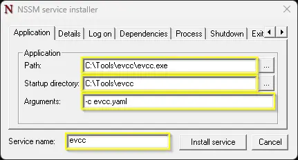
    - _Path_: Pfad zur `evcc.exe`.
    - _Start directory_: Arbeitsverzeichnis für evcc.
    - _Arguments_: Parameter für evcc, z. B. `-c evcc.yaml`.
      Optional: `--database evcc.db`, um den Datenbankpfad explizit zu setzen.
      Ohne diese Option liegt die Datenbank im Benutzerprofil des ausführenden Kontos.
      Beim Konto _System_ wäre das `%SystemRoot%\system32\config\systemprofile\.evcc\evcc.db`, also ein anderer Ort als beim interaktiven Start.
      Mit `--database` stellst du sicher, dass immer dieselbe Datenbank verwendet wird.
      Das ist beim [Zurücksetzen des Passworts](/de/faq#password-reset) wichtig.

  - **Details**:

    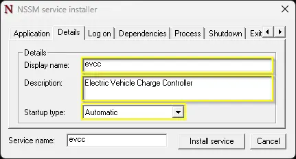
    - _Display Name_: Name des Dienstes in der Diensteverwaltung von Windows (am besten identisch mit _Service Name_).
    - _Startup type_: _Automatic_ für den automatischen Start beim Booten.

  - **Log on**:

    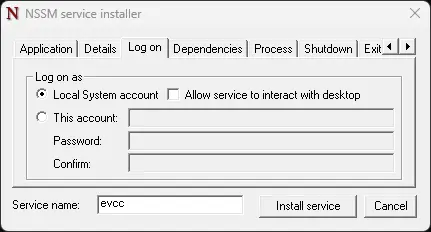

    Standard: Der Dienst läuft unter dem Konto _System_.
    Details: [nssm-Dokumentation](https://nssm.cc/usage).

    :::important
    Das hier gewählte Konto bestimmt, wo evcc seine Datenbank `evcc.db` ablegt (siehe _Arguments_ oben).
    :::

  - **Dependencies**:

    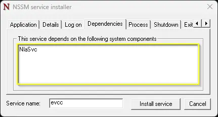

    `NlaSvc` als Abhängigkeit stellt sicher, dass das Netzwerk bereit ist, bevor evcc startet.

  - **Process**:

    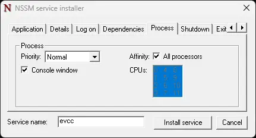

    Behalte die Standardeinstellungen bei.

  - **Shutdown**:

    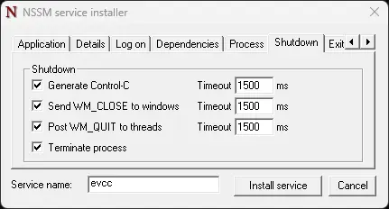

    Behalte die Standardeinstellungen bei.
    nssm versucht es zuerst mit `Ctrl`+`C`, dann mit `WM_CLOSE`/`WM_QUIT` und beendet den Prozess nach Ablauf des Timeouts zwangsweise.

  - **Exit actions**:

    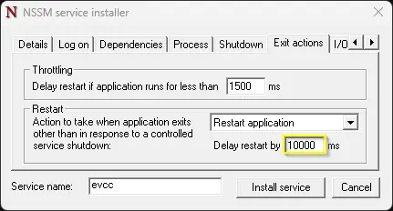

    Empfehlung: _Restart application_ mit 10 Sekunden Verzögerung, damit evcc nach einem Absturz oder einem Neustart über die Weboberfläche automatisch wieder startet.

  - **I/O**:

    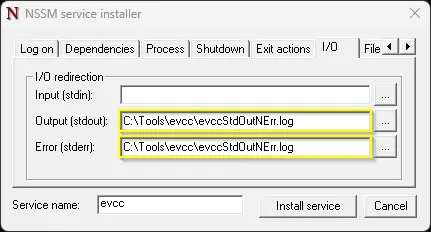

    Optional kannst du `stdout` und `stderr` in Log-Dateien umleiten.
    Halte das Log-Level von evcc niedrig, damit die Dateien nicht zu schnell wachsen.

  - **File rotation**:

    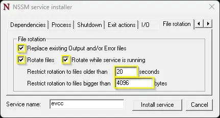

    Optional kannst du die Log-Rotation aktivieren, um die Größe der Log-Dateien zu begrenzen.

  - **Environment**:

    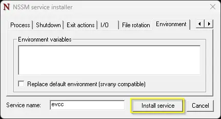

    Behalte die Standardeinstellungen bei.

Klicke auf _Install Service_, um den Dienst einzurichten.
Der Dienst kann anschließend in der Windows-Diensteverwaltung gestartet und gestoppt werden.
Rufe zur Kontrolle im Browser `http://localhost:7070` auf.
