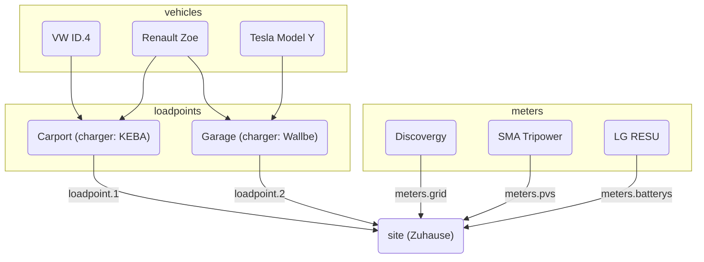

evcc kann auf zwei Arten konfiguriert werden:

**1. UI-Konfiguration (empfohlen)**

Die Konfiguration erfolgt über die Weboberfläche unter **Konfiguration**.
Die Einstellungen werden automatisch in der Datenbank gespeichert.
Weitere Informationen findest du unter [Konfiguration](/de/installation/configuration).

**2. Dateibasierte Konfiguration**

Die Konfiguration über die Datei `evcc.yaml` wird weiterhin unterstützt.
Dieser Bereich dokumentiert die YAML-basierte Konfiguration.

:::note[Parallele Nutzung]
Beide Konfigurationsmethoden können parallel genutzt werden.
Geräte (Ladepunkte, Zähler, PV-Anlagen, Hausbatterien, Fahrzeuge) werden aus beiden Quellen zusammengeführt.
Bei anderen Einstellungen hat die UI-Konfiguration Vorrang.
Details findest du in den [FAQ](/de/faq#ui-migration).
:::

## Dateibasierte Konfiguration (evcc.yaml)

Die Konfigurationsdatei ist im YAML-Format geschrieben und heißt standardmäßig `evcc.yaml`.
Sie liegt entweder im gleichen Verzeichnis wie evcc selbst oder auf POSIX-Systemen (z. B. Linux) unter `/etc/evcc.yaml`.

Abweichende Pfade können beim Start angegeben werden: `evcc -c /pfad/zur/evcc.yaml`

### Struktur

Die Konfigurationsdatei besteht aus mehreren Abschnitten.
Damit sich die Abschnitte gegenseitig referenzieren können, hat jedes Gerät einen Parameter `name`.

Eine Beispieldatei mit vielen Parametern findest du hier:
https://github.com/evcc-io/evcc/blob/master/evcc.dist.yaml

Hier ein Überblick über die Beziehungen zwischen den wichtigsten Bestandteilen der
Konfiguration:

### Wie funktioniert evcc? (Ein Blick ins Innere)

Damit das System funktioniert, ist ein Netzzähler (`grid`-Zähler) wichtig.
Er ermittelt die aktuelle Überschussleistung.
Die Messung der Erzeugungsleistung hat in diesem Fall keinen Einfluss auf die Funktion.
Ein Betrieb ohne Netzzähler ist ebenfalls möglich, siehe [FAQ](/de/faq#configuration).

Die Überschussleistung wird mit der Mindestladeleistung verglichen.
Reicht sie aus, startet der Ladevorgang.

Die Mindestladeleistung ergibt sich aus den Werten `minCurrent`
und `phases`, die pro `loadpoint` (eine Gruppe von Wallboxen am selben Ort) definiert werden.
Weitere Informationen findest du unter [`loadpoints`](/de/reference/configuration/loadpoints).

Beispiel: `phases: 1` und `minCurrent: 8`

1 (phases) × 8 A (minCurrent) × 230 V (Netzspannung) = 1840 W (Mindestladeleistung)

#### Einflussmöglichkeiten

Normalerweise entspricht die Überschussleistung der verfügbaren Ladeleistung.
Die verfügbare Ladeleistung lässt sich jedoch über mehrere Parameter individuell anpassen.
Diese sind:

- Standort: `residualpower`
- Standort: `prioritySoc`
- Standort: `bufferSoc`
- Standort: `aux`
- Ladepunkt: `enable: threshold`
- Ladepunkt: `disable: threshold`

Die Einstellmöglichkeiten findest du in der Beschreibung des jeweiligen Parameters.

- [Konfigurationsparameter des Standorts](/de/reference/configuration/site)
- [Konfigurationsparameter des Ladepunkts](/de/reference/configuration/loadpoints)

### Standort

Ein [Standort](/de/reference/configuration/site) beschreibt den Ort mit den vorhandenen und benötigten Geräten
der Hausinstallation und regelt die verfügbare Leistung.

### Ladepunkt

Ein [Ladepunkt](/de/reference/configuration/loadpoints) beschreibt die Ladeinfrastruktur und kombiniert
vorhandene _Wallboxen_, _Fahrzeuge_ und alles Weitere, was ein Ladepunkt benötigt.

### Wallboxen

Der Abschnitt [Wallboxen](/de/reference/configuration/chargers) enthält eine Liste von Wallboxen und ihren Eigenschaften, z. B.
wie sie angesprochen werden.

### Zähler

Der Abschnitt [Zähler](/de/reference/configuration/meters) enthält eine Liste von Geräten, die verschiedene Leistungsflüsse messen.
Dazu gehören:

- Leistung aus Netzbezug und Einspeisung
- PV-Erzeugungsleistung
- Ladestrom des Elektroautos (falls die Wallbox diesen nicht direkt liefert)
- Leistungsfluss der Hausbatterie(n)

### Einspeisebegrenzer

[Einspeisebegrenzer](/de/reference/configuration/curtailers) sind Geräte, die ausschließlich die Einspeisung der PV-Anlage
auf Anforderung des Netzbetreibers begrenzen (§ 9 EEG), z. B. der SMA Sunny Home Manager 2.0 oder der führende
Wechselrichter einer Anlage mit mehreren Wechselrichtern.

### Fahrzeuge

Um den Ladestand von Elektroautos auf einen bestimmten Wert zu begrenzen, kannst du hier
die vorhandenen [Fahrzeuge](/de/reference/configuration/vehicles) und ihre Online-Zugangsdaten angeben.

### HEMS

evcc kann Informationen zu den Ladepunkten und deren Ladeströmen an ein anderes
[Home Energy Management System (HEMS)](/de/reference/configuration/hems) weitergeben, damit dieses die
Informationen z. B. zur Steuerung der Hausbatterie nutzen kann.

### Benachrichtigungen

In diesem Abschnitt kannst du Ereignisse festlegen, über die du informiert werden möchtest.
Für die Zustellung der Nachrichten werden viele verschiedene Systeme unterstützt.

[Weitere Informationen](/de/reference/configuration/messaging)
