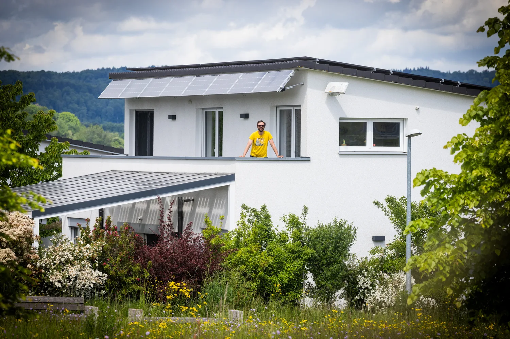
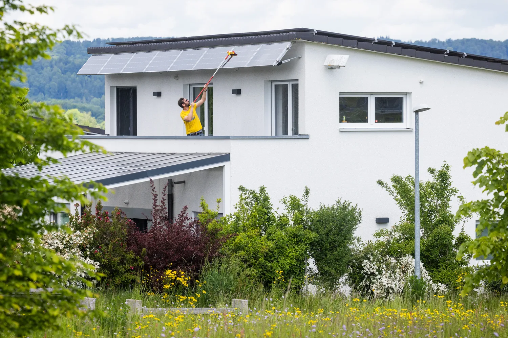
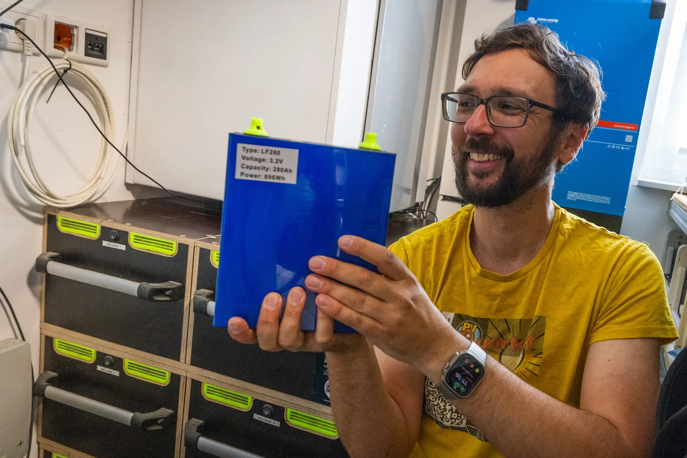
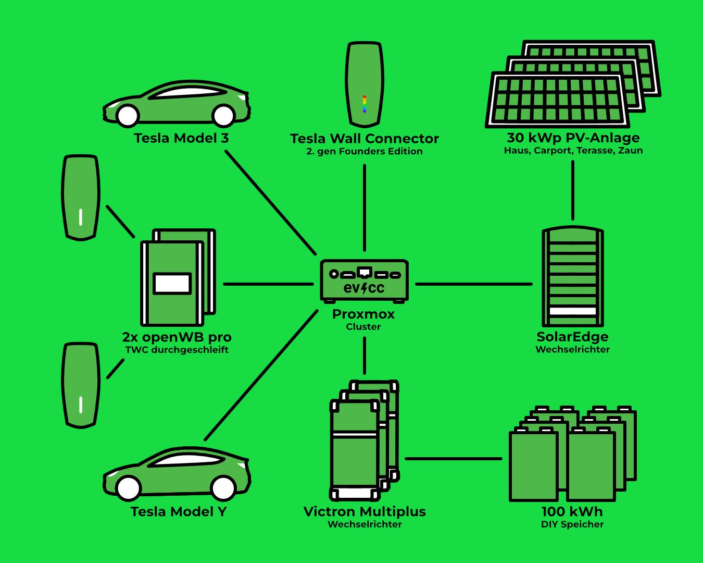
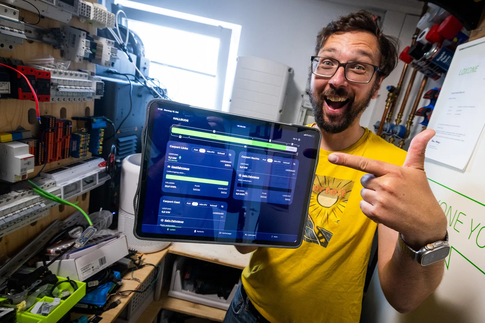

Jörg has been blogging about smart home, solar and electric mobility on [meintechblog.de](https://meintechblog.de) since 2011 and regularly streams on YouTube with the [PV-Quartett](https://www.youtube.com/@MeintechblogDe/streams), together with other enthusiasts from the energy scene.
At his home in Schwäbisch Hall a 100 kWh DIY battery, direct marketing and three wallboxes run side by side, connected through MQTT, [Loxone](https://www.loxone.com) and evcc.
Photographer [Detlef](https://hee.se) paid him a visit.

{/* excerpt */}

## A Hobby With 16,000 Subscribers

**Michael:** Hi Jörg, thanks for taking the time.
You have been blogging since 2011 and now run a [YouTube channel](https://www.youtube.com/@MeintechblogDe) with over 16,000 subscribers.
Is that still a hobby or already a job?

**Jörg:** I have thought a few times about professionalising it.
But it is and stays a hobby.
That way I can write about whatever I feel like and do not have to enter partnerships to make ends meet.
I have sent demo devices back because I did not like them.
Before I write that something is bad, I would rather not write about it at all.
The affiliate income goes back into tech, and then I blog about that.
A cycle.

**Michael:** What does blogging give back to you?

**Jörg:** The exchange.
Some articles have over 200 comments, I constantly get new ideas from them.
The blog has become a connector.
People approach me, we end up in WhatsApp groups or in the PV-Quartett, and there are super nerds among them who have dug in ten times deeper than I have.
Those contacts would never have come about otherwise.

**Michael:** On YouTube you now prefer live sessions over edited videos.
Why?

**Jörg:** I never actually wanted to go for YouTube.
But many people wrote that it was easier to access, so I tried it.
Editing costs me a lot of time, which is why I now often do live sessions.
There you are forced to concentrate and can respond to questions directly.
The channel is big enough that not just two people watch but 20 or 100, and some of them really dig in.

**Michael:** We often get requests for explainer videos, but so far we have not dared to tackle them.
What would you advise us?

**Jörg:** Make some, it is more important than you think.
To you everything is self-explanatory, but a two-minute video per feature picks up people who do not know what is working in the background.
Good documentation still matters: if you want to dig in, you prefer reading and clicking the links.
But do not underestimate YouTube, many people do not watch TV anymore.

## Sun Protection That Produces Power

**Michael:** Your solar system has grown over the years: house roof, carport and most recently the terrace roof with semi-transparent modules.
Would you build the terrace roof the same way again?

**Jörg:** Any time.
Above all it is sun protection, especially in summer.
The modules are 40% transparent, so enough light comes through, and even in winter the house is not too dark.
And every time I look at the app I am happy to see how well they perform.
They are tilted 10% to the south and simply deliver.

**Michael:** So anyone roofing a terrace anyway should plan for solar right away?

**Jörg:** If it fits, yes.
I had just upgraded my SolarEdge inverter to 30 kW, so I could simply add the terrace roof as another string.
No new hardware, which pays off quickly.
You just have to check that the string matches the inverter.

**Michael:** In the photos you are cleaning the modules above the balcony.
How closely do you look at what the individual modules deliver?

**Jörg:** Every power optimiser delivers its data.
A small program fetches the module values from the SolarEdge portal every quarter of an hour, they end up in InfluxDB, and with that I can run analyses at module level.
Every now and then I check out of curiosity whether all modules are still equally strong and which one is the weakest.
That way I squeeze a bit more out of the system.

**Michael:** Do you have further plans for the system?

**Jörg:** The modules above the balcony can be tilted.
Next year I want to motorise them so they track the sun.
That adds even more yield and should pay off despite the extra effort.

## 108 Cells in the Utility Room

**Michael:** Let's get to your setup.
The most striking part is the battery: [100 kWh, self-built](https://meintechblog.de/2023/01/21/operation-hausspeicher-100kwh-mit-neuem-18s-batteriepackdesign/).
How did that come about?

**Jörg:** That was the craziest and most intense project I have done so far.
I feel like I researched for a year, and what you see today is already the third iteration.
It is 108 cells in six packs, and they fit into the utility room to the centimetre.
Nowadays you can buy such enclosures ready-made in steel.
If I had the space, I would take those today, it saves a lot of work and looks more professional.

**Michael:** Why not just buy a ready-made battery?

**Jörg:** The great thing about the self-build is that I can set every parameter the way I want.
Every second I get the status of all 108 cells from the BMS, and I can not only analyse that but watch it live.
I regularly run charge and discharge tests to measure capacity, efficiency and degradation.
This is not a test installation, it is production use around the clock.
You will not find data like this anywhere else.

With an off-the-shelf battery you usually only see an LED from the outside: charging or discharging, nothing more.
A friend of mine has such a device, and it has to be permanently connected to the manufacturer's cloud.
If the internet drops, it takes a few minutes and the battery goes offline and is simply off.
In between it was throttled remotely by the provider, and by now it is completely broken.
There is still no replacement date, instead he gets a monthly compensation for the thing not working.

I do not want something like that in my house without knowing what is going on inside.
Put bluntly, someone could hack in from outside and tell the battery: do not charge the cells to 4.2 V but to 4.5 V.
That end-of-charge voltage is the limit at which a cell is full, and whoever exceeds it risks the thing going up in smoke.
I have no desire for that.
That is why I want to see at cell level what is happening, how the cells age and how degradation develops.

I also want to blog more about these findings again soon, the content is there.
Hardly anyone will rebuild the battery exactly like this and monitor everything.
But many can benefit from the experience.
I have also made so many mistakes, and I always share them openly so that others do not have to make them first.

## Two Wall Connectors Are Just a Facade

**Michael:** How do you charge your two Teslas?

**Jörg:** Through two [openWB Pro](https://openwb.de).
Between the openWB and the car hangs a looped-through Tesla Wall Connector that does not charge by itself.
It is there for the looks and brings the button on the charging cable that opens the charge port.
To make that work through the openWB [I had to tinker](https://meintechblog.de/2023/11/03/so-habe-ich-meine-openwb-pro-per-charge-port-opener-gepimpt/): a step-down converter on the openWB power supply feeds the data line of the plug.
I fiddled with that a lot until it worked.

**Michael:** The diagram shows a third wallbox.

**Jörg:** Another Wall Connector Gen 2 for guests, Founders Edition with Elon's signature. (laughs)
It is connected via [TWCManager](https://github.com/dracoventions/TWCManager).
My own web app "Wallbox-Master" presents it on the network as an openWB Pro so that evcc integrates it seamlessly.
I also built a [WLED](https://kno.wled.ge/) strip into that one, which [visualises the charging session](https://meintechblog.de/2024/02/20/pimp-my-wallbox-kurzer-nerd-einblick-in-meine-wled-ladevisualisierung/).

## Everything by Cable, Nothing in the Cloud

**Michael:** Loxone, [Node-RED](https://nodered.org), [Home Assistant](https://www.home-assistant.io), your own web apps and evcc all run in parallel at your place.
Who takes which role?

**Jörg:** Loxone has been the brain for nine years, everything comes together there.
It stays updatable, I never had any trouble with it, and my wife navigates the app like an online shop.
But the extensions for KNX, DMX and RS485 are terribly expensive, and the Miniserver only does MQTT half-heartedly.
That is why I am now going all in on MQTT.
A KNX gateway translates directly to MQTT, and for everything without a suitable interface I write my own software that ends up speaking MQTT.
Then I have one broker for everything and can say for every project: I want these values combined.

**Michael:** And Home Assistant?

**Jörg:** I am torn on that one.
There is a plugin for every device, but every installation ate RAM without end.
These days I let my LLM write the integration itself.
It looks at how Home Assistant does it and builds it the way I want it.
I always wanted to do that myself but never had the time.
Now you say "go ahead", and ten minutes later it runs.
But you have to tell it exactly what you want and understand the framework yourself.

**Michael:** Is there a motto behind all this?

**Jörg:** Everything by cable and not by radio, and ideally no cloud at all.
The same goes for AI: a local model runs on my Mac mini.
Sensitive data does not go straight to the cloud, the local model looks at it first, anonymises it and then passes it on.
For development it is too weak, so the two work together.

## A Zoo of AI Experts

**Michael:** You are all in on AI, you have integrations written and data analysed for you.
How do you keep track of it all?

**Jörg:** I have one agent per domain that is the expert there, and I split that into separate sessions.
A little zoo of experts at home that knows my concepts and ideas.
I had also tried OpenClaw, but it burned tokens without end, so I dropped it completely.
Now I am building this up slowly and in a structured way, so that not too many changes happen at once and I can trace and roll back everything.
And no agent is allowed to do anything irreversible without asking me.

**Michael:** What do you use the agents for day to day?

**Jörg:** For my data, for example.
For what feels like 30 years I have been scanning every invoice and everything that comes in the post, and my email history goes back similarly far.
The local model recognises the content, and everything additionally ends up in a vector database.
Now I type in a few terms and find the Tesla invoice from three years ago instead of digging through the Amazon history forever.
That is a game changer.
The same goes for the energy data in InfluxDB: as a human you draw yourself a few graphs, the AI simply analyses it so much better.

## The Setup at a Glance

| Component        | Details                                                                                                                                                                               |
| ---------------- | ------------------------------------------------------------------------------------------------------------------------------------------------------------------------------------- |
| **Solar system** | 30 kWp, 108 modules on the house roof, terrace roof, carport roof and carport wall                                                                                                    |
| **Inverter**     | SolarEdge 30 kW, 3 strings, power optimiser per module                                                                                                                                |
| **Battery**      | 100 kWh DIY LFP (108 cells in 6 packs) 3x Victron MultiPlus 10 kVA                                                                                                                |
| **Wallboxes**    | 2x openWB Pro 22 kW with a looped-through Tesla Wall Connector Gen 2 as charging outlet 1x Tesla Wall Connector Gen 2 Founders Edition for guests via TWCManager, with WLED strip |
| **Vehicles**     | Tesla Model 3 Long Range, Tesla Model Y Standard Range                                                                                                                                |
| **Tariff**       | Direct marketing via LuoxEnergy Consumption still on a fixed tariff                                                                                                               |
| **Control**      | evcc in a Debian LXC on a [Proxmox](https://www.proxmox.com) cluster (3 nodes) Loxone as central visualisation Node-RED, Home Assistant, own web apps                         |

## Grid-Friendly Instead of Midday Peak

**Michael:** Your 30 kWp are spread across the house roof, the terrace roof and the roof and wall of the carport.
Since 2023 you have been selling the power on the exchange through [direct marketing](https://meintechblog.de/2022/09/06/operation-direktvermarktung-die-eigene-pv-anlage-als-goldesel/).
What was the motivation?

**Jörg:** I always wanted a grid-friendly system that does not stupidly feed in at noon when nobody needs the power and prices are in the basement.
It got on my nerves: everyone builds a solar system, the battery is full by late morning, and at the midday peak the systems get curtailed one after another.
And I was interested in how big the hurdles are until grid operator, RLM meter and everything else are up and running.
That was rocky in parts.

**Michael:** Where does it get stuck with the grid operators?

**Jörg:** Many grid operators struggle to manage the data at all.
Until now there was one meter reading per year, now they have to store quarter-hour values.
They have to offer the flexible grid fees, but make them so unattractive that nobody uses them.
[Andreas Schmitz](https://www.youtube.com/@Akkudoktor) also really wanted to get into direct marketing, and it dragged on forever because metering and grid operators did not respond.
That has to improve if we want to make progress.

**Michael:** In March you did a livestream on [where direct marketing is heading](https://www.youtube.com/watch?v=JOFYWo6T8qE).
What is the next step?

**Jörg:** On the consumption side I want to switch to a flexible tariff next year.
For that the RLM meter probably has to go and a smart meter gateway has to come in.
Then I can buy at cheap grid prices, charge the battery and benefit from variable grid fees under § 14a EnWG.

## What Role Does evcc Play?

**Michael:** With so much software of your own: what job does evcc have at your place?

**Jörg:** Controlling the vehicles, especially for my wife.
She sees what is happening with the cars and can say: charge fast now, I have to leave soon, do not wait for the sun.
I think the whole project is great: you can integrate any wallbox, and since everything can be configured in the UI, the pain with the YAML file is gone.
The setup wizard also guides people who do not yet know what they actually want.
It is light on resources, looks good and has worked for me since day one.

**Michael:** But the decision when to charge is not made in evcc?

**Jörg:** I had considered letting evcc control the charging times more.
But for that I need a solution that has my whole house in view.
I am in direct marketing, and a friend has developed software that works, among other things, together with the [EOS](https://github.com/Akkudoktor-EOS/EOS) by Andreas Schmitz, and I am going to use it.
It analyses my historical data locally, derives forecasts from it and then says: in these hours it makes the most sense to charge the car.
I pass that information on to evcc, and evcc takes care of the charging.
I do not want to cram everything into evcc, and it should not do that either.

**Michael:** Since the last release we have the [optimizer](/en/features/optimizer) with automatic mode.
It looks three days ahead, works with electricity prices, feed-in and your consumption history, and plans home battery control and vehicle charging from that.
Maybe worth a look?

**Jörg:** I did not know that one yet, I will take a look.
You provide all the data via MQTT anyway, so I will log it along.
Then I compare the evcc forecast with what my other programs say.
Maybe I will conclude that the evcc approach works just as well with fewer resources.
For 99% of people that is certainly enough.
I just have special requests: the logic should know, e.g., that a Tesla is currently 100 km away and does not need to be scheduled.
I get the position live via [TeslaMate](https://github.com/teslamate-org/teslamate).

## Open Interfaces and Local Control

**Michael:** Finally: what matters most to you in a system like evcc?

**Jörg:** The philosophy behind it: a system with open interfaces.
That is the future for everything, because you have to bring data together across trades and devices to control things sensibly.
An island that collects data and does not share it is something no manufacturer can afford anymore.
evcc is the example of how to do it right, and nothing is hidden.
Add the local aspect: shovelling the data into the cloud is simply not necessary.
If the front door no longer opens because the internet is down, something went wrong in the concept.

**Michael:** For you, local means more than "no cloud".
Is security part of the thinking?

**Jörg:** Absolutely.
The attack vectors keep growing, above all through AI that finds gaps in seconds.
No installation should hang off a central control on the internet through which thousands of systems can be switched off at once.

**Michael:** Thank you for the insight into a setup that goes far beyond the typical family home.

**Jörg:** My pleasure.
With all the tinkering, I am mostly glad that it runs reliably and the cars are charged every day the way they should be.
And soon you will be back on my livestream, where I will quiz you about evcc.

**Michael:** Yes, let's do that.

---

**What does your evcc setup look like?**
If you're interested in sharing your experiences, your journey and your technology in the form of a community portrait, feel free to sign up [here in the form](https://airtable.com/appDI3xIiev1DOpMY/shrW1zGH26KElfZOK).
We're particularly looking for portraits of extraordinary installations or users outside Germany.
