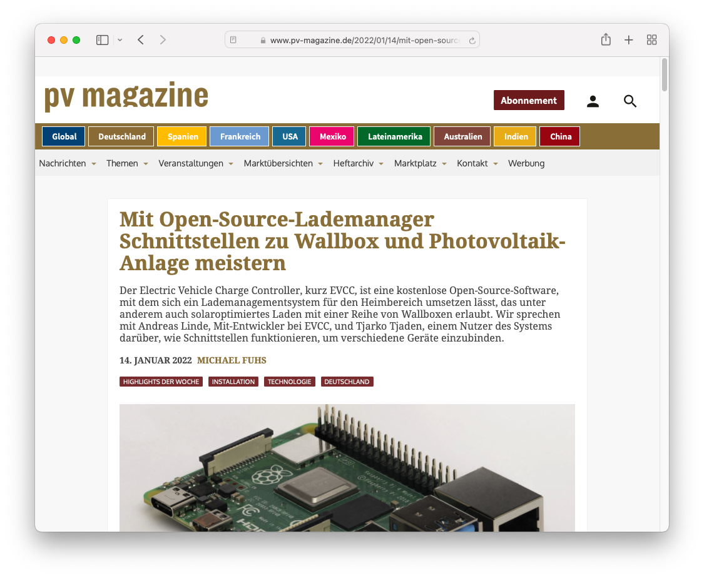

Notre développeur principal [Andreas Linde](https://twitter.com/DerAndereAndi) et notre utilisateur [Tjarko Tjaden](https://twitter.com/TjarkoTjaden) ont accordé à l’édition allemande du pv magazine une interview sur la façon de [maîtriser les interfaces avec le chargeur et l’installation photovoltaïque grâce à un gestionnaire de charge open source](https://www.pv-magazine.de/2022/01/14/mit-open-source-lademanager-schnittstellen-zu-wallbox-und-photovoltaik-anlage-meistern/).

<!-- excerpt -->
