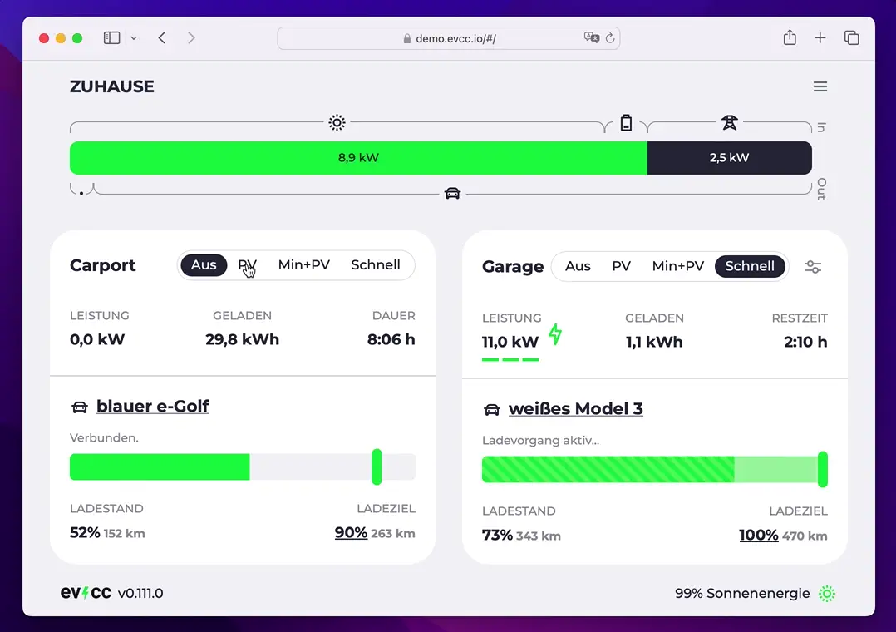

Pile le 11 janvier, la version 0.111 arrive avec quelques nouvelles fonctions que nous vous présentons brièvement ici.

<!-- excerpt -->

## 🧞‍♂️ Nouveau planificateur de charge : utiliser l’électricité renouvelable du réseau

La fonction de charge planifiée existe dans evcc depuis un certain temps. Elle vous permet de définir une heure cible à laquelle le véhicule connecté doit atteindre un certain niveau de charge. La fonction est p. ex. pratique pour recharger la voiture à temps avant un long trajet.



La stratégie de charge utilisée jusqu’ici était relativement simple : la charge démarre le plus tard possible, de sorte que la batterie atteigne le niveau souhaité juste à temps pour le départ. Cela ménage la batterie, car elle ne reste pas longtemps à un niveau de charge élevé.

Avec cette version, le planificateur de charge devient plus intelligent et prend en compte les prix dynamiques de l’énergie et les données CO₂. La charge est ainsi planifiée sur des créneaux où la part d’électricité renouvelable dans le réseau est élevée. Cela permet d’économiser de l’argent, soulage le réseau électrique et réduit le besoin en énergies fossiles.

### 📈 Prix du marché spot avec awattar et Tibber

Les tarifs horaires d’awattar et de Tibber sont intégrés depuis un moment déjà. Jusqu’ici, nous n’avions cependant qu’un pilotage simple, qui autorise la charge en dessous d’un prix de l’électricité configuré à l’avance (`cheap`).

Désormais, les prix horaires sont aussi utilisés dans la planification de la charge et la voiture charge quand l’électricité du réseau est particulièrement bon marché.

Configuration pour awattar

```yaml
tariffs:
  grid:
    type: template
    template: awattar
    region: de # or at
```

Configuration pour Tibber

```yaml
tariffs:
  grid:
    type: template
    template: tibber
    token: "476...963a4" # access token
```

### 📊 Tarifs manuels par plages horaires

Il est désormais aussi possible de définir des tarifs par plages horaires. Voici un exemple de configuration avec une énergie bon marché la nuit et encore moins chère le week-end :

```yaml
tariffs:
  grid:
    type: fixed
    price: 0.294 # EUR/kWh
    zones:
      - days: Mo-Fr
        hours: 2-5
        price: 0.2 # EUR/kWh
      - days: Sa,So
        price: 0.15 # EUR/kWh
```

Ces données de prix sont elles aussi prises en compte par le nouvel algorithme de planification.

### 🌱 Données CO₂ de GrünStromIndex et ElectricityMap

Même sans tarif dynamique, vous pouvez charger en ménageant le climat. Pour cela, nous intégrons désormais des données CO₂. Nous avons implémenté deux sources pour l’instant, mais nous sommes ouverts à d’autres suggestions.

[GrünStromIndex](https://gruenstromindex.de) fournit des prévisions régionales sur la propreté de l’électricité du réseau en Allemagne. Il vous suffit d’indiquer votre code postal.

```yaml
planner:
  type: template
  template: grünstromindex
  zip: 12349
```

[Electricity Map](https://app.electricitymaps.com/map) fournit des prévisions dans le monde entier. Pour l’utiliser dans evcc, vous avez besoin d’un jeton et du préfixe d’URL. Vous les obtenez en créant un [compte gratuit sur le portail API](https://api-portal.electricitymaps.com/).

```yaml
planner:
  type: template
  template: electricitymaps
  uri: https://api-access.electricitymaps.com/2w...1g/
  token: Rp...D2
  zone: DE
```

## Perspectives

Pour l’une des prochaines versions, nous travaillons à une représentation visuelle du plan de charge. Vous pourrez alors voir les créneaux calculés par l’algorithme ainsi que l’économie concrète en coût ou en CO₂.

## Autres nouveautés

En plus des habituelles petites améliorations et corrections de bugs, cette version apporte quelques autres nouvelles fonctions :

- 🔋🪫 Meilleure prise en charge de plusieurs batteries domestiques [#5598](https://github.com/evcc-io/evcc/pull/5598)
- 🌞 Prise en charge de FoxESS [#5721](https://github.com/evcc-io/evcc/pull/5721)
- 🔌 Prise en charge du Tesla Wall Connector 3 [#5341](https://github.com/evcc-io/evcc/pull/5341)
- 🚙 Prise en charge des véhicules Volvo [#5681](https://github.com/evcc-io/evcc/pull/5681)
- 🏳️‍🌈 Trois nouvelles langues pour l’interface

**Merci pour votre soutien !**<br />
L’équipe principale d’evcc<br />
[@andig](https://github.com/andig), [@premultiply](https://github.com/premultiply) et [@naltatis](https://github.com/naltatis)
