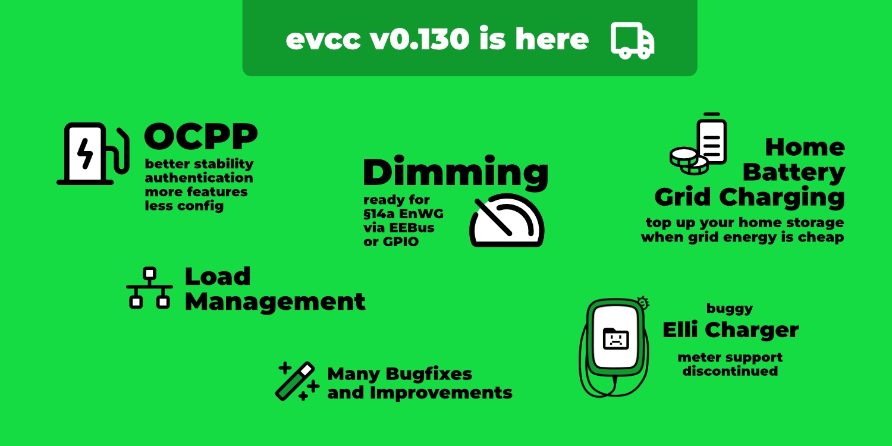
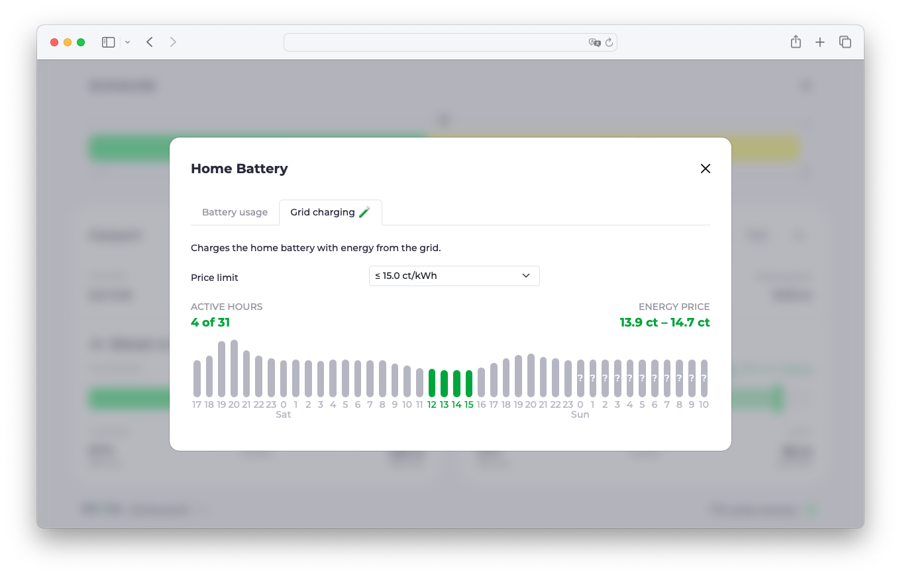
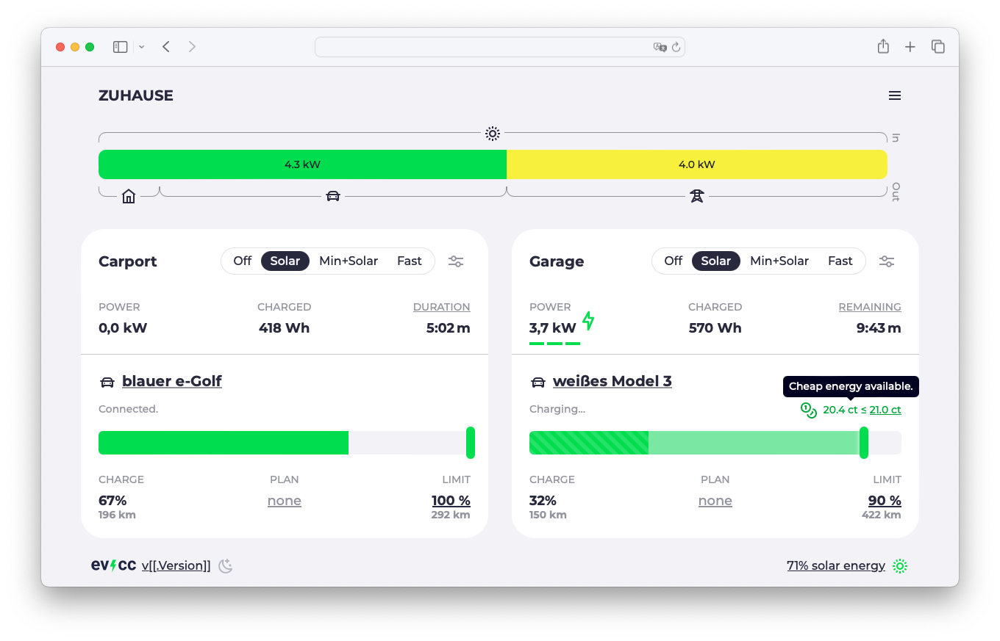
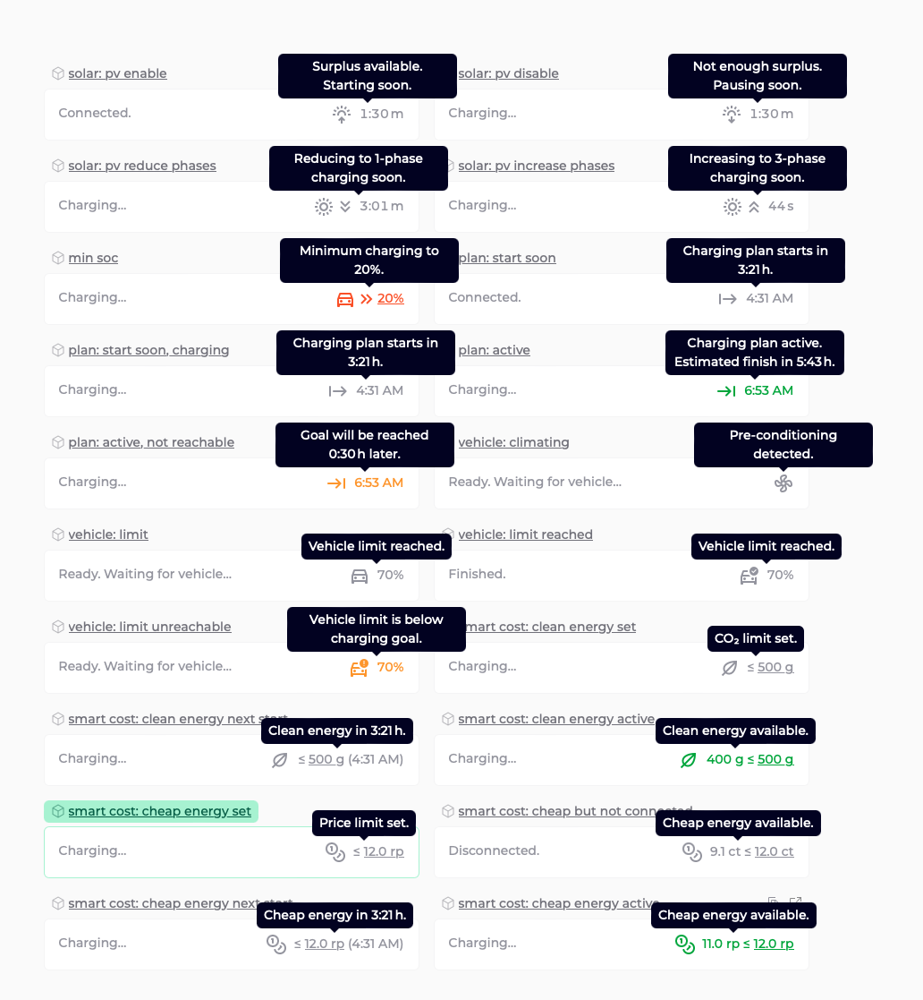

La [version 0.130](https://github.com/evcc-io/evcc/releases) d’evcc est sortie aujourd’hui.
Comme notre dernier article sur une version remonte à un certain temps, voici un aperçu des points forts des dernières versions.

{/* excerpt */}

## Gestion de la charge et § 14a EnWG

Il y a quelques versions, nous avons introduit la gestion de la charge en tant que fonction expérimentale.
Elle permet de définir une limite de puissance et/ou de courant pour toute la maison.
evcc pilote les chargeurs de façon à ne pas dépasser ces limites.
Pour les installations plus complexes, il est aussi possible de configurer des sous-circuits avec leurs propres limites et compteurs.
Vous trouverez plus d’informations dans la [documentation](/fr/features/loadmanagement).

### Consommateurs pilotables

En Allemagne, le § 14a de la loi sur l’économie énergétique (Energiewirtschaftsgesetz, EnWG) est actuellement un sujet très présent.
Il permet aux gestionnaires de réseau de réduire la puissance consommée par les gros consommateurs, comme les chargeurs, en cas de forte charge du réseau.
Si le client accepte ce dispositif, il bénéficie de frais de réseau réduits.

La mise en œuvre technique est intéressante.
Le gestionnaire de réseau n’accède pas directement au chargeur, mais transmet le signal de réduction de puissance via la passerelle du compteur intelligent (Smart Meter Gateway, SMGW).
Le système de gestion de l’énergie de la maison doit ensuite limiter la puissance des consommateurs concernés.

Avec evcc, vous pouvez dès aujourd’hui satisfaire cette exigence (modulation) pour tous les chargeurs, sans devoir les couper complètement (p. ex. par un contact sec).
Les points de charge peuvent continuer à fonctionner à leur puissance minimale (p. ex. 4,1 kW) pendant cette période.
Cela signifie que tout chargeur pris en charge par evcc peut être utilisé dans ce scénario.
Inutile d’acheter un nouveau chargeur capable de communiquer avec la SMGW ou le boîtier de commande.

### Comment ça marche

En cas de surcharge du réseau, le gestionnaire de réseau envoie un signal à la SMGW.
La SMGW elle-même n’offre pas de moyen pertinent de communiquer avec le réseau domestique.
Cette communication passe par un boîtier de commande (Steuerbox) raccordé derrière la SMGW.
Ce boîtier certifié transmet le signal aux appareils concernés via EEBus.
evcc a implémenté l’interface EEBus vers le boîtier de commande.
Lorsqu’un signal de réduction arrive, evcc réagit et régule les chargeurs en conséquence.

Une alternative à EEBus est la communication via un simple contact de commutation du boîtier de commande.
Celui-ci peut alors être relié à evcc, p. ex. via une broche GPIO.
Si le boîtier de commande reçoit un signal de réduction, le contact se ferme, evcc le détecte et réduit la puissance maximale des chargeurs.

Cette solution plus simple par contact fonctionne aussi avec les récepteurs de télécommande centralisée existants, y compris les modèles radio ((Funk-)Rundsteuerempfänger, FRSE).
Ils ne font pas partie du § 14a EnWG, mais sont tolérés comme solution transitoire.

En pratique, l’utilisation de cette fonction se heurte encore au manque de boîtiers de commande installés sur le terrain.
Ils seront déployés dans les mois à venir.
Si vous possédez déjà un tel appareil, n’hésitez pas à nous contacter.

### Charge de la batterie domestique depuis le réseau

Il s’agit d’une fonction expérimentale, disponible si votre onduleur prend en charge le pilotage actif de la batterie ([voir la documentation](/fr/meters)) et si vous avez un tarif d’électricité dynamique.
Dans ce cas, vous pouvez définir une limite de prix.
Si le prix passe en dessous, evcc charge la batterie domestique avec l’électricité du réseau.

Cette fonction peut être particulièrement utile pendant les mois d’hiver.
Si peu d’énergie solaire est attendue pendant la journée, la batterie peut être chargée la nuit avec de l’électricité bon marché du réseau.
La batterie vous permet ainsi de traverser les périodes où l’électricité est chère.

Dans l’implémentation actuelle, la limite de prix fixe est volontairement simple et ne constitue qu’une première étape.
Si vous ne voulez pas vérifier et ajuster régulièrement la limite via l’interface web, vous pouvez déjà construire des solutions plus intelligentes (p. ex. basées sur l’heure ou les prévisions) à l’aide de la nouvelle API.

## Elli Charger : point sur la situation

Un chargeur relativement répandu est l’Elli Charger du groupe VW.
Il est aussi vendu sous les noms « VW ID. Charger », « Skoda iV Charger », « Cupra Charger » ou « Audi Wallbox » et existe en différentes variantes selon la marque, se terminant par « Connect », « plus », « Pro », « Connect+ » ou « pro » ([voir l’aperçu](https://github.com/evcc-io/evcc/pull/7757#issuecomment-1529477695)).

Ces dernières années, la prise en charge de ce chargeur nous a malheureusement donné du fil à retordre.
[DerAndereAndi](https://github.com/DerAndereAndi) y a investi beaucoup de passion et de temps.
Merci pour cela 🙌 !
La qualité du firmware est assez médiocre et il y a de nombreux bugs.
Ce n’est pas rare pour des produits et des logiciels récents.
Le problème est toutefois que ce produit est sur le marché depuis plusieurs années et que le fabricant ne fait aucun effort sérieux pour corriger ces bugs par des mises à jour.

[Cet article](https://github.com/evcc-io/evcc/discussions/15367) résume les problèmes techniques qui surviennent lors du pilotage et de la lecture du chargeur.
Les données de compteur peu fiables étaient et restent une source d’erreurs permanente.
Dans la version actuelle, nous avons donc retiré la prise en charge du compteur intégré et recommandons à tous les propriétaires de ce chargeur d’utiliser un compteur séparé en amont.

Si vous prévoyez d’acheter un chargeur pilotable avec evcc, nous ne pouvons que vous déconseiller ces appareils.
Elli a annoncé un produit de nouvelle génération, l’[ElliCharger 2](https://www.elli.eco/de/privatkunden/produkte/wallbox).
D’après ce que nous savons jusqu’ici, cet appareil est bien plus abouti.
Cela ne change toutefois rien au fait que les chargeurs de première génération, toujours activement vendus aujourd’hui, sont absolument inacceptables en ce qui concerne la qualité du logiciel de leur interface.

Si vous possédez un tel chargeur et êtes concerné par les problèmes décrits ci-dessus, nous vous recommandons de contacter le service client d’Elli.
Nous avons peu d’espoir qu’il y ait des mises à jour logicielles.
Nous pensons toutefois que leur approche, qui consiste à remplacer un matériel techniquement bon par un plus récent simplement parce que le logiciel n’est plus maintenu, n’est pas vraiment durable.

Nous aimerions aussi avoir un contact technique direct avec Elli.
Jusqu’à présent, toutes nos tentatives sont toutefois restées sans succès.

## Indicateurs d’état au point de charge

Parmi les changements visuels récents d’evcc figure la refonte des textes d’état.
Jusqu’ici, des messages comme « Surplus disponible. Démarrage dans 1:22 min… » ou « Plan de charge actif. Démarrage à 23:12. » s’affichaient au-dessus de la barre du niveau de charge.

Avec le nombre croissant de fonctions, cet affichage était devenu peu flexible, et plusieurs états, comme la temporisation solaire, le plan de charge et la limite de prix, ne pouvaient pas être affichés en même temps.
Nous avons donc revu cette zone.
L’état du chargeur est toujours affiché sous forme de texte court (« Connecté », « En charge », etc.).
Les informations supplémentaires comme la temporisation solaire, le plan de charge, la limite de prix, la climatisation ou la limite du véhicule s’affichent désormais, le cas échéant, sous forme d’icône avec une infobulle explicative.

Voici un aperçu des nouvelles icônes et infobulles :

## OCPP : stabilité, fonctions et parrainage

La prise en charge d’OCPP fait partie d’evcc depuis longtemps.
Ces derniers mois, nous nous sommes de nouveau penchés sur ce sujet et avons [beaucoup travaillé](https://github.com/evcc-io/evcc/pulls?q=is%3Apr+is%3Amerged+sort%3Aupdated-desc+ocpp) sur la stabilité et les fonctionnalités de notre implémentation.
Jusqu’ici, certains chargeurs nécessitaient des paramètres de configuration spéciaux lors de la mise en service.
À de très rares exceptions près, ils sont désormais tous obsolètes.
Des fonctions comme les données de compteur, les intervalles d’interrogation, les signaux ping et heartbeat sont maintenant configurées automatiquement.
Comme il existe encore des chargeurs qui ne respectent pas entièrement la norme, nous avons dû implémenter quelques traitements spécifiques à certains appareils.
Ils sont désormais transparents pour l’utilisateur.

### RFID et autorisation

Du point de vue de l’utilisateur, le plus grand changement ou la plus grande nouveauté est la prise en charge de l’autorisation conforme à la norme.
Elle permet désormais aussi la [détection du véhicule par RFID](/fr/features/vehicle#detection-via-rfid).
La charge immédiate sans autorisation reste possible.
Pour cela, la fonction correspondante doit être activée dans le chargeur (« Autostart », « Freies Laden », « Free Vending » ou similaire).
Si votre chargeur ne dispose pas de ce réglage (ce qui est plutôt rare), vous pouvez aussi rétablir l’ancien comportement d’evcc avec le paramètre `remotestart: true`.
evcc démarre alors la charge sans validation par l’appareil.

### De nombreux chargeurs testés

Nous avons testé avec succès l’implémentation avec de nombreux appareils et les avons ajoutés à la [documentation](/fr/chargers).
La liste n’est certainement pas complète.
Si votre chargeur OCPP n’y figure pas mais fonctionne bien avec evcc, nous serions ravis d’[avoir de vos nouvelles](https://github.com/evcc-io/evcc/issues/new/choose) pour l’ajouter à la documentation à l’intention des autres utilisateurs.
Si votre chargeur ne fonctionne pas comme prévu, nous aimerions aussi le savoir 😉.

### Parrainage requis

À partir de la version 0.130, la prise en charge d’OCPP devient une fonction qui nécessite un 💚 parrainage.
Nous sommes conscients que ce changement peut être désagréable pour celles et ceux qui se servaient d’evcc gratuitement jusqu’ici.
Nous avons néanmoins décidé de faire ce changement.
Il y a principalement deux raisons à cela :

1. Dans de nombreux chargeurs récents et commerciaux, OCPP est devenu le protocole de communication de référence et souvent la seule interface de pilotage. C’est pourquoi nous trouvons juste, en particulier vis-à-vis des utilisateurs d’autres chargeurs, que la prise en charge d’OCPP nécessite un parrainage et soutienne ainsi l’ensemble du projet.

2. Comme décrit ci-dessus, nous avons investi beaucoup d’énergie et de temps dans l’amélioration de l’implémentation et souhaitons continuer à le faire pour garantir stabilité et fonctionnalités. Votre soutien financier nous aide à disposer des ressources nécessaires.

Nous espérons que vous comprendrez ce changement.

## Autres améliorations

- **Interface des journaux :** les journaux peuvent désormais être consultés, filtrés et exportés directement dans l’interface web.
- **Langues :** evcc prend désormais en charge 27 langues. Un grand merci à tous les traducteurs.
- **Interface de configuration :** au fil des dernières versions, de nombreuses fonctions nécessaires pour remplacer le fichier `evcc.yaml` ont été ajoutées. Nous y reviendrons dans un prochain article de blog.
- **Corrections de bugs :** comme toujours, nous avons corrigé de nombreux bugs et amélioré la stabilité.
- **Nouveaux appareils :** nous élargissons constamment la liste des chargeurs, onduleurs, compteurs et tarifs pris en charge.

Pour plus de détails, vous pouvez toujours consulter les [notes de version](https://github.com/evcc-io/evcc/releases) ainsi que les pull requests et discussions qui y sont liées.

## Nouveaux parrains

Nous remercions aussi toutes les personnes qui soutiennent le projet par leur parrainage.
Pouvoir travailler sur un projet open source financé presque entièrement par la communauté et les utilisateurs, c’est vraiment génial.

Nous constatons qu’evcc est désormais pris au sérieux aussi par les entreprises.
Cela se voit au fait que des fabricants nous contactent parfois directement pour assurer une bonne intégration de leurs appareils.

Nous avons pu convaincre [CUBOS](https://www.cubos.com), une entreprise du secteur du photovoltaïque et des infrastructures de recharge commerciales, [lekker Energie](https://www.lekker.de), un fournisseur d’énergie berlinois, et [Victron Energy](https://www.victronenergy.com), un fabricant de systèmes ouverts et modulaires d’onduleurs, de batteries et de recharge, de devenir parrains financiers en tant qu’entreprises.

**Bonne recharge !** 
L’équipe evcc 
Michael, Andi et Uli
