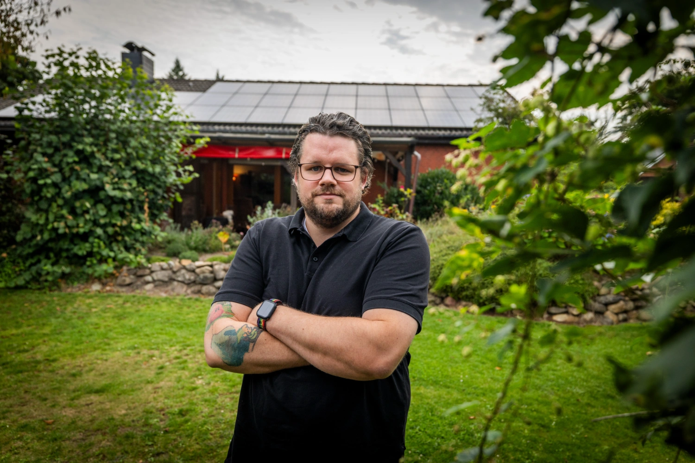
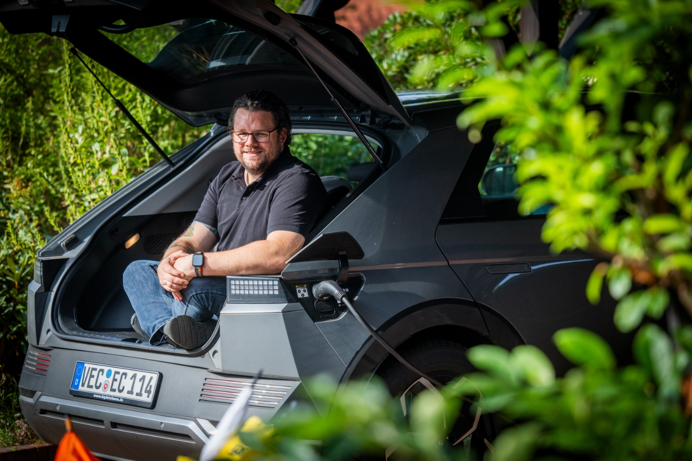
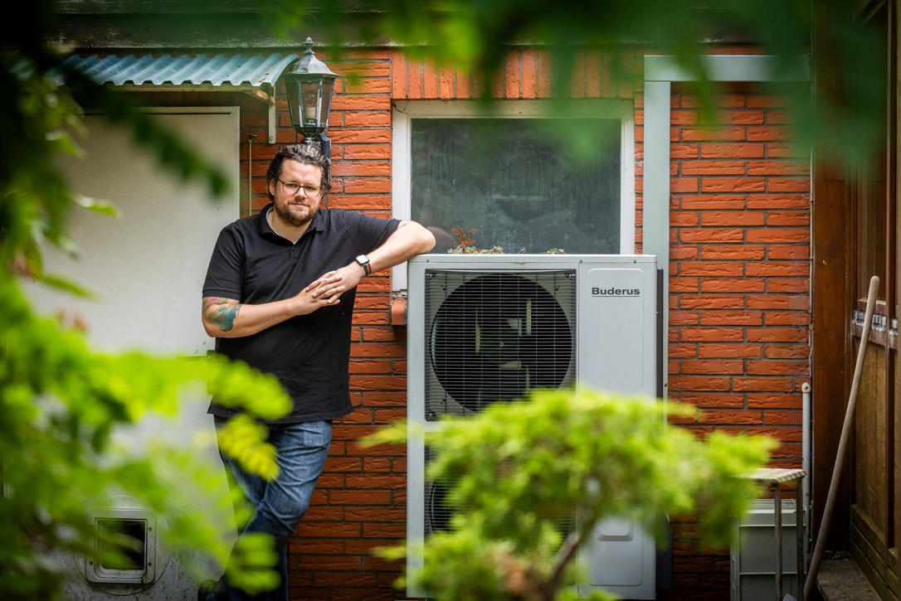
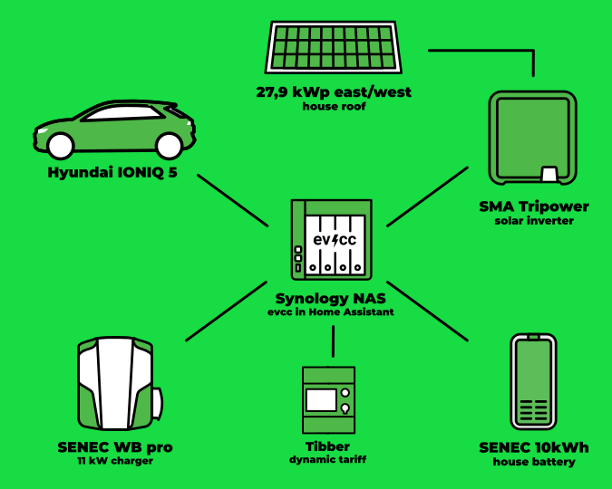
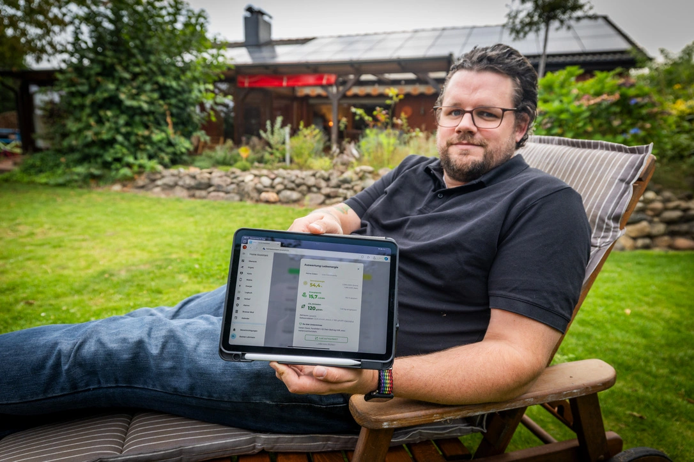
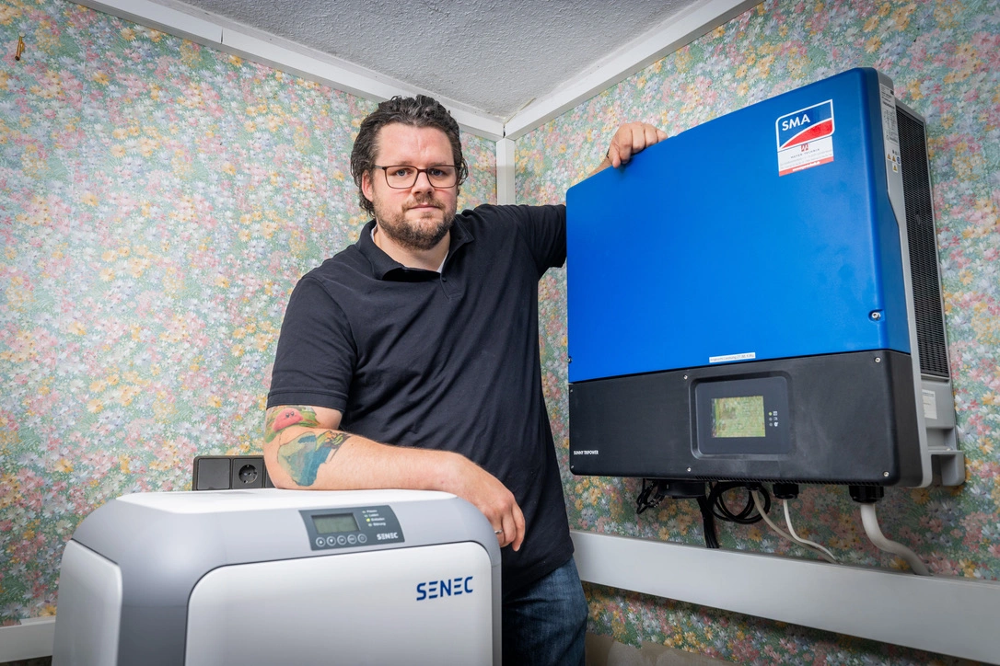
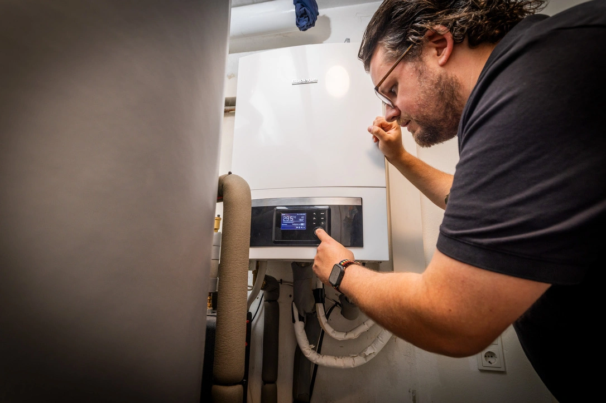

Dans le cadre de notre série de portraits communautaires, le photographe [Detlef](https://hee.se) a récemment rendu visite à Bastian à Ahlhorn, dans la commune de Großenkneten.

{/* excerpt */}

## « C’est le moment ! »

**Michael :** Bonjour Bastian, ravi de faire votre connaissance.
Parlez-nous un peu de vous et de la façon dont vous en êtes venu aux voitures électriques et à la charge avec le surplus.

**Bastian :** Oui, volontiers.
Je m’appelle Bastian et je vis avec ma femme et nos deux enfants dans la commune de Großenkneten, dans l’arrondissement de l’Oldenburger Land.
L’emplacement était parfait pour nous, car nous sommes proches de grandes villes (Vechta, Oldenburg, Brême), mais la maison restait tout de même abordable.
Côté infrastructures, nous avons aussi tout ce dont nous avons besoin à quelques pas, dont deux supermarchés, tous les types d’écoles et une école maternelle.
Après avoir emménagé dans notre maison de 1978, je me suis assez vite intéressé aux installations photovoltaïques.
Le toit en pente de notre bungalow s’y prête parfaitement.
Et l’électricité était, à mon avis, déjà trop chère à l’époque.
Notre devise : « C’est le moment », et autant en tirer le maximum.
Nous avons donc très vite fait poser une grande installation photovoltaïque sur les pans est et ouest du toit.

## 28 kWc de solaire + tarif dynamique = 💚

**Michael :** Utiliser le toit pour produire de l’électricité est toujours une excellente idée.
Ensuite est arrivée la voiture électrique ?

**Bastian :** Oui, exactement, l’an dernier, mon employeur a commencé à proposer des voitures électriques en leasing, et ça a été le déclic pour nous lancer dans le domaine passionnant de la mobilité électrique.
Comme nous pouvons produire beaucoup d’électricité grâce aux grandes surfaces de toit, il était logique de charger la voiture avec notre propre électricité.
En cherchant des solutions, je suis vite tombé sur evcc sur Internet.
C’est aussi pour cette raison, et pour l’intégration de Frigate, que je suis passé d’ioBroker à Home Assistant.
Début janvier, nous sommes aussi passés chez Tibber, pour pouvoir charger à bas prix en hiver également.
Il y a deux ans, nous avons installé une pompe à chaleur qui, surtout en hiver, consomme presque toute notre électricité solaire.
Il ne reste donc pas grand-chose, mais avec Tibber, je peux charger à bas prix la nuit.

## Synology, Home Assistant et evcc

**Michael :** C’est logique.
Surtout en hiver, un tarif dynamique permet d’économiser beaucoup.
À quoi ressemble votre installation technique actuelle chez vous ?

**Bastian :** Voici un aperçu des composants qui fonctionnent avec evcc chez moi :

| **Composant**                   | **Détails**                                              |
| ------------------------------- | -------------------------------------------------------- |
| **Matériel**                    | Synology DS923+                                          |
| **Logiciel**                    | Home Assistant avec l’add-on evcc                        |
| **Voiture**                     | Hyundai IONIQ 5                                          |
| **Batterie domestique**         | SENEC.Home 2.1 10 kWh                                    |
| **Chargeur**                    | SENEC.Wallbox pro                                        |
| **Onduleur**                    | SMA Tripower STP 25000TL-30                              |
| **Installation photovoltaïque** | 27,88 kWc, 82 modules AXITEC X HC 340 (40 est, 42 ouest) |
| **Électricité**                 | Tibber                                                   |

**Michael :** Ça fait pas mal de composants différents qui travaillent ensemble.
Vous avez déjà mentionné que vous utilisez Home Assistant.
Y a-t-il d’autres intégrations avec d’autres systèmes ?

**Bastian :** Pour l’instant, j’utilise uniquement Home Assistant.
Avec evcc, je veux surtout suivre mes coûts d’électricité quotidiens.

**Michael :** Vous avez dit avoir trouvé evcc en cherchant sur Internet.
Qu’est-ce qui vous a fait choisir ce système ?

**Bastian :** Je suis tombé sur evcc assez rapidement.
J’ai d’abord essayé les composants Senec, mais leur système ne permettait pas de charger avec le surplus solaire.
C’est ce qui m’a mené à evcc.
Depuis janvier, j’utilise la charge en fonction du prix avec Tibber, ce qui m’a permis de charger à bas prix en hiver.

**Michael :** Quelle fonctionnalité d’evcc préférez-vous ?

**Bastian :** C’est une question difficile, mais je crois que ce que je préfère, c’est la charge automatique aux heures bon marché.
J’apprécie aussi qu’evcc soit très convivial et dispose d’une interface très claire.

## Prochain objectif : la pompe à chaleur

**Michael :** Avez-vous des souhaits pour le développement futur ?

**Bastian :** Je suis le projet sur GitHub et j’ai hâte que la charge combinée aux prévisions solaires arrive.
Une charge avec un planificateur plus élaboré serait aussi géniale.
C’est surtout ce dernier point qui m’aidera à mieux passer l’hiver.

Mon prochain objectif sera ensuite d’intégrer ma pompe à chaleur.
Je ne sais pas encore si je dois le faire directement dans evcc ou dans un système EMS, et si oui, lequel.
D’abord, je dois pouvoir accéder à ma pompe à chaleur.
Ce n’est pas si simple avec Buderus/Bosch…

**Michael :** Ça a l’air parfait.
Une meilleure intégration des pompes à chaleur est aussi à notre programme.
Merci beaucoup de nous avoir présenté tout cela, et bonne continuation !
