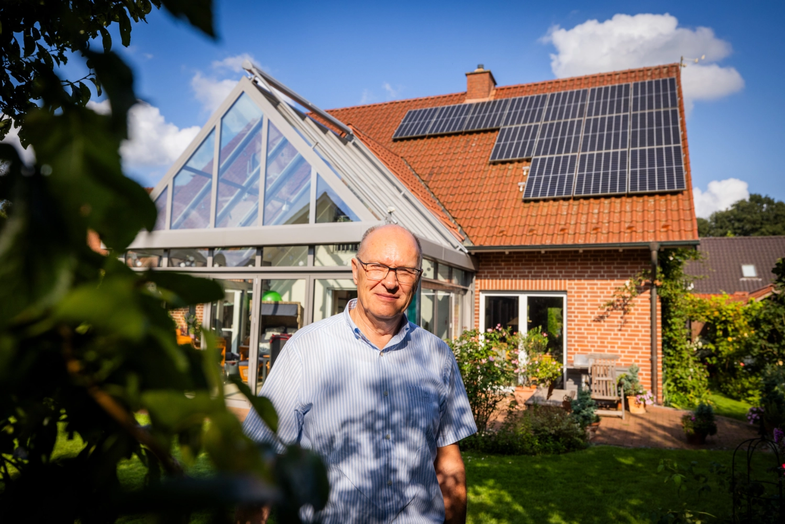
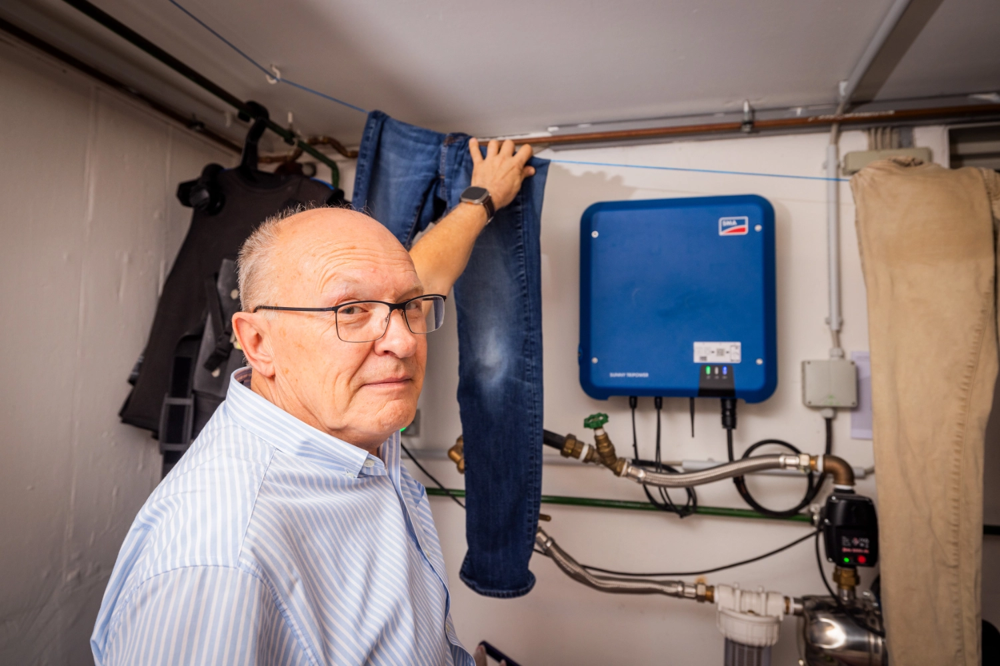
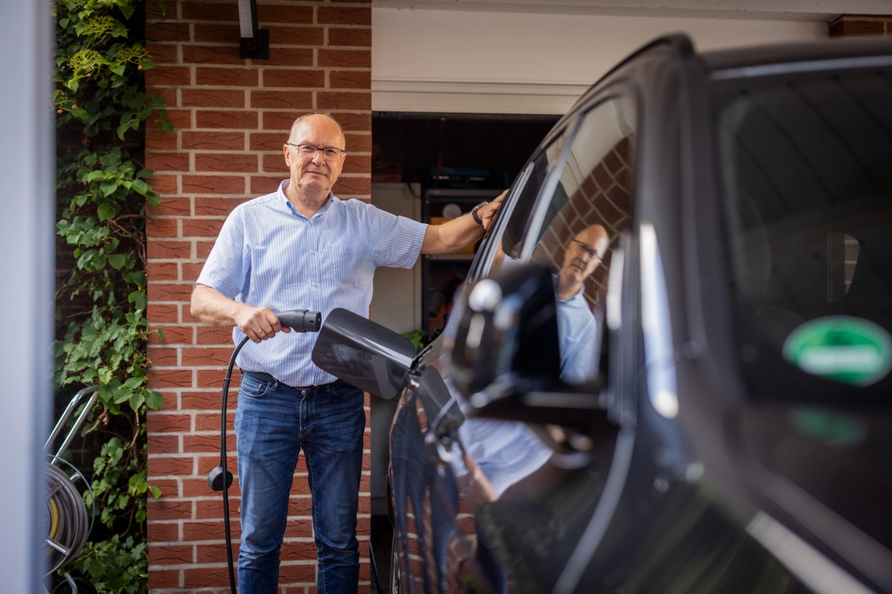
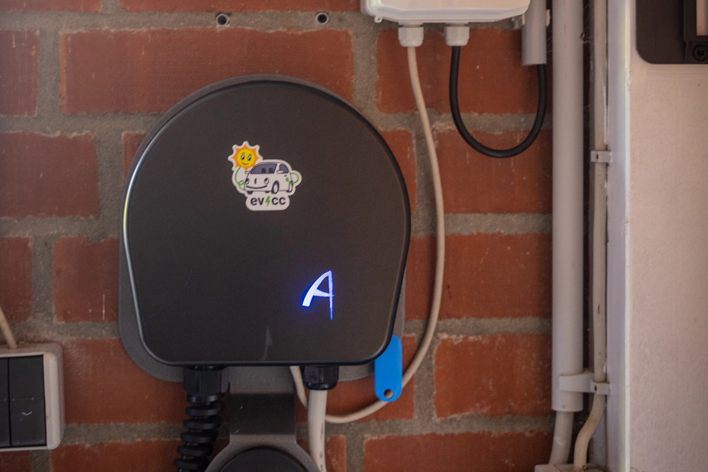
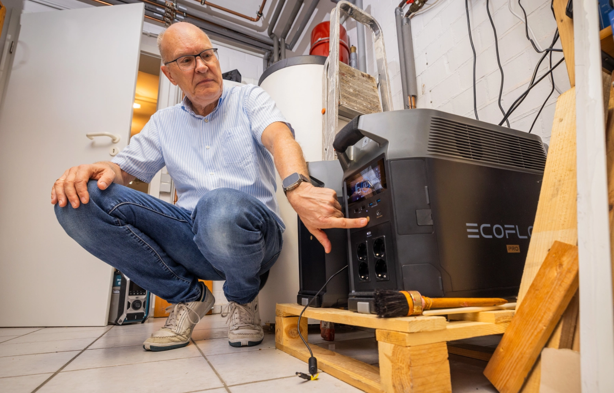
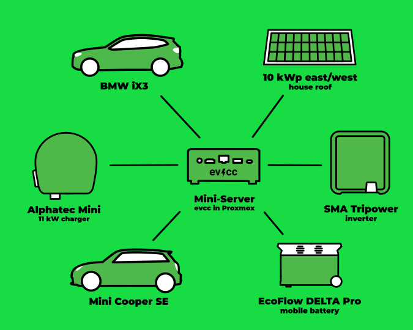
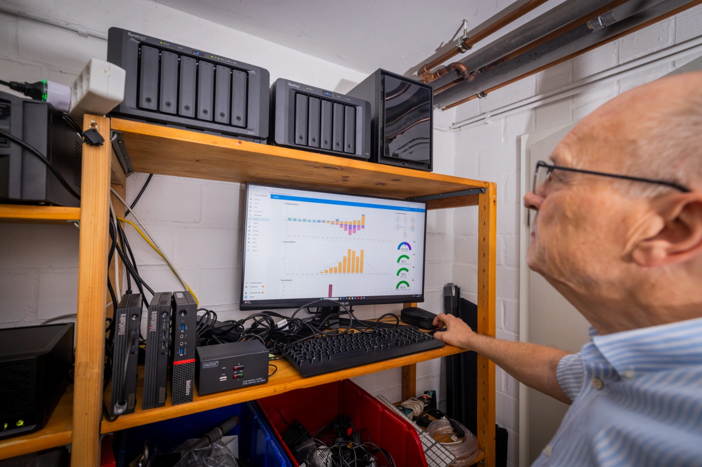

Dans le cadre de notre série de portraits communautaires, le photographe [Detlef](https://hee.se) a rendu visite à Andreas à Wettringen, dans la région du Münsterland.

{/* excerpt */}

## Fasciné par l’informatique, je n’ai jamais décroché

**Michael :** Bonjour Andreas, ravi de faire votre connaissance.
Parlez-moi un peu de vous et de la façon dont vous en êtes venu aux voitures électriques et à la charge solaire.

**Andreas :** Oui, bonjour Michael.
Je suis pharmacien de métier.
Pendant 35 ans, j’ai dirigé la Sonnen-Apotheke à Wettringen.
Je suis marié, j’ai deux enfants, aujourd’hui adultes, et nous vivons dans une maison individuelle à la campagne.
J’ai vendu la pharmacie au début de cette année, mais j’ai toujours géré moi-même l’informatique de la pharmacie (10 postes de travail, 5 serveurs virtuels, Windows et Linux).
Ces connaissances, j’ai pu les emporter avec moi.
Je m’occupe d’informatique depuis la fin de mon service dans la Bundeswehr.
Avec la prime de départ, j’ai acheté mon premier ordinateur, un Tandy TRS 80.
Depuis, l’informatique me fascine et je n’ai jamais décroché.

**Michael :** Waouh, vous avez de solides connaissances techniques et une bonne idée de tout ce qu’il faut pour faire tourner une entreprise.
Comment en êtes-vous venu aux voitures électriques et à la charge solaire ?

**Andreas :** Il y a trois ans, j’ai acheté une Mini SE, par intérêt pour la technologie.
Elle a remplacé une Mini Cooper à moteur thermique.
À l’époque, les chargeurs étaient encore rares, alors j’ai pris celui que l’installateur m’a recommandé.
Je ne savais pas du tout ce qui serait une bonne solution.
Deux mois plus tard, l’installation photovoltaïque de 10 kWc a été mise en place.

Une moitié des modules est orientée à l’est (4,6 kWc), l’autre moitié à l’ouest (5,4 kWc).
Comme je n’avais pas de batterie à ce moment-là, je voulais utiliser le surplus de l’installation photovoltaïque directement pour charger la Mini.

## Le fonctionnement manuel n’était plus une solution

**Michael :** D’accord, vous vous êtes lancé si tôt qu’il existait peu de retours d’expérience, et vous avez dû tout découvrir par vous-même.
Est-ce que la charge de la Mini a fonctionné comme vous l’imaginiez ?

**Andreas :** Eh bien, mon installation n’avait aucune logique de pilotage.
Chaque matin, une fois le soleil levé, j’allais brancher la voiture.
Ce processus manuel est vite devenu fastidieux, alors j’ai commencé à chercher des automatisations.
Comme je m’intéresse à l’open source depuis longtemps, j’ai un peu cherché sur GitHub et je suis tombé sur evcc.
L’installation sur un serveur Linux déjà en service a été vite faite.
Les différents composants, comme l’onduleur, le chargeur et la voiture, ont été intégrés rapidement.

## Débogage du chargeur, mais maintenant ça marche

**Michael :** Ça semble être un bon début.
Comment avez-vous procédé ensuite ?

**Andreas :** Tout fonctionnait, sauf le chargeur, un Alphatec Mini, qui ne se laissait pas piloter.
Après quelques recherches sur le forum, il est vite apparu que le chargeur ne fonctionnait pas comme il le devait.
Il n’existait pas non plus de description correcte des commandes de pilotage.
Mais [Premultiply](https://github.com/premultiply) pourrait sans doute en dire plus à ce sujet.
Après ma prise de contact avec le fabricant, tout est allé vite : Premultiply a reçu un boîtier de test et le firmware de la carte de commande a été mis à jour.
J’ai envoyé la carte au fabricant et j’ai fait installer le nouveau firmware.
Maintenant, evcc peut communiquer avec le chargeur.
Grâce à cette solution, le problème n’a pas seulement été réglé pour moi, mais aussi pour tous les nouveaux utilisateurs d’Alphatec.
Voilà l’open source dans ce qu’il a de meilleur !

Un réglage progressif de la puissance de charge de 6 à 16 A était enfin possible.
Comme le boîtier ne permet pas de basculer entre monophasé et triphasé, un contacteur a été ajouté dans le tableau divisionnaire.
Normalement, je charge en monophasé, car la plupart du temps mon surplus ne suffit pas pour davantage.
Ce n’est que lorsque j’ai besoin d’une charge plus rapide, ou lorsqu’il n’y a pas de surplus du tout, que je passe manuellement en triphasé.
Je pouvais enfin profiter pleinement d’evcc.

**Michael :** Ah, vous avez donc optimisé et adapté votre première installation.
Quel effet cela a-t-il eu sur l’utilisation ?

**Andreas :** Après un an de fonctionnement de l’installation, j’ai pu constater que, malgré la voiture électrique, j’exportais environ 4 500 kWh vers le réseau.
Une deuxième voiture électrique tombait donc à pic.
L’ancienne voiture familiale, elle aussi un diesel, a été remplacée par une électrique.
Désormais, deux voitures sont chargées avec evcc, et l’une d’elles est toujours branchée au chargeur.

Idéal pour notre situation.
Pour pouvoir continuer à faire fonctionner au moins quelques appareils en cas de coupure de courant temporaire, j’ai acheté une EcoFlow DELTA Pro avec une batterie supplémentaire, soit 7,2 kWh de capacité au total.
Grâce à quelques scripts dans Home Assistant, les batteries sont chargées lorsqu’il y a du surplus.
Une partie de cette capacité sert ensuite la nuit à réduire la consommation d’électricité, le reste sert de réserve.

| **Composant**                   | **Détails**                         |
| ------------------------------- | ----------------------------------- |
| **Voitures**                    | Mini SE, BMW iX3                    |
| **Chargeur**                    | Alphatec Mini                       |
| **Onduleur**                    | SMA Tripower 10                     |
| **Installation photovoltaïque** | 10 kWc (4,6 kWc est, 5,4 kWc ouest) |
| **Batterie domestique**         | EcoFlow DELTA Pro (7,2 kWh)         |
| **Pilotage**                    | evcc sur Ubuntu Server sous Proxmox |
| **Intégrations**                | Home Assistant                      |

## Domotique et serveur multimédia

**Michael :** Quel parcours passionnant !
À quoi ressemble votre homelab ?
Utilisez-vous des intégrations avec d’autres systèmes ?

**Andreas :** Oh oui, la domotique me fascine depuis longtemps.
J’ai commencé avec la domotique Homematic.
Et de plus en plus de composants sont venus s’ajouter.
Comme j’ai aussi essayé d’autres fabricants, j’ai vite voulu gérer tous les composants ensemble.
Home Assistant a été ma solution d’intégration.

Je fais aussi tourner un serveur multimédia depuis deux décennies.
Mes enfants ont toujours réussi à abîmer les cassettes et les CD au point qu’ils devenaient inutilisables.
J’ai donc commencé tôt à numériser les supports analogiques et à les rendre accessibles de manière centralisée.

D’abord avec des applications qui tournaient sur un NAS, plus tard sous forme de serveurs virtuels sur un hyperviseur.
Actuellement, diverses applications homelab tournent sous Proxmox : evcc sur un Ubuntu Server, Plex comme serveur multimédia, eBlocker, paperlessNGX, Home Assistant.

## Une solution qui répond à tous mes besoins

**Michael :** Après les difficultés et les optimisations du début, on dirait que vous disposez maintenant d’une solution qui fonctionne bien.
Avez-vous des souhaits ou des suggestions pour le développement futur d’evcc ?

**Andreas :** Pour moi, evcc répond à tous mes besoins.
Les options de configuration et de statistiques disponibles me permettent de faire beaucoup de choses, et j’obtiens toutes les informations dont j’ai besoin.

**Michael :** Merci pour cet entretien, Andreas.
C’était passionnant d’en apprendre plus sur votre installation et vos expériences.
Je vous souhaite le meilleur pour l’avenir.
