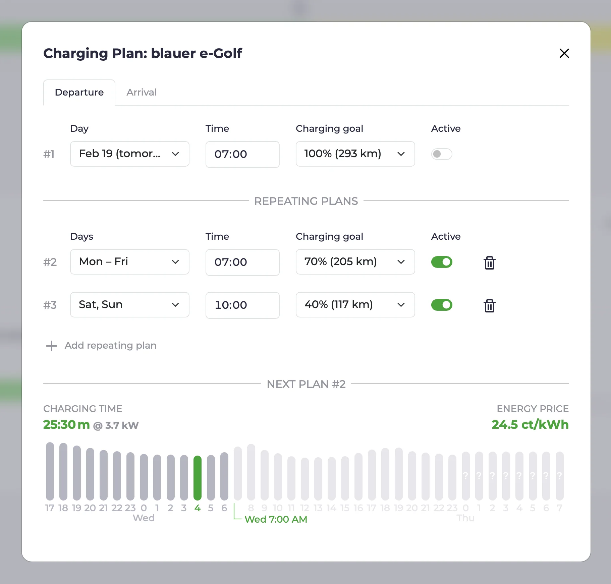

import Video from "@components/Video.astro";
import forecastsVideo from "../../../../../en/blog/2025/02/19/forecasts.mp4";
import forecastsPoster from "../../../../../en/blog/2025/02/19/forecasts.webp";
import configUiVideo from "../../../../../en/blog/2025/02/19/config-ui.mp4";
import configUiPoster from "../../../../../en/blog/2025/02/19/config-ui.webp";
export const SgreadySvg = "/img/sgready.svg?url";

Avec la [sortie de la v0.200](https://github.com/evcc-io/evcc/releases), nous avons franchi une étape importante vers plus de stabilité et de convivialité.
Dans cet article, nous vous donnons un peu de contexte sur ce saut de version.
Pour ménager le suspense, nous gardons cela pour la fin de l’article ;)

Nous présentons aussi quelques nouvelles fonctionnalités ajoutées depuis l’[article de novembre](/fr/blog/2024/11/22/highlights-charts-stats).

{/* excerpt */}

## Prévisions

La charge [optimisée selon le CO₂](/fr/features/co2) et celle [optimisée selon le prix](/fr/features/dynamic-prices) existent depuis un moment.
Avec [Forecast.solar](https://forecast.solar) et [Solcast](https://solcast.com/free-rooftop-solar-forecasting), nous avons maintenant intégré nos deux premiers fournisseurs de prévisions de production solaire.
Pour cela, il y a un nouveau champ `solar` dans la [configuration des tarifs](/fr/tariffs).

Lorsqu’une source de prévisions solaires est configurée, vous voyez la production solaire attendue pour aujourd’hui en kWh dans l’aperçu énergétique.
Un clic sur ce chiffre ou sur la nouvelle entrée de menu **Prévisions** ouvre une vue qui représente la production solaire attendue pour les 48 prochaines heures.
Cette visualisation affiche aussi les prévisions de prix et de CO₂.

<Video src={forecastsVideo} poster={forecastsPoster} />

~Actuellement, une seule prévision solaire (correspondant à une surface de toit) peut être configurée.
Avec la prochaine version, nous ajouterons la possibilité de combiner des prévisions.~ 
C’est désormais possible, voir [Prévision solaire](/fr/tariffs#solar).

Les données de prévision solaire n’influencent pas encore la planification de la charge, mais elles posent les bases de futures fonctionnalités et optimisations.

## Plans de charge récurrents

Lorsqu’evcc connaît le niveau de charge du véhicule, plusieurs fonctions de charge utiles deviennent disponibles.
La possibilité d’atteindre une [charge minimale](/fr/features/limits#minimum) immédiatement après le branchement existe depuis un moment.
Le [plan de charge](/fr/features/plans) (heure de départ et niveau de charge cible), qui permet de charger le véhicule de manière efficace et propre, existe lui aussi depuis longtemps.

La demande de plans de charge récurrents est presque aussi ancienne.
Il s’agit de plans définis par jour de la semaine, qu’il n’est pas nécessaire de reprogrammer sans cesse.
Un grand merci à [@Maschga](https://github.com/Maschga), qui s’est attaqué à cette grosse fonctionnalité.
Le résultat est vraiment réussi.

Les plans peuvent être désactivés au besoin (p. ex. pendant les vacances).
Les fuseaux horaires, l’heure d’été et l’heure d’hiver sont gérés correctement 🤯.
Vous pouvez créer plusieurs plans récurrents ; si deux plans sont rapprochés, evcc retient le plus pertinent et affiche clairement ce choix.

Pour en savoir plus, consultez [Plans de charge](/fr/features/plans#repeating-plans).

## Pompes à chaleur et SG Ready

La demande de prise en charge des pompes à chaleur est revenue régulièrement ces derniers mois.
Jusqu’ici, nous nous sommes volontairement concentrés sur le cas d’usage du véhicule électrique pour garder evcc ciblé et maîtrisable.
Il était déjà possible, et courant, d’intégrer des dispositifs de chauffage via des méthodes comme les [relais et prises connectées](/fr/smartswitches#heating) et l’interface de plugins ([exemple](https://github.com/naltatis/aton-ctrl)).

Depuis janvier, nous proposons un modèle d’appareil dédié au pilotage des pompes à chaleur.
De nombreuses pompes à chaleur prennent en charge l’interface SG Ready.
À l’aide d’un relais commutable (p. ex. Shelly), on peut demander à la pompe à chaleur de fonctionner davantage en cas de surplus ou lorsque l’électricité du réseau est bon marché.

<SgreadySvg
  alt="Schéma du pilotage d’une pompe à chaleur via un relais SG Ready"
  style={{ maxWidth: "700px" }}
/>

Certaines pompes à chaleur prennent aussi en charge une communication directe, p. ex. via le réseau.
La liste de ces appareils est encore relativement courte.
Si vous avez une telle pompe à chaleur et savez comment la piloter, ouvrez un [ticket GitHub](https://github.com/evcc-io/evcc/issues).

Vous trouverez plus d’informations sur les [pompes à chaleur et chauffages électriques](/fr/heating) dans la documentation.

L’intégration des dispositifs de chauffage dans l’interface est fonctionnelle, mais pas encore parfaite.
Des sujets comme les statistiques dans le temps et une meilleure représentation de la pompe à chaleur dans la vue principale figurent sur notre liste de tâches.

## Interface de configuration : mise en service dans le navigateur

Depuis le début du développement d’evcc, nous tenons à garder l’interface aussi simple et épurée que possible.
Nous recevons régulièrement des retours selon lesquels les autres membres du foyer (souvent peu technophiles) se retrouvent rapidement dans l’interface.
C’est une qualité qui ne va pas de soi, surtout dans les projets open source « classiques », et dont nous sommes assez fiers.

Un facteur important est l’uniformisation poussée et le modèle de données sous-jacent.
Une fois un onduleur, un véhicule ou un chargeur configuré, les particularités des appareils ne comptent plus dans l’interface.

Cependant, le plus gros point de friction pour beaucoup d’utilisateurs est justement d’atteindre cet état où « tout est configuré ».
Jusqu’ici, il fallait pour cela utiliser la ligne de commande et modifier un fichier YAML.

Nous travaillons depuis longtemps pour permettre la configuration initiale via l’interface.
Au cours des dernières années et des derniers mois, nous avons progressivement ajouté des fonctions comme la création de véhicules, de compteurs, d’onduleurs, de tarifs et plus encore.
Des fonctions indispensables comme une vue des journaux et un système d’authentification sont désormais aussi de la partie.

Avec la v0.200, nous avons posé la « dernière grande pièce du puzzle » de la configuration via l’interface.
**Les points de charge et les chargeurs, les composants centraux d’evcc, peuvent désormais être créés et modifiés via l’interface.**
Cela nous rapproche sensiblement d’une version 1.0 stable.

<Video src={configUiVideo} poster={configUiPoster} />

L’interface de configuration est encore marquée comme fonctionnalité expérimentale 🧪.
Tous les champs ne sont pas encore au bon endroit, ne portent pas tous la bonne description et ne sont pas tous testés en profondeur.
Nous attendons donc avec impatience vos retours, suggestions et rapports de bugs.

Des fonctionnalités avancées, comme la création d’appareils personnalisés et de meilleurs outils de diagnostic, sont encore au programme.
Vous trouverez plus d’informations sur l’état et l’avancement de ce sujet dans le [ticket de suivi](https://github.com/evcc-io/evcc/issues/6029).

### Essayer l’interface de configuration

Si vous voulez essayer la configuration uniquement via l’interface, vous pouvez **démarrer evcc avec un fichier `evcc.yaml` vide**.
Vous obtenez alors un écran d’accueil et pouvez poursuivre votre configuration via l’interface.
Pour cela, les fonctionnalités expérimentales doivent être activées dans l’interface.

## Et bien plus encore…

Comme d’habitude dans les articles sur les points forts, ce n’est qu’une petite sélection de tous les sujets en cours.
Depuis le dernier article de novembre, [plus de 250 pull requests](https://github.com/evcc-io/evcc/pulls?q=is%3Apr+is%3Amerged) 🤯 ont été développées, relues et intégrées avec succès.

Vous trouverez la liste complète des sujets dans les [notes de version](https://github.com/evcc-io/evcc/releases) sur GitHub.

**Amicalement** 
L’équipe evcc 
Michael, Andi & Uli
