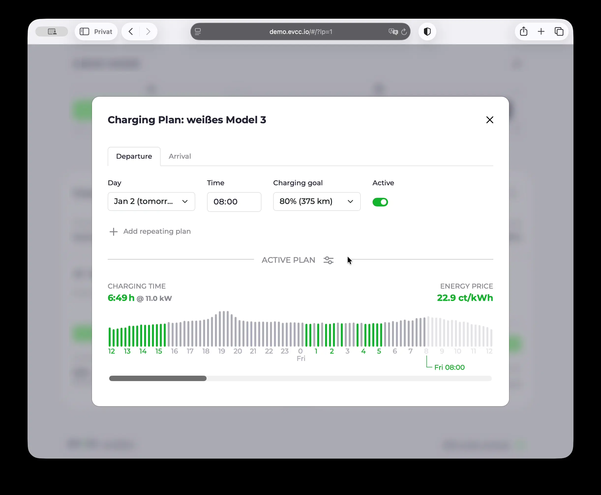
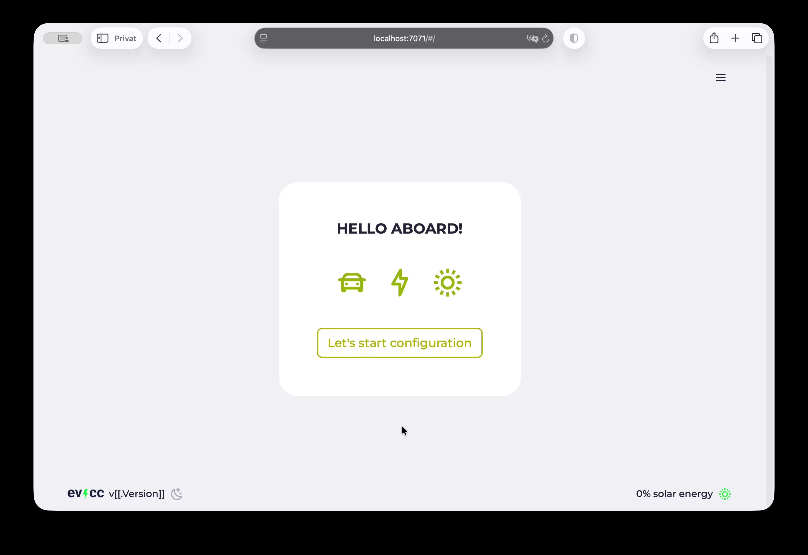
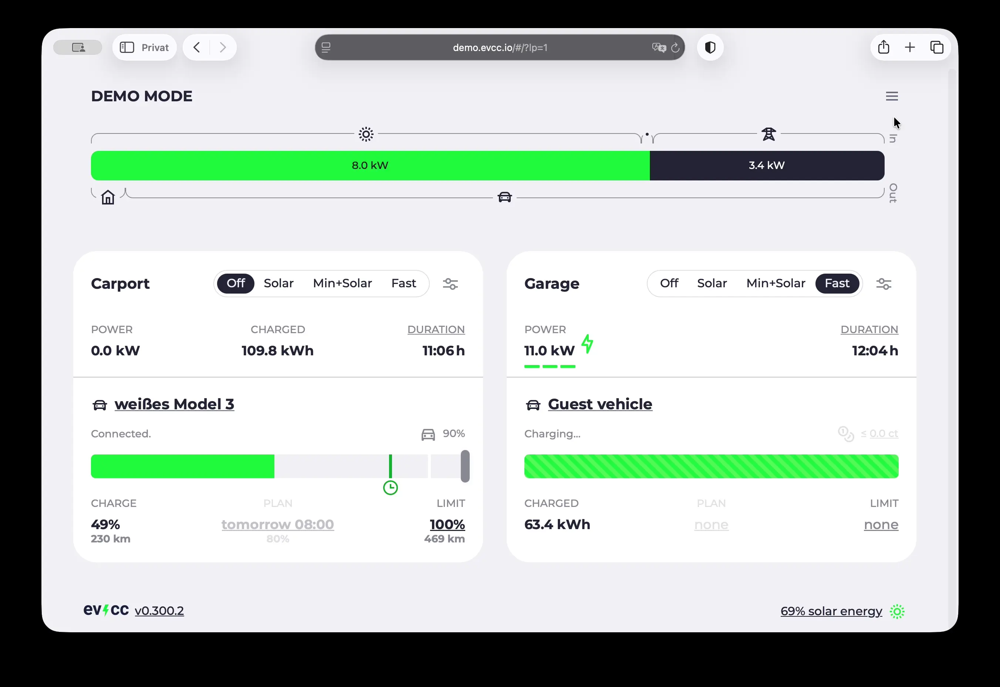

2026 est là et, avec evcc [v0.300](https://github.com/evcc-io/evcc/releases/tag/0.300.2), l’année commence par le jalon sans doute le plus important : la configuration dans le navigateur n’est plus expérimentale.
La fonctionnalité la plus demandée est enfin prête pour une utilisation en production.
Les nouveaux utilisateurs peuvent désormais configurer evcc entièrement sans ligne de commande ni fichiers YAML.

Dans cet article, nous passons en revue les points forts depuis [juillet 2025](/fr/blog/2025/07/30/highlights-config-ui-feedin-ai) et donnons un aperçu de l’année à venir.

{/* excerpt */}

## Configuration dans le navigateur

La configuration initiale en ligne de commande et l’édition de fichiers YAML ont longtemps été le principal obstacle pour les nouveaux utilisateurs.
Nous travaillons depuis plusieurs années à simplifier ce processus.
Avec la v0.300, le moment est venu : **la configuration dans le navigateur via l’interface web est désormais officiellement publiée et c’est la méthode recommandée pour les nouveaux utilisateurs.**

### Quoi de neuf ?

Depuis le dernier article sur les points forts, nous avons ajouté et amélioré de nombreuses fonctionnalités :

- **Signalement de bugs directement dans l’interface web :** les informations de diagnostic peuvent désormais être exportées pour les issues GitHub directement depuis l’interface.
- **Configuration OCPP :** la mise en place des chargeurs OCPP a été nettement simplifiée.
- **Interface pour le proxy Modbus :** une interface pratique pour configurer le proxy Modbus.
- **Authentification OAuth :** un processus d’autorisation dans l’interface pour BMW, Mini, Viessmann, Home Assistant, Volvo et d’autres services.
- **Suggestions dynamiques :** des valeurs suggérées intelligentes simplifient la configuration. Elles servent p. ex. pour les capteurs et interrupteurs de Home Assistant. Bientôt disponibles pour les paramètres Modbus et les appareils réseau.
- De nombreuses autres corrections de bugs et améliorations.

### Que manque-t-il encore ?

Toutes les fonctions peuvent être configurées via l’interface.
La syntaxe YAML reste toutefois nécessaire à certains endroits.

- Tarifs et prévisions
- Gestion de charge et configuration HEMS
- Notifications ([en cours](https://github.com/evcc-io/evcc/pull/25768))

Nous nous en occuperons dans les mois à venir.

### Pour les utilisateurs existants

Vous utilisez déjà evcc avec un `evcc.yaml` ?
Vous n’avez alors rien à changer.
Le fichier `evcc.yaml` reste pris en charge.

Si vous souhaitez passer à l’interface web, vous pouvez utiliser les deux méthodes de configuration en parallèle et migrer progressivement.
Les appareils du fichier `evcc.yaml` sont visibles dans l’interface, mais pas modifiables.
Vous trouverez plus de détails sur la migration dans la [FAQ](/fr/faq#ui-migration).

## Images Linux pour evcc

En plus de l’interface web stable, il y a une autre nouveauté importante : des [images Linux](https://github.com/evcc-io/images) prêtes à l’emploi pour Raspberry Pi et d’autres systèmes.

L’installation est désormais possible sans grandes connaissances techniques :

1. Téléchargez l’image
2. Flashez-la sur une carte SD
3. Insérez-la dans le Raspberry Pi
4. Lancez la configuration directement dans le navigateur

**Entièrement sans ligne de commande ni fichiers YAML.**

Outre toutes les versions de Raspberry Pi, le NanoPi R3S est également pris en charge.
Les images reposent sur [Armbian](https://www.armbian.com), ce qui facilite l’ajout de nouvelles plateformes de nano-ordinateurs.

Vous trouverez plus de détails dans le [guide d’installation](/fr/installation/linux-image) et dans le [dépôt GitHub](https://github.com/evcc-io/images).

## Autres points forts

En plus de l’interface web, de nombreuses autres nouveautés sont arrivées ces derniers mois :

### Tarifs : prévisions de prix au quart d’heure

Depuis octobre 2025, le prix de l’électricité à la bourse EPEX est publié par intervalles de 15 minutes au lieu d’une heure.
En interne, evcc utilise désormais systématiquement des créneaux d’un quart d’heure.
L’algorithme de planification et la visualisation ont été adaptés.
De nombreux tarifs et prévisions solaires sont déjà passés à l’intervalle plus court.

### Planificateur : charge continue

Le planificateur de charge a reçu une nouvelle option.
Vous pouvez désormais choisir entre **continu** et **le moins cher**.
La planification continue sélectionne la meilleure plage de charge d’un seul tenant pour éviter les interruptions fréquentes.

### Intégration : Home Assistant

Nous avons [échangé avec l’équipe Home Assistant](https://www.linkedin.com/posts/michael-geers_homeassistant-githubuniverse-opensource-activity-7391032971517992960-a9V8) et travaillons à une meilleure intégration des deux projets.
Les premiers résultats sont déjà visibles.
Vous pouvez configurer des véhicules, des chargeurs et des compteurs à partir de capteurs et d’interrupteurs Home Assistant.
Nous utilisons pour cela la **découverte automatique** et le **mécanisme OAuth** de Home Assistant.
Les **entités Home Assistant** correspondantes vous sont **suggérées** dans l’écran de modification.

### Points de charge : trier et masquer

Les points de charge peuvent désormais être triés et masqués dans l’interface.
Les réglages sont enregistrés par navigateur et permettent des vues individuelles pour différents utilisateurs.

## Parrainage : nouveaux prix

Nous aimons l’open source et sommes convaincus que les connaissances ouvertes accumulées dans le projet donnent un énorme coup de pouce à la transition énergétique.

Le développement du logiciel vit grâce à vous, la communauté : souhaits, idées, tests et contributions actives au code orientent le projet.
Faire tourner le projet et s’y consacrer pleinement demande cependant beaucoup de temps.
Le projet a tellement grandi qu’il est depuis longtemps bien plus qu’un petit projet annexe pour nous.
Un soutien financier est donc important pour continuer à développer et maintenir evcc sur le long terme.

Après près de cinq ans, nous avons décidé d’ajuster pour la première fois les prix du parrainage.

### Nouveaux prix à partir de 2026

- **Parrainage mensuel :** à partir de 4 $ (auparavant 2 $)
- **Parrainage unique :** à partir de 150 $ (auparavant 100 $)

### Pourquoi cet ajustement ?

Beaucoup de choses ont changé ces cinq dernières années :

**Taux de change du dollar et inflation :** le taux de change du dollar (parrainage GitHub) a baissé et l’inflation a également augmenté nos coûts réels.

**Étendue des fonctionnalités :** evcc a énormément évolué.
Des fonctionnalités comme l’interface web, les images Linux, les plans de charge intelligents, le pilotage des pompes à chaleur, les prévisions solaires et bien d’autres fonctions ont été ajoutées.
Ce qui a commencé en 2020 comme un simple outil de charge sur surplus solaire est aujourd’hui une plateforme complète de gestion de l’énergie.

**Pérennité :** nous avons encore beaucoup de projets (voir les perspectives 2026 ci-dessous).
Pour continuer à développer evcc sur le long terme et en maintenir la qualité, une base financière solide est nécessaire.

### Vous êtes déjà parrain ?

Rien ne change pour les parrains existants :

- Les **parrainages uniques** (effectués avant 2026) restent bien entendu valables
- Les **parrainages mensuels** se poursuivent sans augmentation de prix : vous continuez à payer le prix précédent
- Les augmentations volontaires sont bien sûr les bienvenues, mais pas obligatoires

🙌 Merci à toutes celles et ceux qui ont soutenu evcc au fil des années : sans vous, le projet ne serait pas là où il en est aujourd’hui.

Vous trouverez plus de détails dans la [documentation sur le parrainage](/fr/sponsorship).

## Nouveaux appareils pris en charge

**44 nouveaux fabricants** ont été ajoutés depuis juillet 2025.
La bibliothèque d’appareils d’evcc compte désormais plus de **240 fabricants** et **plus de 620 produits**.

**Chargeurs :** Alpitronic, EV Expert, FoxESS, Neoom, Sigenergy, V2C, Veton

**Pompes à chaleur et thermoplongeurs :** LG, NIBE

**Compteurs :** Aandewiel, B+GE-TECH, Cozify HAN, DDM, EcoFlow, Home Assistant, Lovato, Senergy, Sermatec, Solakon, Strong Energy, Zendure, amsleser.no

**Systèmes solaires et batteries :** ABB, B+GE-TECH, Bernecker Engineering, DDM, DZG, EcoFlow, Home Assistant, Lovato, ORNO, Saia-Burgess Controls (SBC), Schneider Electric, Sermatec, Solakon, Strong Energy, Wago, Weidmüller, amsleser.no, inepro

**Véhicules :** Ford Connect, Home Assistant, Hyundai (US), Subaru

Bien entendu, de nombreuses corrections de bugs et améliorations ont aussi été apportées aux implémentations existantes.
Vous trouverez les détails dans les [notes de version](https://github.com/evcc-io/evcc/releases).

## Perspectives 2026

Avec l’interface web stable, un jalon majeur est atteint.
Ce travail nous a pris beaucoup de temps.
Nous sommes heureux de pouvoir à nouveau nous concentrer davantage sur de nouvelles fonctionnalités.
L’année à venir sera passionnante : voici un aperçu des priorités prévues :

### Algorithme d’optimisation

Aujourd’hui, nous pilotons souvent les composants individuellement.
L’optimiseur vise à optimiser l’ensemble du système : charge en parallèle de plusieurs véhicules, batteries domestiques et consommateurs, en s’appuyant sur les signaux de prix, les prévisions solaires et les prévisions de consommation du foyer.

Depuis mi-2025, un groupe de personnes travaille sur un algorithme d’optimisation pour evcc.
Il repose sur des systèmes d’équations et des statistiques.
Le marketing produit appellerait probablement cela de l’IA 😉.
L’optimiseur peut déjà être intégré aujourd’hui en mode lecture seule, et ses résultats peuvent être affichés avec une configuration spéciale.

Les prochaines étapes :

- **Visualisation :** afficher les informations de l’optimiseur dans l’interface d’evcc là où c’est pertinent
- **Pilotage actif :** piloter le planificateur, la charge depuis le réseau et d’autres fonctions à partir des données de l’optimiseur

Plus d’informations dans l’[issue GitHub](https://github.com/evcc-io/evcc/issues/23042).

### Meilleur affichage des consommateurs et chauffages

L’affichage et le pilotage des **consommateurs courants** (lave-linge, sèche-linge, …) et des **chauffages** doivent être améliorés.

Aujourd’hui, ils peuvent déjà être ajoutés comme « Chauffage » ou « Compteurs supplémentaires » et affichés dans le diagramme de flux d’énergie.
Un affichage sous forme de cartes séparées est prévu, ainsi que l’enregistrement d’un historique.
Le concept de « mini points de charge » existe depuis un moment, et la plupart des briques sont désormais en place.
Nous y travaillerons dans l’année à venir et nous nous réjouissons d’y voir plus clair et d’avoir des fonctions spécifiques pour ces appareils.

Vous trouverez les détails dans la [discussion GitHub](https://github.com/evcc-io/evcc/discussions/7235).

### Statistiques dans le temps

Actuellement, nous enregistrons uniquement des statistiques basées sur les sessions de charge.
Nous prévoyons en plus de collecter des données horodatées, indépendantes des sessions de charge, pour la consommation, la production, la production de chaleur et d’autres indicateurs.
Cette fonctionnalité demandée depuis longtemps permettra des statistiques d’ensemble comparables à celles de nombreuses applications de fabricants, mais pour tous les appareils de votre maison.
Des questions comme « Combien d’électricité solaire la pompe à chaleur a-t-elle utilisée ? » ou « Combien d’énergie mes installations photovoltaïques ont-elles produite aujourd’hui ? » devraient ainsi trouver une réponse.
Cet affichage complétera la vue actuelle, optimisée pour la charge.

---

💚 Un grand merci à toutes celles et ceux qui ont amené le projet jusqu’ici, par leur collaboration, leurs discussions, leurs idées, leurs tests et surtout leur soutien financier.

Nous vous souhaitons un bon début d’année 2026 et nous nous réjouissons que les jours rallongent à nouveau.

**Cordialement** 
L’équipe evcc 
Michael, Andi et Uli
