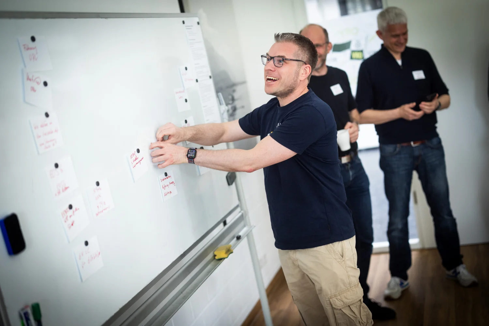
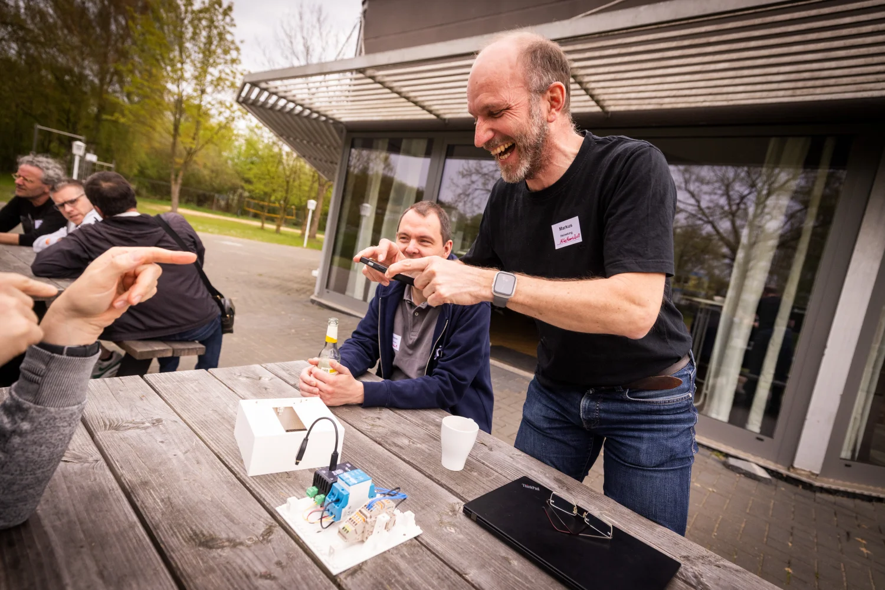
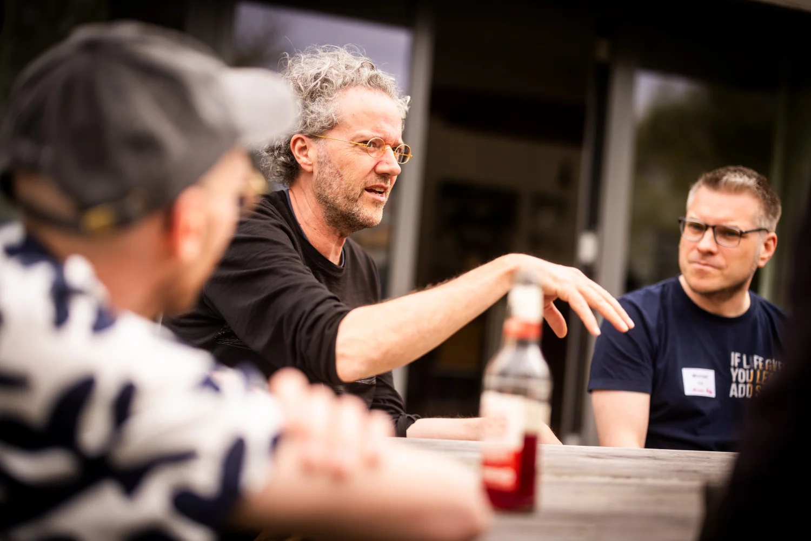
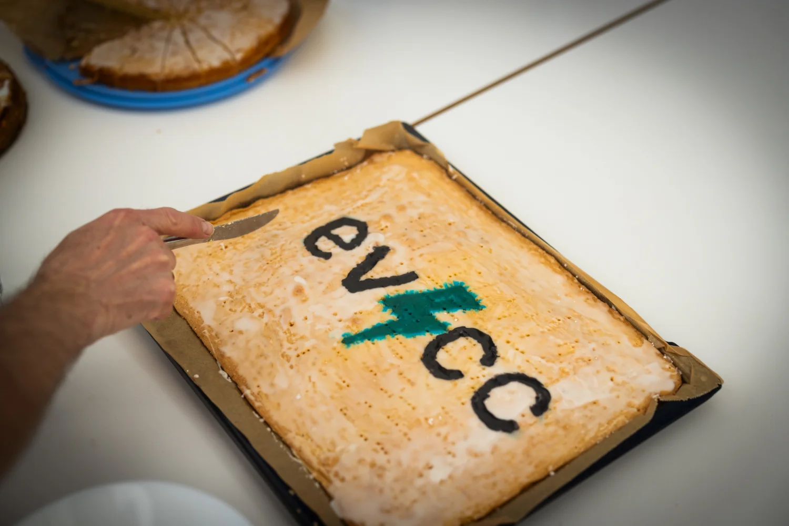

Le 18 avril 2026, nous nous sommes retrouvés pour la première rencontre de la communauté evcc au club d’aviron [Osnabrücker Ruderverein](https://www.orv.de). Environ 40 participants nous ont rejoints, venus d’Allemagne, de Belgique et des Pays-Bas. Certains avaient fait tout le trajet depuis la Bavière et le Bade-Wurtemberg.

{/* excerpt */}

## Un après-midi façon barcamp

L’après-midi s’est déroulé en mode barcamp : les participants apportent les sujets, et le reste prend forme sur place. Trois grandes sessions en sont ressorties :

- **Charge bidirectionnelle** : Jan Luca et Marcel ont expliqué comment CUBOS déploie la charge bidirectionnelle en entreprise.
- **Optimisation avancée** : l’interaction avec [EOS](https://github.com/Akkudoktor-EOS/EOS) (un projet d’[Akkudoktor](https://akkudoktor.net)), [OpenEMS](https://openems.io), [Victron ESS](https://www.victronenergy.com/live/ess:start), [Home Assistant](https://www.home-assistant.io), l’[optimiseur evcc](/fr/features/optimizer) actuellement en développement, et la vente directe d’électricité.
- **Gestion de la charge, § 14a, § 9 et EEBUS** : la réglementation allemande actuelle et la manière dont evcc peut mettre en œuvre ces exigences en pratique.

En parallèle, de nombreux petits groupes se sont formés : l’usage de l’IA dans le code d’evcc, des recommandations de chargeurs, les prochaines étapes de l’interface (par exemple les « mini points de charge »), et bien plus encore.

## Du matériel evcc professionnel

Dominik a présenté son système [eHive](https://www.ehiv3.de), un matériel sur rail DIN spécialement optimisé pour evcc. Pour clore la session, un appareil a été mis en jeu parmi les participants : la personne qui estimait le plus précisément le poids du matériel l’a remporté.

## Visites des installations énergétiques du club

Markus et Michael de l’Osnabrücker Ruderverein ont proposé plusieurs visites des équipements énergétiques du club et des hangars à bateaux. Pour en savoir plus sur l’installation du club, lisez le [portrait communautaire](/fr/blog/2025/11/29/osnabruecker-ruderverein).

## Fin de journée

Nous avons terminé la journée autour d’un barbecue et de boissons. L’occasion de bonnes conversations et de nouveaux contacts au sein de la communauté.

Et il y avait même un gâteau evcc :

## Galerie photos

[Detlef](https://hee.se) a photographié la rencontre. Vous trouverez toutes les photos dans sa [galerie photos](https://hee.se/portfolio/evcc/).

## Remerciements

Un grand merci à l’[Osnabrücker Ruderverein](https://www.orv.de) pour son accueil, à Markus et Michael pour les visites et à [Detlef](https://hee.se) pour les photos. Et à toutes celles et ceux qui ont apporté des sujets, des idées et de l’énergie pour faire vivre cette rencontre.

À la prochaine !
