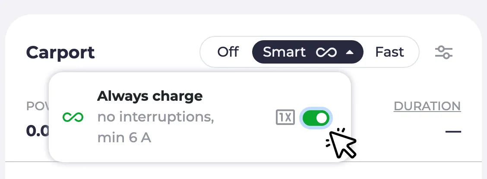
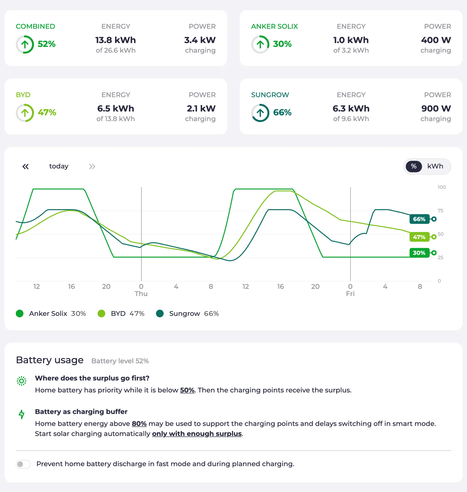
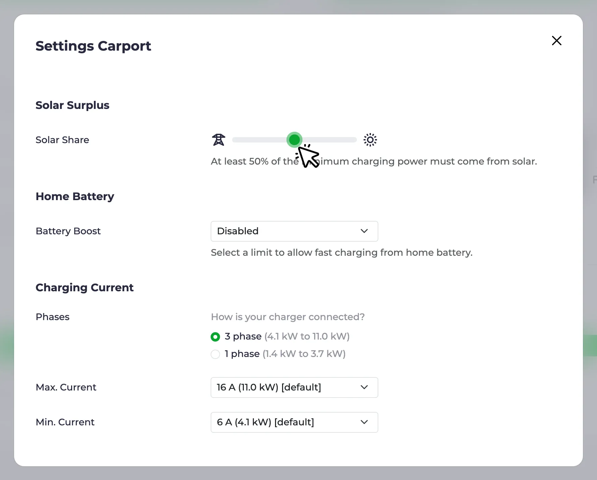

Depuis le [dernier article sur les points forts](/fr/blog/2026/08/19/highlights-release-process-optimizer-customize), deux versions avec de nouvelles fonctionnalités sont sorties : [0.315](https://github.com/evcc-io/evcc/releases/tag/0.315.0) et [0.316](https://github.com/evcc-io/evcc/releases/tag/0.316.0).
Cet article présente les deux.
Les grands sujets : les modes de charge sont réorganisés avec **Intelligent** et **Toujours en charge**, la page de la batterie domestique a été remaniée, le nouveau curseur **Part solaire** remplace les seuils en watts déroutants, et l’optimiseur se rapproche de plus en plus du moment où il prendra les commandes.

{/* excerpt */}

:::note[Mise à jour]
**26 septembre 2026 :** le [mode Intelligent](#modes) est désormais expliqué plus en détail, et la nouvelle [page sur les modes](/fr/features/modes) couvre tous les modes.
La [section sur l’optimiseur](#optimizer) précise maintenant que l’optimiseur nécessite un jeton de parrain.
:::

## Nouveaux modes : Intelligent et Toujours en charge \{#modes\}

Les modes **Solaire** et **Min+Solaire** remontent à l’époque où evcc servait uniquement à la charge sur surplus solaire.
Au fil du temps, nous avons ajouté des fonctionnalités qui n’ont pas grand-chose à voir avec le solaire : tarifs dynamiques, plans de charge, pompes à chaleur et appareils commutables.
Beaucoup utilisent aujourd’hui evcc sans aucune installation photovoltaïque, et ces noms semaient la confusion chez les nouveaux utilisateurs.

Avec la [0.316](https://github.com/evcc-io/evcc/pull/32490), les modes portent le nom de ce qu’ils font, et non de la façon dont l’électricité est produite.
**Solaire** devient **Intelligent**.

**Arrêté** et **Rapide** sont de simples interrupteurs : l’appareil reste éteint, ou il fonctionne à pleine puissance comme un chargeur sans evcc.
Tout ce qu’evcc décide de lui-même se passe en mode **Intelligent** :

- [Charge sur surplus solaire](/fr/features/solar-charging)
- Charge depuis le réseau avec de l’énergie bon marché ou propre grâce à un [tarif dynamique](/fr/features/dynamic-prices) ou à une [prévision CO₂](/fr/features/co2)
- Priorités entre la [batterie domestique](/fr/features/battery), les points de charge et les chauffages
- [Plans de charge](/fr/features/plans)

**Intelligent** est aussi le mode dans lequel fonctionnera le futur optimiseur.

Le mode **Min+Solaire** disparaît.
Il se comportait comme le mode **Solaire**, mais sans pauses et toujours avec au moins la puissance minimale, ce qui est important pour les véhicules qui supportent mal les démarrages et arrêts répétés de la charge, ou pour les installations avec peu de surplus solaire.
Mais ce concept n’a de sens que pour la charge de véhicules, pas pour les appareils commutables, les chauffages ou les pompes à chaleur.
C’est pourquoi il n’est plus un mode à part entière : sur les points de charge pour véhicules, il devient l’option **Toujours en charge**, accessible depuis le menu déroulant du bouton **Intelligent**.
Elle peut être activée en permanence ou, avec le bouton **1x**, uniquement pour la session de charge en cours.
Dans les paramètres du véhicule, vous pouvez définir une valeur par défaut pour chaque véhicule.

Les libellés des modes s’adaptent à l’appareil : un chargeur affiche **Arrêté / Intelligent / Rapide**, un appareil commutable **Arrêté / Intelligent / Enclenché**, une pompe à chaleur **Normal / Intelligent / Boost**.
La nouvelle [page sur les modes](/fr/features/modes) explique en détail tous les modes et [Toujours en charge](/fr/features/modes#always-charge).

Ce changement n’est pas rétrocompatible pour les intégrations.
L’API, MQTT et le websocket renvoient désormais `smart` au lieu de `pv`, et `minpv` n’apparaît plus en lecture.
L’écriture des anciennes valeurs fonctionne toujours : `pv` bascule en **Intelligent**, `minpv` bascule en **Intelligent** avec **Toujours en charge** activé, de sorte que les automatisations existantes conservent leur comportement.
Si votre intégration compare des valeurs avec `pv` ou `minpv`, il est temps de la mettre à jour.
Les principales intégrations ont été mises à jour avant la sortie.
Merci à tous les mainteneurs qui ont mis à jour leurs projets 🙌

## Page de la batterie domestique \{#battery\}

La page **Batterie** était jusqu’ici une simple page de paramètres.
Elle commence désormais par une vue d’ensemble : une carte d’état avec le niveau de charge, l’énergie stockée et la puissance actuelle.
Avec plusieurs batteries, la page les détaille : une carte par batterie ainsi qu’une carte globale, et le graphique en dessous montre le niveau de charge de chaque batterie au cours des derniers jours.
Lorsque l’[optimiseur](#optimizer) est activé, la page affiche aussi ses suggestions : ce qu’il ferait de la batterie en ce moment, p. ex. la maintenir ou la charger depuis le réseau, et comment le niveau de charge évoluerait.
Nous y revenons plus bas.
Les paramètres d’utilisation (priorité, tampon de charge et démarrage automatique) sont toujours là, désormais sous forme de phrases plus faciles à comprendre au lieu d’un formulaire.

Si vous aviez activé les fonctionnalités expérimentales, vous connaissez déjà cette page.
Avec la [0.316](https://github.com/evcc-io/evcc/pull/33434), elle devient la page par défaut pour tout le monde.

**Modes de pilotage de la batterie :** le pilotage de la batterie est désormais plus fin.
Chaque batterie indique les modes qu’elle prend en charge : fonctionnement normal, blocage de la décharge, charge depuis le réseau, blocage de la charge et décharge vers le réseau.
evcc ne propose que ce qu’un appareil sait réellement faire.
Le rôle de chaque mode est expliqué dans le [tableau des modes](/fr/user-defined-devices#battery-modes) de la documentation, et des systèmes externes peuvent définir un mode via l’[API REST](/integrations/rest-api/operations/setexternalbatterymode).
La prise en charge du pilotage actif des batteries s’est étendue au cours de ce cycle : les batteries Huawei SUN2000, Kostal Plenticore, Sungrow, Zendure Solarflow, Anker Solarbank, Atmoce, EcoFlow Stream, Marstek et Home Assistant ont gagné des modes supplémentaires.
La [liste des appareils](/fr/meters?f=battery-control) indique quels systèmes de batterie prennent en charge le pilotage actif, et la [page sur la batterie domestique](/fr/features/battery) explique ce que vous pouvez en faire.

## Part solaire \{#solar-share\}

Il s’agit d’une très ancienne demande de fonctionnalité.
Par défaut, la charge en mode **Intelligent** ne démarre que lorsque le surplus couvre toute la puissance de charge minimale du véhicule.
Si votre installation photovoltaïque est petite ou si le soleil est bas en hiver, ce moment risque de ne jamais arriver.
Jusqu’ici, vous pouviez abaisser la barre avec des seuils en watts dans la configuration du point de charge (redémarrage nécessaire).
Ces seuils déroutent les nouveaux utilisateurs depuis des années et, pour être honnête, pas mal d’utilisateurs de longue date aussi 😅.

Le nouveau curseur [**Part solaire**](https://github.com/evcc-io/evcc/pull/32104) dans les paramètres du point de charge est plus simple : vous y définissez la part de la puissance de charge minimale qui doit provenir du solaire.
100 % signifie que la charge attend un surplus complet.
50 % signifie que la moitié peut provenir du réseau.
0 % signifie que la charge démarre dès qu’il y a le moindre surplus.
Pas de redémarrage, pas de watts, juste un curseur.
Les anciens seuils fonctionnent toujours pour les configurations avancées.
Tant qu’ils sont définis, le curseur est désactivé et en indique la raison.

La [page sur la charge solaire](/fr/features/solar-charging#not-enough-surplus) donne tous les détails.

## Progrès de l’optimiseur \{#optimizer\}

L’[optimiseur](/fr/features/optimizer) calcule un plan pour toute votre maison sur les prochains jours : batterie, points de charge et chauffage, à partir des prévisions et des prix.
Il est encore expérimental et se contente de conseiller : il montre ce qu’il ferait, mais n’agit pas encore.
Beaucoup de choses ont changé au cours des deux dernières versions :

- L’horizon couvre désormais [le reste de la journée et les 48 heures suivantes](https://github.com/evcc-io/evcc/pull/32893), et le graphique indique le jour de la semaine à chaque changement de jour.
- La consommation de la maison est [répartie en profils individuels](https://github.com/evcc-io/evcc/pull/33749) : la consommation de base, le chauffage et les points de charge sans capacité de véhicule connue sont affichés séparément.
- La prévision de la consommation de la maison s’est améliorée, p. ex. pour les [chauffages](https://github.com/evcc-io/evcc/pull/28232) et pour les maisons où quelques après-midi très gourmands [faussaient la consommation de base](https://github.com/evcc-io/evcc/pull/33700).
- La page d’optimisation [affiche un message tant qu’aucun plan n’existe, apparaît dans le menu dès que l’optimiseur est activé et propose un lien](https://github.com/evcc-io/evcc/pull/33750) pour signaler les plans invraisemblables.
- Les plans sont [recalculés immédiatement](https://github.com/evcc-io/evcc/pull/33467) lorsqu’un plan de charge change côté véhicule, et l’objectif de niveau de charge du plan [tombe dans le bon créneau](https://github.com/evcc-io/evcc/pull/33832).
- La charge depuis le réseau et la décharge vers le réseau ne sont planifiées que pour les batteries qui [prennent réellement en charge ce mode](https://github.com/evcc-io/evcc/pull/33860).

Si vous ne l’avez pas encore essayé : activez les fonctionnalités expérimentales sous **Configuration → Expérimental**, activez l’optimiseur et vérifiez si le plan semble plausible pour votre maison.
L’optimiseur nécessite un [jeton de parrain](/fr/sponsorship).
Le calcul s’exécute sur un service cloud que nous hébergeons et qui ne conserve aucune donnée.
Vous pouvez aussi faire tourner ce service vous-même : voir la section [Contexte technique](/fr/features/optimizer#technical).
Chaque retour nous est précieux.

La prochaine grande étape est le **mode automatique** : l’optimiseur ne se contentera plus de suggérer, il décidera quand charger la batterie ou maintenir son niveau, et quand les points de charge en mode **Intelligent** démarrent et s’arrêtent.
La [pull request](https://github.com/evcc-io/evcc/pull/32881) est en préparation, et nous avons déjà reçu beaucoup de retours.
Si vous aimez l’aventure, récupérez l’une des versions de test dans les commentaires de la pull request, essayez-la et dites-nous comment ça se passe.
Il reste encore du travail, mais nous avons hâte de l’intégrer à la version nightly.

## Petites améliorations

- **Accès à distance :** [n’est plus expérimental](/fr/features/remote-access). La carte est visible sous **Configuration** sans l’option expérimentale, et une option de réinitialisation supprime la configuration et les identifiants. Nous avons présenté l’accès à distance dans les [points forts de juillet](/fr/blog/2026/07/18/highlights-remote-access-widgets-optimizer).
- **Appareils de bridage :** lorsque le gestionnaire de réseau exige une baisse de l’export vers le réseau (§ 9 EEG), evcc demande normalement à chaque onduleur solaire de réduire sa puissance. Dans certaines installations, cette commande doit plutôt passer par une unité centrale, p. ex. le SMA Sunny Home Manager 2.0 ou le contrôle d’export SolarEdge. Ces appareils ont désormais leur propre [classe d’appareils](https://github.com/evcc-io/evcc/pull/32416), configurée à côté du compteur avant réseau, au lieu de se faire passer pour un compteur. Voir la [page sur la limite externe](/fr/external-limit#curtailment-devices).
- **Format de date :** le format de date suivait jusqu’ici la langue choisie, ce qui ne couvre pas les différences régionales, p. ex. l’anglais en Europe. Vous pouvez maintenant choisir l’ordre jour en premier, mois en premier ou ISO dans les [paramètres de l’interface utilisateur](https://github.com/evcc-io/evcc/pull/29321). Merci à [webalexeu](https://github.com/webalexeu).
- **Indicateur de phases :** l’affichage des phases sur le point de charge a changé. Auparavant, il y avait une barre par phase active et les phases inactives étaient simplement masquées. Désormais, un chargeur triphasé [affiche toujours trois segments](https://github.com/evcc-io/evcc/pull/33173), avec les segments actifs mis en évidence : vous voyez ainsi d’un coup d’œil s’il charge sur une ou trois phases.
- **Polestar :** l’intégration obtenue par rétro-ingénierie est remplacée par l’[API officielle Polestar Data Portal](https://github.com/evcc-io/evcc/pull/33814). Merci à [loebse](https://github.com/loebse).
- **Nissan :** la connexion utilise désormais [MyNISSAN OneID](https://github.com/evcc-io/evcc/pull/33316), depuis que Nissan a abandonné les anciens identifiants NissanConnect. Merci à [alex-irrgang](https://github.com/alex-irrgang).
- **Škoda :** la nouvelle API officielle MyŠkoda est prise en charge, voir l’[article de blog dédié](/fr/blog/2026/08/27/skoda-vehicle-api).
- **Home Assistant :** l’app evcc [détecte automatiquement l’instance Home Assistant et le jeton](https://github.com/evcc-io/evcc/pull/33000), si bien que les appareils Home Assistant apparaissent comme appareils détectés sans aucune configuration manuelle, merci à [wlcrs](https://github.com/wlcrs). Les batteries Home Assistant prennent désormais en charge les [modes blocage de la charge et décharge vers le réseau](https://github.com/evcc-io/evcc/pull/33841), merci à [igotsoul](https://github.com/igotsoul). Deux changements non rétrocompatibles : le pilotage du courant en milliampères du [chargeur Home Assistant](https://github.com/evcc-io/evcc/pull/33858) est désormais facultatif, et le [préréglage minsoc/maxsoc de la batterie](https://github.com/evcc-io/evcc/pull/33707) a été supprimé.

## Nouveaux appareils pris en charge

**Chargeurs :** Steca, prises commutables Sonoff, ainsi que la fonction de compteur pour Spelsberg et des améliorations pour go-e, OpenEVSE, NRGkick, Keba, Voltie et Zaptec

**Compteurs, installations photovoltaïques et batteries :** CHINT ECH10K, Solplanet hybride, API cloud SENEC.Connect, Afore hybride via RS485, micro-onduleurs Deye via Solarman et enregistreur HTTP, Zendure SolarFlow 800 Pro, my-PV HEA THOR 3.5 et 9.0, limiteur de courant Solax X1/X3-HAC, énergie exportée pour Youless, openWB Pro et Sungrow

**Véhicules :** Polestar via l’API officielle Data Portal, nouvelle API officielle MyŠkoda, connexion Nissan OneID, motos LiveWire S2, énergie chargée pour Tesla BLE

**Pompes à chaleur et chauffage :** Weishaupt (Modbus TCP), 1SINQ OneKey (SG Ready via MQTT), puissance et température pour Viessmann grâce à [ickeundso](https://github.com/ickeundso)

**Tarifs :** prix spot EPEX pour la Belgique, spotovaelektrina.cz pour la Tchéquie, régions, devises et clé API supplémentaires pour Energy Price Forecast

**Bridage (§ 9 EEG) :** SMA Sunny Home Manager 2.0, SolarEdge, Sungrow

Bien sûr, il y a aussi eu de nombreuses corrections de bugs et améliorations des intégrations existantes.
Vous trouverez les détails dans les notes de version de la [0.315](https://github.com/evcc-io/evcc/releases/tag/0.315.0) et de la [0.316](https://github.com/evcc-io/evcc/releases/tag/0.316.0).

---

💚 Un grand merci à toutes celles et ceux qui font avancer le projet : par le code, les idées, les tests, les discussions et le soutien financier, sans lequel le projet ne serait pas possible sous cette forme.

Les jours raccourcissent.
Utilisez le soleil à bon escient. 😉
Bonne charge !

**Cordialement** 
L’équipe evcc 
Michael, Andi & Uli
