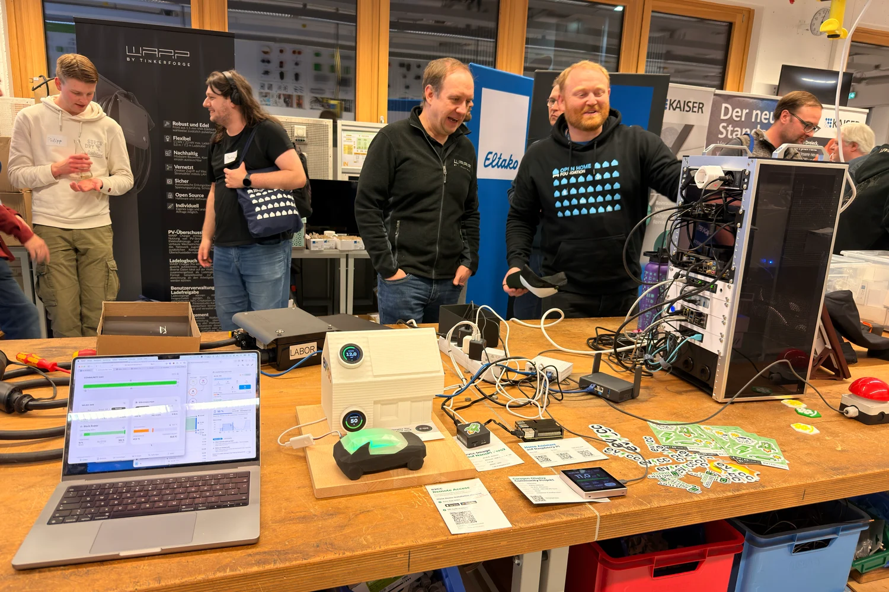
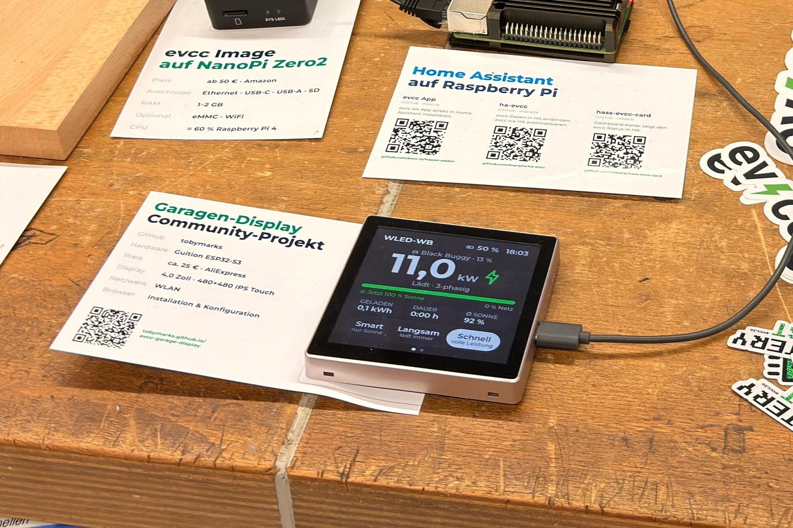
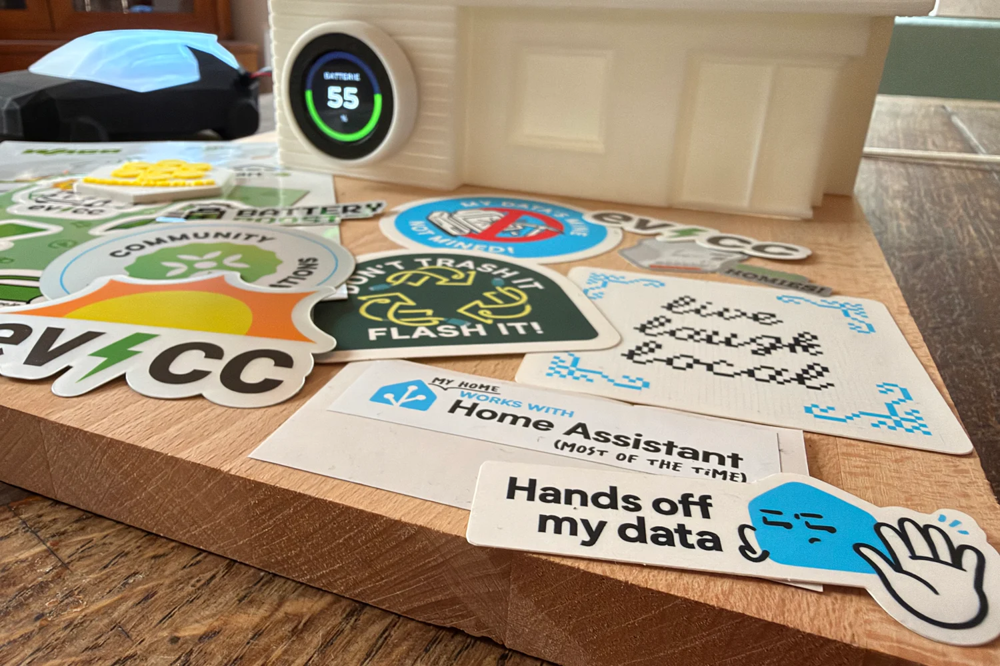

import selfieImg from "../../../../../en/blog/2026/11/10/ha-community-day-selfie.webp";
import wabenwattImg from "../../../../../en/blog/2026/11/10/ha-community-day-wabenwatt.webp";

Samedi dernier, le 7 novembre 2026, c’était le [Community Day](https://www.openhomefoundation.org/community-day/) : les utilisateurs de Home Assistant se sont retrouvés lors de rencontres locales partout dans le monde.
[Andrej Friesen](https://www.ajfriesen.com) m’a invité à [celle de Mönchengladbach](https://luma.com/7mmwwpwj) pour parler un peu d’evcc et de sa place dans l’écosystème Home Assistant.
J’avais aussi apporté une maison miniature avec laquelle les visiteurs pouvaient jouer.

{/* excerpt */}

## La présentation

Beaucoup de gens utilisent evcc et Home Assistant côte à côte, j’ai donc montré comment combiner les points forts des deux.
evcc apporte une configuration simple et un pilotage intelligent de la recharge des véhicules électriques, tandis que Home Assistant ajoute la puissance de ses automatisations et une intégration poussée avec le reste de la maison.

- **[ha-evcc](https://github.com/marq24/ha-evcc)** de Matthias Marquardt ([marq24](https://github.com/marq24)) amène les données et les actions d’evcc dans l’univers Home Assistant.
  Vous n’avez pas besoin d’écrire du YAML ni de vous occuper vous-même de REST ou de MQTT.
- **[hass-evcc-card](https://github.com/mkshb/hass-evcc-card)** de [mkshb](https://github.com/mkshb) s’appuie sur ha-evcc et fournit des cartes de tableau de bord prêtes à l’emploi.
- **[hassio-addon](https://github.com/evcc-io/hassio-addon)** fait tourner evcc directement dans Home Assistant en tant qu’application.
  Merci à [thecem](https://github.com/thecem), [goebelmeier](https://github.com/goebelmeier), [dm82m](https://github.com/dm82m) et à toutes les autres personnes qui le font vivre.

Cela fonctionne aussi dans l’autre sens.
Vous pouvez utiliser des entités Home Assistant comme compteurs, chargeurs ou pompes à chaleur dans evcc.
Les détails se trouvent dans la documentation sur l’[intégration](/fr/smarthome/home-assistant) et l’[installation](/fr/installation/home-assistant).

<iframe
  src="https://speakerdeck.com/player/1a0e9bf1f7fa447ba7f29ca8d49b6175"
  title="Diapositives : evcc & Home Assistant"
  loading="lazy"
  allowfullscreen
  style={{ width: "100%", aspectRatio: "710 / 399", border: 0 }}
></iframe>

[Diapositives sur Speaker Deck (de)](https://speakerdeck.com/naltatis/2026-ha-community-day)

## Maison miniature à manipuler

J’ai partagé une table avec Bastian Nordmeyer de [Tinkerforge](https://www.tinkerforge.com).
Ils fabriquent le [WARP4 Charger](https://warp-charger.com/en/products/warp4-charger), un chargeur [open hardware](https://warp-charger.com/en/warp-for/nerds) très appréciée dans la communauté evcc.
Conçu et fabriqué en Allemagne, il est pensé pour être réparé et mis à niveau.
Le firmware, les schémas et les circuits imprimés sont publiés sur GitHub.
C’est un peu la philosophie des imprimantes Prusa, appliquée aux chargeurs.

Comme Andrej ne semble pas organiser ses événements en été, nous n’avons pas pu présenter la recharge au surplus solaire avec une vraie installation photovoltaïque 😉
C’est pourquoi j’ai construit une maison miniature.
La maison imprimée en 3D possède deux molettes, l’une pour la production solaire et l’autre pour le niveau de charge de la batterie domestique.
À côté se trouve une voiture imprimée en 3D qui indique l’état de sa recharge avec des LED diffuses.
Le tout est relié à un NanoPi Zero2 équipé de l’[image Linux d’evcc](/fr/installation/linux-image), lui-même intégré à une instance Home Assistant qui tournait sur un Raspberry Pi juste à côté.

L’[accès à distance](/fr/features/remote-access) était activé, les visiteurs pouvaient donc scanner un code QR et tout piloter depuis leur propre téléphone.
Il suffisait de monter le soleil ou de changer de mode pour voir le changement se répercuter d’un système à l’autre.

Le vrai WARP4 Charger sur notre table était lui aussi connecté.
[Stefan Mühlen](https://www.linkedin.com/in/stefan-m%C3%BChlen-49b618386/), maître électricien à la Kreishandwerkerschaft Mönchengladbach et notre hôte du jour, a proposé de faire la prochaine fois une vraie installation de chargeur avec recharge de véhicule électrique.
Peut-être qu’Andrej réussira à programmer le prochain événement en été 😅

## Écran de garage

La vedette de la journée était un projet communautaire assez récent de [Toby Marks](https://www.linkedin.com/in/tobiasmarks/) ([tobymarks](https://github.com/tobymarks)).
Son [evcc garage display](https://tobymarks.github.io/evcc-garage-display/) affiche l’état d’un point de charge sur un petit écran tactile de 4 pouces, pour environ 25 € seulement.
Vous voyez votre véhicule et l’avancement de la recharge, et vous pouvez changer le mode ou activer le boost directement sur place.
L’installation se fait depuis le navigateur.

D’autres projets de ce genre se trouvent sur la page des [projets communautaires](/fr/smarthome/awesome).

## Rencontres

J’ai rencontré Dominik Heußen, qui m’a montré son projet [wabenwatt](https://wabenwatt.de/).
C’est une carte en temps réel de la production solaire agrégée à l’échelle de l’Allemagne.

J’ai discuté avec beaucoup d’utilisateurs d’evcc et avec des personnes qui prévoient d’acheter leur première voiture électrique.
Il y a aussi eu des échanges intéressants sur la façon dont l’IA change la manière dont les gens interagissent avec leur maison connectée et dont ils la configurent.
Et c’était un plaisir de revoir Thomas Wiebe du [podcast SmartHütte](/fr/blog/2026/01/26/smarthuette-podcast), Tristan Küsters de [Tristans Smartes Heim](https://www.youtube.com/@tristanssmartesheim), Flo de [Flotomation](https://www.instagram.com/flotomation/), Matthias Kleine de [haus:automation](https://www.youtube.com/@haus_automation), [Almir Hodzic](https://www.linkedin.com/in/almir-hodzic-sales-development-manager/) d’Eltako et [Richard Polzer](https://www.linkedin.com/in/richardpolzer/), qui anime une [chaîne YouTube sur KNX](https://www.youtube.com/@richardpolzer).

## Merci

C’était un après-midi intense.
Merci Andrej pour l’invitation !
J’ai hâte d’être à la prochaine.

