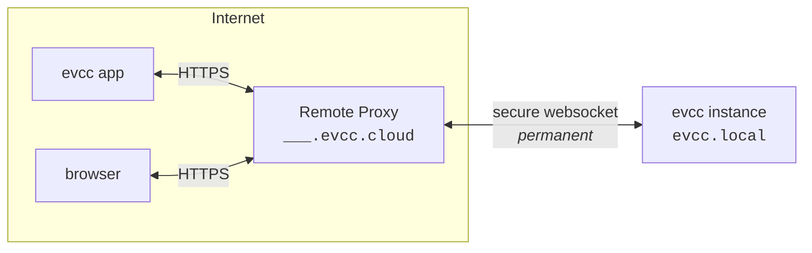

import { Steps } from "@astrojs/starlight/components";
import SponsorInfoBox from "@components/SponsorInfoBox.astro";
import statusImg from "@assets/features/remote-access/status.png";
import clientsImg from "@assets/features/remote-access/clients.png";
import clientCreatedImg from "@assets/features/remote-access/client-created.png";

L’accès à distance vous permet d’atteindre votre instance evcc depuis l’extérieur de votre réseau domestique, via l’[application evcc](/fr/features/app) ou un navigateur.
Votre instance reçoit son propre domaine sur `evcc.cloud`.
Vous n’avez besoin ni de redirection de port, ni de DNS dynamique, ni de VPN, car l’instance établit elle-même la connexion sortante.

<SponsorInfoBox lang="en" type="feature" />

## Mise en place

<Steps>

1. Activez la fonction sous **Configuration → Accès à distance**.

   

2. Votre instance evcc se connecte à `evcc.cloud` et reçoit son propre domaine, p. ex. `swift-dark-crow.evcc.cloud`.

   

3. Créez un client distinct pour chaque appareil qui doit avoir accès.
   Vous recevez un nom d’utilisateur, un mot de passe et un code QR contenant les deux.
   - **Application :** scannez le code QR avec l’appareil photo de votre téléphone.
     L’[application evcc](/fr/features/app) s’ouvre et se connecte immédiatement.
   - **Navigateur :** ouvrez votre domaine personnel et connectez-vous avec le nom d’utilisateur et le mot de passe (authentification basique via HTTPS).
   - **Clients API :** accédez à l’API par programmation avec le nom d’utilisateur et le mot de passe.

     ```bash title="curl example"
     curl --user Macbook:7IIGKZGP-MV0PJKSE "https://swift-dark-crow.evcc.cloud/api/state?jq=.pvPower"
     ```

   

4. La même vue affiche la dernière activité de chaque client et vous permet de révoquer un appareil à tout moment.
   L’accès peut, en option, être limité à une période définie.

</Steps>

## Sécurité

**Transport.**
Les requêtes vers votre domaine passent par HTTPS avec le certificat générique (wildcard) pour `*.evcc.cloud`.
La liaison entre le Remote Proxy et votre instance locale passe par un tunnel WebSocket.

**Ce que voit le Remote Proxy.**
Le Remote Proxy se contente de transmettre les requêtes.
Le contenu des requêtes n’est ni stocké ni inspecté.
Pour chaque enregistrement, seuls le domaine, un hachage du jeton de connexion, le parrain associé et des horodatages sont conservés, afin que le tunnel puisse être réattribué lors d’une reconnexion.

**Autorisation locale.**
Vous créez des identifiants distincts pour chaque appareil.
Ceux-ci sont stockés et vérifiés exclusivement sur votre instance evcc.
Aucun identifiant n’est stocké sur le Remote Proxy.
Le mot de passe n’est affiché qu’une seule fois, lors de la création du client.
Supprimer un appareil ne révoque que l’accès de cet appareil.
Tous les autres restent connectés.
Après plusieurs échecs de connexion, les nouvelles tentatives sont automatiquement ralenties.

**Portée de l’accès.**
Les identifiants d’accès à distance s’ajoutent aux mécanismes de sécurité propres à evcc.
Ils accordent uniquement un accès réseau à votre instance, comparable à un accès depuis votre réseau local.
Les modifications de la configuration, les sauvegardes, les journaux ou un redémarrage nécessitent toujours le mot de passe administrateur.

**Liaison au jeton de parrain.**
L’enregistrement est vérifié auprès de `sponsor.evcc.io`.
Chaque parrain reçoit exactement un domaine, lié définitivement à ce parrain et jamais réattribué.

## Détails techniques

Votre application ou votre navigateur se connecte à votre domaine personnel sur `evcc.cloud`.
Le Remote Proxy transmet les requêtes via un tunnel WebSocket à votre instance evcc locale.
Votre instance locale ouvre elle-même ce tunnel en sortie, si bien qu’aucun port ouvert n’est nécessaire dans votre réseau.



Lors de la première activation, l’instance evcc locale s’enregistre auprès du Remote Proxy.
En échange du jeton de parrain, elle reçoit un jeton de connexion et un domaine attribué aléatoirement.
Les deux sont stockés localement et réutilisés au démarrage suivant pour rétablir le tunnel sans repasser par l’enregistrement.

Lors des démarrages suivants, l’instance evcc locale ouvre une connexion WebSocket persistante et chiffrée par TLS (WSS) vers le Remote Proxy.
Cette connexion sert de tunnel pour tout le trafic ultérieur et est établie en sortie, si bien qu’aucune redirection de port n’est nécessaire.

Sur cette connexion, [hashicorp/yamux](https://github.com/hashicorp/yamux) assure le multiplexage.
Chaque requête HTTP qui arrive au Remote Proxy devient un flux yamux distinct sur la connexion WebSocket existante.
Plusieurs requêtes parallèles partagent une seule connexion, sans nouvelle négociation TCP ou TLS par requête.

Le passage en WebSocket (upgrade) fonctionne aussi à travers le tunnel.
C’est important, car l’interface d’evcc reçoit elle-même ses données en direct via WebSocket.

Si le tunnel est interrompu, l’instance locale se reconnecte automatiquement.
Tant que la connexion est établie, votre domaine est joignable ; sinon, le Remote Proxy renvoie une erreur.

L’hôte du Remote Proxy est par défaut `api.evcc.cloud`.
Pour le développement ou un proxy auto-hébergé, il peut être remplacé avec la variable d’environnement `EVCC_REMOTE_ACCESS`.

Le code source du Remote Proxy sera publié ultérieurement.
Pour en savoir plus sur la protection des données, consultez notre [politique de confidentialité](https://evcc.io/en/datenschutz/).
