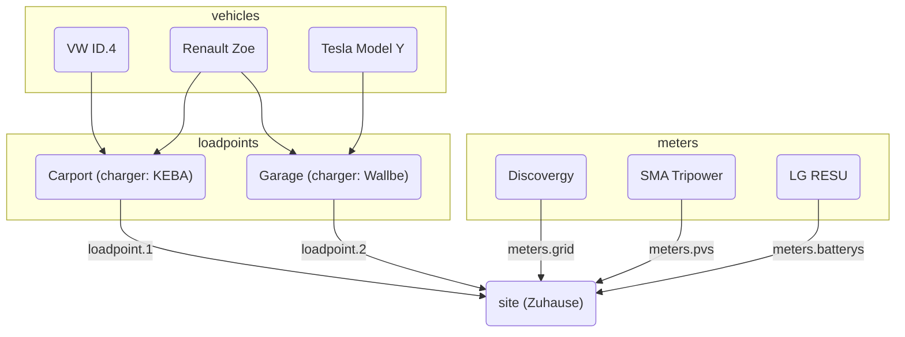

evcc peut être configuré de deux manières :

**1. Configuration via l’interface (recommandée)**

La configuration se fait dans l’interface web sous **Configuration**.
Les paramètres sont enregistrés automatiquement dans la base de données.
Pour plus d’informations, consultez [Configuration](/fr/installation/configuration).

**2. Configuration par fichier**

La configuration via le fichier `evcc.yaml` reste prise en charge.
Cette section documente la configuration basée sur YAML.

:::note[Utilisation en parallèle]
Les deux méthodes de configuration peuvent être utilisées en parallèle.
Les appareils (points de charge, compteurs, installations photovoltaïques, batteries domestiques, véhicules) sont fusionnés à partir des deux sources.
Pour les autres paramètres, la configuration via l’interface est prioritaire.
Vous trouverez les détails dans la [FAQ](/fr/faq#ui-migration).
:::

## Configuration par fichier (evcc.yaml)

Le fichier de configuration est écrit au format YAML et s’appelle par défaut `evcc.yaml`.
Il se trouve soit dans le même répertoire qu’evcc lui-même, soit dans `/etc/evcc.yaml` sur les systèmes POSIX (p. ex. Linux).

Un chemin différent peut être indiqué au démarrage : `evcc -c /path/to/evcc.yaml`

### Structure

Le fichier de configuration contient plusieurs sections.
Pour faire référence d’une section à l’autre, les appareils disposent d’un paramètre `name` qui les identifie.

Vous trouverez ici un fichier d’exemple avec de nombreux paramètres :
https://github.com/evcc-io/evcc/blob/master/evcc.dist.yaml

Voici une vue d’ensemble des relations entre les parties les plus importantes de la
configuration :

### Comment fonctionne evcc ? (coup d’œil sous le capot)

Pour que le système fonctionne, un compteur électrique est important. Il
permet de calculer à tout moment la puissance du surplus. Mesurer la
puissance produite est intéressant, mais n’a aucun effet sur le fonctionnement, à
[cette exception près](/fr/faq#configuration)

La puissance du surplus est comparée à la puissance minimale nécessaire pour charger. Si
elle suffit, la charge démarre.

La puissance minimale nécessaire pour charger est calculée à partir des valeurs `minCurrent`
et `phases`, définies pour chaque `loadpoint` (un groupe de chargeurs situés au même endroit).
Consultez [`loadpoints`](/fr/reference/configuration/loadpoints) pour plus
d’informations.

Par exemple : `phases: 1` et `minCurrent: 8`

1 (phases) × 8 A (minCurrent) × 230 V (tension du réseau) = 1 840 W (puissance minimale nécessaire pour charger)

#### Possibilités d’ajustement

Normalement, la puissance du surplus correspond à la puissance de charge disponible.
La puissance de charge disponible peut toutefois être ajustée individuellement à l’aide
des paramètres suivants :

- Site : `residualpower`
- Site : `prioritySoc`
- Site : `bufferSoc`
- Site : `aux`
- Point de charge : `enable: threshold`
- Point de charge : `disable: threshold`

Les réglages possibles sont décrits dans la documentation de chacun de ces
paramètres.

- [Paramètres de configuration du site](/fr/reference/configuration/site)
- [Paramètres de configuration des points de charge](/fr/reference/configuration/loadpoints)

### Site

Un [site](/fr/reference/configuration/site) décrit l’installation domestique et ses appareils,
et régule la puissance disponible.

### Point de charge

Un [point de charge](/fr/reference/configuration/loadpoints) décrit l’infrastructure de charge et réunit
les _chargeurs_, les _véhicules_ existants et tout ce dont un point de charge a besoin par ailleurs.

### Chargeurs

Les [chargeurs](/fr/reference/configuration/chargers) contiennent la liste des chargeurs et leurs propriétés, p. ex.
la manière de communiquer avec eux.

### Compteurs

Les [compteurs](/fr/reference/configuration/meters) sont une liste d’appareils qui mesurent différents flux de puissance. Ils
mesurent notamment :

- la puissance importée et exportée
- la puissance produite par l’installation photovoltaïque
- le courant de charge du véhicule électrique (si le chargeur ne le fournit pas lui-même)
- le flux de puissance de la ou des batteries domestiques

### Appareils de bridage

Les [appareils de bridage](/fr/reference/configuration/curtailers) sont des appareils qui limitent uniquement l’export de l’installation
photovoltaïque vers le réseau, à la demande du gestionnaire de réseau (§ 9 EEG), p. ex. le SMA Sunny Home Manager 2.0 ou l’onduleur
principal d’une installation comportant plusieurs onduleurs.

### Véhicules

Pour limiter le niveau de charge des véhicules électriques à une valeur donnée, vous pouvez indiquer
ici les [véhicules](/fr/reference/configuration/vehicles) existants et leurs données d’accès en ligne.

### HEMS

evcc peut transmettre les points de charge et leurs courants de charge à un autre
[système de gestion de l’énergie domestique (HEMS)](/fr/reference/configuration/hems) afin qu’il puisse utiliser ces
informations, p. ex. pour piloter la batterie domestique.

### Notifications

Dans cette section, vous pouvez définir les événements pour lesquels vous souhaitez être informé. De
nombreux systèmes différents sont pris en charge pour l’envoi des messages.

[Plus d’informations](/fr/reference/configuration/messaging)
