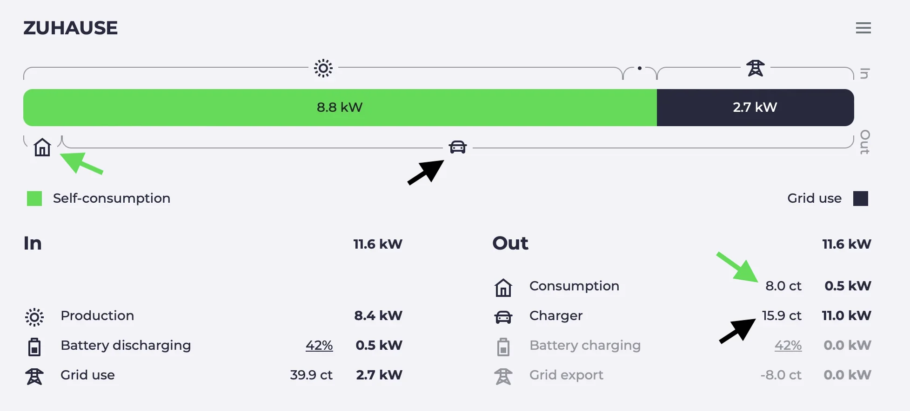

import Video from "@components/Video.astro";
import batterysettingsVideo from "../../../../../en/blog/2023/10/05/batterysettings.mp4";
import batterysettingsPoster from "../../../../../en/blog/2023/10/05/batterysettings.webp";
import chargingplanVideo from "../../../../../en/blog/2023/10/05/chargingplan.mp4";
import chargingplanPoster from "../../../../../en/blog/2023/10/05/chargingplan.webp";
import chargingsessionsVideo from "../../../../../en/blog/2023/10/05/chargingsessions.mp4";
import chargingsessionsPoster from "../../../../../en/blog/2023/10/05/chargingsessions.webp";
import dynamicpricesVideo from "../../../../../en/blog/2023/10/05/dynamicprices.mp4";
import dynamicpricesPoster from "../../../../../en/blog/2023/10/05/dynamicprices.webp";
import minsocVideo from "../../../../../en/blog/2023/10/05/minsoc.mp4";
import minsocPoster from "../../../../../en/blog/2023/10/05/minsoc.webp";
import sessionvaluesVideo from "../../../../../en/blog/2023/10/05/sessionvalues.mp4";
import sessionvaluesPoster from "../../../../../en/blog/2023/10/05/sessionvalues.webp";

Dall’ultimo articolo del blog sono successe tante cose. Abbiamo aggiunto molte nuove funzionalità e corretto alcuni bug. In questo articolo presentiamo alcune delle novità.

## Visualizzazione del pianificatore di ricarica \{#charging-planner-visualization\}

Il pianificatore di ricarica esiste in evcc già da un po’.
Indichi quando il tuo veicolo deve raggiungere il livello di carica desiderato ed evcc trova le fasce orarie migliori.
Da alcune release l’algoritmo non è più una scatola nera, perché visualizziamo il risultato della pianificazione.

<Video src={chargingplanVideo} poster={chargingplanPoster} />

{/* excerpt */}

Come funziona l’algoritmo?

1. L’energia solare in surplus ha la priorità
2. Fasce orarie con energia di rete economica (se è presente una [tariffa dinamica](/it/features/dynamic-prices))
3. Fasce orarie con energia di rete pulita (se è configurata un’[integrazione CO₂](/it/features/co2))
4. Fasce orarie poco prima della partenza

**Prospettive:** al momento stiamo sperimentando con i dati di previsione solare di [Solcast](https://solcast.com/).
Questo permette all’algoritmo di prendere decisioni ancora migliori.
Ad es., se l’orario di partenza cade di giorno, può avere senso non caricare completamente il veicolo con l’energia notturna economica, ma lasciare spazio per il surplus durante il giorno.

## Ricarica minima regolabile dall’interfaccia

La funzione di ricarica minima esiste in evcc da tantissimo tempo.
È utile se torni a casa con la batteria quasi scarica e vuoi essere sicuro di avere sempre abbastanza autonomia per un imprevisto.

Finora si poteva impostare solo tramite il file di configurazione o tramite API.
Ora puoi farlo anche dall’interfaccia in **Piano** → **Arrivo** → **Carica min. %**.

Le impostazioni vengono salvate per ogni veicolo e restano anche dopo un riavvio o un aggiornamento.

<Video src={minsocVideo} poster={minsocPoster} />

## Ricarica intelligente con la rete \{#smart-grid-charging\}

Se il surplus solare non basta, puoi usare anche l’energia di rete nei momenti in cui è particolarmente economica o pulita.
Se fai clic sul prezzo dell’energia di rete o sulle emissioni di CO₂ nel diagramma del flusso di energia, si apre la finestra di dialogo **Ricarica intelligente con la rete**.

Lì puoi impostare una soglia per il prezzo o per le emissioni di CO₂.
Se il prezzo o le emissioni scendono sotto questo valore, evcc mette temporaneamente in ricarica veloce tutti i punti di ricarica in modalità solare.

<Video src={dynamicpricesVideo} poster={dynamicpricesPoster} />

Il prerequisito per questa funzione è aver configurato una tariffa dinamica o un’integrazione CO₂.

Un altro piccolo miglioramento è che con la maggior parte delle tariffe dinamiche ora puoi correggere i prezzi forniti dall’API con **maggiorazioni percentuali o fisse** (`charges` / `tax`).
Tibber e Octopus Energy (UK) forniscono già valori comprensivi di maggiorazioni.
Con awattar, Nordpool Estonia ed Energinet ora puoi aggiungerle.

A proposito: se hai una tariffa dinamica che non è ancora supportata ma offre un’API, apri una issue su GitHub.

## Impostazioni della batteria \{#battery-settings\}

Un enorme vantaggio di evcc rispetto ad altre soluzioni di ricarica con surplus è l’integrazione con la batteria domestica.
Con il valore di configurazione [`prioritySoc`](/it/features/battery) puoi stabilire se il surplus solare debba essere **caricato prima nella batteria domestica o nel veicolo**.

In generale evcc cerca di impedire che in modalità solare la batteria domestica venga scaricata nella batteria del veicolo, per evitare inutili perdite di conversione.
Con il valore [`bufferSoc`](/it/features/battery) puoi però **dedicare consapevolmente una parte della batteria domestica al supporto della ricarica**.

Puoi anche fare in modo che la ricarica parta automaticamente non appena la batteria raggiunge un determinato livello di carica ([`bufferStartSoc`](/it/features/battery)).
La ricarica automatica parte anche se il sole non splende.

<Video src={batterysettingsVideo} poster={batterysettingsPoster} />

## Quota solare, prezzo e CO₂ per sessione di ricarica

Abbiamo qualcosa anche per chi ama l’analisi dei dati.
Ora registriamo per ogni sessione di ricarica la quota di energia solare autoprodotta (in %), il prezzo (totale e per kWh), la durata della ricarica e le emissioni medie di CO₂.
Puoi passare da un valore all’altro direttamente nella sessione di ricarica.

<Video src={sessionvaluesVideo} poster={sessionvaluesPoster} />

## Nuovo calcolo della quota solare

Se hai notato che la quota di energia solare è leggermente diminuita con una delle ultime versioni, il motivo è il nostro nuovo calcolo.
Finora evcc ha sempre ripartito in modo uniforme il mix di energia di rete ed energia autoprodotta tra il consumo della casa e le sessioni di ricarica.

Ora siamo passati a un nuovo modello in cui il consumo della casa riceve per primo l’energia verde e il mix restante va alle sessioni di ricarica.
Grazie a [@MarkusGH](https://github.com/MarkusGH) per l’implementazione.
Trovi maggiori dettagli sul modello [nella documentazione](/it/faq#savings-calculation).

## Panoramica delle sessioni di ricarica

I nuovi valori sono naturalmente arrivati anche nella panoramica delle sessioni di ricarica.
A seconda della configurazione, qui ora si vedono anche i prezzi e le emissioni di CO₂.
Inoltre abbiamo completamente ridisegnato la visualizzazione e scelto una **tabella compatta su base mensile**.
La tabella si può **filtrare per punto di ricarica e veicolo**.

Se ti serve ancora più flessibilità, puoi naturalmente usare anche l’esportazione CSV oppure ottenere i dati grezzi direttamente tramite InfluxDB o MQTT.

<Video src={chargingsessionsVideo} poster={chargingsessionsPoster} />

## Priorità di punti di ricarica e veicoli

Se hai più punti di ricarica, con l’impostazione [`priority`](/it/reference/configuration/loadpoints#priority) puoi stabilire quale deve essere preferito.
Puoi anche far dipendere la priorità dal veicolo riconosciuto o controllarla tramite API.
Al momento non è possibile configurarla dall’interfaccia.

La funzione di priorità è utile anche se usi evcc per controllare altri consumatori, ad es. [una resistenza elettrica o una pompa di calore collegata tramite l’interfaccia dei plugin](https://github.com/evcc-io/evcc/pull/9393).
In questo modo puoi controllarli affinché funzionino solo quando l’auto non è in carica (o non abbastanza).

## Cosa ci aspetta?

Il nostro [backlog](https://github.com/evcc-io/evcc/issues?q=is%3Aopen+is%3Aissue+label%3Abacklog) è ben pieno.
Questi sono i prossimi grandi temi che vogliamo affrontare:

**Interfaccia di configurazione:** ora tutti i prerequisiti sono soddisfatti.
Al momento i veicoli si possono già creare in modalità 🧪 sperimentale e manca poco anche per configurare rete, impianto fotovoltaico o batteria.
C’è ancora molto da fare, ma la luce in fondo al tunnel si vede.

**Pianificazione migliore:** come accennato sopra, stiamo lavorando per integrare buone **previsioni solari** nell’algoritmo di pianificazione e nell’interfaccia.
Abbiamo anche un’idea per supportare **più piani di ricarica**.

**Revisione delle modalità:** evcc è nato come applicazione per la ricarica con surplus solare.
Nel frattempo anche l’interazione con la batteria domestica ha assunto un ruolo importante.
Sta acquistando importanza anche la **ricarica rispettosa della rete** basata su tariffe dinamiche o emissioni di CO₂.
Per questo rivedremo le nostre modalità di ricarica (attualmente PV e Min+PV) e creeremo più flessibilità.

## Altre novità

Questa è stata una panoramica generale, dal punto di vista dell’utente finale.
Naturalmente c’è anche molto lavoro dietro le quinte.

- 🔌 Supporto per altri caricabatterie di 22 nuovi produttori
- 🌞🔋📟 Supporto per contatori, impianti fotovoltaici e sistemi di batterie di 36 nuovi produttori
- 🇬🇧 Sito web e documentazione in lingua inglese. Grazie a [duckfullstop](https://github.com/duckfullstop) e [carygravel](https://github.com/carygravel) 💚

Se vuoi ancora più dettagli, puoi consultare le [note di rilascio](https://github.com/evcc-io/evcc/releases) delle ultime 49(!) release dall’inizio dell’anno.

**Grazie per il tuo supporto a evcc!** 
Il team principale di evcc 
[@andig](https://github.com/andig), [@premultiply](https://github.com/premultiply) e [@naltatis](https://github.com/naltatis)
