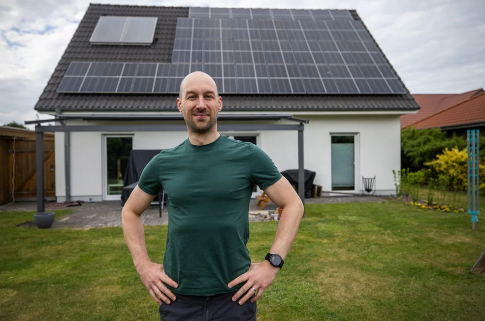
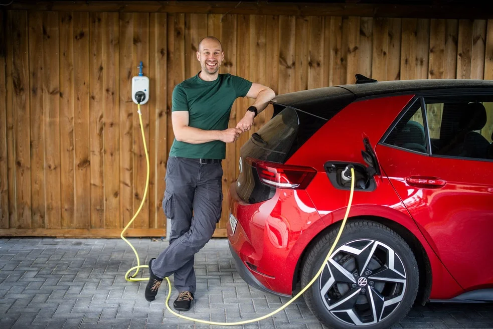
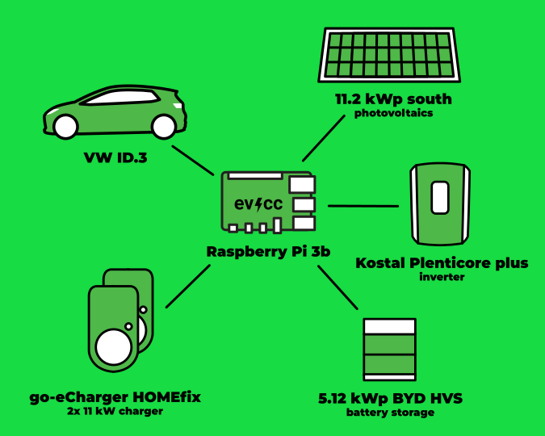
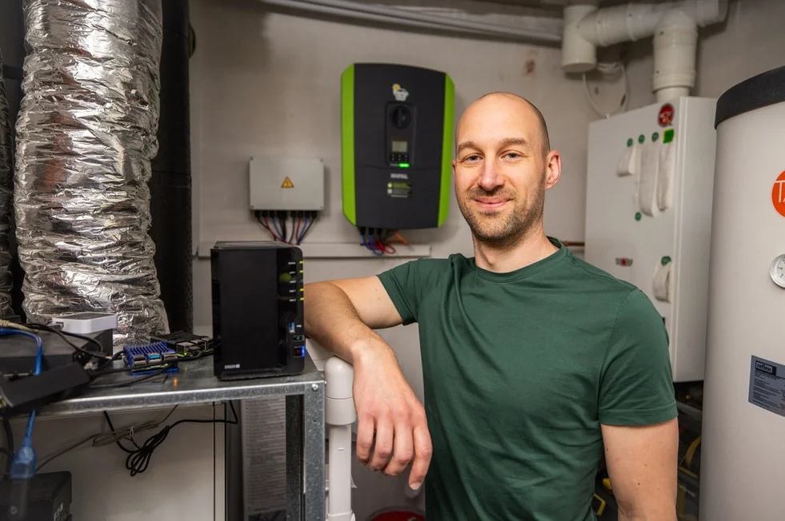
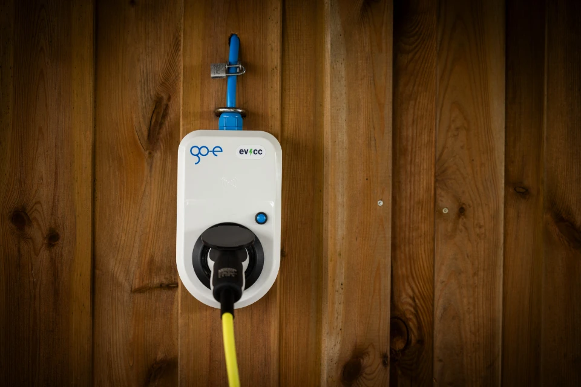

Qualche settimana fa ci ha contattato [Detlef Heese](https://hee.se) di Osnabrück.
È un fotografo affermato, guida un’auto elettrica e ha un impianto fotovoltaico.
Si è offerto di sostenere il progetto evcc e di fornirci foto professionali.
Per questo, alla fine dell’anno scorso, abbiamo lanciato un [appello su GitHub](https://github.com/evcc-io/evcc/discussions/10285) per trovare utenti interessati a presentare sé stessi e il proprio setup evcc in un ritratto della community.
Questo articolo del blog è il primo ritratto di questa serie.

{/* excerpt */}

## La strada verso la mobilità elettrica

**Michael:** Ciao Arne, grazie per aver trovato il tempo per questa intervista.
Ci racconti un po’ di te e di come sei arrivato alla mobilità elettrica?

**Arne:** Ciao Michael, sono Arne e vivo nella piccola città di Gifhorn.
Ci abito con mia moglie e i nostri due figli in una casa unifamiliare.
Grazie agli incentivi tedeschi del 2021 per i caricabatterie abbiamo iniziato a interessarci alla mobilità elettrica.
All’epoca abbiamo fatto installare due caricabatterie in modo economico e con un po’ di fai da te.
Fedeli al motto: “Meglio abbondare che scarseggiare!”
Ancora prima dell’installazione dei caricabatterie avevamo già deciso di sostituire una delle nostre due auto a combustione con un’auto elettrica.
Di sicuro anche la possibilità di ottenere incentivi ha avuto un ruolo importante.

Poco dopo abbiamo ordinato una ID.3 Pure, consegnata nello stesso anno.
E mentre aspettavamo la ID.3 abbiamo completato il pacchetto ordinando anche un impianto fotovoltaico da 11,2 kWp, installato poi all’inizio del 2022.
L’anno scorso abbiamo aggiunto all’impianto fotovoltaico una piccola batteria BYD, acquistata soprattutto per il consumo domestico e usata solo in parte per caricare l’auto elettrica.

**Michael:** Sembra un ottimo setup.
Come sei arrivato a evcc e alla ricarica con il surplus solare?

**Arne:** Già prima dell’installazione dell’impianto fotovoltaico sapevamo di volere un modo per caricare il più possibile con l’elettricità del nostro tetto.
All’inizio avevo pensato di scrivermi un piccolo script per avviare la ricarica quando c’è abbastanza surplus.
Dopo un po’ di ricerche ho scoperto che esiste già qualcosa del genere: evcc.

## Approfondimenti tecnici

**Michael:** Ci dai qualche dettaglio tecnico sul tuo setup?

**Arne:** Certo, ecco i dettagli tecnici più importanti:

| Componente                | Dettagli                                                                                                        |
| ------------------------- | --------------------------------------------------------------------------------------------------------------- |
| **Auto**                  | VW ID.3 Pure                                                                                                    |
| **Caricabatterie**        | 2 × go-eCharger HOMEfix 11 kW                                                                                   |
| **Inverter**              | Kostal Plenticore plus 10 Kostal Smart Energy Meter                                                         |
| **Moduli solari**         | 28 × Trina Vertex S 400 Wp (totale 11,2 kWp) orientamento a sud quasi perfetto su un tetto inclinato di 45° |
| **Batteria**              | BYD HVS 5.1 (5,12 kWh)                                                                                          |
| **Gestione dell’energia** | evcc su un Raspberry Pi 3b                                                                                      |

Gestisco anche un’istanza ioBroker, che però non è coinvolta nel controllo della ricarica.

## Cosa ti piace di evcc?

**Michael:** Sembra un setup ben riuscito. Perché hai deciso di usare evcc e cosa ti piace del progetto?

**Arne:** Non mi aspettavo che con evcc potessimo davvero aumentare così tanto la nostra autosufficienza.
Al momento abbiamo un tasso di autosufficienza di oltre l’80% (a inizio agosto).
evcc si adatta perfettamente alla nostra situazione: lavoriamo in parte da casa e in famiglia abbiamo un’altra auto, usata soprattutto per brevi tragitti.
Durante il giorno possiamo lasciare l’auto elettrica a casa, così può caricarsi con l’energia solare.
L’auto è semplicemente sempre collegata al caricabatterie di casa e, grazie al rilevamento automatico, evcc avvia la ricarica non appena c’è abbastanza surplus.
Così l’auto è sempre carica e pronta all’uso.
Nella vita di tutti i giorni non dobbiamo quasi mai preoccuparci del livello di carica.
Grazie alla funzione di ricarica minima, anche nei mesi invernali c’è sempre abbastanza energia per gli spostamenti quotidiani.
Non potrebbe essere più semplice e pratico.
Di sicuro questo ha reso più facile anche per mia moglie il passaggio alla mobilità elettrica.

**Michael:** Sembra davvero fantastico! Grazie per aver condiviso con noi le tue esperienze.

---

Grazie anche a Detlef per le foto bellissime. Non vediamo l’ora di condividere altre storie della nostra community nei prossimi articoli del blog.

Se ti interessa presentare il tuo setup evcc in un ritratto della community, lascia pure i tuoi dati [qui nel modulo](https://airtable.com/appDI3xIiev1DOpMY/shrW1zGH26KElfZOK).
Soprattutto se non vivi in Germania o nelle vicinanze.
