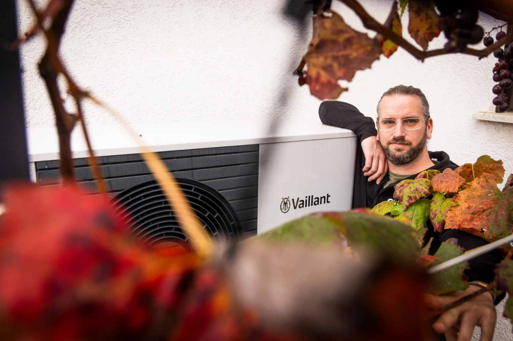
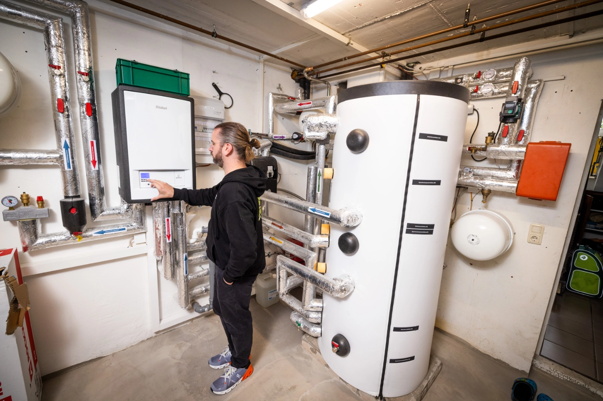
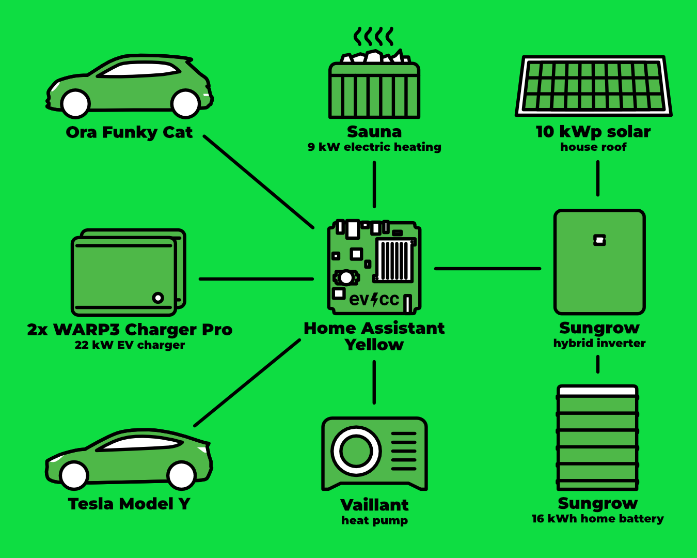
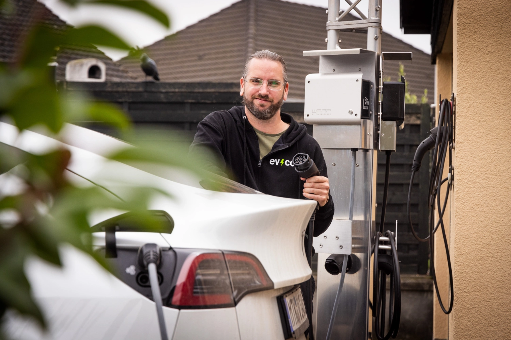
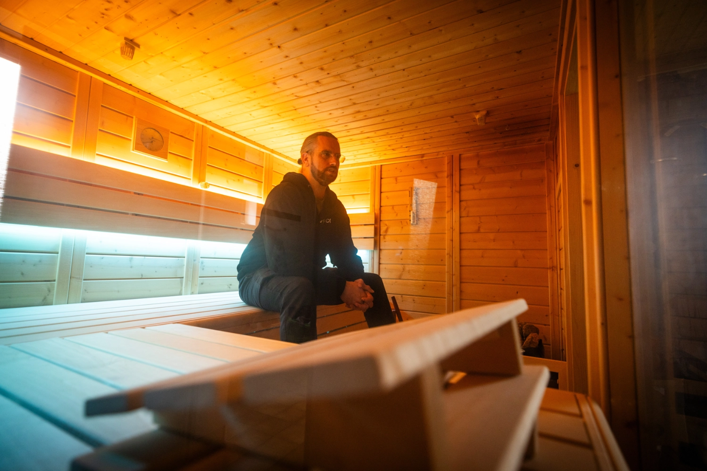

Tobias ha trasformato passo dopo passo la sua casa a Trebur, nell’Assia meridionale, da un’abitazione con riscaldamento a gas in una smart home in gran parte autosufficiente dal punto di vista energetico.
Il fotografo [Detlef](https://hee.se) è andato a trovarlo e ha scattato le foto.

{/* excerpt */}

## Autosufficienza energetica invece del riscaldamento a gas

**Michael:** Ciao Tobias, bello che tu abbia trovato il tempo di mostrarci la tua casa e il tuo setup tecnico.
Ti va di presentarti brevemente?

**Tobias:** Ciao Michael, con piacere.
Allora, mi chiamo Tobias e ho 41 anni.
Come alcuni dei protagonisti dei ritratti precedenti, ho una formazione in informatica e sono un appassionato smanettone quando si tratta di efficienza energetica e smart home.
Io e la mia famiglia abbiamo ereditato una casa unifamiliare qualche anno fa e, da quando ci siamo trasferiti più di 10 anni fa, stiamo migliorando tutto un po’ alla volta.
Abbiamo sempre cercato modi per ridurre i costi delle utenze.
In pratica è stata una trasformazione graduale da un’abitazione con riscaldamento a gas a una smart home in gran parte autosufficiente dal punto di vista energetico.

**Michael:** Ok, sembra un sacco di lavoro, ma alla fine si ottengono soluzioni su misura che si adattano perfettamente alle proprie abitudini ed esigenze abitative.
Ti è rimasto tempo anche per occuparti di altro?

**Tobias:** Certo!
Una delle sfide più grandi è stata sostituire il riscaldamento a gas con una pompa di calore.
Per l’intero impianto abbiamo incaricato un’impresa che opera a livello nazionale.
Purtroppo l’installazione è stata caotica: i tre giorni previsti sono diventati una settimana, si erano dimenticati l’allacciamento elettrico e poi sono emersi vari problemi tecnici, dai collegamenti sbagliati del serbatoio di accumulo a una pompa di circolazione sovradimensionata.
Dopo diverse correzioni, ricerche fatte da noi e il fallimento dell’impresa, gli ultimi aggiustamenti abbiamo dovuto farli da soli.
Oggi la pompa di calore funziona in modo stabile ed efficiente con l’elettricità rinnovabile del nostro tetto: il percorso è stato accidentato, ma ne è valsa la pena.

## Dall’ibrido al completamente elettrico

**Michael:** Sembra una vera prova di pazienza.
Ma meno male che alla fine funziona tutto.
Come sei arrivato alla mobilità elettrica?

**Tobias:** Qualche anno fa abbiamo preso un ibrido plug-in, una VW Passat.
L’impianto fotovoltaico è arrivato un po’ più tardi.
L’obiettivo allora era raggiungere circa 10 kWp di potenza senza dover rinunciare all’impianto solare termico.

All’inizio l’installazione dell’impianto fotovoltaico è stata un po’ un rompicapo, perché il fornitore aveva consegnato due moduli in più e abbiamo dovuto capire come installare anche quelli.
Beh, se c’erano già, volevamo anche usarli.
Dopo l’impianto fotovoltaico è arrivata la prima vera auto elettrica, una Tesla Model Y, e poco dopo la seconda, una Ora Funky Cat.
All’inizio avevamo un caricabatterie KEBA P-30.
Non funzionava molto bene e l’abbiamo sostituito con un WARP Charger 2 Pro.
Con l’arrivo della seconda auto elettrica abbiamo installato un secondo caricabatterie.
Per sfruttare al meglio il surplus solare abbiamo aggiunto il WARP Energy Manager, che permette la commutazione monofase/trifase.
Nel frattempo abbiamo aggiornato entrambi i caricabatterie a WARP Charger 3 con commutazione di fase integrata, per semplificare il sistema.

## Gestione del carico invece di un aumento di potenza

**Michael:** Ci stai già arrivando: dove e perché usi evcc?

**Tobias:** Esatto, ora entriamo nei dettagli.
All’inizio usavo evcc come container Docker su un cluster Proxmox.
Col tempo mi sono dedicato sempre di più a Home Assistant e ora uso solo un Home Assistant Yellow con PoE, CM4 con 8 GB di RAM e un SSD da 1 TB, per risparmiare corrente anche qui.
Usavo evcc come add-on in Home Assistant.

**Michael:** Com’è il tuo setup?

**Tobias:** Il nostro sistema al momento è composto da un impianto fotovoltaico da 10,1 kWp (27x Heckert Solar NeMo), una batteria Sungrow da 16 kWh, 2 WARP Charger 3 Pro, una pompa di calore Vaillant (Arotherm plus) e una sauna (9 kW).
Bilanciare i diversi consumatori, accumuli e produttori ha richiesto un po’ di messa a punto, ma in qualche modo è divertente.

Al momento nel nostro quadro elettrico di casa abbiamo una misura diretta del consumo di elettricità.
Questo significa che il contatore può sopportare in modo continuativo al massimo 44 A (30,4 kW).
Quindi abbiamo dovuto decidere: o fare un aumento di potenza con una misura indiretta tramite trasformatori di corrente, o gestire il tutto con una gestione dinamica del carico.
Per motivi di costo abbiamo scelto per ora la gestione dinamica del carico.

La potenza della sauna non la misuriamo attivamente, quindi in evcc lavoriamo con due circuiti.
Il circuito (Principale) ha un limite di corrente di 44 A e il circuito (Vialetto) un massimo di 32 A.
Entrambi i caricabatterie si dividono i 32 A del circuito (Vialetto), quindi in teoria un caricabatterie potrebbe sempre caricare a 22 kW, anche se oggi quasi nessun veicolo lo supporta.
La sauna e la pompa di calore le assegniamo al circuito (Principale).
Hanno sempre la priorità sui due caricabatterie.
Così l’allacciamento principale non viene mai caricato con più di 44 A.
Se la sauna e la pompa di calore girassero a pieno regime mentre cuociamo i biscotti, evcc ridurrebbe temporaneamente la potenza di carica delle nostre auto.

| Componente                | Dettagli                                                           |
| ------------------------- | ------------------------------------------------------------------ |
| **Impianto fotovoltaico** | 10,1 kWp (27x Heckert Solar NeMo 3.0 120M)                         |
| **Inverter**              | Sungrow SH10.0RT Hybrid                                            |
| **Batteria**              | Sungrow SBR 16 kWh                                                 |
| **Caricabatterie**        | 2x WARP Charger 3 Pro                                              |
| **Veicoli**               | Tesla Model Y, Ora Funky Cat                                       |
| **Pompa di calore**       | Vaillant Arotherm plus vwl 125/6                                   |
| **Sauna**                 | Stufa elettrica da 9 kW                                            |
| **Controllo**             | evcc come add-on di Home Assistant (Home Assistant Yellow con PoE) |

## Da PV Magazine a evcc

**Michael:** Bene, quindi gestisci due caricabatterie, una sauna e i soliti consumatori domestici.
Come sei arrivato a evcc?

**Tobias:** Grazie a un articolo su PV Magazine nel 2022.
A quel punto sapevamo già che avremmo installato un impianto fotovoltaico e volevamo sfruttare il surplus nel modo più efficiente possibile.
Allora c’erano solo soluzioni molto costose o soluzioni che funzionavano bene solo all’interno dell’ecosistema del produttore.

**Michael:** Sì, è stato anche uno dei motivi per cui trovo il progetto così bello: la ricarica con il surplus.
Quali altre funzioni usi, o è proprio quello il caso d’uso principale?

**Tobias:** Beh, fino all’anno scorso avevamo anche Tibber, quindi evcc gestiva la ricarica economica delle auto.
Con l’installazione della pompa di calore e le sfide in arrivo, siamo tornati a una tariffa elettrica fissa più economica e ci serviva la gestione del carico.
Lì evcc ha potuto dare il meglio di sé.
Quindi lo usiamo per controllare i caricabatterie, integrare i veicoli e per la gestione del carico.
Il controllo della pompa di calore l’ho configurato, ma al momento non lo uso, perché con l’impianto solare termico non ha senso.

## Desideri per il futuro

**Michael:** Cosa ti piacerebbe da evcc?
In quale ambito dovremmo investire più energia?

**Tobias:** Mi piacerebbe un’integrazione diretta della pompa di calore Vaillant tramite EEBUS o EBUS.
Credo che lì ci sia ancora del potenziale.
Nel complesso posso dire che abbiamo imparato molto e ottenuto molto.
Sono davvero orgoglioso di ciò che abbiamo realizzato: la casa ha un riscaldamento efficiente (e più sostenibile), l’impianto fotovoltaico produce di giorno quello che ci serve e, insieme al serbatoio di accumulo, ci dà un alto grado di indipendenza.

**Michael:** Grazie, è una bella conclusione.
E grazie mille per averci mostrato come funziona da te.
Sono sicuro che questo ispirerà qualcuno a fare modifiche al proprio setup.

---

**Com’è il tuo setup con evcc?**
Se ti va di raccontare le tue esperienze, il tuo percorso e il tuo impianto in un ritratto della community, compila pure [questo modulo](https://airtable.com/appDI3xIiev1DOpMY/shrW1zGH26KElfZOK).
Cerchiamo in particolare ritratti di installazioni straordinarie o di utenti fuori dalla Germania.
