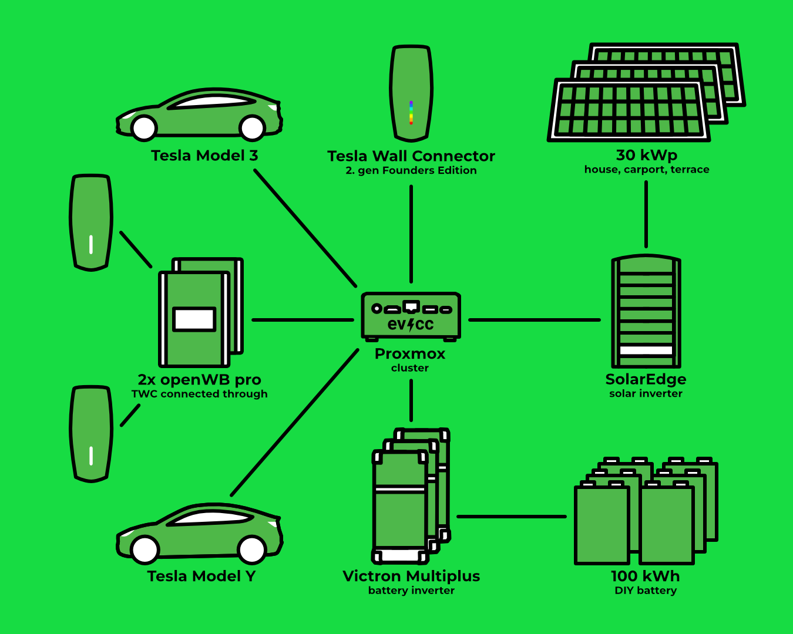

Jörg scrive di smart home, fotovoltaico ed elettromobilità su [meintechblog.de](https://meintechblog.de) dal 2011 e trasmette regolarmente in diretta su YouTube con il [PV-Quartett](https://www.youtube.com/@MeintechblogDe/streams), un gruppo di appassionati del mondo dell’energia che ha fondato lui stesso.
Nella sua casa di Schwäbisch Hall convivono una batteria fai da te da 100 kWh, la vendita diretta della sua energia solare e tre caricabatterie, collegati tramite MQTT, [Loxone](https://www.loxone.com) ed evcc.
Il fotografo [Detlef](https://hee.se) è andato a trovarlo.

{/* excerpt */}

## Un hobby con 16.000 iscritti

**Michael:** Ciao Jörg, grazie per il tuo tempo.
Scrivi sul blog dal 2011 e oggi gestisci un [canale YouTube](https://www.youtube.com/@MeintechblogDe) con oltre 16.000 iscritti.
È ancora un hobby o già un lavoro?

**Jörg:** Ho pensato qualche volta di farlo diventare una professione.
Ma è e resterà un hobby.
Così posso scrivere di ciò che mi va e non devo accettare sponsorizzazioni per arrivare a fine mese.
Ho rispedito indietro dispositivi demo perché non valevano niente.
Piuttosto che scrivere che qualcosa è scadente, preferisco non scriverne affatto.
I guadagni dei link affiliati li reinvesto in tecnologia, e poi ci scrivo sopra.
Un circolo chiuso.

**Michael:** Che cosa ti dà il blog?

**Jörg:** Lo scambio con i lettori.
Alcuni articoli hanno più di 200 commenti, e da lì mi arrivano continuamente nuove idee.
Il blog è diventato un punto di incontro.
Le persone mi contattano, finiamo in gruppi WhatsApp o nel PV-Quartett, e tra loro ci sono veri nerd che hanno scavato dieci volte più a fondo di me.
Quei contatti altrimenti non sarebbero mai nati.

**Michael:** Su YouTube ormai preferisci le dirette ai video montati.
Perché?

**Jörg:** In realtà non ho mai voluto fare YouTube.
Ma molte persone mi scrivevano che era più accessibile, quindi ci ho provato.
Il montaggio mi costa molto tempo, per questo adesso faccio spesso dirette.
Lì sei costretto a concentrarti e puoi rispondere subito alle domande.
Il canale è abbastanza grande da non avere due spettatori ma 20 o 100, e alcuni di loro approfondiscono davvero.
Non sottovalutare YouTube, molte persone non guardano più la TV.

## Una protezione dal sole che produce energia

**Michael:** Il tuo impianto fotovoltaico è cresciuto negli anni: tetto della casa, carport e da ultimo la tettoia della terrazza con moduli semitrasparenti.
Rifaresti la tettoia della terrazza allo stesso modo?

**Jörg:** Assolutamente, lo rifarei subito.
È soprattutto una protezione dal sole, in particolare d’estate.
I moduli sono trasparenti al 40%, quindi passa abbastanza luce, e nemmeno d’inverno la casa è troppo buia.
E ogni volta che guardo l’app sono contento di vedere quanto rendono.
Hanno un’inclinazione del 10% verso sud e la resa è fantastica.
Tutti i dettagli importanti, compresa la costruzione, sono [sul mio blog](https://meintechblog.de/2021/05/10/operation-solar-terrassenueberdachung-anlagenerweiterung-um-48-kwp/).

**Michael:** Quindi chi copre comunque una terrazza dovrebbe pensare subito al fotovoltaico?

**Jörg:** Se ci sono le condizioni, sì.
Dopo il progetto del carport avevo già portato per precauzione il mio inverter SolarEdge a 30 kW, così ho potuto semplicemente agganciare la tettoia della terrazza a una stringa esistente.
Nessun hardware nuovo, quindi si è ripagata in fretta.
Bisogna solo verificare che la stringa sia compatibile con l’inverter.

**Michael:** Nelle foto stai pulendo i moduli sopra il balcone.
Quanto segui da vicino ciò che rendono i singoli moduli?

**Jörg:** Ogni ottimizzatore di potenza fornisce i suoi dati.
Un piccolo programma recupera ogni quarto d’ora i valori dei moduli dal portale SolarEdge e li salva in InfluxDB, così posso fare analisi a livello di modulo.
Ogni tanto controllo per curiosità se tutti i moduli sono ancora ugualmente performanti e quale sia il più debole.
Così tiro fuori un po’ di più dall’impianto.

**Michael:** Hai altri progetti per l’impianto?

**Jörg:** I moduli sopra il balcone sono motorizzati e si possono inclinare.
L’anno prossimo voglio ottimizzare ancora la logica, in modo che seguano perfettamente il sole.
Non porta tanta resa in più, ma non so resistere alle trovate semplicemente belle.

## 108 celle nel locale tecnico

**Michael:** Veniamo al tuo setup.
La parte più evidente è la batteria: [100 kWh, autocostruita](https://meintechblog.de/2023/01/21/operation-hausspeicher-100kwh-mit-neuem-18s-batteriepackdesign/).
Come è nata?

**Jörg:** È stato il progetto più folle e intenso che abbia fatto finora.
Avrò passato un anno a documentarmi, e quello che vedi oggi è già la terza versione.
Sono 108 celle in sei pacchi, e stanno nel locale tecnico al centimetro.
Oggi armadi di questo tipo si possono comprare già pronti in metallo.
Se avessi lo spazio, oggi prenderei quelli, si risparmia molto lavoro e il risultato è più professionale.

**Michael:** Perché non comprare semplicemente una batteria già pronta?

**Jörg:** Il bello dell’autocostruzione è che posso impostare ogni parametro come voglio.
Ogni secondo ricevo dal BMS lo stato di tutte le 108 celle, e non solo posso analizzarlo, ma anche seguirlo in diretta e regolare al volo i parametri rilevanti.
Faccio regolarmente test di carica e scarica per misurare capacità, efficienza e degrado.
Non è un impianto di prova, è in uso reale giorno e notte.
Dati così non li trovi da nessun’altra parte.

Con una batteria commerciale di solito da fuori vedi solo un LED: in carica o in scarica, nient’altro.
Un mio amico ha un dispositivo del genere, che deve essere sempre collegato al cloud del produttore.
Se cade internet, dopo pochi minuti la batteria si scollega dalla rete ed è semplicemente spenta.
A un certo punto il fornitore l’ha limitata da remoto, e ormai si è guastata del tutto.
Non c’è ancora una data per la sostituzione, ma lui riceve un indennizzo mensile perché l’apparecchio non funziona.

Non voglio una cosa del genere in casa senza sapere cosa succede all’interno.
Detto senza mezzi termini, qualcuno potrebbe entrare dall’esterno e dire alla batteria: non caricare le celle a 4,2 V ma a 4,5 V.
Quella tensione di fine carica è il limite al quale una cella è piena, e chi lo supera rischia che la cosa vada in fumo.
A seconda della chimica delle celle è un rischio molto concreto.
No, grazie.
Per questo voglio vedere a livello di cella cosa succede, come invecchiano le celle e come evolve il degrado.

Presto voglio tornare a scrivere sul blog di queste scoperte, il materiale c’è.
Quasi nessuno replicherà la batteria esattamente così e monitorerà tutto.
Ma in molti possono trarre vantaggio dall’esperienza.
Ho anche fatto tantissimi errori, e li condivido sempre apertamente, così gli altri non devono ripeterli.

## Due Wall Connector sono solo una facciata

**Michael:** Come ricarichi le tue due Tesla?

**Jörg:** Con due [openWB Pro](https://openwb.de).
Tra ogni openWB e l’auto c’è un Tesla Wall Connector collegato in passante, che non ricarica nulla da solo.
Serve per l’estetica e fornisce il pulsante sul cavo di ricarica che apre la porta di ricarica.
Per farlo funzionare con la openWB [ho dovuto smanettare](https://meintechblog.de/2023/11/03/so-habe-ich-meine-openwb-pro-per-charge-port-opener-gepimpt/): un convertitore step-down sull’alimentatore della openWB alimenta il meccanismo che apre la porta di ricarica, integrato nella spina.
Ci ho armeggiato parecchio prima che funzionasse.

**Michael:** Nel diagramma c’è un terzo caricabatterie.

**Jörg:** Un altro Wall Connector Gen 2 per gli ospiti, Founders Edition con la firma di Elon. (ride)
È collegato tramite [TWCManager](https://github.com/dracoventions/TWCManager).
La mia web app “Wallbox-Master” lo presenta in rete come una openWB Pro, così evcc lo integra senza problemi.
Anche in questo monterò una mia striscia [WLED](https://kno.wled.ge/), come negli altri due “finti Wall Connector”, dove [visualizza la sessione di ricarica](https://meintechblog.de/2024/02/20/pimp-my-wallbox-kurzer-nerd-einblick-in-meine-wled-ladevisualisierung/).

## Tutto via cavo, niente nel cloud

**Michael:** Da te girano in parallelo Loxone, [Node-RED](https://nodered.org), [Home Assistant](https://www.home-assistant.io), le tue web app ed evcc.
Che ruolo ha ciascuno?

**Jörg:** Loxone è il cervello da nove anni, lì converge tutto.
Riceve continuamente aggiornamenti, non ho mai avuto problemi, e mia moglie si orienta nell’app come in un negozio online.
Ma le estensioni per KNX, DMX e RS485 sono carissime, e il Miniserver supporta MQTT solo a metà.
Per questo ora punto tutto su MQTT.
Un gateway KNX traduce direttamente in MQTT, e per tutto ciò che non ha un’interfaccia adatta scrivo un mio software che alla fine parla MQTT.
Così ho un unico broker per tutto e per ogni progetto posso dire: voglio combinare questi valori.

**Michael:** E Home Assistant?

**Jörg:** Su quello sono combattuto.
Esiste un plugin per ogni dispositivo, ma ogni installazione divorava RAM in modo assurdo.
Oggi faccio scrivere l’integrazione direttamente al mio LLM.
Guarda come lo fa Home Assistant e la costruisce come la voglio io.
Ho sempre voluto farlo da solo, ma non ho mai avuto il tempo.
Adesso dici “vai”, e dieci minuti dopo funziona.
Però devi dirgli esattamente cosa vuoi e capire tu stesso il framework.

**Michael:** C’è un motto dietro a tutto questo?

**Jörg:** Tutto via cavo, niente wireless e possibilmente niente cloud.
Lo stesso vale per l’IA: sul mio Mac mini gira un modello locale.
I dati sensibili non vanno subito nel cloud, prima li guarda il modello locale, li anonimizza e poi li passa avanti.
Per lo sviluppo è troppo debole, quindi i due lavorano insieme.

## Uno zoo di esperti IA

**Michael:** Punti tutto sull’IA, ti fai scrivere integrazioni e analizzare dati.
Come fai a non perdere il filo?

**Jörg:** Ho un agente per ogni ambito che ne è l’esperto, ciascuno nella propria sessione.
Un piccolo zoo di esperti in casa che conosce i miei concetti e le mie idee.
Avevo provato anche OpenClaw, ma consumava token in modo assurdo, quindi l’ho abbandonato del tutto.
Ora sto costruendo il tutto lentamente e in modo strutturato, così che non cambino troppe cose insieme e io possa ripercorrere e annullare tutto.
E nessun agente può fare qualcosa di irreversibile senza chiedermelo.
L’ho imparato a mie spese, quindi ora sto particolarmente attento e non mi fido più ciecamente dell’IA.
Presto ne parlerò su meintechblog.de, compresi i miei fallimenti.

**Michael:** Per cosa usi gli agenti nella vita di tutti i giorni?

**Jörg:** Per i miei dati, ad esempio.
Da qualcosa come 30 anni scansiono ogni fattura e tutto ciò che arriva per posta, e il mio archivio email risale più o meno allo stesso periodo.
Il modello locale riconosce il contenuto, e tutto finisce anche in un database vettoriale.
Ora digito qualche parola chiave e trovo la fattura Tesla di tre anni fa invece di scavare all’infinito nella cronologia di Amazon.
Questo cambia davvero le cose.
Lo stesso vale per i dati energetici in InfluxDB: da essere umano tracci qualche grafico, l’IA semplicemente li analizza molto meglio.

## Il setup in sintesi

| Componente                | Dettagli                                                                                                                                                                                                    |
| ------------------------- | ----------------------------------------------------------------------------------------------------------------------------------------------------------------------------------------------------------- |
| **Impianto fotovoltaico** | 30 kWp, 108 moduli sul tetto della casa, sulla tettoia della terrazza, sul tetto e sulla parete del carport                                                                                                 |
| **Inverter**              | SolarEdge 30 kW, 3 stringhe, ottimizzatore di potenza per ogni modulo                                                                                                                                       |
| **Batteria**              | 100 kWh LFP fai da te (108 celle in 6 pacchi) 3x Victron MultiPlus 10 kVA                                                                                                                               |
| **Caricabatterie**        | 2x openWB Pro 22 kW con un Tesla Wall Connector Gen 2 collegato in passante come uscita di ricarica, con striscia WLED 1x Tesla Wall Connector Gen 2 Founders Edition per gli ospiti tramite TWCManager |
| **Veicoli**               | Tesla Model 3 Long Range, Tesla Model Y Standard Range                                                                                                                                                      |
| **Tariffa**               | Vendita diretta tramite LuoxEnergy Consumo ancora a tariffa fissa                                                                                                                                       |
| **Controllo**             | evcc in un LXC Debian su un cluster [Proxmox](https://www.proxmox.com) (3 nodi) Loxone come visualizzazione centrale Node-RED, Home Assistant, web app proprie                                      |

## Al servizio della rete invece del picco di mezzogiorno

**Michael:** I tuoi 30 kWp sono distribuiti tra tetto della casa, tettoia della terrazza e tetto e parete del carport.
Dal 2023 vendi l’energia in borsa tramite la [vendita diretta](https://meintechblog.de/2022/09/06/operation-direktvermarktung-die-eigene-pv-anlage-als-goldesel/).
Qual era la motivazione?

**Jörg:** Ho sempre voluto un impianto al servizio della rete, che non immetta in rete stupidamente a mezzogiorno, quando nessuno ha bisogno dell’energia e i prezzi sono ai minimi.
Mi dava fastidio: tutti costruiscono un impianto fotovoltaico, la batteria è piena già in tarda mattinata, e nel picco di mezzogiorno gli impianti vengono limitati uno dopo l’altro.
E mi interessava capire quanto fossero alti gli ostacoli prima che gestore di rete, contatore RLM e tutto il resto fossero operativi.
In parte è stata dura.

**Michael:** Dove si incagliano le cose con i gestori di rete?

**Jörg:** Molti gestori di rete faticano già solo a gestire i dati.
Finora c’era una lettura del contatore all’anno, ora devono memorizzare valori ogni quarto d’ora.
Devono offrire gli oneri di rete flessibili, ma li rendono così poco attraenti che nessuno li usa.
Anche [Andreas Schmitz](https://www.youtube.com/@Akkudoktor) voleva assolutamente passare alla vendita diretta, e la cosa si è trascinata all’infinito perché gestori della misura e gestori di rete non rispondevano.
Questo deve migliorare se vogliamo andare avanti.

**Michael:** A marzo, in streaming, hai parlato di [dove sta andando la vendita diretta](https://www.youtube.com/watch?v=JOFYWo6T8qE).
Qual è il prossimo passo?

**Jörg:** Sul lato del consumo l’anno prossimo voglio passare a una tariffa flessibile.
Per farlo probabilmente il contatore RLM deve andarsene e deve arrivare uno smart meter gateway.
Poi posso prelevare energia dalla rete quando costa poco, caricare la batteria e sfruttare gli oneri di rete variabili ai sensi del § 14a EnWG.

## Che ruolo ha evcc?

**Michael:** Con così tanto software tuo: che compito ha evcc da te?

**Jörg:** Gestire la ricarica delle auto, soprattutto per mia moglie.
Vede cosa succede con le auto e può dire: ricarica veloce adesso, devo partire a breve, non aspettare il sole.
Trovo l’intero progetto fantastico: puoi integrare qualsiasi caricabatterie, e dato che tutto si può configurare nell’interfaccia, il tormento con il file YAML è finito.
Anche la procedura guidata di configurazione accompagna chi non sa ancora bene cosa vuole.
Consuma poche risorse, è bello da vedere e per me funziona dal primo giorno.

**Michael:** Ma la decisione su quando ricaricare non la prende evcc?

**Jörg:** Avevo pensato di lasciare a evcc un controllo maggiore sugli orari di ricarica.
Ma per questo mi serve una soluzione che guardi l’intera casa.
Partecipo alla vendita diretta, e userò [DVhub](https://dvhub.de), un software sviluppato da Christin, una mia amica, che tra l’altro lavora insieme all’[EOS](https://github.com/Akkudoktor-EOS/EOS) di Andreas Schmitz.
Analizza localmente i miei dati storici, ne ricava previsioni e poi dice: in queste ore conviene di più ricaricare l’auto.
Passo questa informazione a evcc, ed evcc si occupa della ricarica.
Non voglio infilare tutto in evcc, e non dovrebbe nemmeno farlo.

**Michael:** Dall’ultima release abbiamo l’[ottimizzatore](/it/features/optimizer) con controllo automatico.
Guarda avanti di tre giorni, lavora con i prezzi dell’energia, l’immissione in rete e lo storico dei tuoi consumi, e da questo pianifica il controllo della batteria domestica e la ricarica dei veicoli.
Forse vale la pena dargli un’occhiata?

**Jörg:** Non lo conoscevo ancora, ci darò un’occhiata.
Tanto fornite tutti i dati via MQTT, quindi li registrerò in parallelo.
Poi confronto la previsione di evcc con quello che dicono i miei altri programmi.
Magari arriverò alla conclusione che l’approccio di evcc funziona altrettanto bene con meno risorse.
Per il 99% delle persone basta sicuramente.
Io ho solo esigenze particolari: la logica dovrebbe sapere, ad esempio, che una Tesla si trova al momento a 100 km di distanza e non va pianificata.
La posizione la ricevo in diretta tramite [TeslaMate](https://github.com/teslamate-org/teslamate).

## Interfacce aperte e controllo locale

**Michael:** Per finire: cosa conta di più per te in un sistema come evcc?

**Jörg:** La filosofia che c’è dietro: un sistema con interfacce aperte.
È il futuro per tutto, perché bisogna mettere insieme i dati tra ambiti e dispositivi diversi per controllare le cose in modo sensato.
Un sistema chiuso che raccoglie dati e non li condivide è qualcosa che nessun produttore può più permettersi.
evcc è l’esempio di come si fa bene, e non c’è nulla di nascosto.
Poi c’è l’aspetto locale: spingere tutti i dati nel cloud semplicemente non serve.
Se la porta di casa non si apre più perché internet non va, qualcosa nel concetto è andato storto.

**Michael:** Per te locale significa più di “niente cloud”.
Anche la sicurezza fa parte del ragionamento?

**Jörg:** Assolutamente.
La superficie di attacco continua a crescere, soprattutto per via dell’IA che trova vulnerabilità in pochi secondi.
Nessuna installazione dovrebbe dipendere da un controller centrale su internet tramite cui migliaia di impianti possono essere spenti in un colpo solo.

**Michael:** Grazie per averci mostrato un setup che va ben oltre la tipica casa unifamiliare.

**Jörg:** Con piacere.
Con tutto lo smanettare, sono soprattutto contento che funzioni in modo affidabile e che le auto siano cariche ogni giorno come devono.
E presto sarai di nuovo ospite nella mia diretta, dove ti farò il terzo grado su evcc.

**Michael:** Sì, facciamolo.

---

**Com’è il tuo setup con evcc?**
Se ti va di raccontare le tue esperienze, il tuo percorso e la tua tecnologia sotto forma di ritratto della community, compila pure [questo modulo](https://airtable.com/appDI3xIiev1DOpMY/shrW1zGH26KElfZOK).
Cerchiamo in particolare ritratti di installazioni straordinarie o di utenti fuori dalla Germania.
