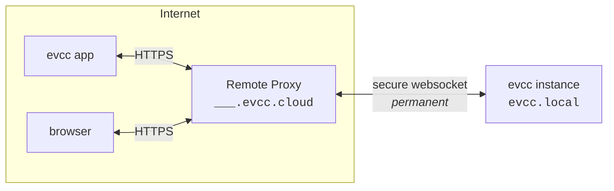

import { Steps } from "@astrojs/starlight/components";
import SponsorInfoBox from "@components/SponsorInfoBox.astro";
import statusImg from "@assets/features/remote-access/status.png";
import clientsImg from "@assets/features/remote-access/clients.png";
import clientCreatedImg from "@assets/features/remote-access/client-created.png";

L’accesso remoto ti permette di raggiungere la tua istanza evcc dall’esterno della rete di casa, tramite l’[app evcc](/it/features/app) o un browser.
La tua istanza riceve un proprio dominio su `evcc.cloud`.
Non servono port forwarding, DNS dinamico né VPN, perché è l’istanza stessa a stabilire la connessione in uscita.

<SponsorInfoBox lang="en" type="feature" />

## Configurazione

<Steps>

1. Attiva la funzione in **Configurazione → Accesso remoto**.

   

2. La tua istanza evcc si connette a `evcc.cloud` e riceve un proprio dominio, ad es. `swift-dark-crow.evcc.cloud`.

   

3. Crea un client separato per ogni dispositivo che deve avere accesso.
   Ottieni un nome utente, una password e un codice QR che li contiene entrambi.
   - **App:** inquadra il codice QR con la fotocamera del telefono.
     L’[app evcc](/it/features/app) si apre ed è subito connessa.
   - **Browser:** apri il tuo dominio personale e accedi con nome utente e password (basic auth su HTTPS).
   - **Client API:** accedi all’API in modo programmatico con nome utente e password.

     ```bash title="curl example"
     curl --user Macbook:7IIGKZGP-MV0PJKSE "https://swift-dark-crow.evcc.cloud/api/state?jq=.pvPower"
     ```

   

4. La stessa vista mostra quali client sono stati attivi più di recente e ti permette di revocare in qualsiasi momento l’accesso ai singoli dispositivi.
   Facoltativamente, l’accesso può essere limitato a un periodo definito.

</Steps>

## Sicurezza

**Trasporto.**
Le richieste al tuo dominio passano su HTTPS con il certificato wildcard per `*.evcc.cloud`.
Il collegamento tra il Remote Proxy e la tua istanza locale passa attraverso un tunnel WebSocket.

**Cosa vede il Remote Proxy.**
Il Remote Proxy si limita a inoltrare le richieste.
Il contenuto delle richieste non viene né salvato né esaminato.
Per ogni registrazione vengono salvati solo il dominio, un hash del token di connessione, lo sponsor associato e i timestamp, in modo che il tunnel possa essere riassegnato alla riconnessione.

**Autorizzazione locale.**
Per ogni dispositivo crei credenziali separate.
Queste vengono salvate e verificate esclusivamente sulla tua istanza evcc.
Sul Remote Proxy non viene salvata alcuna credenziale.
La password viene mostrata una sola volta, alla creazione del client.
Se rimuovi un dispositivo, revochi solo il suo accesso.
Tutti gli altri restano connessi.
I ripetuti tentativi di accesso falliti vengono rallentati automaticamente.

**Ambito dell’accesso.**
Le credenziali dell’accesso remoto si affiancano ai meccanismi di sicurezza propri di evcc.
Concedono solo l’accesso di rete alla tua istanza, come se la raggiungessi dalla rete locale.
Le modifiche alla configurazione, i backup, i log o un riavvio richiedono comunque la password di amministratore.

**Vincolo al token sponsor.**
La registrazione viene verificata tramite `sponsor.evcc.io`.
Ogni sponsor riceve esattamente un dominio, vincolato in modo permanente a quello sponsor e mai riassegnato.

## Dettagli tecnici

La tua app o il tuo browser si connette al tuo dominio personale su `evcc.cloud`.
Il Remote Proxy inoltra le richieste attraverso un tunnel WebSocket alla tua istanza evcc locale.
È la tua istanza locale ad aprire quel tunnel in uscita, quindi nella tua rete non serve alcuna porta aperta.



Alla prima attivazione, l’istanza evcc locale si registra presso il Remote Proxy.
In cambio del token sponsor riceve un token di connessione e un dominio assegnato casualmente.
Entrambi vengono salvati localmente e riutilizzati all’avvio successivo per ristabilire il tunnel senza ripetere la registrazione.

Agli avvii successivi, l’istanza evcc locale apre una connessione WebSocket persistente e cifrata con TLS (WSS) verso il Remote Proxy.
Questa connessione fa da tunnel per tutto il traffico successivo e viene stabilita in uscita, quindi non serve alcun port forwarding.

Sopra questa connessione, [hashicorp/yamux](https://github.com/hashicorp/yamux) funge da multiplexer.
Ogni richiesta HTTP in arrivo al Remote Proxy diventa uno stream yamux separato all’interno della connessione WebSocket esistente.
Più richieste parallele condividono un’unica connessione senza un nuovo handshake TCP o TLS per ogni richiesta.

Anche gli upgrade WebSocket attraverso il tunnel funzionano.
Questo è importante perché la UI di evcc stessa riceve i dati in tempo reale tramite WebSocket.

Se il tunnel cade, l’istanza locale si riconnette automaticamente.
Finché la connessione è attiva, il tuo dominio è raggiungibile, altrimenti il Remote Proxy restituisce un errore.

L’host predefinito del Remote Proxy è `api.evcc.cloud`.
Per lo sviluppo o per un proxy ospitato in proprio, si può sovrascrivere con la variabile d’ambiente `EVCC_REMOTE_ACCESS`.

Il codice sorgente del Remote Proxy sarà pubblicato in un secondo momento.
Per i dettagli sulla privacy, consulta la nostra [informativa sulla privacy](https://evcc.io/en/datenschutz/).
